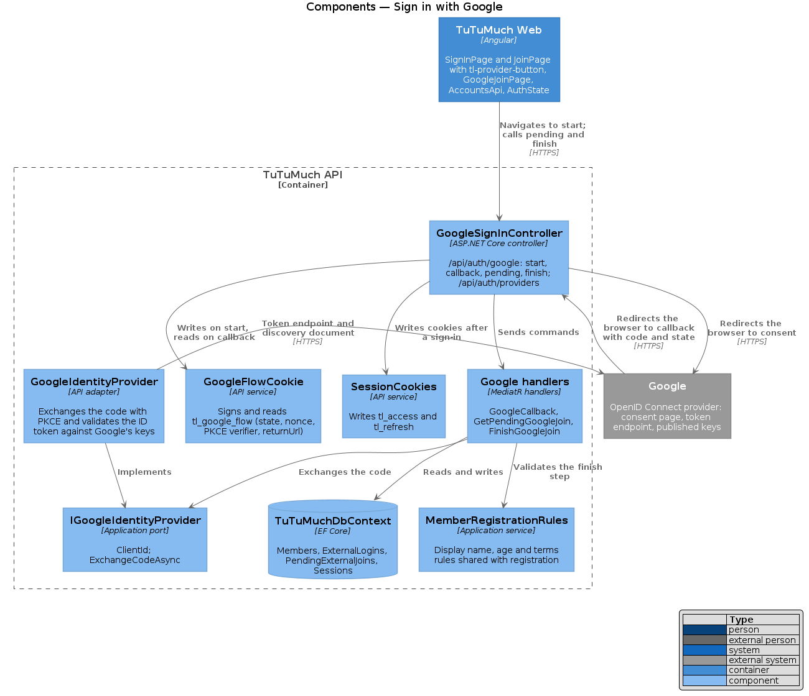
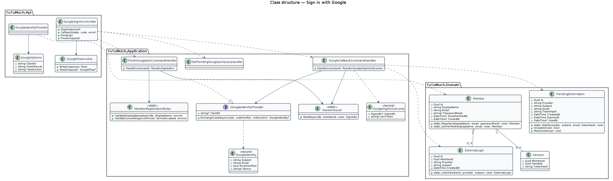
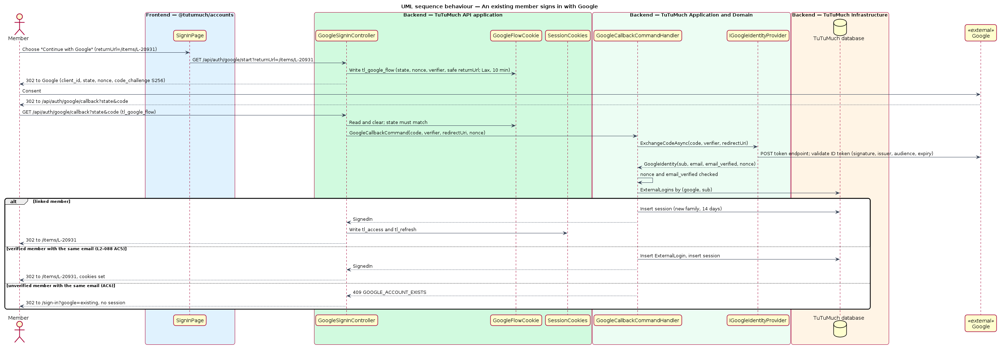
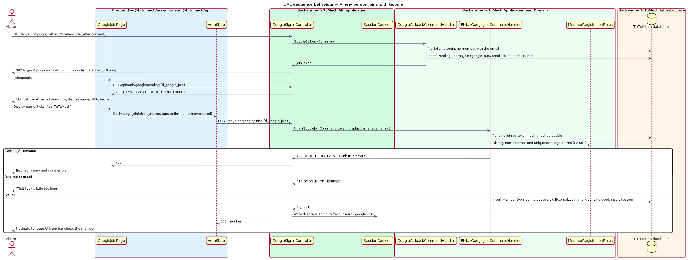
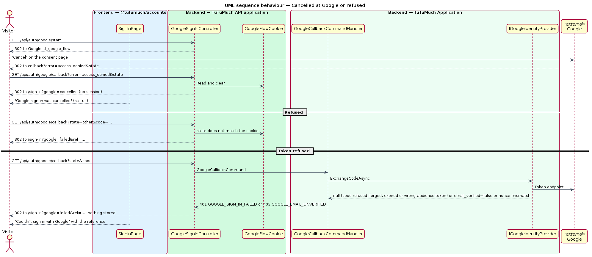

# Sign in with Google

## Overview

TuTuMuch is a marketplace for all things young girls. Members join and sign in with an email and a password ([sign-up-and-sign-in](../sign-up-and-sign-in/README.md)). This feature adds "Continue with Google" to `/sign-in` and `/join` of the full application: a member linked to a Google account signs in with one press, a verified member whose email matches links and signs in, and a new person finishes joining with a display name, the age confirmation and the terms, with no password and no verification email, because Google has verified the email. The result is the same session as a password sign-in (`L2-008`), returned to the same `returnUrl` (`L2-006`).

The feature sits in the accounts subsystem (`L1-001`, `L1-002`) and realises `L2-088`. It works on `https://uat.tutumuch.kids` and locally ([ADR platform/0013](../../../adr/platform/0013-uat-host-in-the-production-web-image.md)); the marketing host `www.tutumuch.kids` has no sign-in. The decisions are recorded in [ADR accounts/0001](../../../adr/accounts/0001-sign-in-with-google.md).

Terms used in this design:

- **flow** — one round trip to Google: the `state`, nonce, PKCE verifier and safe `returnUrl` created at the start endpoint and read at the callback
- **flow cookie** — `tl_google_flow`, which carries the flow signed, `HttpOnly`, `Secure`, `SameSite=Lax`, path `/api/auth/google`, 10 minutes
- **external login** — a row of `ExternalLogins` linking a member to a provider's stable subject (`sub`), never to an email
- **pending join** — a row of `PendingExternalJoins` holding a Google identity whose email has no member yet, valid for 10 minutes, used once
- **join cookie** — `tl_google_join`, the raw pending-join token, `HttpOnly`, `Secure`, `SameSite=Strict`, path `/api/auth/google`, 10 minutes
- **Google-only member** — a member with an external login and `PasswordHash` null

## Description

The slice runs from the sign-in, join and finish-joining pages in `@tutumuch/accounts` through `GoogleSignInController` in `TuTuMuch API` to `Members`, `ExternalLogins`, `PendingExternalJoins` and `Sessions` in `TuTuMuch database`, and out to Google's consent page and token endpoint. Screens and copy come from the mocks `docs/mocks/pages/sign-in/` (states `default`, `google-busy`, `google-cancelled`, `google-existing`, `google-failed`), `docs/mocks/pages/register/` and `docs/mocks/pages/join-google/`; the components each state uses are in [`docs/screen-composition.md`](../../../screen-composition.md).

### Frontend (`TuTuMuch Web`, `src/frontend/projects/accounts/`, `src/frontend/projects/api/` and `src/frontend/projects/components/`)

- **`tl-provider-button` and `tl-or-divider`** (`@tutumuch/components`, design system: Provider button) — a link styled as the secondary `lg` `block` button with Google's published "G" mark and the label "Continue with Google", above an "or" divider. `href` is the API start endpoint; `busy` sets `aria-busy` while the browser leaves; `pressed` lets the page set busy. It is a plain link: the browser navigates to the API, no Google script runs in the page.
- **`AccountsApi`** (`@tutumuch/api`) — `providers()` (`GET /api/auth/providers` → `{ google: boolean }`), `googleStartUrl(returnUrl)` (`/api/auth/google/start?returnUrl=…`), `googleJoinPending()` (`GET /api/auth/google/pending` → `{ email }`).
- **`AuthState`** (`@tutumuch/api`) — `finishGoogleJoin(displayName, ageConfirmed, termsAccepted)` posts `/api/auth/google/finish` and, on `200`, sets the member as `signIn()` does. After the callback signs a member in, the next page load's `GET /api/auth/me` sees the new cookies, so nothing else changes.
- **`SignInPage`** (`/sign-in?returnUrl=…&google=…&ref=…`, mocks `pages/sign-in`) — on load calls `providers()`; with Google configured it renders `tl-provider-button` first, then `tl-or-divider`, then the email form (keyboard order Google, email, password, Sign in). `returnUrl` is passed to the start URL as given; the API makes it safe. The `google` query parameter picks an alert: `cancelled` → info "Google sign-in was cancelled" / "Nothing was changed. Try again, or sign in with your email and password." as a status; `existing` → warning "An account with this email already exists" / "Sign in with your password and verify your email first. After that, Google will sign you in to the same account." with the lock icon; `failed` → danger "Couldn’t sign in with Google" / "Try again in a moment, or sign in with your email and password." with the reference `ref`. A failed `providers()` call hides the button; password sign-in is unchanged.
- **`JoinPage`** (`/join`, mocks `pages/register`) — the same button and divider above the form, with `returnUrl` `/`.
- **`GoogleJoinPage`** (`/join/google?returnUrl=…`, mocks `pages/join-google`, auth shell) — `loading` (form-shaped skeleton) while `googleJoinPending()` runs; `default` shows the Google email read-only with the help "From your Google account. It counts as verified.", the display name (help "3–30 letters, numbers, _ or -. Shown publicly."), "I’m 18 or older" and "I accept the terms and marketplace rules", and "Join TuTuMuch". Client checks mirror the server messages and show `tl-error-summary` (focused) and inline errors; a `422` maps `displayName`, `ageConfirmed` and `termsAccepted` to their controls. `410` on load or on finish shows `expired`: "That took a little too long" / "Google sign-ins have to be finished within 10 minutes. Nothing was created." with "Continue with Google again" and "Back to sign in" (both to `/sign-in`). Other failures show "Couldn’t create your account" with the reference. On success it navigates to `returnUrl` when it is a same-site path, otherwise to `/`.
- **Routes** — `@tutumuch/accounts` adds `join/google` (`data.shell = 'auth'`, title "Finish joining · TuTuMuch") before `join`'s siblings; the application mounts the routes as before.

### API (`TuTuMuch.Api`)

- **`AuthController`** — `GET /api/auth/providers` → `200 { "google": true | false }` for everyone.
- **`GoogleSignInController`** (`/api/auth/google`); every action answers `404 GOOGLE_NOT_CONFIGURED` when `IGoogleIdentityProvider.ClientId` is null:
  - `GET start?returnUrl=…` — creates `state`, nonce and PKCE verifier with `SecureTokens.Create()`, the `code_challenge` as base64url SHA-256 of the verifier, keeps them with the safe `returnUrl` (a path starting with `/` and not `//`, else `/`) in the flow cookie, and answers `302` to `https://accounts.google.com/o/oauth2/v2/auth` with `client_id`, `redirect_uri`, `response_type=code`, `scope=openid email`, `state`, `nonce`, `code_challenge`, `code_challenge_method=S256`, `prompt=select_account`. The redirect URI is `{scheme}://{host}/api/auth/google/callback` with the scheme from `X-Forwarded-Proto` when present, or `Auth:Google:RedirectUri` when set.
  - `GET callback?state=…&code=…` or `?state=…&error=…` — reads and clears the flow cookie. No cookie, an unreadable cookie or a `state` that does not match → `302 /sign-in?google=failed&ref={correlation id}`. `error` present → `302 /sign-in?google=cancelled`. Otherwise sends `GoogleCallbackCommand(code, verifier, redirectUri, nonce)`: `SignedIn` → writes `tl_access` and `tl_refresh` and answers `302` to the flow's `returnUrl`; a join token → writes the join cookie and answers `302 /join/google?returnUrl=…`; `409 GOOGLE_ACCOUNT_EXISTS` → `302 /sign-in?google=existing`; any other error → `302 /sign-in?google=failed&ref=…`. The code and the token never appear in a response, a redirect or a log.
  - `GET pending` — reads the join cookie; `200 { email }`, or `410 GOOGLE_JOIN_EXPIRED` ("Start again") when the cookie is missing or the pending join is unknown, expired or used.
  - `POST finish` — body `displayName`, `ageConfirmed`, `termsAccepted`; reads the join cookie. `200` with the member (as `GET me`) and both session cookies, the join cookie cleared; `422 GOOGLE_JOIN_INVALID` with field errors; `410 GOOGLE_JOIN_EXPIRED`.
- **`GoogleFlowCookie`** — serialises the flow as JSON, signs it with HMAC-SHA256 over `Auth:SigningKey` under the label `google-flow`, and refuses a cookie whose signature does not match or whose `IssuedAt` is older than 10 minutes by the injected `TimeProvider`.
- **`GoogleIdentityProvider`** (adapter for `IGoogleIdentityProvider`) — `ClientId` from `GoogleOptions` (null when unset). `ExchangeCodeAsync` posts `grant_type=authorization_code`, `code`, `code_verifier`, `redirect_uri`, `client_id` and `client_secret` to `https://oauth2.googleapis.com/token` through `IHttpClientFactory`, then validates the `id_token` with `JsonWebTokenHandler` against Google's keys from the discovery document (`ConfigurationManager<OpenIdConnectConfiguration>`, refreshed automatically), issuers `https://accounts.google.com` and `accounts.google.com`, audience the client ID, lifetime by the injected clock with no skew. A refused code or an invalid token answers null; the token's `sub`, `email`, `email_verified` and `nonce` become a `GoogleIdentity`.
- **`GoogleOptions`** (`Auth:Google`) — `ClientId`, `ClientSecret`, `RedirectUri`; validated on start-up: both `ClientId` and `ClientSecret` set, or neither.
- **Cookies** — `tl_google_flow` and `tl_google_join` are added to `Privacy:Cookies:StrictlyNecessary`, so `CookieAllowListMiddleware` lets them through (`L2-056`).

### Application and domain (`TuTuMuch.Application`, `TuTuMuch.Domain`)

- **`Member`** — `PasswordHash` becomes nullable. `Member.JoinVerified(displayName, email, now)` creates a member with `EmailVerifiedAt = now` and no password. `SignInCommandHandler` answers `SIGN_IN_FAILED` when the hash is null, exactly as for a wrong password.
- **`ExternalLogin`** — `Id`, `MemberId`, `Provider` (`google`), `Subject`, `CreatedAt`; `ExternalLogin.Link(memberId, provider, subject, now)`.
- **`PendingExternalJoin`** — `Id`, `Provider`, `Subject`, `Email`, `TokenHash`, `CreatedAt`, `ExpiresAt` (10 minutes), `UsedAt`; `Start(...)`, `IsUsable(now)`, `MarkUsed(now)`.
- **`IGoogleIdentityProvider`** (port) — `string? ClientId`; `Task<GoogleIdentity?> ExchangeCodeAsync(code, codeVerifier, redirectUri, cancellationToken)`. `GoogleIdentity(Subject, Email, EmailVerified, Nonce)`.
- **`GoogleCallbackCommandHandler`** — exchanges the code; null, a nonce that differs from the flow's, or an empty subject or email → `401 GOOGLE_SIGN_IN_FAILED`; `EmailVerified` false → `403 GOOGLE_EMAIL_UNVERIFIED`. Then: an `ExternalLogin` for (`google`, `sub`) → its member (a closed member → `401 GOOGLE_SIGN_IN_FAILED`) and a new session; else a member with the same normalised email → closed → `401`; unverified → `409 GOOGLE_ACCOUNT_EXISTS`; verified → link and a new session; else a `PendingExternalJoin` whose raw token is returned. Returns `GoogleSignInOutcome(SignedIn?, JoinToken?)`.
- **`GetPendingGoogleJoinQueryHandler`** — the email of a usable pending join by the token's hash, else `410 GOOGLE_JOIN_EXPIRED`.
- **`FinishGoogleJoinCommandHandler`** — the pending join must be usable (`410`); `MemberRegistrationRules.ValidateDisplayNameAsync` and `ValidateConsent` collect `displayName`, `ageConfirmed` and `termsAccepted` errors with the codes and messages of `L2-001` (`422 GOOGLE_JOIN_INVALID`); a member created meanwhile with the same email → `422` with `email` `EMAIL_TAKEN`. Then `Member.JoinVerified`, `ExternalLogin.Link`, `MarkUsed`, one `SaveChanges`, and `SessionIssuer.StartAsync`.
- **`MemberRegistrationRules`** — the display name and consent checks lifted out of `RegisterMemberCommandHandler`, which now calls them too; the password and email checks stay in the registration handler.
- **`SessionIssuer.StartAsync(db, memberId, now)`** — creates the refresh token and the `Session` row and returns `SignedIn`; `SignInCommandHandler` uses it as well.

### Infrastructure and data (`TuTuMuch.Infrastructure`)

- **Migration `AddGoogleSignIn`** — `Members.PasswordHash` nullable; `ExternalLogins` (`UX_ExternalLogins_Provider_Subject` unique, `IX_ExternalLogins_MemberId`, foreign key to `Members` with cascade delete); `PendingExternalJoins` (`UX_PendingExternalJoins_TokenHash` unique). The model snapshot is updated with it.
- **Configurations** — `ExternalLoginConfiguration` (`Provider` 32, `Subject` 255) and `PendingExternalJoinConfiguration` (`Provider` 32, `Subject` 255, `Email` 254, `TokenHash` 64) in `MemberConfigurations.cs`.
- **Compose** — `api` already receives every variable of `/opt/tutumuch/.env` through `env_file`, so `Auth__Google__ClientId` and `Auth__Google__ClientSecret` reach it with no change to `docker-compose.yml`.

### Security and privacy

- **Open redirect** — `returnUrl` is kept only as a path starting with `/` and not `//`, else `/`; `GoogleJoinPage` applies the same test before navigating.
- **CSRF on the callback** — the `state` in the signed flow cookie must match the query; the cookie is `Lax` so it is sent on the top-level redirect from Google and on nothing cross-site that is not a top-level GET.
- **Replay** — the nonce in the ID token must match the flow's; the flow cookie is cleared at the callback, a reused code is refused by Google, and a pending join is single use with a 10-minute life.
- **Tokens** — the code, the ID token and the join token never appear in a response body, a URL or a log; the join token travels only in an `HttpOnly` cookie; nothing is put in web storage (`L2-008`).
- **Data kept** — only Google's `sub` and the email; no name, picture or locale is requested (`scope=openid email`). Deleting a member deletes its external logins (cascade), which covers account closure (`L2-005`) once closure is built ([protect-personal-data](../../privacy/protect-personal-data/README.md)).
- **CSP** — no script, frame or XHR to Google from the page; the start endpoint is a link navigation, not a form, so `form-action 'self'` and `script-src 'self'` of [harden-http-and-api](../../platform/harden-http-and-api/README.md) hold unchanged.
- **Account takeover** — a Google email that matches an unverified member is refused (`GOOGLE_ACCOUNT_EXISTS`); see ADR accounts/0001.

### Tests

- `TuTuMuch.Api.Tests` — `SignInWithGoogleTests` hosts the API with `WebApplicationFactory`, SQLite in memory, `FakeGoogleIdentityProvider` and `FakeTimeProvider`; the client keeps cookies over `https://localhost` and does not follow redirects, so each hop is asserted. Covered: the start redirect's parameters and cookie; an existing linked member; a verified member linked by email; an unverified member refused; a new person through pending and finish, including every `L2-001` field error, expiry and single use; cancelled, forged `state`, a refused code, an unverified Google email and an unsafe `returnUrl`; a Google-only member's password sign-in; everything `404` with no client; no code or token in any response.
- `src/frontend/e2e/tests/sign-in-with-google.spec.ts` with `pages/sign-in.page.ts`, `pages/join.page.ts` and `pages/google-join.page.ts` — Chromium against the built app; `page.route` answers `/api/auth/providers`, `/api/auth/google/start` (a `302` back to `/sign-in` with the chosen result), `/api/auth/google/pending` and `/api/auth/google/finish`. Google is never reached.

### Configuration

| Key | Value | Notes |
|-----|-------|-------|
| `Auth:Google:ClientId` | the OAuth client ID | `Auth__Google__ClientId` in `/opt/tutumuch/.env`; `dotnet user-secrets` locally; unset hides the feature |
| `Auth:Google:ClientSecret` | the OAuth client secret | Same places; required when the client ID is set; never in `appsettings*.json` |
| `Auth:Google:RedirectUri` | optional | Overrides `{scheme}://{host}/api/auth/google/callback` |
| `Privacy:Cookies:StrictlyNecessary` | adds `tl_google_flow`, `tl_google_join` | In `appsettings.json` |

### Open questions and deferred items

- The per-IP limits of `L2-007` and `L2-051` are not built for any sign-in endpoint yet; the Google endpoints join that item.
- Account closure (`L2-005`) has no endpoint yet; the cascade delete removes a closed member's external logins when the erasure job deletes the member.
- `PendingExternalJoins` rows are not cleaned up after they expire; a sweep in `TuTuMuch.Worker` is deferred.
- Linking or unlinking Google from account settings is deferred; linking happens only through a sign-in.
- Google's consent screen must be verified by Google before unlisted users can sign in; the owner steps are in `docs/deployment.md`.

## Requirements

The feature realises the following level-2 (L2) requirements. Each refines the level-1 (L1) requirement cited.

| L2 ID | Refines (L1) | Requirement |
|-------|--------------|-------------|
| `L2-088` | `L1-002`, `L1-001` | A visitor shall be able to choose "Continue with Google" on the sign-in page and on the join page of the full application and come back signed in with the same session as a password sign-in, returned to the same-site `returnUrl`. The API shall run the OpenID Connect authorization code flow with PKCE on the server and validate the `state`, the nonce, the ID token and `email_verified`. Google's subject identifies a linked account; only the subject and the email are stored. A new person still gives a display name, confirms 18 or older and accepts the terms. A verified matching email links and signs in; an unverified one is refused. A Google-only member's password sign-in gets the answer of `L2-006`. Without a Google client nothing about Google shows and the endpoints answer 404. |

`L2-001`, `L2-002`, `L2-006` and `L2-008` are reused, not changed: the finish step applies the display name, age and terms rules; Google's verified email counts as verified; the session is the one of sign-up-and-sign-in.

## Diagrams

### Components

`GoogleSignInController` writes and reads the flow cookie, sends the Google commands, and writes the session cookies; `GoogleIdentityProvider` implements the port against Google's token endpoint and keys.

### Class structure

A `Member` has many external logins; a pending join holds a Google identity until the person finishes joining.

### Behaviour — an existing member

The start endpoint sends the browser to Google; the callback checks the state, exchanges the code, finds the linked member (or links a verified one by email) and sets the session cookies.

### Behaviour — a new person

The callback stores a pending join and sends the browser to `/join/google`; the finish step applies the `L2-001` rules and creates a verified member with no password.

### Behaviour — cancelled or refused

Denied consent comes back as `google=cancelled`; a mismatched state, a refused code, an invalid token or an unverified email come back as `google=failed` with a reference and nothing stored.

