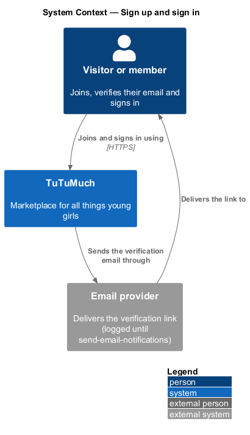
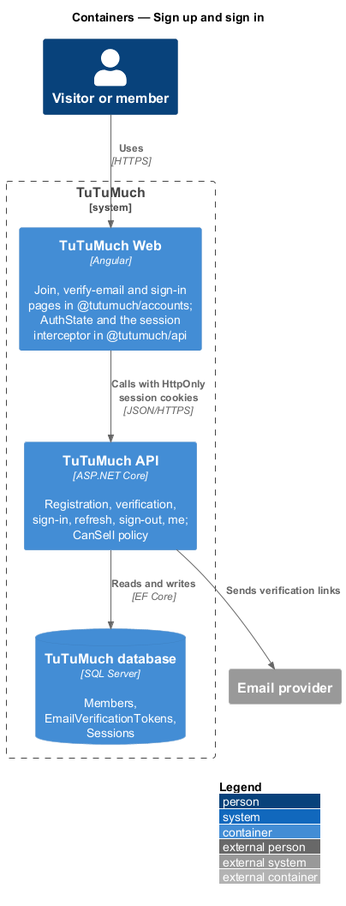
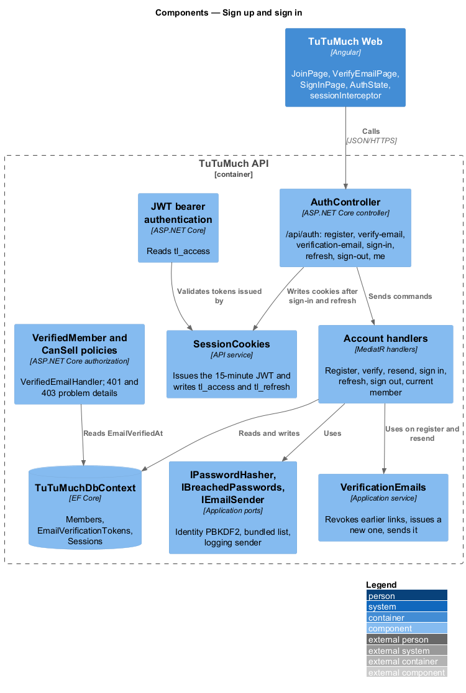
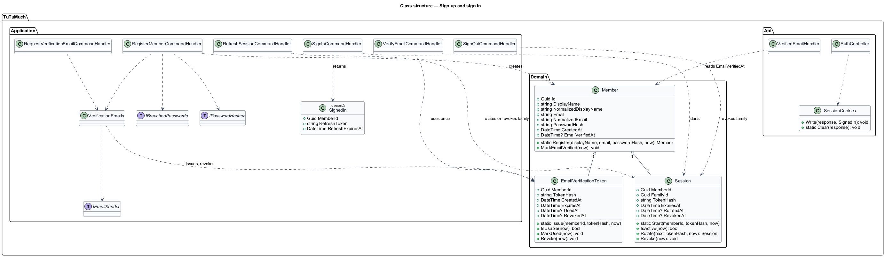
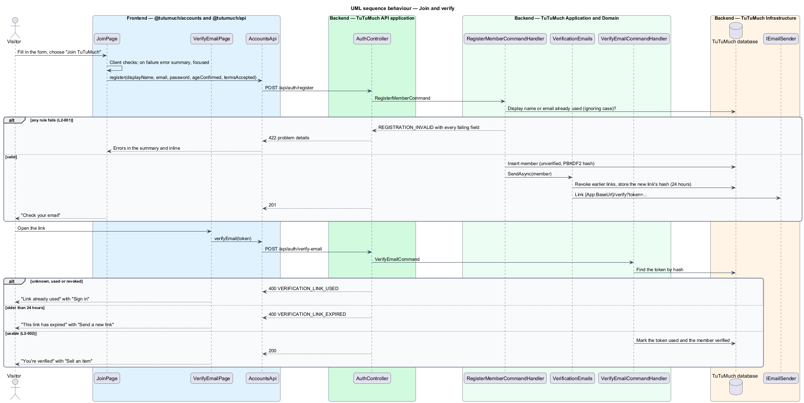
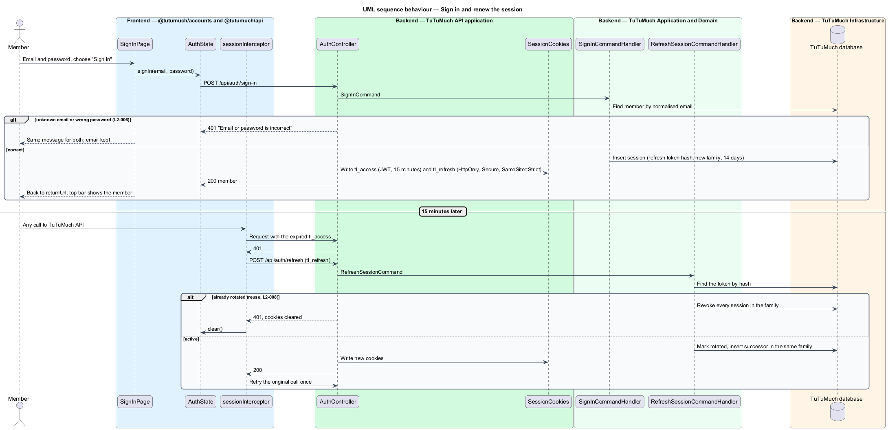

# Sign up and sign in

## Overview

TuTuMuch is a marketplace for all things young girls. Anyone may browse; buying and selling need a member whose email is verified, with one account for both (`L2-002`, `L2-003`). This feature is the minimum member authentication the selling journey needs: a visitor joins, opens the verification link, signs in and stays signed in, and `TuTuMuch API` refuses anonymous and unverified callers on the endpoints that need a verified member.

The feature sits in the accounts subsystem (`L1-001`, `L1-002`). It was built inside the [create-listing](../../listings/create-listing/README.md) run, which is the first journey that needs a signed-in seller.

Terms used in this design:

- **member** — registered person with a display name, an email and a password
- **verified member** — member whose `EmailVerifiedAt` is set; only verified members may sell or buy
- **verification link** — single-use link `{App:BaseUrl}/verify?token=…` emailed to the member, valid for 24 hours; only the SHA-256 hash of the token is stored
- **session** — what a sign-in creates: a short-lived access token and a rotating refresh token, both in cookies
- **access token** — JWT valid for 15 minutes, carrying only the member ID, in the cookie `tl_access`
- **refresh token** — 32 random bytes in the cookie `tl_refresh`, valid for 14 days, exchanged for a new one on every refresh; tokens from one sign-in form a family
- **auth shell** — the layout of the auth pages: large logo above a centred card, no top bar or footer

## Description

The slice runs from the auth pages in `@tutumuch/accounts` through `TuTuMuch API` to the `Members`, `EmailVerificationTokens` and `Sessions` tables in `TuTuMuch database`. Screens and copy come from the mocks `docs/mocks/pages/register/`, `docs/mocks/pages/verify-email/` and `docs/mocks/pages/sign-in/`; the components each state uses are listed in [`docs/screen-composition.md`](../../../screen-composition.md).

### Frontend (`TuTuMuch Web`, `src/frontend/projects/accounts/` and `src/frontend/projects/api/`)

- **Routes** — `@tutumuch/accounts` exports `routes` with `/join`, `/verify` and `/sign-in`; the application mounts them at the root because the paths are top level. Each route carries `data.shell = 'auth'`, so `AppShellComponent` renders the auth shell (it reads the shell on `ResolveEnd`, before the page is created).
- **`JoinPage`** (`/join`, mocks `pages/register`) — display name (help "3–30 letters, numbers, _ or -. Shown publicly."), email, password (help "At least 12 characters."), "I'm 18 or older" and "I accept the terms and marketplace rules". Client checks mirror the server messages; failures show `tl-error-summary` (focused) and each error inline. A 422 from the API maps `displayName`, `email`, `password`, `ageConfirmed` and `termsAccepted` to their controls. Other failures show "Couldn't create your account" with the reference. Success shows "Check your email", "We sent a link to {email}. It works for 24 hours.", "Browse while you wait" and "Resend email", which shows "Link sent" or "Too many requests".
- **`VerifyEmailPage`** (`/verify?token=…`, mocks `pages/verify-email`) — "Verifying" with a spinner while `POST /api/auth/verify-email` runs, then "You're verified" with "Start shopping" and "Sell an item", "This link has expired" with "Send a new link", "Link already used" with "Sign in", or "Something went wrong" with the reference and "Try again". "Send a new link" resends for a signed-in member; a visitor is sent to sign in and resends from the sell page. A signed-in member's `AuthState` is reloaded after verifying.
- **`SignInPage`** (`/sign-in?returnUrl=…`, mocks `pages/sign-in`) — email and password; "Sign in" busy while signing in with the fields read-only. A 401 shows "Email or password is incorrect", "Check both and try again." and keeps the email; other failures show "Something went wrong" with the reference. On success it navigates to `returnUrl` when it is a same-site path, otherwise to `/`.
- **`AuthState`** (`@tutumuch/api`) — signals `member` (`displayName`, `email`, `emailVerified`) and `ready`. `load()` calls `GET /api/auth/me` once; `reload()`, `signIn()` and `signOut()` update it. No token ever reaches web storage (`L2-008`).
- **`sessionInterceptor`** (`@tutumuch/api`) — sends cookies with every call to `TuTuMuch API`; on a 401 from any endpoint outside `/api/auth/` (and from `/api/auth/me`) it calls `POST /api/auth/refresh` once, shared by concurrent calls, and retries; when refresh fails it clears `AuthState`.
- **`AccountsApi`** (`@tutumuch/api`) — `register`, `verifyEmail` and `requestVerificationEmail`, each resolving to `ApiResult<T>`.
- **Top bar** — `tl-top-bar` receives the member from `AuthState`: a visitor sees "Sell" and "Sign in"; a member sees "Sell" with the plus icon and the avatar link "Your account, {display name}" (initials from the display name).
- **Development** — `ng serve` proxies `/api` to `TuTuMuch.Api` so cookies stay same-origin; `environment.development.ts` uses `/api`.

### API (`TuTuMuch.Api`)

- **`AuthController`** (`/api/auth`):
  - `POST register` — body `displayName`, `email`, `password`, `ageConfirmed`, `termsAccepted`. `201`, or `422 REGISTRATION_INVALID` with every failing field.
  - `POST verify-email` — body `token`. `200`, or `400 VERIFICATION_LINK_EXPIRED` ("This link has expired") or `400 VERIFICATION_LINK_USED` ("Link already used"; also for unknown and revoked tokens).
  - `POST verification-email` — body `email`. `202` for unknown, verified and unverified emails alike; `429 RATE_LIMITED` with `Retry-After` when 3 links were sent to the member in the last hour.
  - `POST sign-in` — body `email`, `password`. `200` with the member and both cookies, or `401 SIGN_IN_FAILED` "Email or password is incorrect" for an unknown email and a wrong password alike.
  - `POST refresh` — reads `tl_refresh`; `200` with the member and new cookies, or `401 SESSION_EXPIRED` and cleared cookies.
  - `POST sign-out` — revokes the presented token's family and clears the cookies; `204`.
  - `GET me` — `200` with `displayName`, `email`, `emailVerified`; `401` without a valid access token.
- **Cookies** — `tl_access` (path `/`, 15 minutes) and `tl_refresh` (path `/api/auth`, 14 days), both `HttpOnly`, `Secure`, `SameSite=Strict` (`L2-008`, [ADR platform-0005](../../../adr/platform/0005-session-cookies-with-jwt-access-and-rotating-refresh-tokens.md)).
- **Authentication** — JWT bearer reading the token from `tl_access`, issuer and audience `TuTuMuch`, key `Auth:SigningKey`, zero clock skew and lifetime checked against the injected `TimeProvider`.
- **Policies** (`L2-010`) — `VerifiedMember` and `CanSell`: authenticated and `EmailVerifiedAt` set, read from `TuTuMuch database` by `VerifiedEmailHandler`. `ProblemAuthorizationResultHandler` answers `401 UNAUTHENTICATED` and `403 EMAIL_NOT_VERIFIED` (or `403 FORBIDDEN`) as problem details. The `Administrator` role check belongs to resolve-order-problems.

### Application and domain (`TuTuMuch.Application`, `TuTuMuch.Domain`)

- **`Member`** — `Id`, `DisplayName`, `NormalizedDisplayName`, `Email`, `NormalizedEmail`, `PasswordHash`, `CreatedAt`, `EmailVerifiedAt`. Normalised values are upper-cased so names and emails compare ignoring case (`L2-001`, `L2-006`).
- **`EmailVerificationToken`** — `MemberId`, `TokenHash`, `CreatedAt`, `ExpiresAt` (24 hours), `UsedAt`, `RevokedAt`. Issuing a new link revokes every unused earlier one (`L2-002` criterion 5).
- **`Session`** — `MemberId`, `FamilyId`, `TokenHash`, `CreatedAt`, `ExpiresAt` (14 days), `RotatedAt`, `RevokedAt`. `Rotate` marks the token used and returns its successor in the family.
- **`RegisterMemberCommandHandler`** — display name `^[A-Za-z0-9_-]{3,30}$` (`DISPLAY_NAME_FORMAT`) and unique (`DISPLAY_NAME_TAKEN`, "That display name is taken"); email of at most 254 characters with one `@` (`EMAIL_FORMAT`) and unique (`EMAIL_TAKEN`, "An account with this email already exists"); password 12 to 128 characters (`PASSWORD_TOO_SHORT`, "Password must be at least 12 characters") and not breached (`PASSWORD_BREACHED`, "This password has appeared in a data breach. Choose another."); `AGE_REQUIRED` "Confirm you're 18 or older"; `TERMS_REQUIRED` "Accept the terms to continue". All failures are reported together; then the member is stored and `VerificationEmails` sends the link.
- **`VerifyEmailCommandHandler`**, **`RequestVerificationEmailCommandHandler`**, **`SignInCommandHandler`**, **`RefreshSessionCommandHandler`**, **`SignOutCommandHandler`**, **`GetCurrentMemberQueryHandler`** — the endpoints above, returning `Result<T>` (MediatR 12, [ADR platform-0008](../../../adr/platform/0008-mediatr-12-and-domain-validation.md)). Refresh with an already rotated token revokes the family (`L2-008` criterion 3).
- **Ports** — `IPasswordHasher`, `IBreachedPasswords`, `IEmailSender`, `ITuTuMuchDbContext`, and `TimeProvider` for every clock reading.

### Infrastructure and data (`TuTuMuch.Infrastructure`)

- **Tables** (migration `InitialCreate`) — `Members` with unique indexes `UX_Members_NormalizedEmail` and `UX_Members_NormalizedDisplayName`; `EmailVerificationTokens` with `UX_EmailVerificationTokens_TokenHash` and `IX_EmailVerificationTokens_MemberId_CreatedAt`; `Sessions` with `UX_Sessions_TokenHash` and `IX_Sessions_FamilyId`.
- **`IdentityPasswordHasher`** — PBKDF2 `PasswordHasher` from ASP.NET Core Identity.
- **`BundledBreachedPasswords`** — a short bundled list of common breached passwords of 12 or more characters.
- **`LoggingEmailSender`** — writes the email to the log; send-email-notifications replaces it with the email provider.

### Tests

- `TuTuMuch.Api.Tests` — `RegistrationTests` and `SignInTests` host the API with `WebApplicationFactory`, SQLite in memory, `CapturingEmailSender` and `FakeTimeProvider`; the client keeps cookies over `https://localhost`.
- `src/frontend/e2e/tests/sign-up-and-sign-in.spec.ts` with `pages/join.page.ts`, `pages/verify-email.page.ts` and `pages/sign-in.page.ts` — Chromium against the built app; `fixtures.ts` answers `GET /api/auth/me` and `POST /api/auth/refresh` as a visitor unless `signInAs` signs a member in.

### Configuration

| Key | Value | Notes |
|-----|-------|-------|
| `Auth:SigningKey` | secret, at least 32 bytes | From the secret store; a development key is in `appsettings.Development.json` |
| `App:BaseUrl` | origin of `TuTuMuch Web` | Builds the verification link |
| `ConnectionStrings:TuTuMuch` | SQL Server connection string | From the environment, never committed |

### Open questions and deferred items

- Deferred to their own designs: password reset (`L2-009`), lockout after failed sign-ins (`L2-007`, the `locked` mock state), managing sessions and "Sign out everywhere" (`L2-008` criterion 5), editing the profile, closing the account, and the "Forgot password?" link on the sign-in page.
- The breached-password check uses a bundled list; a k-anonymity lookup against the breached-password service is `<TO SUPPLY>`.
- The registration limit of `L2-051` (5 per hour per IP) and the anti-forgery header of `L2-050` belong to harden-http-and-api; `SameSite=Strict` cookies apply meanwhile.
- `POST /api/auth/verification-email` answers 429 for an unverified account and 202 for an unknown one, which tells an attacker an unverified account exists after 3 requests; accepted for now.
- Resending from an expired link needs the member to sign in, because the link does not identify the email.

## Requirements

The feature realises the following level-2 (L2) requirements. Each refines the level-1 (L1) requirement cited.

| L2 ID | Refines (L1) | Requirement |
|-------|--------------|-------------|
| `L2-001` | `L1-001` | A visitor shall be able to register with a display name, an email address and a password. The display name shall be 3 to 30 characters of letters, digits, underscores or hyphens and unique ignoring case. The email address shall be a valid address unique ignoring case. The password shall be 12 to 128 characters and shall not appear in a list of known breached passwords. The visitor shall confirm they are 18 or older and accept the terms of service. |
| `L2-002` | `L1-001` | A new account shall be verified by a single-use link emailed to the member. The link shall expire 24 hours after it is sent. Unverified members shall be able to browse but not list or buy. |
| `L2-006` | `L1-002` | A member shall be able to sign in with their email and password. The error shown for an unknown email and for a wrong password shall be identical. |
| `L2-008` | `L1-002` | Sessions shall use a short-lived access token (15 minutes) and a rotating refresh token (14 days) held in `HttpOnly`, `Secure`, `SameSite=Strict` cookies. Tokens shall never be stored in `localStorage` or `sessionStorage`. Signing out shall revoke the session on the server. |
| `L2-010` | `L1-002` | Every API endpoint shall check that the caller is allowed to act on the resource. A member shall only change their own profile and listings, and shall only see orders they are the buyer or seller of. Administrator endpoints shall require the Administrator role. Requests for resources the caller is not allowed to see shall return HTTP 404 so their existence is not revealed. |

`L2-010` is partly realised here: the `VerifiedMember` and `CanSell` policies and the 401 for anonymous callers. Ownership checks live in each feature (create-listing answers 404 for another member's listing); the Administrator role arrives with resolve-order-problems.

## Diagrams

### System context

A visitor joins and signs in through TuTuMuch. TuTuMuch sends the verification link by email.

### Containers

`TuTuMuch Web` calls `TuTuMuch API` with session cookies; `TuTuMuch API` stores members, verification tokens and sessions in `TuTuMuch database`.

### Components

`AuthController` sends commands to the account handlers, writes the session cookies through `SessionCookies`, and the policies read verification from the database.

### Class structure

A `Member` has many verification tokens and sessions; sessions of one sign-in share a family.

### Behaviour — join and verify

Registration reports every failing field together, stores the member unverified and emails a link; opening the link within 24 hours verifies the member once.

### Behaviour — sign in and renew the session

Sign-in answers one message for an unknown email and a wrong password. After 15 minutes the interceptor renews the session once; a reused refresh token revokes the family.

