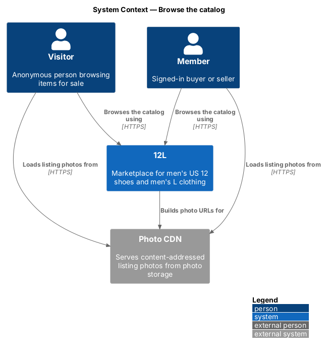
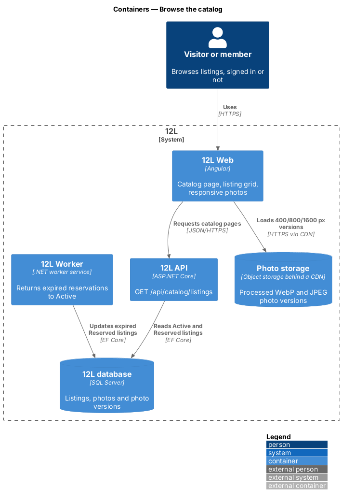
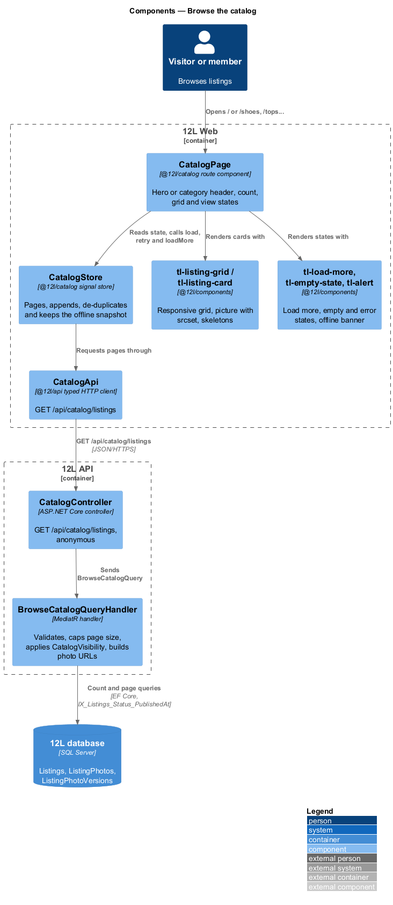
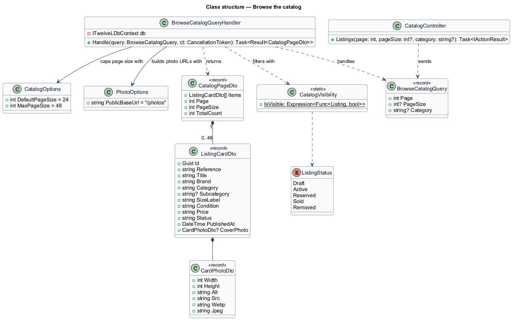
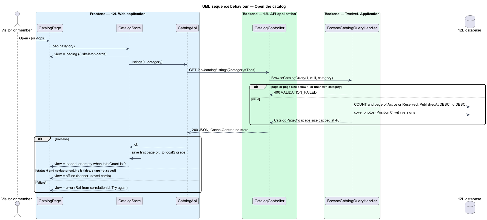
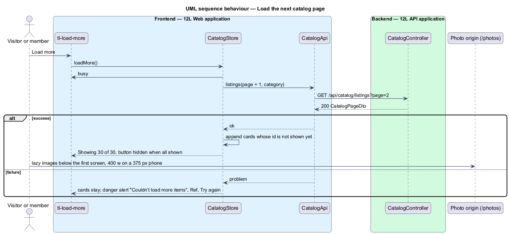

# Browse the catalog

## Overview

TuTuMuch is a marketplace for all things young girls. The *catalog* is the public grid of items that are currently for sale, and it is the home page of TuTuMuch (`/`). This feature covers browsing that grid: loading the first page of listing cards, loading further pages, and showing the right state when there is nothing to show, when the request fails, or when the device is offline.

A *listing* is one item a seller offers for sale. A listing has a status, and only two statuses are visible in the catalog:

> **Active listing** — published listing that a buyer may start checkout for

> **Reserved listing** — Active listing held for one buyer's checkout for 10 minutes (`L2-028`)

Draft, Sold and Removed listings never appear in the catalog. A *listing card* is the compact summary of one listing in the grid: cover photo, size tag, brand, title, condition and price. A Reserved card carries a "Reserved" stamp so a visitor knows the item is in someone's checkout.

Anonymous visitors browse the same catalog as members; no account is needed. The catalog is paged 24 cards at a time, newest first, and a "Load more" control appends the next page. Photos are delivered from the photo origin at the size each card needs, so a phone fetches a 400 px thumbnail rather than the 1600 px original (`L2-059`). The grid shows 2 columns on extra-small and small viewports, 3 on medium and 4 on large and extra-large (`L2-061`).

Keyword search, filters and sort run through the same endpoint and page component; they are described in [search-and-filter-catalog](../search-and-filter-catalog/README.md). Opening a card leads to [view-listing-detail](../view-listing-detail/README.md). The `Listing` entity itself, its photos and its status transitions belong to the [listings](../../listings/) subsystem; this feature only reads them.

## Description

The slice runs from the catalog page in `TuTuMuch Web` through `TuTuMuch API` to the `TuTuMuch database`; photos come from the public photo origin (`/photos`, the CDN origin once one exists). The screens and copy come from `docs/mocks/pages/catalog/` (states `default`, `guest`, `category`, `loading`, `empty`, `error`, `offline`). The screen is composed as listed in `docs/screen-composition.md`.

### Frontend — `TuTuMuch Web`

Feature library `@tutumuch/catalog` (`src/frontend/projects/catalog/src/lib/`), API client in `@tutumuch/api`, shared UI in `@tutumuch/components`.

- **`routes`** (`catalog.routes.ts`) — mounted by the application at `''`. `''` (full match) and the category paths `clothing`, `shoes`, `dance`, `sports`, `cameras-and-tech` and `toys-and-crafts` lazy-load `CatalogPage`, titled "{Category} · TuTuMuch"; each category route carries `data.pageCategory` (`Clothing`, `Shoes`, `Dance`, `Sports`, `Cameras and tech`, `Toys and crafts`), bound to the page's `category` input. No guard, so anonymous visitors reach every route. These are the links of the top bar.
- **`CatalogPage`** (`catalog/catalog-page`) — renders the hero ("Find something *she’ll love.*" and the lead "Clothes, dance and sports gear, cameras, toys and more, from families whose girls have outgrown them.") at `/`, or a page header with the category name and a large `tl-size-tag` on a category page; then the toolbar with the polite item count and the grid. It reads all state from `CatalogStore` and renders exactly one view:
  - `loading` — `tl-listing-grid` with 8 skeleton cards (`aria-busy="true"`, label "Loading listings"); the count shows a text skeleton.
  - `loaded` — the grid, the count "1,284 items" and `tl-load-more`.
  - `empty` — `tl-empty-state` "Nothing listed yet", "Be the first to list a pair of 12s or something in L.", primary link "Sell an item" to `/sell`; the count reads "0 items".
  - `error` — `tl-empty-state` in the error tone: "Couldn’t load items", "Something went wrong on our side. Ref {ref}", "Try again" repeats the request.
  - `offline` — warning `tl-alert` banner "You’re offline. Showing items from your last visit." at the top of `main`, the saved cards and the count "{n} saved items"; no Load more.
- **`CatalogStore`** — signal store provided by the page. `load(category)` fetches page 1 and replaces the cards; `retry()` repeats it; `loadMore()` fetches the next page and appends cards whose `id` is not shown yet (offset paging can repeat a card when newer listings are published between requests). When a next page fails, the cards stay and a danger `tl-alert` "Couldn’t load more items" with the reference and a Try again link is shown. After a successful first page of `/` it writes the cards to `localStorage` key `tutumuch.catalog.snapshot.v1` (public listing data only); when page 1 fails with status 0 while `navigator.onLine` is false, that snapshot is shown. Storage failures are ignored and only disable the offline view.
- **`formatPrice`** — "$85" for whole dollars, "$18.50" when cents are non-zero, thousands separators ("$1,200").
- **`CatalogApi`** (`@tutumuch/api`, `catalog/catalog-api.ts`) — `listings(page, category)` calls `GET /api/catalog/listings`, leaving out `page` when it is 1, and resolves to `ApiResult<CatalogPage>` through the shared `toResult` (problem details with correlation ID, status 0 for network failures).
- **`tl-listing-grid`** and **`tl-listing-card`** (`@tutumuch/components`) — the grid is a `ul role="list"` with 2 columns below 768 px, 3 from 768 px and 4 from 992 px (`L2-061`, the `.listing-grid` styles). Each card is one link to `/items/{reference}` with a `<picture>`: a `type="image/webp"` source and a JPEG ``, both with `srcset` of the 400, 800 and 1600 px versions and `sizes="(min-width: 1200px) 270px, (min-width: 992px) 23vw, (min-width: 768px) 31vw, 50vw"`, so a 375 px viewport selects the 400 w version (`L2-059`). The `` carries the photo's `width` and `height`. The first 4 cards are eager with `fetchpriority="high"`; the rest are `loading="lazy"` and `decoding="async"`. A Reserved card shows the "Reserved" stamp. All text is bound as text (`L2-015`).
- **`tl-load-more`**, **`tl-empty-state`** (`@tutumuch/components`) — see the design system pages of the same names. `tl-alert` gained a title-less banner form for the offline banner.

### API — `TuTuMuch.Api`

- **`CatalogController`** — `[AllowAnonymous]`.
  - `GET /api/catalog/listings?page={n}&pageSize={n}&category={name}`; `page` defaults to 1, `pageSize` to 24, `category` is optional.
    - `200 OK` with `CatalogPageDto` and `Cache-Control: no-store`.
    - `400 Bad Request` problem details, code `VALIDATION_FAILED`, when `page < 1`, `pageSize < 1` or the category is not one of the 4.
    - `500` problem details with correlation ID and no stack trace (`L2-068`).
  - A `pageSize` above 48 is not an error: the handler caps it at 48 (`L2-022` criterion 5).
- Keyword search, the other filters and sort are added to the same endpoint by search-and-filter-catalog.

### Application and domain — `TuTuMuch.Application`, `TuTuMuch.Domain`

- **`BrowseCatalogQuery`** (`Catalog/BrowseCatalog.cs`) — record `(int Page, int? PageSize, string? Category)`.
- **`BrowseCatalogQueryHandler`** — validates the page, page size and category, caps the page size with `CatalogOptions.MaxPageSize`, counts and reads one page through `ITuTuMuchDbContext` with `AsNoTracking()`, ordered by `PublishedAt DESC, Id DESC`, then reads the cover photos (`ListingPhotos` at `Position = 0` with their versions) in one query and maps each listing to `ListingCardDto`. It reads through the existing unit-of-work port rather than a separate read-store port ([ADR catalog/0001](../../../adr/catalog/0001-catalog-reads-through-the-db-context-port.md)).
- **`CatalogVisibility`** (`TuTuMuch.Domain.Listings`) — the single rule for what the catalog shows: `Status` is `Active` or `Reserved`, as a LINQ expression the query uses.
- **`CatalogPageDto`** — `{ items, page, pageSize, totalCount }`.
- **`ListingCardDto`** — `{ id, reference, title, brand, category, subcategory, sizeLabel ("Girls"), condition, price, status ("Active" | "Reserved"), publishedAt, coverPhoto }`. `price` is a decimal string with two places (`"85.00"`) so no floating-point value crosses the wire (`L2-018`).
- **`CardPhotoDto`** — `{ width, height, alt, src, webp, jpeg }`: the original dimensions, "Photo 1 of {brand} {title}", the 400 px JPEG, and the WebP and JPEG `srcset` strings (`{base}/{hash}/{size}.{ext} {width}w`). URLs are built from `Photos:PublicBaseUrl` and the content-addressed keys produced by `listings/upload-listing-photos`, which also serves them with `Cache-Control: public, max-age=31536000, immutable` (`L2-059`).
- **`CatalogOptions`** — configuration section `Catalog`: `DefaultPageSize = 24`, `MaxPageSize = 48`.

### Infrastructure and data — `TuTuMuch.Infrastructure`, `TuTuMuch database`

- **Tables read** (owned by listings): `Listings`, `ListingPhotos`, `ListingPhotoVersions`.
- **Index** — the existing `IX_Listings_Status_PublishedAt` on `Listings (Status, PublishedAt)` serves the filter and the order; no new index or migration is introduced. A covering filtered index is left until measurements show a need.
- **Configuration** — `Catalog:DefaultPageSize` (24), `Catalog:MaxPageSize` (48), `Photos:PublicBaseUrl` (`/photos` until a CDN exists).

### Testing

- xUnit acceptance tests `tests/TuTuMuch.Api.Tests/BrowseCatalogTests.cs` host the API in memory with SQLite in-memory: visibility and order, card fields and photo `srcset`, paging, the page-size cap, validation and the category filter.
- Playwright `src/frontend/e2e/tests/browse-catalog.spec.ts` with page object `e2e/pages/catalog.page.ts` serves `TuTuMuch API` through `page.route` fixtures (`serveCatalog`, `catalogCard`, `catalogPage` in `e2e/fixtures.ts`): cards and Load more, Reserved and price formatting, `picture` markup, 2, 3 and 4 columns at 375, 800 and 1280 px, no horizontal scroll at 320 px, category routes, loading, empty, error, next-page failure and offline.

### Deferred

- Search, filters, sort, the filter sidebar and the subcategory chips: search-and-filter-catalog.
- A Reserved listing whose reservation has expired shows as Reserved until `TuTuMuch Worker` returns it to Active; reservations and their expiry arrive with checkout (`L2-028`).
- The anonymous rate limit of `L2-060` on this endpoint, and HTTP caching of anonymous catalog pages.
- The next-page failure uses an inline alert, and the offline banner sits at the top of `main`, until `ToastService` and `tl-system-banner` exist (responsive-accessible-shell).

### Error codes

| Code | HTTP | Raised when |
|------|------|-------------|
| `VALIDATION_FAILED` | 400 | `page` or `pageSize` is below 1, or the category is unknown |
| `INTERNAL_ERROR` | 500 | an unhandled exception; body holds the correlation ID only |

## Requirements

The feature realizes the following level-2 (L2) requirements. Each L2 requirement refines a level-1 (L1) requirement, cited by identifier.

| L2 ID | Refines (L1) | Requirement |
|-------|--------------|-------------|
| `L2-022` | `L1-005` | The catalog shall show Active and Reserved listings only, as cards with cover photo, title, brand, size, condition and price, sorted newest first by default and paged 24 at a time. Reserved listings shall be marked "Reserved". Anonymous visitors shall be able to browse the catalog. |
| `L2-059` | `L1-015` | Photos shall be served from a CDN in WebP with a JPEG fallback, sized to the space they fill using `srcset`, with explicit width and height to avoid layout shift. Photos below the first screen shall be lazy loaded. Photo URLs shall be content-addressed and cached for at least one year. |
| `L2-061` | `L1-016` | Every page and dialog shall render without horizontal scrolling from 320px wide upwards. The layout shall adapt at these breakpoints: extra small (<576px), small (>=576px), medium (>=768px), large (>=992px) and extra large (>=1200px). |

## Diagrams

### System context

Visitors and members browse TuTuMuch; TuTuMuch serves listing photos through the CDN in front of photo storage. No other external system takes part in browsing.

### Containers

The Angular application calls `TuTuMuch API` for listing data and loads photos directly from the CDN. `TuTuMuch API` reads the `TuTuMuch database`; `TuTuMuch Worker` returns expired reservations to Active, which changes what the catalog shows.

### Components

Inside `TuTuMuch Web`, `CatalogPage` reads `CatalogStore`, which calls `CatalogApi`, and renders the `@tutumuch/components` grid and states. Inside `TuTuMuch API`, `CatalogController` sends `BrowseCatalogQuery` to its handler, which reads the database and builds photo URLs from `PhotoOptions`.

### Class structure

`BrowseCatalogQueryHandler` handles `BrowseCatalogQuery`, uses `CatalogOptions` and `PhotoOptions`, and returns a `CatalogPageDto` of `ListingCardDto` items. `CatalogVisibility` is the one rule for which `ListingStatus` values are shown.

### Behaviour — open the catalog

The page shows skeleton cards, requests page 1, and renders the grid, the empty state, the error state with its correlation ID, or the offline snapshot. The handler caps the page size at 48 and applies `CatalogVisibility` (`L2-022`).

### Behaviour — load the next page

"Load more" requests the next page of 24, appends new cards and skips any card already shown. Photos below the first screen load lazily from the CDN at the width the card needs (`L2-059`).

