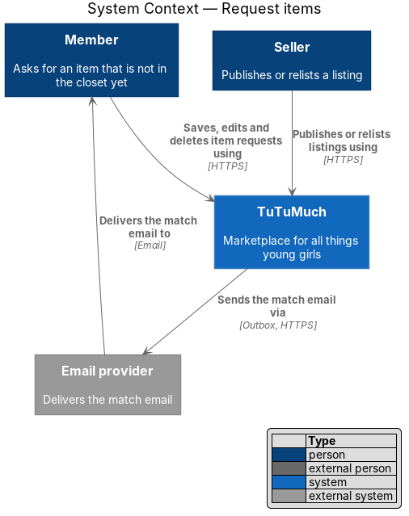
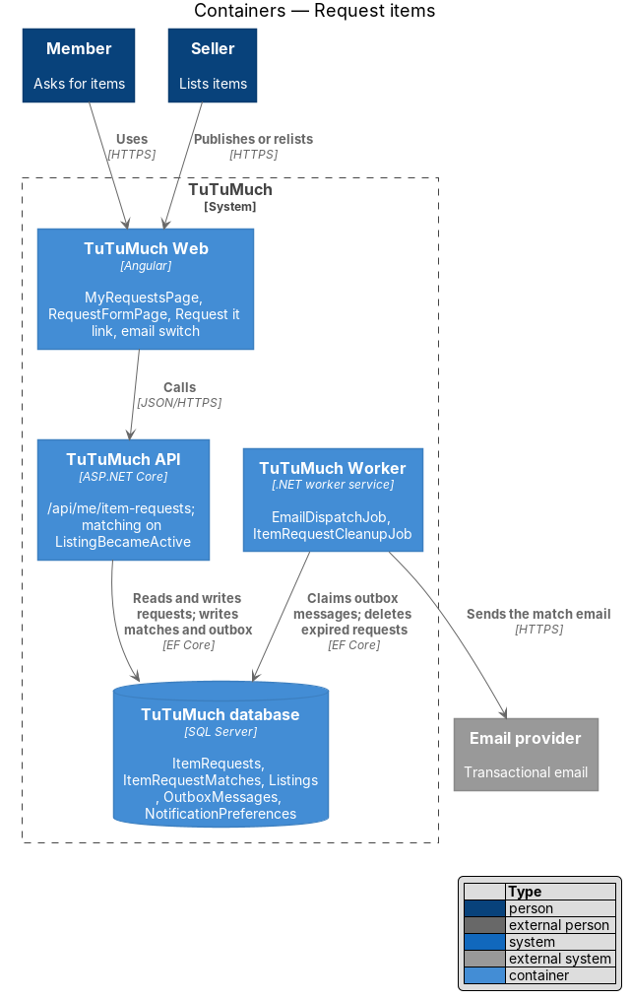
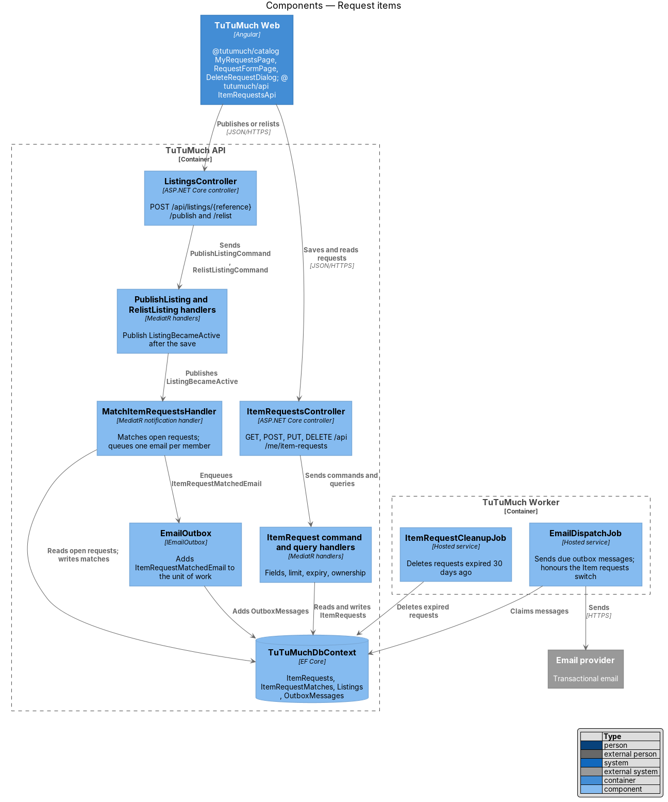
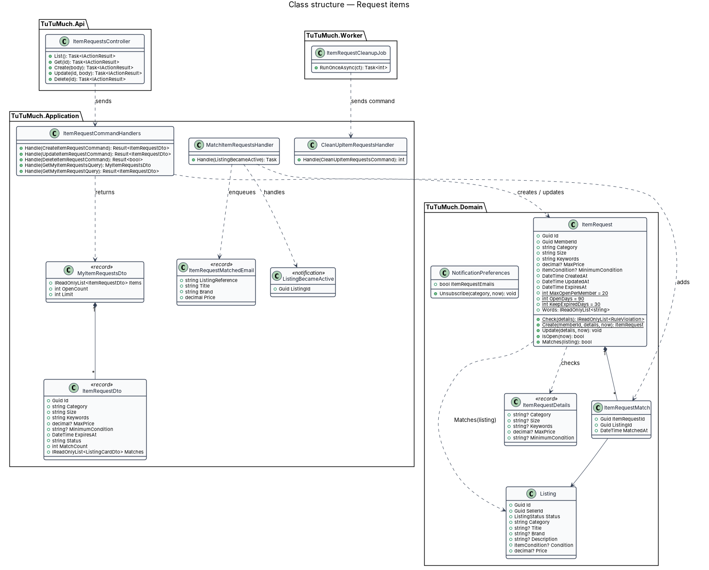
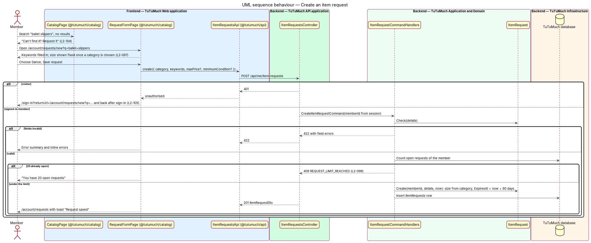
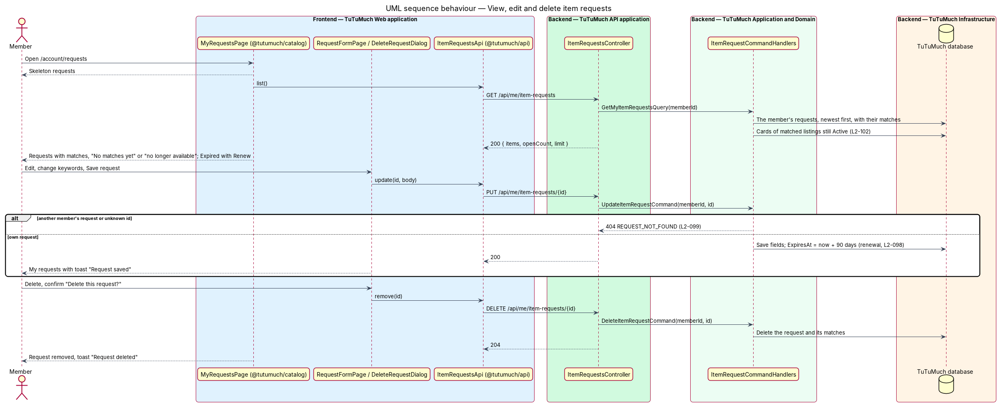
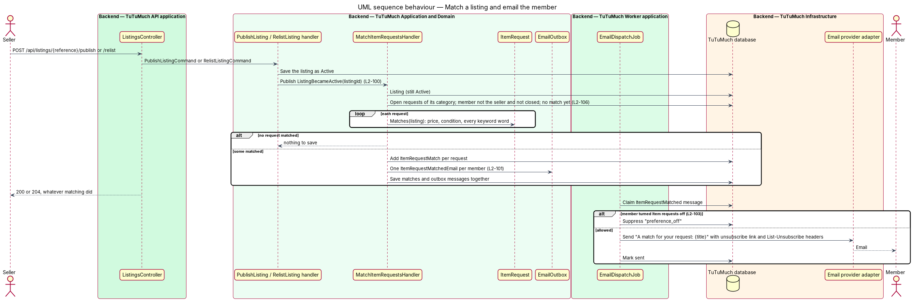
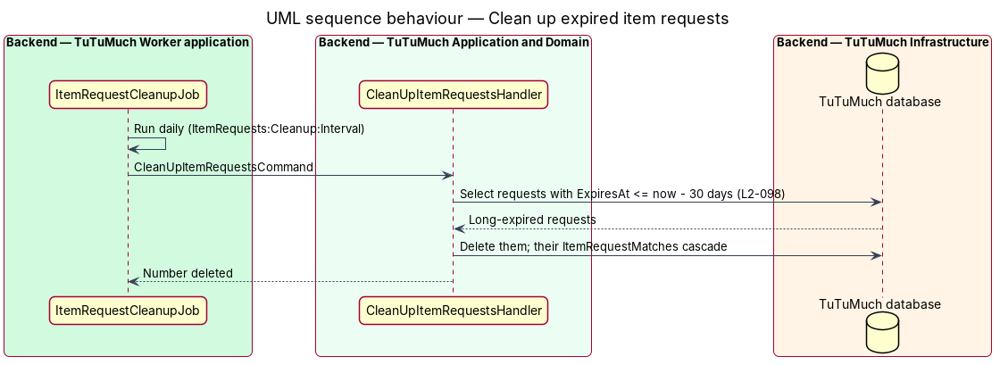

# Request items

## Overview

A TuTuMuch shopper sometimes looks for something the closet does not hold yet, for example ballet slippers before the next term starts. This feature lets a signed-in member leave an **item request** with TuTuMuch: a category, a few keywords and, if they wish, a highest price and a lowest condition. When a seller later publishes a listing that fits, or relists the listing of a cancelled order, TuTuMuch records a **match**, emails the member once for that listing, and shows the listing under the request on the member's **My requests** page (`L1-023`).

The feature sits in the catalog subsystem because a request is a saved search over the catalog: it uses the same categories, the same size rule (`L1-003`) and the same keyword rule as catalog search ([ADR catalog/0003](../../../adr/catalog/0003-keyword-search-by-case-insensitive-match.md)). It reads listings written by the [listings](../../listings/README.md) subsystem, sends email through the outbox of [send-email-notifications](../../notifications/send-email-notifications/README.md), adds a switch to [manage-notification-preferences](../../notifications/manage-notification-preferences/README.md), and reuses sign-in from [sign-up-and-sign-in](../../accounts/sign-up-and-sign-in/README.md) without changing it. Launch phases decide who may sell, not who may request, so requests work in every phase ([ADR platform/0014](../../../adr/platform/0014-launch-phase-configuration.md)).

Terms used in this design:

- **item request** — one member's saved description of an item they want: category, keywords, optional highest price, optional lowest condition; "request" for short
- **open request** — a request whose expiry lies in the future; only open requests are matched and only they count toward the limit
- **expiry** — the moment a request stops being open, 90 days after it was created or last saved
- **match** — the record that one listing fitted one request when the listing became Active; a request and a listing are matched at most once
- **listing became active** — a listing moving into the Active status by publish (`L2-019`) or by relist after a cancelled order (`L2-035`); edits and released reservations do not count
- **match email** — the plain-text email that tells a member a listing matched one or more of their open requests
- **request limit** — at most 20 open requests per member

## Description

Screens, states and copy come from `docs/mocks/pages/my-requests/`, `docs/mocks/pages/request-form/`, `docs/mocks/dialogs/delete-request/`, `docs/mocks/notifications/request-toasts/`, `docs/mocks/pages/request-match-email/`, the `no-results` and `category-empty` states of `docs/mocks/pages/catalog/` and the default state of `docs/mocks/pages/notification-settings/`. `docs/screen-composition.md` names the library components of each.

### Frontend (`TuTuMuch Web`)

`@tutumuch/catalog` (`src/frontend/projects/catalog/src/lib/`) owns the screens, because a request is about finding items; it adds three lazy routes to `catalog.routes.ts`, all in the app shell.

- **`MyRequestsPage`** (`my-requests/`) at `/account/requests`. The header shows "Requests", the subtitle "{n} open requests" and the primary "Request an item" (icon `plus`) linking to `/account/requests/new`. Each request is a `.request` block: the keywords as an `h2`, the facts line "{category} · Girls’ · Up to {price} · {condition} or better", "Open until {Mon d}" or `tl-status` (tone `removed`) "Expired" with "Expired on {Mon d}", the actions "Edit" (`/account/requests/{id}/edit`) or "Renew", and "Delete". Under it, the matched listings still Active as `tl-listing-grid` cards (newest match first) under "{n} match(es)"; otherwise "No matches yet. We’ll email you when one is listed.", "Your match is no longer available. We’ll keep looking." when `matchCount` is above 0 but no match is Active, or "Renew it to keep looking for 90 more days." for an expired request. States:
  - `loading` — three skeleton request blocks, `aria-busy="true"`, `aria-label="Loading requests"`.
  - `default`, `no-matches`, `expired` — as above.
  - `empty` — `tl-empty-state` with Tilly, "No requests yet", "Ask for something that isn’t in the closet yet. We’ll email you when it’s listed." and the primary "Request an item".
  - `limit-reached` — with 20 open requests the header action is replaced by the line "You have 20 open requests. Delete one to add another." (`L2-098`).
  - `error` — "Couldn’t load your requests", the correlation reference and "Try again" (`L2-068`).
  - `signed-out` — a `401` navigates to `/sign-in?returnUrl=/account/requests` (`L2-105`).
  "Renew" sends the request back unchanged with `PUT`, which renews it; a `409 REQUEST_LIMIT_REACHED` shows the warning toast "You have 20 open requests", "Delete one to renew this one."
- **`RequestFormPage`** (`request-form/`) at `/account/requests/new` and `/account/requests/{id}/edit`. Fields: Category (`select`, "Choose a category", the six categories of `L2-011`), the read-only `tl-fixed-size` "Size: Girls’" once a category is chosen (no size input, `L2-097`), Keywords (help "The words a seller would use, like “ballet slippers”. Every word must be in the listing.", counter "{n} / 100"), Highest price (optional, `$` addon, help "Shipping not included.") and Lowest condition (optional `select`, "Any condition" then the five conditions, help "This condition or better."). `?category={slug}` and `?q=` fill a new form (keywords cut to 100 characters, `L2-104`). "Save request" posts or puts; on success the page navigates to `/account/requests` and shows the success toast "Request saved", "We’ll email you when it’s listed." A `422` shows `tl-error-summary` and the inline errors; `409 REQUEST_LIMIT_REACHED` shows the limit-reached center state; `404` on edit shows "This request isn’t here"; a load failure shows "Couldn’t open this request" with the reference; a `401` navigates to `/sign-in` with the whole URL, query string included, as `returnUrl` (`L2-105`).
- **`DeleteRequestDialog`** (`delete-request/`) through `DialogService`: "Delete this request?", "“{keywords}” stops looking for new listings. This can’t be undone.", "Keep request" focused and the danger "Delete" with `busy`; a failure shows "Couldn’t delete" / "Your request is still open." and "Try again". On success the page removes the block and shows the info toast "Request deleted".
- **`CatalogPage`** (existing) — the filtered empty state adds the link "Can’t find it? Request it" after "Try fewer filters or a different word."; a category page with nothing in it (no keyword or other filter) shows "Nothing in {category} right now", "New items arrive every day. Can’t find it? Request it" and the primary "Shop the closet". The link goes to `/account/requests/new` with `category` (the page's category slug, when one is chosen) and `q` (the keyword, when there is one). It is shown to visitors as well; the form sends them through sign-in.
- **`NotificationSettingsPage`** (`@tutumuch/accounts`, existing) — adds the "Item requests" row, "When something you asked for is listed", switch "Item request emails", saved as `itemRequestEmails` (`L2-103`). **`UnsubscribePage`** names the category the token turned off: "You’re unsubscribed from item request emails" for `ItemRequests`.
- **`ItemRequestsApi`** in `@tutumuch/api` (`src/lib/requests/item-requests-api.ts`) — `list()`, `get(id)`, `create(body)`, `update(id, body)`, `remove(id)` over `/api/me/item-requests`, returning `ApiResult`. Feature libraries never call `HttpClient` directly.
- The account sub-navigation of the mocks gains a "Requests" tab; like the other account tabs it is composed with the account overview journey. Until then My requests is reached from the toast, the match email, the empty catalog and direct links.

### API (`TuTuMuch.Api`)

- **`ItemRequestsController`** — `[Authorize]`: any signed-in member, verified or not, in every launch phase; a visitor gets `401` (`L2-105`). The member ID comes from the session, never from the request (`L2-010`).
  - `GET /api/me/item-requests` — `200` with `MyItemRequestsDto { items, openCount, limit }`, newest first.
  - `GET /api/me/item-requests/{id}` — `200` with `ItemRequestDto`; `404 REQUEST_NOT_FOUND` for an unknown ID or another member's request (`L2-099`).
  - `POST /api/me/item-requests` — body `{ category, size?, keywords, maxPrice?, minimumCondition? }`; `201` with `Location` and the request; `422` with field errors; `409 REQUEST_LIMIT_REACHED` "You have 20 open requests".
  - `PUT /api/me/item-requests/{id}` — same body; `200`; saves the fields and renews the expiry; `404`; `422`; `409 REQUEST_LIMIT_REACHED` when renewing an expired request while 20 are open. No ETag: the last save wins, as the only writer is the member ([ADR catalog/0006](../../../adr/catalog/0006-item-request-limit-and-expiry.md)).
  - `DELETE /api/me/item-requests/{id}` — `204`; `404`.
- **Error codes** of a `422`: `CATEGORY_INVALID` ("Choose a category"), `SIZE_NOT_ACCEPTED` (any size but the category's, `L2-013`), `REQUEST_KEYWORDS_LENGTH` ("Describe the item in 3 to 100 characters"), `PRICE_OUT_OF_RANGE` ("Enter a price from $1.00 to $5,000.00"), `CONDITION_INVALID` ("Choose one of the 5 conditions"). The top-level code is `CATEGORY_INVALID` or `SIZE_NOT_ACCEPTED` when those fail, the field's own code when one field fails, else `REQUEST_INVALID`, as for listings.
- **`NotificationPreferencesController`** (existing) — `PUT /api/me/notification-preferences` accepts an optional `itemRequestEmails`; when it is absent the stored choice does not change (`L2-103`). `GET` lists five categories: `accountSecurity`, `orders`, `itemRequests`, `reviews`, `marketing`.
- **`UnsubscribeController`** (existing) — accepts tokens of the `ItemRequests` category as well as `Marketing`, and answers `{ category: "ItemRequests", unsubscribed: true }`.

### Application and domain (`TuTuMuch.Application`, `TuTuMuch.Domain`)

- **`ItemRequest`** (`TuTuMuch.Domain/Requests/ItemRequest.cs`) — aggregate with `Id`, `MemberId`, `Category`, `Size` (always the category's accepted size, set by the server), `Keywords` (trimmed, whitespace collapsed), `MaxPrice?`, `MinimumCondition?` (`ItemCondition`), `CreatedAt`, `UpdatedAt` and `ExpiresAt`. `ItemRequest.Check(details)` returns every `RuleViolation`; `Create` and `Update` set `ExpiresAt = now + 90 days`; `IsOpen(now)` is `ExpiresAt > now`; `Words` are the lower-cased keywords split on whitespace; `Matches(listing)` applies the match rule ([ADR catalog/0005](../../../adr/catalog/0005-item-request-match-rule.md)): the same category, `Price <= MaxPrice` when set, `Condition` at or better than `MinimumCondition` when set (the enum order runs from New with tags to Used - Fair), every word inside the lower-cased title, brand or description, and the listing's seller is not the request's member. Constants: `MaxOpenPerMember = 20`, `OpenDays = 90`, `KeepExpiredDays = 30`, `MinKeywords = 3`, `MaxKeywords = 100`.
- **`ItemRequestMatch`** — `ItemRequestId`, `ListingId`, `MatchedAt`; the pair is the key, so a request and a listing are matched once (`L2-100` criterion 7).
- **`ItemRequestCommands`** (`TuTuMuch.Application/Requests/`) — `CreateItemRequestCommand`, `UpdateItemRequestCommand`, `DeleteItemRequestCommand`, `GetMyItemRequestsQuery`, `GetMyItemRequestQuery`, all keyed by the caller's member ID. Create and renew count the member's open requests first and refuse the 21st with `409 REQUEST_LIMIT_REACHED` (`L2-098`); an update of an open request is not counted again. Another member's request is looked up with both IDs, so it answers `404` (`L2-099`).
- **`ItemRequestDto`** — `id`, `category`, `size`, `keywords`, `maxPrice?`, `minimumCondition?`, `createdAt`, `updatedAt`, `expiresAt`, `status` (`Open` or `Expired`), `matchCount` (all matches ever recorded) and `matches` (the catalog's `ListingCardDto` of the matched listings that are still Active, newest match first, `L2-102`).
- **`ListingBecameActive`** (`TuTuMuch.Application/Listings/`) — MediatR notification `{ ListingId }` that `PublishListingCommand` and `RelistListingCommand` publish after their save ([ADR catalog/0004](../../../adr/catalog/0004-match-item-requests-in-process-when-a-listing-becomes-active.md)).
- **`MatchItemRequestsHandler`** — handles `ListingBecameActive`: reads the listing (still Active), loads the open requests of its category whose member is not the seller and not closed (`L2-106`) and that have no match with it yet, keeps those `ItemRequest.Matches` accepts, adds one `ItemRequestMatch` per request and queues one `ItemRequestMatchedEmail` per member through `IEmailOutbox`, then saves once, so matches and emails commit together (`L2-101`). A failure is logged and never fails the publish or relist that raised the event.
- **`CleanUpItemRequestsCommand`** — deletes requests that expired at least 30 days ago, with their matches (`L2-098` criterion 8).
- **Notifications** — `NotificationType.ItemRequestMatched` in the new `NotificationCategory.ItemRequests`; `NotificationPreferences.ItemRequestEmails` (on for every member until turned off) and `Unsubscribe(category, now)`; `ItemRequestMatchedEmail(ListingReference, Title, Brand, Price)` rendered by `EmailTemplates` as "A match for your request: {title}" with the price and links to `/items/{reference}` and `/account/requests`. `DispatchEmailsHandler` suppresses the email when the switch is off and adds the item-request unsubscribe link and the `List-Unsubscribe` headers, as for marketing ([ADR catalog/0007](../../../adr/catalog/0007-match-email-per-listing-without-a-digest.md)).

### Worker and infrastructure (`TuTuMuch.Worker`, `TuTuMuch.Infrastructure`, `TuTuMuch.Cli`)

- **`ItemRequestCleanupJob`** — hosted service that sends `CleanUpItemRequestsCommand` once every `ItemRequests:Cleanup:Interval` (one day).
- **`ItemRequestConfiguration`** — table `ItemRequests` (`Category` 32, `Size` 16, `Keywords` 100, `MaxPrice` `decimal(9,2)`, `MinimumCondition` as a string of 24), foreign key to `Members` with cascade delete, so erasing a member erases their requests (`L2-106`); indexes `IX_ItemRequests_MemberId_CreatedAt` and `IX_ItemRequests_Category_ExpiresAt`. Table `ItemRequestMatches` with key (`ItemRequestId`, `ListingId`), cascade from both sides (listings already restrict their delete from members, so there is one cascade path) and index `IX_ItemRequestMatches_ListingId`.
- **`NotificationPreferences.ItemRequestEmails`** — new `bit` column, default `1` for existing rows.
- **Migration `AddItemRequests`** — the two tables, their indexes and the new column.
- **`DemoSeeder`** (`TuTuMuch.Cli`) — seeds two open requests for a demo shopper, one that a demo listing already matches, so My requests has data on a local install.

### Configuration

| Key | Value | Notes |
|-----|-------|-------|
| `ItemRequest.MaxOpenPerMember` | 20 | Domain constant, `L2-098` |
| `ItemRequest.OpenDays` | 90 | Domain constant, `L2-098` |
| `ItemRequest.KeepExpiredDays` | 30 | Domain constant, `L2-098` |
| `ItemRequests:Cleanup:Interval` | `1.00:00:00` | How often the clean-up job runs |

## Requirements

The feature realises the following level-2 (L2) requirements. Each refines the level-1 (L1) requirement cited.

| L2 ID | Refines (L1) | Requirement |
|-------|--------------|-------------|
| `L2-097` | `L1-023`, `L1-003` | A signed-in member shall be able to save an item request with a category (one of the six of `L2-011`), keywords, an optional highest price and an optional lowest condition, the size fixed by the category. |
| `L2-098` | `L1-023` | A member shall have at most 20 open requests. A request is open until it expires, 90 days after it was created or last saved, and is deleted 30 days after it expired. |
| `L2-099` | `L1-023`, `L1-002` | A member shall have a "My requests" page listing their requests newest first, from which they can edit and delete them; another member's request answers 404. |
| `L2-100` | `L1-023`, `L1-005` | When a listing becomes Active, by publishing or relisting, it shall be matched against every open request by category, highest price, lowest condition and keywords, never against the seller's own requests. |
| `L2-101` | `L1-023`, `L1-011` | For each listing that matches, each member whose open requests it matched shall receive one email through the outbox. |
| `L2-102` | `L1-023` | Each request on My requests shall show the listings it matched that are still Active. |
| `L2-103` | `L1-011`, `L1-023` | The email settings page shall add an "Item requests" switch, on until turned off, and every match email shall carry a one-click unsubscribe. |
| `L2-104` | `L1-023`, `L1-005` | An empty search, filtered catalog or category page shall offer "Can't find it? Request it", linking to the filled-in request form. |
| `L2-105` | `L1-023`, `L1-002` | Every item request endpoint shall require a signed-in member; a visitor shall go through sign-in and come back. |
| `L2-106` | `L1-014`, `L1-023` | A request shall be visible only to the member who made it, and erased with their personal data. |

## Diagrams

### System context

A member asks TuTuMuch for an item. When a seller lists a match, TuTuMuch emails the member through the email provider.

### Containers

`TuTuMuch Web` saves and reads requests through `TuTuMuch API`, which matches a listing when it becomes Active and writes the match email to the outbox in `TuTuMuch database`. `TuTuMuch Worker` sends the email and deletes long-expired requests.

### Components

`ItemRequestsController` sends the request commands and queries. The listing commands publish `ListingBecameActive`, which `MatchItemRequestsHandler` turns into matches and outbox messages. `EmailDispatchJob` and `ItemRequestCleanupJob` run in the worker.

### Class structure

`ItemRequest` owns the validation, expiry and match rule and has many `ItemRequestMatch` rows. The handlers return `ItemRequestDto` with the catalog's listing cards.

### Behaviour — create a request

A signed-in member saves the form; the API checks the fields and the limit and stores the request. A visitor is sent through sign-in first and comes back to the filled-in form.

### Behaviour — view, edit and delete requests

My requests loads the member's requests with their Active matches. Editing saves and renews; deleting asks for confirmation first. Another member's request answers 404.

### Behaviour — match a listing and email the member

After a publish or relist is saved, the listing is matched against open requests; the matches and one email per member commit together, and the dispatcher sends the email unless the member turned item request emails off.

### Behaviour — clean up expired requests

Once a day the worker deletes requests that expired at least 30 days ago, with their matches.

## Testing

- `tests/TuTuMuch.Domain.Tests/ItemRequestTests.cs` — field rules and messages, the size set by the category, expiry and renewal, and every branch of the match rule.
- `tests/TuTuMuch.Api.Tests/ItemRequestsTests.cs` — xUnit acceptance tests through `TuTuMuchApiFactory` (SQLite in-memory, fakes): create, list newest first, edit and renew, delete, `404` for another member's request, `401` for a visitor, the limit of 20, expiry, every launch phase.
- `tests/TuTuMuch.Api.Tests/ItemRequestMatchingTests.cs` — matching on publish and on relist, never the seller's own or a closed member's requests, once per request and listing, one email per member per listing, the switch and the one-click unsubscribe, matches shown while Active, and the clean-up.
- `tests/TuTuMuch.Worker.Tests/ItemRequestCleanupJobTests.cs` — each pass sends `CleanUpItemRequestsCommand`; the job runs at least daily.
- `tests/TuTuMuch.Cli.Tests/SeedItemRequestsTests.cs` — the demo requests and their match.
- `src/frontend/e2e/tests/request-items.spec.ts` with `e2e/pages/my-requests.page.ts` and `e2e/pages/request-form.page.ts` — Playwright (Chromium) with every `TuTuMuch API` call served by `page.route` fixtures: Request it from an empty search and category page, sign-in and back, create, invalid, limit reached, My requests with matches, no matches and no longer available, expired and renew, edit, delete, empty, error and the email switch.

## Open questions

- Matching a new request against listings already in the closet is not part of this design: a request looks only forward. The empty search that led to the request already showed that nothing matched.
- Push, SMS and an in-app notification centre are out of scope; email and My requests are the only channels.
