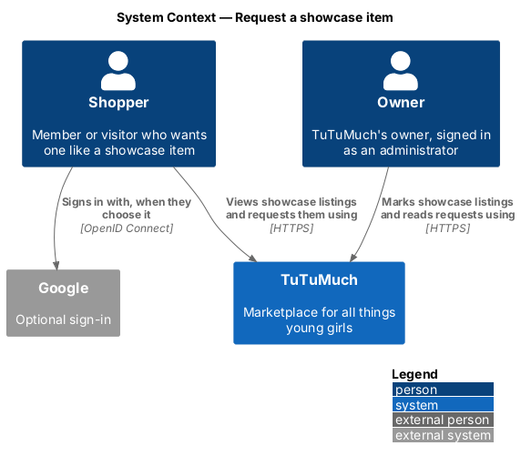
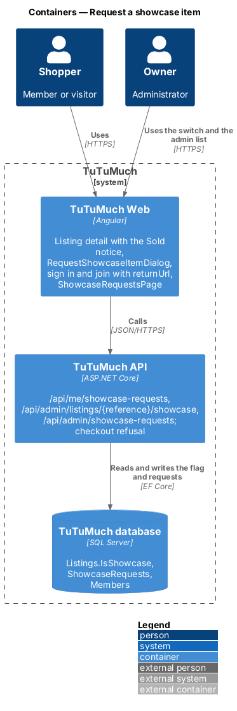
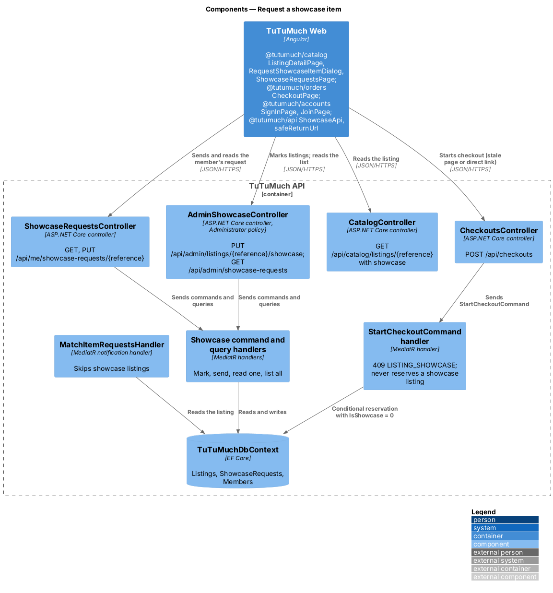
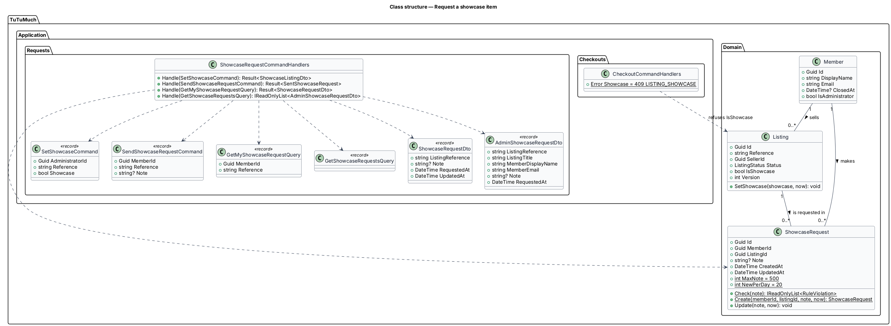
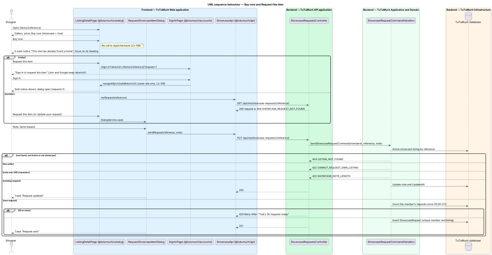
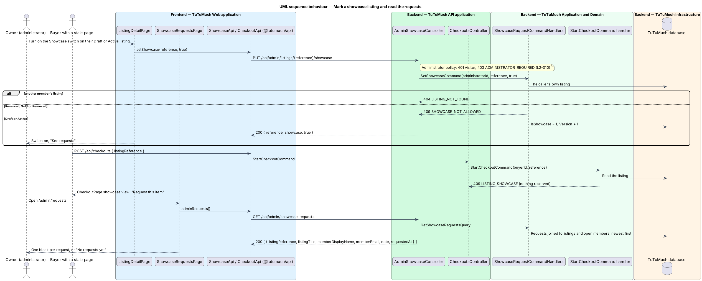

# Request a showcase item

## Overview

TuTuMuch's owner sells on TuTuMuch as an ordinary member whose account holds the `Administrator` role (`L2-010`). Some of the owner's items have already gone to a new home, but they show shoppers what the closet can hold and what the owner can find again. This feature lets the owner mark such a listing as a **showcase listing**. It looks exactly like any Active listing in the catalog and on its detail page, with its price and "Buy now". Choosing "Buy now" does not start checkout: the page shows the "Sold" label with "This one has already found a home" and the action **"Request this item"**. A signed-in member sends a short request, and the owner sees every request in the admin shell (`L1-024`).

The feature sits in the catalog subsystem, next to [request-items](../request-items/README.md), because it changes what the listing detail page offers and records interest in an item. It reads and flags the `Listing` aggregate written by the [listings](../../listings/README.md) subsystem, makes [checkout-and-pay](../../orders/checkout-and-pay/README.md) refuse a showcase listing before anything is reserved, and reuses sign-in and join from [sign-up-and-sign-in](../../accounts/sign-up-and-sign-in/README.md) and [sign-in-with-google](../../accounts/sign-in-with-google/README.md) with a return URL. It works in every launch phase ([ADR platform/0014](../../../adr/platform/0014-launch-phase-configuration.md)). The decisions are recorded in [ADR catalog/0008](../../../adr/catalog/0008-showcase-listings-and-showcase-requests.md).

Terms used in this design:

- **showcase listing** — an Active listing of an administrator with `IsShowcase` set; it browses like any Active listing but is never reserved, sold or paid for
- **Sold notice** — the `tl-sold-notice` panel that replaces the buy bar after "Buy now" on a showcase listing: the Sold label, "This one has already found a home", one line and one action
- **showcase request** — one member's request for one showcase listing, with an optional note of up to 500 characters; at most one per member and listing. It is a different thing from an [item request](../request-items/README.md), which is a saved search matched against new listings
- **return URL** — the same-site path a visitor comes back to after signing in or joining, here `/items/{reference}?request=1`

## Description

Screens, states and copy come from the `showcase`, `showcase-sold`, `showcase-guest`, `showcase-requested` and `showcase-own` states of `docs/mocks/pages/listing-detail/`, `docs/mocks/dialogs/request-showcase-item/`, `docs/mocks/notifications/showcase-request-toasts/`, the `showcase` state of `docs/mocks/pages/checkout/`, the `request` states of `docs/mocks/pages/sign-in/` and `docs/mocks/pages/register/`, and `docs/mocks/pages/showcase-requests/`. `docs/screen-composition.md` names the library components of each.

### Frontend (`TuTuMuch Web`)

- **`ListingDetailPage` and `ListingDetailStore`** (`@tutumuch/catalog`, `src/lib/listing-detail/`, existing). `ListingDetailDto` gains `showcase`. `primaryAction` gains `showcase` for an Active showcase listing seen by anyone but its seller; the buy bar then shows "Buy now" as a `button`. Pressing it sets the store's `soldNoticeShown` signal and no request is sent: the buy bar gives way to `tl-sold-notice` ("This one has already found a home", "We can look for another one like it. Tell us what you’re after.", primary "Request this item"), and the page calls the notice's `focus()` (`L2-108`). For a signed-in member the store reads `GET /api/me/showcase-requests/{reference}` when the notice is first shown; with a request the line reads "You asked for this on {Mon d}. Add a note or change it any time." and the action "Update your request". "Request this item":
  - visitor — navigates to `/sign-in?returnUrl=/items/{reference}?request=1` (`L2-109`);
  - member — opens `RequestShowcaseItemDialog` through `DialogService`.
  The query parameter `request=1` (a component input) shows the notice at once and, for a signed-in member, opens the dialog.
  For the administrator's own showcase listing (`viewer.relation = Seller` and `AuthState.member().isAdministrator`) the manage bar stays ("Edit listing", "Withdraw") and a row under it holds `tl-switch` "Showcase" with the hint "Buy now shows Sold and Request this item" and, when on, the ghost link "See requests" to `/admin/requests`. Toggling calls `ShowcaseApi.setShowcase`; on failure the switch goes back and the danger toast "Couldn’t change the showcase" is shown (`L2-107`). The administrator's ordinary Active listing shows the switch off, and their Draft shows the switch too, so a listing can be a showcase before it is published.
- **`RequestShowcaseItemDialog`** (`@tutumuch/catalog`, `src/lib/request-showcase-item/`). `tl-dialog` with icon `heart`, heading "Request this item", description "Tell TuTuMuch you’d like one like it. Only TuTuMuch sees your request."; `tl-item-row` with the listing; one `tl-form-field` textarea "Note" (optional, help "Anything that helps us find one like it: size, colour, when you need it.", counter "{n} / 500"), filled with the saved note when one exists. "Send request" (or "Update request") calls `ShowcaseApi.sendRequest`. Client check: more than 500 characters after trimming shows the error summary and "Keep the note to 500 characters", as the API would. `201` closes with the toast "Request sent", "Thank you. TuTuMuch sees every request."; `200` with "Request updated"; `422` shows the inline error; `429` the warning alert "That’s 20 requests today" in the top slot; `401` closes and goes to sign in with the return URL; any other failure the danger alert "Couldn’t send your request" with the reference and "Try again", keeping the note.
- **`ShowcaseRequestsPage`** (`@tutumuch/catalog`, `src/lib/showcase-requests/`) at `/admin/requests`, route `data.shell = 'admin'`. It reads `ShowcaseApi.adminRequests()` and shows `loading` (three skeleton blocks), `default` (header "Showcase requests", "{n} requests"; one block per request: listing title linking to `/items/{reference}`, the reference and the date, the member's display name and a `mailto:` email, the note as text or "No note"), `empty` (`tl-empty-state` "No requests yet", "When a shopper asks for a showcase item, it shows up here."), `error` ("Couldn’t load requests", reference, "Try again") and `forbidden` (`403`: `tl-center-state` "You can’t open this"). A `401` navigates to `/sign-in?returnUrl=/admin/requests` (`L2-110`).
- **`CheckoutPage`** (`@tutumuch/orders`, existing). `409 LISTING_SHOWCASE` from `POST /api/checkouts` is the new `showcase` view: `tl-center-state` with icon `heart`, "This one has already found a home", "We can look for another one like it.", primary "Request this item" to `/items/{reference}?request=1` and "Keep shopping"; no address or card field (`L2-108` criterion 4).
- **`SignInPage` and `JoinPage`** (`@tutumuch/accounts`, existing). `safeReturnUrl(url)` moves to `@tutumuch/api` (`src/lib/auth/return-url.ts`) and both pages use it: a value that does not start with one `/`, or starts with `//` or `/\`, becomes `/`. Sign in reads "Sign in to request this item" with "You’ll go straight back to the item and your request." when the return URL is `/items/{reference}?request=1`, and its "Join" link carries the return URL. Join takes `returnUrl` too: its Google start URL and "Sign in" link carry it, the lead reads "Join, verify your email, then sign in and we’ll take you back to your request.", and the success state's primary action becomes "Sign in to send your request". A member does not need a verified email to send a request, so the new member can send it before verifying.
- **`ShowcaseApi`** (`@tutumuch/api`, `src/lib/catalog/showcase-api.ts`) — `myRequest(reference)`, `sendRequest(reference, note)`, `setShowcase(reference, showcase)` and `adminRequests()`, returning `ApiResult`; `sendRequest` reports whether the request was created. Feature libraries never call `HttpClient` directly.

### API (`TuTuMuch.Api`)

- **`ShowcaseRequestsController`** — `[Authorize]`: any signed-in member, verified or not; a visitor gets `401` (`L2-109`). The member comes from the session (`L2-010`).
  - `GET /api/me/showcase-requests/{reference}` — `200` with `ShowcaseRequestDto { listingReference, note, requestedAt, updatedAt }`; `404 SHOWCASE_REQUEST_NOT_FOUND` when the caller has none for that listing (`L2-111`).
  - `PUT /api/me/showcase-requests/{reference}` — body `{ note? }`; `201` when created, `200` when updated, with the request; `404 LISTING_NOT_FOUND` when the listing is unknown, not Active or not a showcase listing; `422 CANNOT_REQUEST_OWN_LISTING` for the seller; `422 SHOWCASE_NOTE_LENGTH` "Keep the note to 500 characters"; `429` with `Retry-After` and title "That’s 20 requests today" for a 21st new request in a UTC day (`L2-051`).
- **`AdminShowcaseController`** — `[Authorize(Policy = Administrator)]`: `401` for a visitor, `403 ADMINISTRATOR_REQUIRED` for anyone else (`L2-010`).
  - `PUT /api/admin/listings/{reference}/showcase` — body `{ showcase: bool }`; `200` with `{ reference, showcase }`; `404 LISTING_NOT_FOUND` for another member's listing; `409 SHOWCASE_NOT_ALLOWED` unless the listing is a Draft or Active (`L2-107`).
  - `GET /api/admin/showcase-requests` — `200` with `AdminShowcaseRequestDto[] { listingReference, listingTitle, memberDisplayName, memberEmail, note, requestedAt }`, most recently sent first, without closed members (`L2-110`, `L2-111`).
- **`CheckoutsController`** (existing) — `POST /api/checkouts` answers `409 LISTING_SHOWCASE` "This one has already found a home" for a showcase listing (`L2-108`).
- **`CatalogController`** (existing) — `GET /api/catalog/listings/{reference}` adds `showcase` to `ListingDetailDto`. Catalog cards do not change (`L2-107` criterion 5).

### Application and domain (`TuTuMuch.Application`, `TuTuMuch.Domain`)

- **`Listing.IsShowcase`** and **`Listing.SetShowcase(bool, now)`** — only a Draft or Active listing may change it; it bumps `Version`, so an edit read before the change is refused with `412 LISTING_CHANGED` like any concurrent change (`L2-020`). Nothing else in the listing's state machine changes ([ADR catalog/0008](../../../adr/catalog/0008-showcase-listings-and-showcase-requests.md)).
- **`ShowcaseRequest`** (`TuTuMuch.Domain/Requests/ShowcaseRequest.cs`) — `Id`, `MemberId`, `ListingId`, `Note?` (trimmed, empty becomes null), `CreatedAt`, `UpdatedAt`. `Check(note)` returns the `RuleViolation` of a note over `MaxNote = 500`; `Create` and `Update` set the note and dates. `NewPerDay = 20`.
- **`ShowcaseRequestCommands`** (`TuTuMuch.Application/Requests/`) — `SetShowcaseCommand(AdministratorId, Reference, Showcase)` finds the caller's own listing; `SendShowcaseRequestCommand(MemberId, Reference, Note)` finds an Active showcase listing, refuses the seller, checks the note, updates the member's request for that listing or, after counting the requests the member created since 00:00 UTC, creates one; `GetMyShowcaseRequestQuery(MemberId, Reference)`; `GetShowcaseRequestsQuery` joins requests, listings and open members, newest `UpdatedAt` first.
- **`StartCheckoutCommand`** (existing) — returns `CheckoutCommandHandlers.Showcase` (`409 LISTING_SHOWCASE`) after the visibility and own-listing checks, and its conditional reservation update also requires `!IsShowcase`, so a listing marked while a checkout starts is never reserved (`L2-029` holds unchanged for ordinary listings).
- **`MatchItemRequestsHandler`** (existing, request-items) — skips a showcase listing, so publishing a showcase draft records no match and queues no email (`L2-107` criterion 10).
- **`GetListingDetailQueryHandler`** (existing) — fills `Showcase`. **`GetMyItemRequestsQuery`** (existing, request-items) shows only matches that are Active and not showcase listings (`L2-102`).

### Infrastructure and data (`TuTuMuch.Infrastructure`)

- **`Listings.IsShowcase`** — new `bit` column, default `0`, so every existing listing stays ordinary.
- **`ShowcaseRequestConfiguration`** — table `ShowcaseRequests` (`Note` `nvarchar(500)` null), unique index `IX_ShowcaseRequests_MemberId_ListingId` (one request per member and listing, also the race guard when two sends arrive together), index `IX_ShowcaseRequests_UpdatedAt` (admin list) and `IX_ShowcaseRequests_MemberId_CreatedAt` (daily count). Foreign keys to `Members` and to `Listings` both cascade on delete; listings restrict their delete from members, so there is one cascade path from a member. Erasing a member erases their showcase requests (`L2-111`).
- **Migration `AddShowcaseRequests`** — the column, the table and its indexes.
- **`DemoSeeder`** (`TuTuMuch.Cli`) — not changed. The demo members are never administrators (`L2-076`), so there is no owner whose listing could be a showcase; a developer marks one with the switch after granting their own account the role.

### Configuration

| Key | Value | Notes |
|-----|-------|-------|
| `ShowcaseRequest.MaxNote` | 500 | Domain constant, `L2-109` |
| `ShowcaseRequest.NewPerDay` | 20 | Domain constant, `L2-109`, counted in the database like the publish limit ([ADR platform/0006](../../../adr/platform/0006-daily-publish-limit-counted-in-database.md)) |

### Error codes

| Code | HTTP | Title | When |
|------|------|-------|------|
| `LISTING_SHOWCASE` | 409 | This one has already found a home | Checkout of a showcase listing |
| `SHOWCASE_NOT_ALLOWED` | 409 | Only a draft or active listing can be a showcase | Marking a Reserved, Sold or Removed listing |
| `CANNOT_REQUEST_OWN_LISTING` | 422 | You can’t request your own listing | The seller requests their own showcase listing |
| `SHOWCASE_NOTE_LENGTH` | 422 | Keep the note to 500 characters | Note over 500 characters |
| `SHOWCASE_REQUEST_NOT_FOUND` | 404 | Not found | The caller has no request for the listing |
| (none) | 429 | That’s 20 requests today | A 21st new request in a UTC day |

## Requirements

The feature realises the following level-2 (L2) requirements. Each refines the level-1 (L1) requirement cited.

| L2 ID | Refines (L1) | Requirement |
|-------|--------------|-------------|
| `L2-107` | `L1-024`, `L1-002` | An administrator shall be able to mark their own Active listing as a showcase listing, which browses like any Active listing and is never reserved, sold or paid for. |
| `L2-108` | `L1-024`, `L1-007` | "Buy now" on a showcase listing shall show the Sold label and "Request this item" without starting checkout; the checkout endpoint refuses it with `409 LISTING_SHOWCASE`. |
| `L2-109` | `L1-024`, `L1-002` | "Request this item" shall open the request form for a member and send a visitor through sign-in or join and back; one request per member and listing, a note of up to 500 characters, 20 new requests a day. |
| `L2-110` | `L1-024`, `L1-002` | The administrator shall see every showcase request at `/admin/requests`. |
| `L2-111` | `L1-014`, `L1-024` | A showcase request shall be visible only to its member and administrators, and erased with the member's personal data. |

## Diagrams

### System context

A shopper asks TuTuMuch for a showcase item; the owner marks showcase listings and reads the requests.

### Containers

`TuTuMuch Web` shows the Sold notice without calling checkout and sends the request to `TuTuMuch API`, which stores it in `TuTuMuch database`. The owner's admin page reads the requests from the same API.

### Components

`ShowcaseRequestsController` and `AdminShowcaseController` send the showcase commands and queries; `CheckoutsController` refuses a showcase listing; the catalog detail query exposes the flag.

### Class structure

`Listing` carries `IsShowcase`; `ShowcaseRequest` belongs to one member and one listing.

### Behaviour — Buy now and request this item

"Buy now" on a showcase listing shows the Sold notice without a request; a member sends the request from the dialog, and a visitor signs in first and comes back with the dialog open.

### Behaviour — mark a showcase listing and read the requests

The owner turns the switch on for their own Active listing and later reads the requests in the admin shell. A checkout started for the listing is refused.

## Testing

- `tests/TuTuMuch.Domain.Tests/ShowcaseRequestTests.cs` — note rules, create and update; `Listing.SetShowcase` only for a Draft or Active listing.
- `tests/TuTuMuch.Api.Tests/ShowcaseRequestsTests.cs` — xUnit acceptance tests through `TuTuMuchApiFactory` (SQLite in-memory, fakes): marking (administrator only, own listing, Draft or Active only, every phase, no item-request match on publish), the detail flag and unchanged cards, checkout refused with nothing reserved, send and update, the note limit, `401`, `404`, own listing, the daily limit, the admin list (newest first, `403`, closed members left out), privacy of the public responses and erasure by cascade.
- `src/frontend/e2e/tests/request-showcase-item.spec.ts` with `e2e/pages/listing-detail.page.ts`, `e2e/pages/request-showcase-item.page.ts` and `e2e/pages/showcase-requests.page.ts` — Playwright (Chromium) with every `TuTuMuch API` call served by `page.route` fixtures: Buy now shows the notice and never calls checkout, a visitor signs in and comes back with the dialog open, join keeps the return URL, an unsafe return URL goes to `/`, send, update, invalid, failure, the daily limit, the checkout page's showcase state, the owner's switch and the admin list in every state.

## Open questions

- An item request (`L1-023`) that matched a listing before it was marked as a showcase has already been emailed; marking hides the match from My requests but cannot recall the email. The owner marks the draft before publishing to avoid this.
- Replying to a request, telling members when a showcase item becomes available, and requests on ordinary members' listings are deferred.
