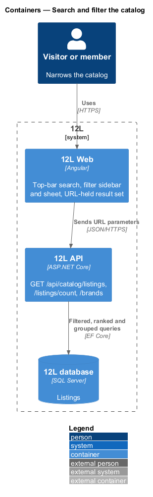
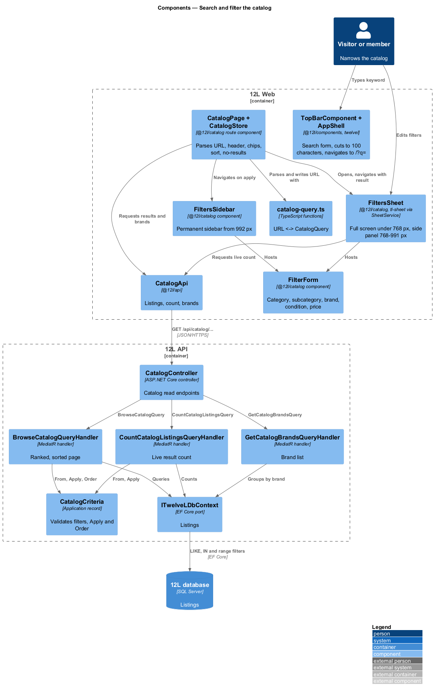
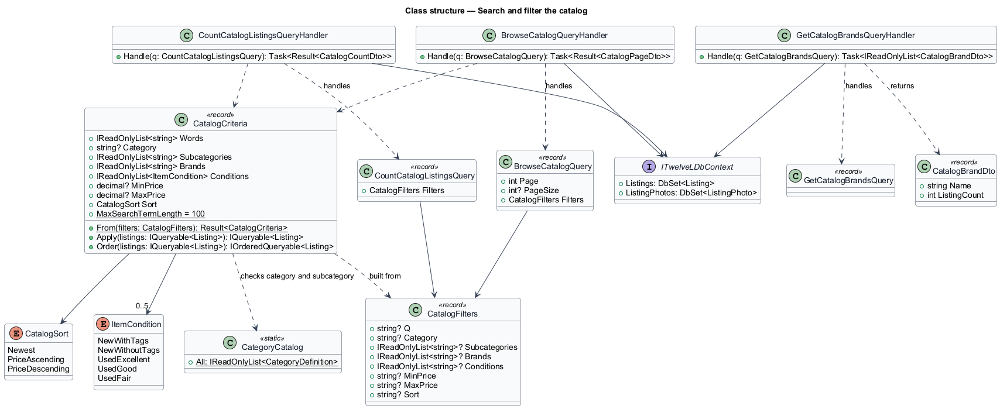
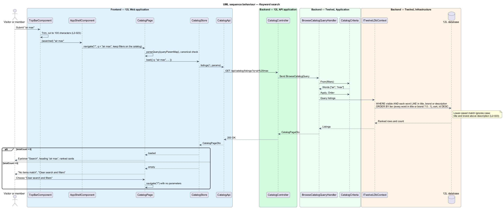
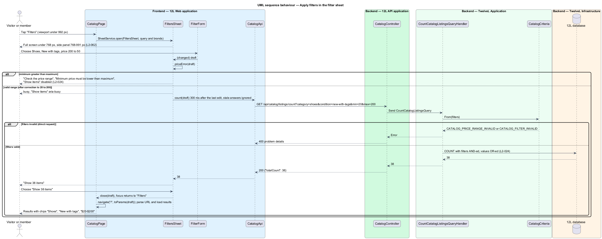
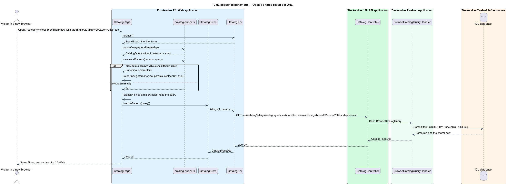

# Search and filter the catalog

## Overview

The Tutu Much catalog lists every Active and Reserved listing, newest first (see [browse-catalog](../browse-catalog/README.md)). With 100,000 listings in view, a visitor needs to narrow that set. This feature adds three ways to do so, all on the same catalog page and the same API endpoint:

> **keyword search** — free-text match of a visitor's words against listing title, brand and description

> **filter** — restriction of the result set to listings whose category, subcategory, brand, condition or price meets a chosen value

> **sort order** — ordering of the result set by newest, price low to high, or price high to low

Filters combine with each other and with the keyword using AND; two or more values chosen inside one filter (for example brands "Nike" and "Adidas") combine with OR. A *result set* is the listings a given keyword, filter and sort combination returns. The whole combination lives in the page URL, so a result set can be bookmarked, shared or reopened in another browser and returns the same listings in the same order (`L2-024`).

Search ranks a listing whose title or brand matches above a listing that matches only in its description, and ignores letter case (`L2-023`). Terms longer than 100 characters are truncated before searching.

Filters appear in three layouts depending on the viewport (`L2-062`): a full-screen *filter panel* under 768 px, a side panel from 768 px to 991 px, and a permanent *filter sidebar* beside the results from 992 px. The panel offers "Clear" and an apply button that shows the live result count; the sidebar applies each change directly.

The categories, subcategories and conditions offered come from the server-held category list (`L2-011`) and condition list (`L2-016`), owned by the [listings](../../listings/) subsystem.

## Description

The slice extends the catalog page and `GET /api/catalog/listings` from browse-catalog, and adds two small read endpoints. Screens and copy come from `docs/mocks/pages/catalog/` (states `search`, `category`, `filtered`, `no-results`) and `docs/mocks/dialogs/filters/` (states `default`, `busy`, `invalid`). Catalog reads go through `ITutuMuchDbContext` ([ADR catalog/0001](../../../adr/catalog/0001-catalog-reads-through-the-db-context-port.md)); keyword search is a case-insensitive word match, not a full-text index ([ADR catalog/0003](../../../adr/catalog/0003-keyword-search-by-case-insensitive-match.md)).

### URL contract

The page URL is the single source of truth for a result set. `catalog-query.ts` reads and writes these query parameters on `/`, and Tutu Much API takes the same names and values:

| Parameter | Values | Example |
|-----------|--------|---------|
| `q` | keyword, trimmed, at most 100 characters | `q=air%20max` |
| `category` | `shoes`, `tops`, `outerwear`, `bottoms` | `category=shoes` |
| `subcategory` | repeatable slug from the chosen category, such as `sneakers`, `dress-shoes`, `t-shirts` | `subcategory=boots` |
| `brand` | repeatable brand name | `brand=Nike&brand=Adidas` |
| `condition` | repeatable `new-with-tags`, `new-without-tags`, `used-excellent`, `used-good`, `used-fair` | `condition=new-with-tags` |
| `min`, `max` | price in dollars, up to two decimal places | `min=20&max=200` |
| `sort` | `newest` (default, omitted), `price-asc`, `price-desc` | `sort=price-asc` |

The mock example `/?category=shoes&condition=new-with-tags&min=20&max=200&sort=price-asc` is a valid URL under this contract. `toParams` writes parameters in the fixed order above and omits defaults, so one result set has one canonical URL. A `subcategory` is only valid with its parent `category`. Values the page does not recognise are dropped and the URL is replaced (`replaceUrl: true`) with its canonical form; parameters the catalog does not own (such as `from=sign-in`) are kept. Paging is not held in the URL; reopening a URL shows its first page. The category pages `/shoes`, `/tops`, `/outerwear` and `/bottoms` from browse-catalog fix the category through route data (`pageCategory`, not `category`, because input binding would also fill an input named `category` from the query string); any filter change there navigates to `/` with the category kept.

### Frontend — `Tutu Much Web`, feature library `@tutumuch/catalog` (`src/frontend/projects/catalog/src/lib/`)

- **`CatalogQuery`** (`catalog/catalog-query.ts`) — `{ q; category; subcategories; brands; conditions; min; max; sort }` with the slugs of the URL. The same file holds the category, subcategory, condition and sort option lists (`CATEGORIES`, `CONDITIONS`, `SORTS`) and pure functions `parseQuery(ParamMap)`, `toParams(query)`, `canonicalParams(params, query)`, `priceError(query)` and `chipsOf(query)`.
- **`CatalogPage`** (from browse-catalog, `catalog/catalog-page.ts`) — subscribes to `ActivatedRoute.queryParamMap` in `ngOnInit`, replaces a non-canonical URL, and otherwise calls `CatalogStore.load(params)` once per distinct result set, so the back button, a bookmark and a shared link all go through one path. Every filter, chip, sort and clear action navigates to `/` with the new query. The page header:
  - keyword present: eyebrow "Search" and heading “{q}” (for example “nike”);
  - only a category: heading with the category name and its size tag ("Shoes" with "US 12");
  - other filters without a keyword: heading "Shop";
  - nothing: the hero from browse-catalog.
- **`CatalogStore`** (from browse-catalog) — loads page 1 of a result set and appends later pages; only the latest load may set the state. The offline snapshot is written and shown only for the unfiltered catalog.
- **Toolbar** (in the page template) — the "Filters" button (`tmButton`, hidden from 992 px; opens the filter sheet), the result count in an `aria-live="polite"` region ("2 items", "0 items"), one `tm-chip` per active filter value ("Shoes", "New with tags", "$20–$200"), each with a remove button labelled "Remove filter {label}", a "Clear all" link button that removes every filter and the keyword, and the "Sort" select with options "Newest", "Price: low to high", "Price: high to low".
- **`FilterForm`** (`tm-filter-form`, `filters/filter-form.ts`) — the controlled form both layouts use; it emits the edited query on every change. Fieldsets: "Category" (radios: All, Shoes, Tops, Outerwear, Bottoms), a subcategory group headed by the chosen category (checkboxes), "Brand" (checkboxes for the top 6 brands plus any chosen brand, with an "All {n} brands" link button that expands the full list), "Condition" (checkboxes for the 5 conditions) and "Price" (two `$` `tm-input-group` inputs labelled "Minimum price in dollars" and "Maximum price in dollars", `inputmode="decimal"`). When both prices are set and the minimum exceeds the maximum (equal values are allowed), the inputs carry `aria-invalid="true"` and `aria-describedby` pointing at "Minimum price must be lower than maximum" (`L2-024`).
- **`FiltersSidebar`** (`tm-filters-sidebar`) — `<aside class="filters" aria-label="Filters">`, shown from 992 px without any tap (`L2-062`). Choice changes navigate immediately; price inputs navigate 400 ms after the last keystroke and only when the range is valid, merged into the latest URL.
- **`FiltersSheet`** (`tm-filters-sheet`) — opened with `SheetService` from the "Filters" button; a `tm-sheet` with `side`, so it fills the screen under 768 px and is a 24rem left panel from 768 px to 991 px; title "Filters", close button "Close filters", Escape closes. It edits a draft copy of the query:
  - `default` — footer "Clear" and primary "Show {n} items" with the live count from `GET /api/catalog/listings/count`;
  - `busy` — while the count is refreshing the primary button carries `aria-busy="true"` and reads "Show items"; the form stays usable;
  - `invalid` — `tm-error-summary` "Check the price range" linking to the minimum price field, the inline field error, and a disabled "Show items" button.
  The count request waits 300 ms after the last edit and a stale answer is ignored. "Clear" resets the draft (keeping the keyword and sort) without closing. Apply closes the sheet, navigates with the draft, and focus returns to the "Filters" button.
- **Search** — the top bar (`tm-top-bar` in `@tutumuch/components`) has a `role="search"` form, label "Search Tutu Much" (visually hidden), placeholder "Search brands and items". On submit it trims the term, cuts it to 100 characters (`L2-023`) and emits `(searched)`; the app shell navigates to `/` with `q` set, keeping the other filters when already on the catalog. Under 992 px the top bar shows a search icon button that reveals the same form.
- **No-results state** — when a keyword or filter is set and `totalCount` is 0, the page shows `tm-empty-state` (icon `search`) titled "No items match", text "Try fewer filters or a different word." and primary action "Clear search and filters", which navigates to `/`. Filters and chips stay visible (`L2-023`).
- **API client** — `CatalogApi` in `@tutumuch/api` (`src/lib/catalog/catalog-api.ts`): `listings(page, filters)`, `count(filters)` and `brands()`. Feature code never calls `HttpClient`.
- **Components** — `tm-sheet` with `SheetService` and `tm-chip` were added to `@tutumuch/components` with this feature, with pages in `docs/design-system/components/`.

### API — `TutuMuch.Api`

All endpoints are on `CatalogController`, anonymous, `Cache-Control: no-store`. The filter parameters bind to `CatalogFilterParameters` as strings, so a malformed value is a 400 with a Tutu Much code rather than a model-binding error.

- `GET /api/catalog/listings` — the browse endpoint gains `q`, `category`, `subcategory[]`, `brand[]`, `condition[]`, `min`, `max`, `sort` (same values as the URL contract; category also accepts the display name in any case).
  - `200 OK` `CatalogPageDto`.
  - `400 Bad Request`, code `CATALOG_PRICE_RANGE_INVALID`, title "Minimum price must be lower than maximum", when `min > max`.
  - `400 Bad Request`, code `CATALOG_FILTER_INVALID`, when a category, subcategory, condition or sort value is unknown, a subcategory is given without its category or outside it, or a price is negative, not a number or has more than two decimal places.
- `GET /api/catalog/listings/count` — same filter parameters, no paging. `200 OK` `{ "totalCount": 38 }`; same `400` codes. Used by the filter sheet's "Show {n} items".
- `GET /api/catalog/brands` — `200 OK` `[{ "name": "Nike", "listingCount": 212 }, …]`, brands of Active and Reserved listings ordered by `listingCount` descending then name. The form shows the first 6 and "All {n} brands".

### Application — `TutuMuch.Application/Catalog`

- **`CatalogFilters`** (record) — the raw values: `Q`, `Category`, `Subcategories`, `Brands`, `Conditions`, `MinPrice`, `MaxPrice`, `Sort`.
- **`CatalogCriteria`** (record) — `Words`, `Category`, `Subcategories`, `Brands` (lower-cased), `Conditions` (`ItemCondition`), `MinPrice`, `MaxPrice`, `CatalogSort Sort`. `From(CatalogFilters)` returns `Result<CatalogCriteria>`: it collapses whitespace, truncates the keyword to `MaxSearchTermLength` (100) characters (`L2-023` acceptance criterion 5), checks every value against `CategoryCatalog` and the condition and sort slugs, and refuses `Min > Max`. Price bounds are inclusive, so `$20` to `$50` keeps `$20.00` and `$50.00` (`L2-024` acceptance criterion 2).
- **`CatalogCriteria.Apply(IQueryable<Listing>)`** — `CatalogVisibility.IsVisible`, then one `Where` per filter: each keyword word in title, brand or description (lower-cased `Contains`), `Category ==`, `Subcategory IN`, lower-cased `Brand IN`, `Condition IN`, `Price >= Min`, `Price <= Max`. Every clause is AND-ed; values inside one list are OR-ed through `IN` (`L2-024`). All values are bound as parameters (`L2-049`).
- **`CatalogCriteria.Order`** — with no keyword, results follow `Sort`; with a keyword, the primary key is the match tier — 0 when every word is in the title or brand, 1 otherwise (`L2-023` acceptance criterion 3) — and `Sort` orders listings within each tier. `Id DESC` is always the final tie-breaker so paging is stable.
- **`CatalogSort`** — `Newest`, `PriceAscending`, `PriceDescending`.
- **`BrowseCatalogQuery`** (from browse-catalog) — `(int Page, int? PageSize, CatalogFilters Filters)` → `Result<CatalogPageDto>`.
- **`CountCatalogListingsQuery`** — `(CatalogFilters Filters)` → `Result<CatalogCountDto>`.
- **`GetCatalogBrandsQuery`** — → `IReadOnlyList<CatalogBrandDto>`, grouped on every request, not cached.

### Infrastructure and data

No change. The handlers query `ITutuMuchDbContext`; there is no full-text index, computed column, new index or migration (ADR catalog/0003).

### Error codes

| Code | HTTP | Raised when |
|------|------|-------------|
| `CATALOG_PRICE_RANGE_INVALID` | 400 | `min` is greater than `max` |
| `CATALOG_FILTER_INVALID` | 400 | an unknown category, subcategory, condition or sort, a subcategory outside its category, or a malformed price |
| `VALIDATION_FAILED` | 400 | a page or page size below 1 (browse-catalog) |

### Tests

- `tests/TutuMuch.Api.Tests/SearchAndFilterCatalogTests.cs` — the API on SQLite in-memory: keyword in title and brand ignoring case, ranking, truncation, AND and OR combinations, inclusive prices with both price sorts, both 400 codes, the count and the brands.
- `src/frontend/e2e/tests/search-and-filter-catalog.spec.ts` with `e2e/pages/catalog-filters.page.ts` — every Tutu Much API call served by `page.route` (`serveSearch` in `e2e/fixtures.ts`): top-bar search, truncation, the sidebar at 1280 px and its URL surviving reload, chips and Clear all, the brand list, the invalid price range in the sidebar and in the sheet, the full-screen sheet at 390 px, the side panel at 800 px, no results and URL canonicalisation.

### Deferred

- Saved searches.
- The subcategory chips under a category header ("All shoes", "Sneakers"…); the subcategory group of the filter form covers the same filter.

## Requirements

The feature realizes the following level-2 (L2) requirements. Each L2 requirement refines a level-1 (L1) requirement, cited by identifier.

| L2 ID | Refines (L1) | Requirement |
|-------|--------------|-------------|
| `L2-023` | `L1-005` | Visitors shall be able to search by keyword. Search shall match title, brand and description, ignore case, and rank title and brand matches above description matches. |
| `L2-024` | `L1-005` | Visitors shall be able to filter by category, subcategory, brand (multiple), condition (multiple) and price range, and sort by newest, price low to high, or price high to low. Filters combine with each other and with the keyword using AND. Filters and sort shall be held in the page URL so a result set can be bookmarked and shared. |
| `L2-062` | `L1-016` | On XS and SM viewports, the main navigation shall collapse into a menu button and the catalog filters shall open in a full-screen panel. On MD, filters shall open in a side panel. On LG and XL, the navigation shall be shown in full and filters shall be a permanent sidebar. |

The navigation half of `L2-062` (menu button, `docs/mocks/dialogs/nav-menu/`) belongs to the platform shell; this feature realizes the filter half.

## Diagrams

### System context

Visitors and members search and filter the catalog inside Tutu Much. No external system takes part.

### Containers

`Tutu Much Web` holds the result set in the URL and calls `Tutu Much API`. `Tutu Much API` reads the visible listings from the `Tutu Much database`.

### Components

The filter form feeds the URL; `CatalogPage` turns the URL into a `CatalogQuery`. On the API side, the browse and count handlers share `CatalogCriteria`, which composes the filters into one query over `ITutuMuchDbContext`.

### Class structure

`CatalogCriteria` is built from `CatalogFilters` and holds the keyword words, the filters and the `CatalogSort`. The browse, count and brand handlers each read `ITutuMuchDbContext`.

### Behaviour — keyword search

The search form cuts the term to 100 characters and navigates; the API matches every word in title, brand or description, ranks title and brand matches first, and the page shows results or "No items match" (`L2-023`).

### Behaviour — apply filters in the filter panel

The sheet refreshes the live count as the visitor edits, refuses an inverted price range, and on apply writes the canonical URL that drives the results (`L2-024`, `L2-062`).

### Behaviour — open a shared result-set URL

A bookmarked or shared URL is parsed into the same `CatalogQuery`, so a new browser shows the same filters, sort and results (`L2-024` acceptance criterion 5).

