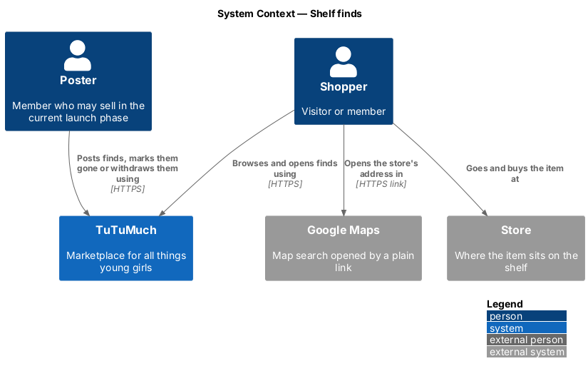
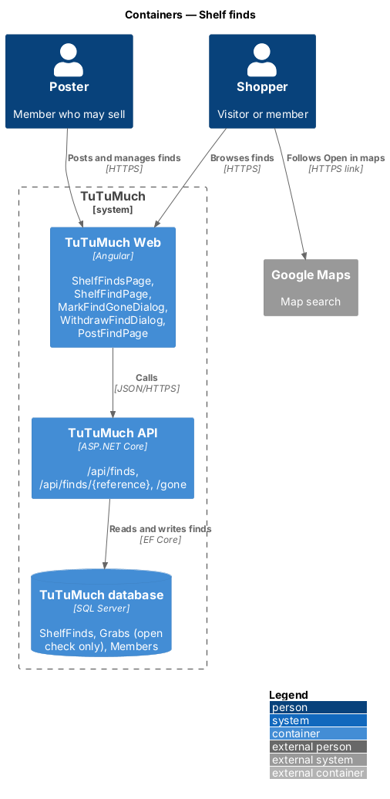
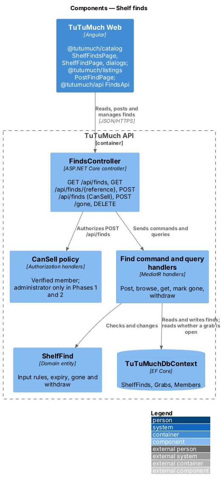
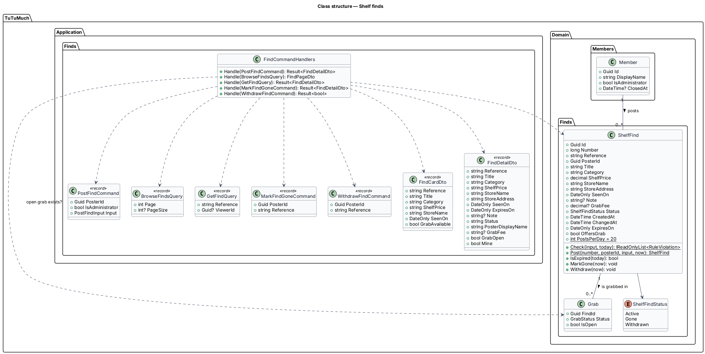
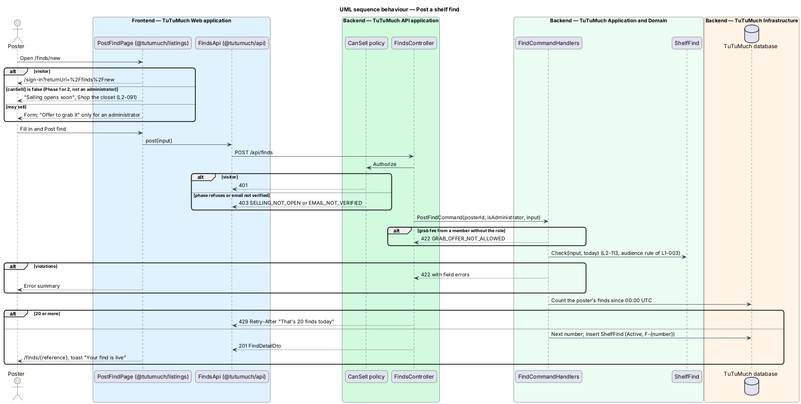
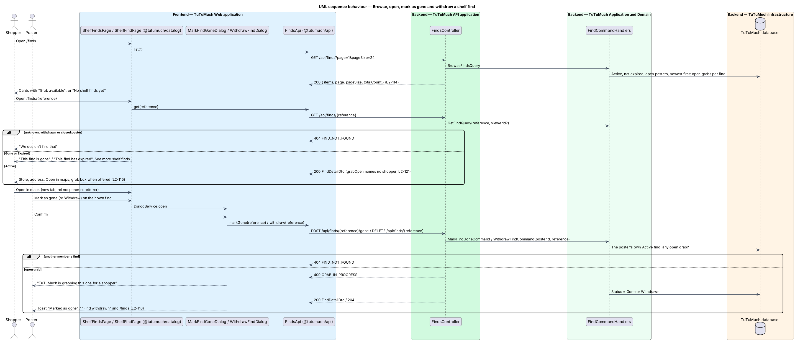

# Shelf finds

## Overview

A member who spots something for girls in a store, such as a leotard on clearance or a camera at a thrift shop, can tell others where to buy it. This feature lets them post a **shelf find**: the title, the category, the shelf price, the store's name and address, the day they saw it and an optional note. Anyone, signed in or not, can browse shelf finds, open one, see where the store is and go there (`L1-025`). TuTuMuch's owner may also offer to grab a find for a fee; that flow is designed in [grab-it-for-me](../../orders/grab-it-for-me/README.md).

The feature sits in the catalog subsystem because it is a public shop window, but it does not read or write the `Listing` aggregate. A find is not a listing: nobody owns the item, TuTuMuch never ships it from the poster, and it goes stale in days. It has its own table and never appears in the catalog, search, filters, category pages or item-request matching ([ADR catalog/0009](../../../adr/catalog/0009-shelf-finds-are-not-listings.md)). Posting follows the selling rule of the launch phases ([launch-phases](../../platform/launch-phases/README.md), `L2-091`).

Terms used in this design:

- **shelf find** (find) — one item seen in a store, with the reference `F-{number}`; Active, Gone or Withdrawn
- **poster** — the member who posted the find
- **seen on** — the UTC date the poster saw the item; at most 7 days before posting
- **expires on** — 14 days after the seen-on date; a find past it is Expired and leaves Shelf finds, without a job
- **grab** — a paid request that TuTuMuch buy the item and send it ([grab-it-for-me](../../orders/grab-it-for-me/README.md)); an **open grab** is one that is PaymentPending, Requested, Accepted or Bought

## Description

Screens, states and copy come from the shelf-finds mocks under `docs/mocks/pages/` and `docs/mocks/dialogs/` (the list, the detail page in its Active, grab, own, gone, expired and not-found states, the post form and the Mark as gone and Withdraw dialogs). `docs/screen-composition.md` names the library components of each. Finds have no photos in this release; cards and the page show the category's icon from `tl-icon`.

### Frontend (`TuTuMuch Web`)

- **`FindsApi`** (`@tutumuch/api`, `src/lib/finds/`) — `list(page)`, `get(reference)`, `post(input)`, `markGone(reference)` and `withdraw(reference)`, returning `ApiResult`, with the DTOs `FindCardDto`, `FindDetailDto` and `PostFindInput`. Feature libraries never call `HttpClient` directly.
- **`ShelfFindsPage`** (`@tutumuch/catalog`, `src/lib/shelf-finds/`) at `/finds`. Heading "Shelf finds", lede "Spotted in a store by our community. Go get it, or let TuTuMuch grab it for you." and, when `LaunchState.canSell()` is true, the action "Post a shelf find" to `/finds/new`. States: `loading` (skeleton cards), `default` (cards with the category icon, title, shelf price, store name, "Seen {date}" and the chip "Grab available" when `grabAvailable`; one per row under 576px), `empty` ("No shelf finds yet", "When someone spots something great in a store, it shows up here.") and `error` ("Couldn't load shelf finds", the reference and "Try again"). "Load more" asks for the next 24 (`L2-114`).
- **`ShelfFindPage`** (`@tutumuch/catalog`, `src/lib/shelf-find/`) at `/finds/:reference`. It shows the icon, title, price, "Seen in store on {date}", the store name and address, the note as plain text, the poster's display name linking to their profile and the notice "Prices and stock change. Check with the store before you go." "Open in maps" is a link to `https://www.google.com/maps/search/?api=1&query=` with the URL-encoded "{store name}, {store address}", `target="_blank"`, `rel="noopener noreferrer"` and a visually hidden "(opens in a new tab)". Variants (`L2-115`):
  - grab offered, no open grab — the box "Grab it for me", "TuTuMuch buys it at the store and sends it to you for a {fee} grab fee." and the primary "Grab it for me" to `/finds/{reference}/grab`;
  - open grab — the box reads "Someone already asked TuTuMuch to grab this one", without a button;
  - the poster's own Active find (`mine`) — "Mark as gone" and "Withdraw" instead of the grab button;
  - Gone or Expired — "This find is gone" or "This find has expired" with "See more shelf finds", without the grab box;
  - `404` — the not-found state of the listing detail page ("We couldn't find that").
- **`MarkFindGoneDialog`** and **`WithdrawFindDialog`** (`@tutumuch/catalog`, `src/lib/shelf-find/`) through `DialogService`: "Gone from the shelf? Shoppers will see it's gone." and "Withdraw this find? It disappears from Shelf finds." Success shows the toast "Marked as gone" with the gone state, or "Find withdrawn" and navigates to `/finds`. `409 GRAB_IN_PROGRESS` shows "TuTuMuch is grabbing this one for a shopper" in the dialog (`L2-116`).
- **`PostFindPage`** (`@tutumuch/listings`, `src/lib/post-find/`) at `/finds/new`, guarded like `/sell`: a visitor goes to `/sign-in?returnUrl=%2Ffinds%2Fnew`, and anyone `canSell()` refuses sees the "Selling opens soon" state with "Shop the closet". Fields: Title, Category (the six categories), Shelf price, Store name, Store address (hint "The store's street address or mall and city. Never your home."), Seen on (date, today to 7 days ago), Note with "{n} / 500"; an administrator also sees the switch "Offer to grab it" and, when it is on, Grab fee. Client checks mirror the API; `422` field errors fill the error summary; `429` shows the warning alert "That's 20 finds today". Success navigates to `/finds/{reference}` with the toast "Your find is live" (`L2-113`).
- **Shell** (`tutumuch` application) — the top bar's category row and the footer gain a "Shelf finds" link to `/finds` (`L2-114`).

### API (`TuTuMuch.Api`)

- **`FindsController`**:
  - `GET /api/finds?page=1&pageSize=24` — anonymous; `200` with `{ items: FindCardDto[], page, pageSize, totalCount }`. `FindCardDto { reference, title, category, shelfPrice, storeName, seenOn, grabAvailable }`.
  - `GET /api/finds/{reference}` — anonymous, member optional; `200` with `FindDetailDto { reference, title, category, shelfPrice, storeName, storeAddress, seenOn, expiresOn, note, status, posterDisplayName, grabFee, grabOpen, mine }`, `status` one of `Active`, `Gone`, `Expired`; `404 FIND_NOT_FOUND` for an unknown or withdrawn find, or one whose poster closed their account.
  - `POST /api/finds` — `[Authorize(Policy = CanSell)]`: `401` for a visitor, `403 SELLING_NOT_OPEN` or `403 EMAIL_NOT_VERIFIED` (`L2-091`, `L2-010`). Body `{ title, category, shelfPrice, storeName, storeAddress, seenOn, note?, grabFee? }`; `201` with `FindDetailDto`.
  - `POST /api/finds/{reference}/gone` — `[Authorize]`; `200` with `FindDetailDto`.
  - `DELETE /api/finds/{reference}` — `[Authorize]`; `204`.

  Amounts in responses are strings such as `"40.00"` (`CheckoutMoney.Format`); amounts in request bodies are numbers; dates are `YYYY-MM-DD`. The member always comes from the session (`L2-010`).

### Application and domain (`TuTuMuch.Application`, `TuTuMuch.Domain`)

- **`ShelfFind`** (`TuTuMuch.Domain/Finds/ShelfFind.cs`) — `Id`, `Number`, `Reference` (`F-{number}`), `PosterId`, `Title`, `Category`, `ShelfPrice`, `StoreName`, `StoreAddress`, `SeenOn`, `Note?`, `GrabFee?`, `Status` (`Active`, `Gone`, `Withdrawn`), `CreatedAt`, `ChangedAt`. `ExpiresOn` is `SeenOn` plus 14 days; `IsExpired(today)`; `OffersGrab` is true when `GrabFee` is set. `Check(input, today)` returns every `RuleViolation`: title 5 to 80 characters, a category of `CategoryCatalog` (`CATEGORY_NOT_SUPPORTED`, the audience rule of `L1-003`), shelf price $1.00 to $5,000.00, store name 2 to 80, store address 5 to 200, seen on from 7 days ago to today, note at most 500, grab fee $1.00 to $50.00. `Post(...)` creates an Active find; `MarkGone(now)` and `Withdraw(now)` act only on an Active find. `PostsPerDay = 20`.
- **`FindCommands`** (`TuTuMuch.Application/Finds/FindCommands.cs`), with the DTOs in `FindDtos.cs`:
  - `PostFindCommand(PosterId, IsAdministrator, input)` — refuses a grab fee from a member without the role with `422 GRAB_OFFER_NOT_ALLOWED`, checks the input, counts the poster's finds since 00:00 UTC (`429` "That's 20 finds today", `L2-051`), takes the next number (its unique index is the race guard) and saves.
  - `BrowseFindsQuery(Page, PageSize)` — Active finds not past `ExpiresOn` whose poster is open, newest `CreatedAt` first; `grabAvailable` is `OffersGrab` with no open grab.
  - `GetFindQuery(Reference, ViewerId?)` — an Active, Gone or Expired find of an open poster; `grabOpen` says only that an open grab exists, never by whom (`L2-121`).
  - `MarkFindGoneCommand(PosterId, Reference)` and `WithdrawFindCommand(PosterId, Reference)` — another member's find answers `404 FIND_NOT_FOUND`; an open grab answers `409 GRAB_IN_PROGRESS`.

### Infrastructure and data (`TuTuMuch.Infrastructure`)

- **`ShelfFindConfiguration`** — table `ShelfFinds`: `Title nvarchar(80)`, `Category nvarchar(40)`, `ShelfPrice decimal(10,2)`, `StoreName nvarchar(80)`, `StoreAddress nvarchar(200)`, `SeenOn date`, `Note nvarchar(500) null`, `GrabFee decimal(10,2) null`, `Status nvarchar(16)`. Unique indexes on `Number` and `Reference`; indexes on `(Status, CreatedAt)` for the list and `(PosterId, CreatedAt)` for the daily count. The foreign key to `Members` cascades, so erasing a member erases their finds (`L2-121`).
- **Migration `AddShelfFindsAndGrabs`** — this table together with the grab changes of [grab-it-for-me](../../orders/grab-it-for-me/README.md).
- **`DemoSeeder`** (`TuTuMuch.Cli`) — three demo finds from demo members, so `/finds` is not empty locally.

### Configuration

| Key | Value | Notes |
|-----|-------|-------|
| `ShelfFind.PostsPerDay` | 20 | Domain constant, `L2-113`, counted in the database ([ADR platform/0006](../../../adr/platform/0006-daily-publish-limit-counted-in-database.md)) |
| `ShelfFind.Lifetime` | 14 days | Domain constant, after the seen-on date |
| `ShelfFind.MaxSeenAge` | 7 days | Domain constant |
| Page size | 24 | As the catalog (`L2-022`) |

### Error codes

| Code | HTTP | Title | When |
|------|------|-------|------|
| `FIND_NOT_FOUND` | 404 | Not found | Unknown, withdrawn or a closed poster's find; another member's find for gone and withdraw |
| `GRAB_IN_PROGRESS` | 409 | TuTuMuch is grabbing this one for a shopper | Mark as gone or withdraw while a grab is open |
| `GRAB_OFFER_NOT_ALLOWED` | 422 | Only TuTuMuch can offer to grab a find | A grab fee from a member without the Administrator role |
| `TITLE_LENGTH`, `CATEGORY_NOT_SUPPORTED`, `SHELF_PRICE_OUT_OF_RANGE`, `STORE_NAME_LENGTH`, `STORE_ADDRESS_LENGTH`, `SEEN_ON_OUT_OF_RANGE`, `NOTE_LENGTH`, `GRAB_FEE_OUT_OF_RANGE` | 422 | Field errors | The input rules of `L2-113` |
| (none) | 429 | That's 20 finds today | A 21st find in a UTC day |
| `SELLING_NOT_OPEN`, `EMAIL_NOT_VERIFIED` | 403 | As `L2-091` and `L2-003` | The `CanSell` policy refuses |

## Requirements

The feature realises the following level-2 (L2) requirements. Each refines the level-1 (L1) requirement cited.

| L2 ID | Refines (L1) | Requirement |
|-------|--------------|-------------|
| `L2-113` | `L1-025`, `L1-003`, `L1-021` | A member who may sell in the current launch phase shall be able to post a shelf find with title, category, shelf price, store name and address, seen-on date and an optional note; an administrator may add a grab fee; at most 20 finds a day. |
| `L2-114` | `L1-025`, `L1-005` | Anyone shall be able to browse Active, unexpired shelf finds at `/finds`, newest first, 24 at a time; finds never appear in the catalog or match item requests. |
| `L2-115` | `L1-025`, `L1-006` | `/finds/{reference}` shall show one find with the store, an "Open in maps" link and, when offered, the "Grab it for me" box; gone and expired finds show their state and withdrawn ones answer `404`. |
| `L2-116` | `L1-025`, `L1-004` | The poster shall be able to mark their own Active find as gone or withdraw it, unless a grab is open. |
| `L2-121` | `L1-014`, `L1-025` | A find shall be public apart from its poster's member ID; a closed member's finds shall leave Shelf finds at once and be erased with their personal data. |

## Diagrams

### System context

A poster tells TuTuMuch about an item in a store; shoppers read the find and go to the store, helped by a map link.

### Containers

`TuTuMuch Web` reads and posts finds through `TuTuMuch API`, which stores them in `TuTuMuch database`. The map is an external link only.

### Components

`FindsController` sends the find commands and queries; the `CanSell` policy guards posting; the find handlers read open grabs only to say whether one exists.

### Class structure

`ShelfFind` belongs to one poster and may have grabs; the commands and queries return the card and detail DTOs.

### Behaviour — post a find

A permitted member posts a find; the policy, the grab-offer rule, the input rules and the daily limit are checked in that order.

### Behaviour — browse, open, mark as gone and withdraw

A shopper browses and opens a find and follows the map link; the poster marks it as gone or withdraws it, unless a grab is open.

## Testing

- `tests/TuTuMuch.Domain.Tests/ShelfFindTests.cs` — every input rule, expiry by date, gone and withdraw only from Active.
- `tests/TuTuMuch.Api.Tests/ShelfFindsTests.cs` — xUnit acceptance tests through `TuTuMuchApiFactory` (SQLite in-memory, fakes): posting per phase and role, `401`, `403`, field errors, the grab-offer rule, the daily limit, the list (expired, gone, withdrawn and closed posters left out, paging, `grabAvailable`), the detail (`404`, `grabOpen` without a shopper), gone and withdraw (`404`, `409 GRAB_IN_PROGRESS`) and erasure by cascade.
- `src/frontend/e2e/tests/shelf-finds.spec.ts` with page objects under `e2e/pages/` — Playwright (Chromium) with every `TuTuMuch API` call served by `page.route` fixtures: the list in every state, the detail variants, the maps link, posting (valid, invalid, refused by the phase, an administrator's grab fee), mark as gone and withdraw.

## Open questions

- Photos of a find, editing a find, reporting a find (moderation is out of scope, [ADR general/0001](../../../adr/general/0001-defer-moderation-reviews-and-data-export.md)) and finding finds near a location are deferred.
