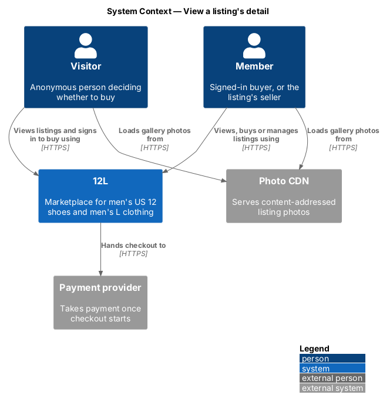
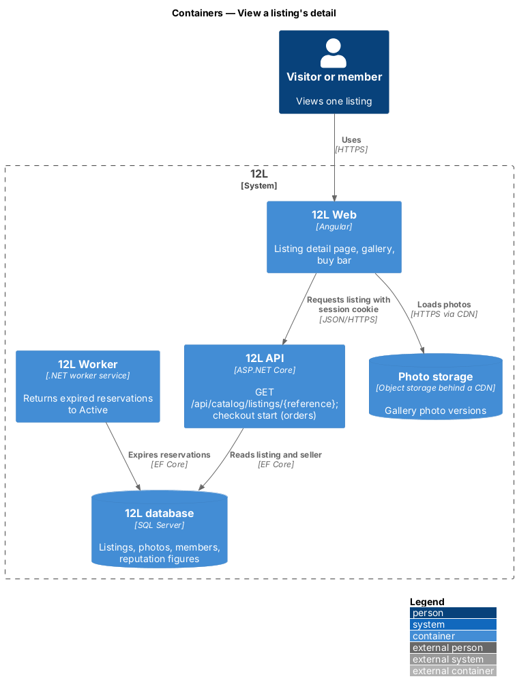
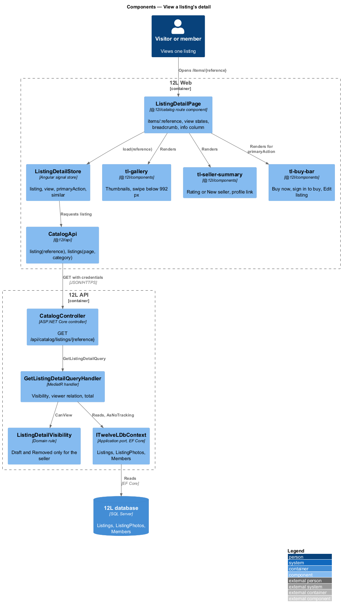
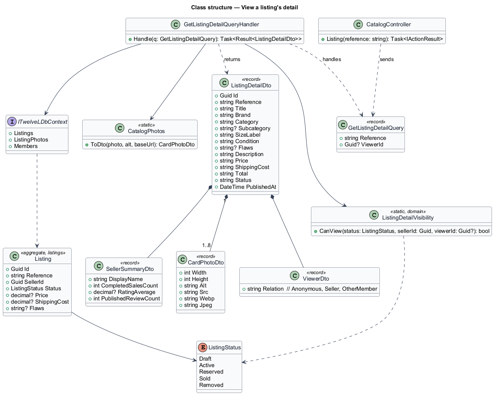
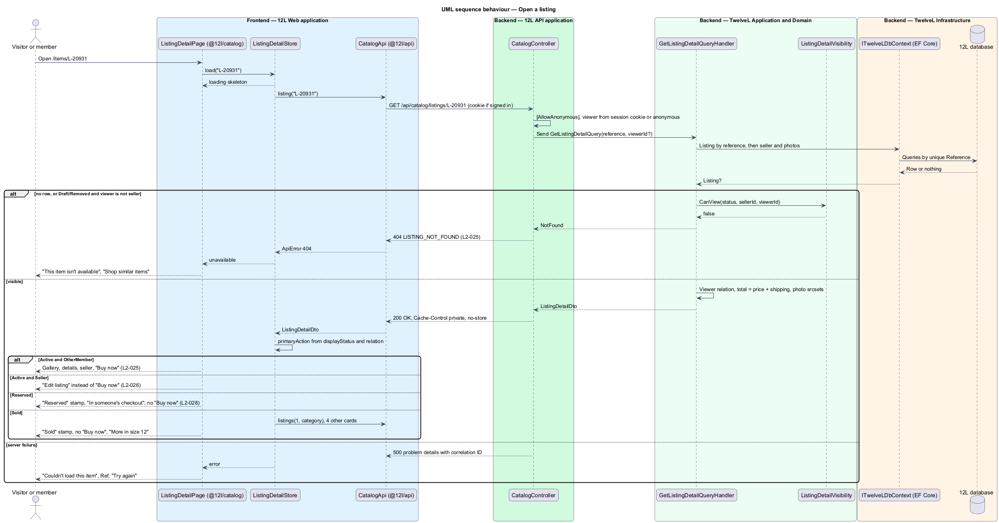
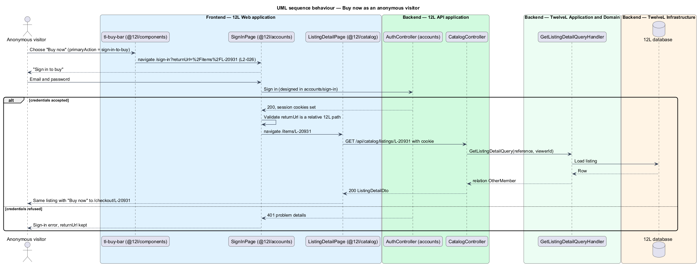

# View a listing's detail

## Overview

Every item for sale on TuTuMuch has its own *listing detail page*, reached from a catalog card, a member profile, an email or a shared link. The page gives a would-be buyer everything needed to decide: photos, title, price, shipping cost, total, size, category, brand, condition, description, date listed and the seller's reputation (`L2-025`). It is also where the purchase starts, through the "Buy now" action that leads to checkout.

Each listing has a stable, shareable URL of the form `/items/{reference}`, where the *listing reference* is the short public identifier the listings subsystem assigns at creation (for example `L-20931`). The URL keeps working for the life of the listing, including after the item is sold.

The page shows the same listing differently depending on its status and on who views it:

> **viewer relation** — relationship between the person viewing and the listing: anonymous visitor, the listing's seller, or another member

> **seller reputation** — public summary of a seller's track record: average rating, review count and number of completed sales

- An Active listing seen by another member shows "Buy now".
- An anonymous visitor also sees "Buy now"; choosing it sends the visitor to sign in and back to the listing (`L2-026`).
- The seller viewing their own Active listing sees "Edit listing" and "Withdraw" instead of "Buy now", and the API refuses any attempt by a member to buy their own listing (`L2-026`).
- A Reserved listing, held for another buyer's checkout for 10 minutes, shows a "Reserved" label and no "Buy now" (`L2-028`).
- A Sold listing keeps its URL, shows a "Sold" label, no "Buy now", and similar items.
- A Draft or Removed listing opened by anyone other than its seller shows "This item isn't available" with HTTP 404.

A seller with no completed sales shows "New seller" in place of a rating. A Used - Fair listing shows its flaws (`L2-016`). On viewports narrower than 992 px the page uses one column with a swipeable gallery and a "Buy now" bar fixed to the bottom of the screen; from 992 px it uses two columns with the gallery on the left (`L2-063`).

The `Listing` entity, editing and withdrawing belong to the [listings](../../listings/) subsystem; checkout and the reservation itself belong to [orders](../../orders/). This feature reads the listing and decides what the page shows; the guard that refuses a checkout of one's own listing is built with checkout.

## Description

Screens and copy come from `docs/mocks/pages/listing-detail/` (states `default`, `guest`, `own`, `new-seller`, `reserved`, `sold`, `loading`, `error`, `unavailable`). The guest return flow ends on `docs/mocks/pages/sign-in/return.html`.

### Frontend — `TuTuMuch Web`, feature library `@tutumuch/catalog` (`src/frontend/projects/catalog/src/lib/listing-detail/`)

- **Route** — `items/:reference` in the catalog library's `routes`, no guard, component `ListingDetailPage`. The reference arrives as a component input (router input binding), so the skeleton paints at once.
- **`ListingDetailPage`** — calls `ListingDetailStore.load(reference)`, sets the document title to "{title} · {brand} · TuTuMuch" and renders one view:
  - `loading` — skeleton matching the gallery and info columns (`aria-busy="true"`, label "Loading listing", visually hidden heading "Loading listing").
  - `loaded` — breadcrumb "Shop / {category} / {subcategory}", `tl-gallery`, the info column, and for a Sold listing the section "More girls' clothing" with up to 4 cards in `tl-listing-grid`.
  - `unavailable` — API returned 404: `tl-center-state` with code "404", heading "This item isn’t available", text "It may have been sold or taken down.", primary action "Shop similar items" to `/`.
  - `error` — any other failure: heading "Couldn’t load this item", text "It’s us, not you. Try again in a moment.", "Ref {correlationId}", actions "Try again" and "Back to shop".
- **Info column** (local markup on the kit classes) — "Reserved" or "Sold" stamp; brand eyebrow; title as `<h1>`; `tl-size-tag` and condition; price "$85.00" and the line "{shipping} · {total} total before tax", where shipping reads "$9.00 shipping" or "Free shipping" when 0 (`L2-018`); the buy bar; for Reserved the warning `tl-alert` "In someone’s checkout" with "If they don’t finish within 10 minutes, it’s back on sale."; the flaws block "Flaws: {flaws}" for Used - Fair; the description; the facts "Size" ("Girls'"), "Category" ("Dresses · Tutus"), "Condition", "Listed" (relative time inside `<time datetime>`); and `tl-seller-summary`. All listing text is bound as text and never as HTML (`L2-015`).
- **`ListingDetailStore`** — signal store: `listing`, `view`, `errorRef`, `similar`, and the computed `primaryAction: 'buy' | 'sign-in-to-buy' | 'manage' | 'none'`:

  | `status` | `viewer.relation` | `primaryAction` |
  |----------|-------------------|-----------------|
  | `Active` | `OtherMember` | `buy` |
  | `Active` | `Anonymous` | `sign-in-to-buy` |
  | `Active` | `Seller` | `manage` |
  | `Reserved`, `Sold`, `Draft`, `Removed` | any | `none` |

  For a Sold listing it calls `CatalogApi.listings(1, category)` and keeps up to 4 cards other than the listing itself.
- **`tl-gallery`** (`@tutumuch/components`) — a horizontal CSS scroll-snap track holding every photo (WebP and JPEG `srcset`, `sizes="(min-width: 992px) 50vw, 100vw"`, the first eager with `fetchpriority="high"`), dots below 992 px, and thumbnail buttons labelled "Show photo {i} of {n}" with `aria-current` on the selected one. Selecting a thumbnail scrolls the track to that photo (`L2-025` acceptance criterion 4); a swipe updates the selection from the scroll position (`L2-063`). Left and Right arrows move between thumbnails. Thumbnails are at least 44 × 44 px.
- **`tl-seller-summary`** (`@tutumuch/components`) — avatar with initials, display name linking to `/members/{displayName}`, "{n} sales" and the rating "4.9 (128 reviews)", or the badge "New seller" when `completedSalesCount` is 0 (`L2-025` acceptance criterion 5).
- **`tl-buy-bar`** (`@tutumuch/components`) — the total with caption "incl. shipping" and the projected actions:
  - `buy` — primary "Buy now" linking to `/checkout/{reference}` (orders subsystem).
  - `sign-in-to-buy` — primary "Buy now" linking to `/sign-in?returnUrl=%2Fitems%2F{reference}`. The accounts sign-in page shows "Sign in to buy" with "You’ll go straight back to the item." and, after sign-in, navigates to the validated relative `returnUrl` (`L2-026` acceptance criterion 3).
  - `manage` — primary "Edit listing" linking to `/items/{reference}/edit`. "Withdraw" and its dialog are added by `listings/edit-and-withdraw-listing`, which also builds the edit route.
  - `none` — the bar is not rendered.
  Below 992 px the bar is `position: sticky; bottom: 0` with safe-area padding, so "Buy now" stays visible while scrolling (`L2-063`).
- **`CatalogApi.listing(reference)`** (`@tutumuch/api`) — `GET /api/catalog/listings/{reference}`; the session interceptor sends credentials, so a signed-in viewer is recognised.
- **Layout** — `.detail` uses one column below 992 px (gallery above the info) and two columns from 992 px with the gallery on the left (`L2-063`).

### API — `TuTuMuch.Api`

- `GET /api/catalog/listings/{reference}` on `CatalogController`, `[AllowAnonymous]`. The JWT bearer scheme authenticates the access-token cookie when present, so the handler knows the viewer; a missing or expired token means a visitor rather than 401.
  - `200 OK` `ListingDetailDto` with `Cache-Control: private, no-store` (the body depends on the viewer).
  - `404 Not Found`, code `LISTING_NOT_FOUND`, when no listing has that reference, or when the listing is Draft or Removed and the viewer is not its seller (`L2-025` acceptance criterion 3, `L2-010`). Both cases return the same body apart from the correlation ID, so a hidden listing cannot be told apart from a missing one.
  - `500` problem details with correlation ID (`L2-068`).
- The SPA document for `/items/{reference}` is served by the static host with status 200; returning HTTP 404 on the document itself needs server-side rendering and is not built.

### Application and domain — `TuTuMuch.Application`, `TuTuMuch.Domain`

- **`GetListingDetailQuery`** — record `(string Reference, Guid? ViewerId)`; the controller fills `ViewerId` from the authenticated member, or null.
- **`GetListingDetailQueryHandler`** — reads through `ITuTuMuchDbContext` with `AsNoTracking()` (as browse-catalog, [ADR catalog/0001](../../../adr/catalog/0001-catalog-reads-through-the-db-context-port.md)): the listing by its unique `Reference`, applies `ListingDetailVisibility`, then the seller's display name and the photos in position order; computes the viewer relation and `total = price + shippingCost` in `decimal`; maps photos with `CatalogPhotos.ToDto`, shared with browse-catalog.
- **`ListingDetailVisibility`** (domain) — `CanView(status, sellerId, viewerId)`: true for Active, Reserved and Sold; true for Draft and Removed only when `viewerId == sellerId`.
- **`ListingDetailDto`** — `{ id, reference, title, brand, category, subcategory, sizeLabel, condition, flaws, description, price, shippingCost, total, status, publishedAt, photos: CardPhotoDto[] (cover first), seller: SellerSummaryDto, viewer: { relation: "Anonymous" | "Seller" | "OtherMember" } }`. Money values are decimal strings (`"85.00"`, `"9.00"`, `"94.00"`). No email address, phone number, real name or street address is present (`L2-054`).
- **`SellerSummaryDto`** — `{ displayName, completedSalesCount, ratingAverage?, publishedReviewCount }`. Completed sales are recorded by `orders/complete-order` and ratings by reviews, neither built yet, so the handler returns 0, null and 0 and every seller shows "New seller" ([ADR catalog/0002](../../../adr/catalog/0002-seller-reputation-defaults-until-orders-and-reviews.md)). The public location and avatar are added with `reviews/view-member-profile`.
- **Purchase guard** — refusing a member's checkout of their own listing with HTTP 422 `CANNOT_BUY_OWN_LISTING` (`L2-026` acceptance criterion 2) is built by `orders/checkout-and-pay`, the first feature with a checkout request to refuse. This feature only keeps "Buy now" away from the seller. The Reserved conflict (HTTP 409, `L2-028`) and reservation expiry are designed there too; until then a Reserved listing shows as Reserved.

### Infrastructure and data — `TuTuMuch.Infrastructure`, `TuTuMuch database`

- No new tables, columns, indexes or migrations. The read uses the unique index on `Listings (Reference)` from `listings/create-listing` and the existing `ListingPhotos` and `Members` tables.

### Error codes

| Code | HTTP | Raised when |
|------|------|-------------|
| `LISTING_NOT_FOUND` | 404 | the reference is unknown, or the listing is Draft or Removed and the viewer is not its seller |
| `CANNOT_BUY_OWN_LISTING` | 422 | a member's checkout-start request names their own listing (built by `orders/checkout-and-pay`) |

### Open questions

- What the buyer who holds the reservation sees on the detail page during their own checkout (for example a "Continue checkout" action) is not mocked; the design shows them the Reserved view.
- What the seller sees on their own Reserved, Sold, Draft or Removed listing beyond the status stamp is not mocked; the design shows no actions, consistent with `L2-020`.
- "Withdraw" on the seller's own listing waits for `listings/edit-and-withdraw-listing`; until then the own view shows "Edit listing" only.

## Requirements

The feature realizes the following level-2 (L2) requirements. Each L2 requirement refines a level-1 (L1) requirement, cited by identifier.

| L2 ID | Refines (L1) | Requirement |
|-------|--------------|-------------|
| `L2-025` | `L1-006` | The listing detail page shall show a photo gallery, title, price, shipping cost, total, size, category, brand, condition (with flaws when Used - Fair), description, date listed, and the seller's display name, rating, number of completed sales and a link to their profile. Each listing shall have a stable, shareable URL. |
| `L2-026` | `L1-006` | A member shall not be able to buy their own listing. An anonymous visitor who chooses "Buy now" shall be sent to sign in and then returned to the listing. |
| `L2-063` | `L1-016` | On XS, SM and MD viewports, the listing detail page shall use one column with a swipeable photo gallery and a "Buy now" bar fixed to the bottom of the screen. On LG and XL, it shall use two columns with the gallery on the left. Forms shall use one column on XS and SM. Touch targets shall be at least 44 by 44 CSS pixels on XS, SM and MD. |
| `L2-028` | `L1-007` | When a buyer starts checkout, the listing shall become Reserved for that buyer for 10 minutes. While Reserved, no other member shall be able to start checkout for it. If payment does not succeed within 10 minutes, the listing shall return to Active. |

This feature realizes the display side of `L2-028` (the "Reserved" label and the absence of "Buy now"); the reservation, its 409 conflict and its expiry are designed in `orders/checkout-and-pay`. The form rule of `L2-063` belongs to the listing form in the listings subsystem.

## Diagrams

### System context

Visitors and members view listings in TuTuMuch and load the photos from the CDN. Buying leaves this feature for checkout, which talks to the payment provider.

### Containers

`TuTuMuch Web` requests the listing from `TuTuMuch API`, sending the session cookie when one exists. `TuTuMuch API` reads the listing, photos and seller reputation from the `TuTuMuch database`.

### Components

`ListingDetailPage` in `@tutumuch/catalog` composes `tl-gallery`, `tl-seller-summary` and `tl-buy-bar` from `@tutumuch/components` with `ListingDetailStore`, which calls `CatalogApi` in `@tutumuch/api`. `GetListingDetailQueryHandler` applies `ListingDetailVisibility` and the viewer relation, reading through `ITuTuMuchDbContext`.

### Class structure

`ListingDetailDto` composes the photos, `SellerSummaryDto` and `ViewerDto`; `GetListingDetailQueryHandler` depends on `ITuTuMuchDbContext`, `ListingDetailVisibility` and `CatalogPhotos`.

### Behaviour — open a listing

The handler hides Draft and Removed listings from everyone except the seller with HTTP 404 and returns the viewer relation from which the page chooses "Buy now", "Edit listing", or no action (`L2-025`, `L2-028`).

### Behaviour — Buy now as an anonymous visitor

"Buy now" sends the visitor to sign in with the listing as the return URL; after sign-in the member lands back on the same listing and sees the member view (`L2-026`).

### Behaviour — refuse buying one's own listing

The page never offers "Buy now" to the seller; a direct checkout request is refused with HTTP 422 and nothing is written (`L2-026`). The refusal is built by `orders/checkout-and-pay`.

