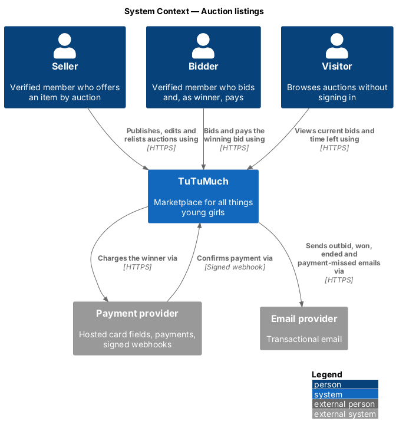
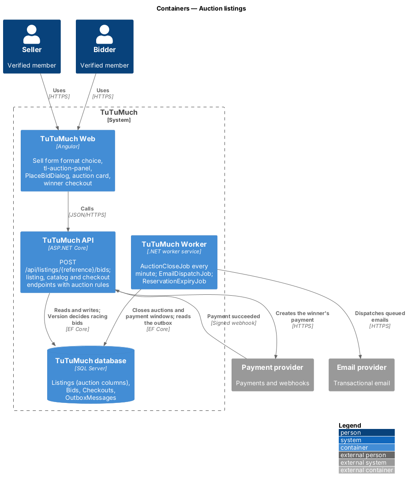
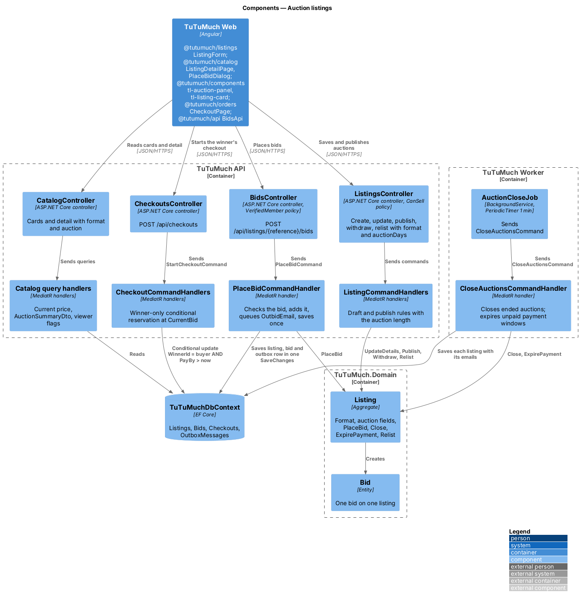
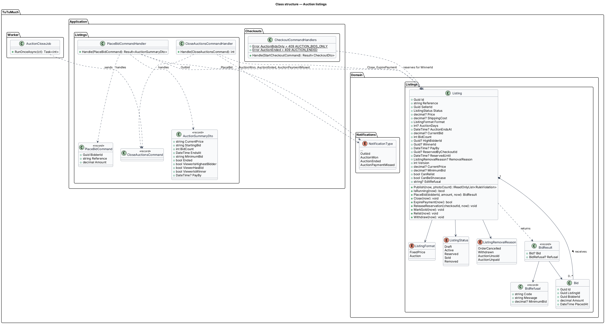
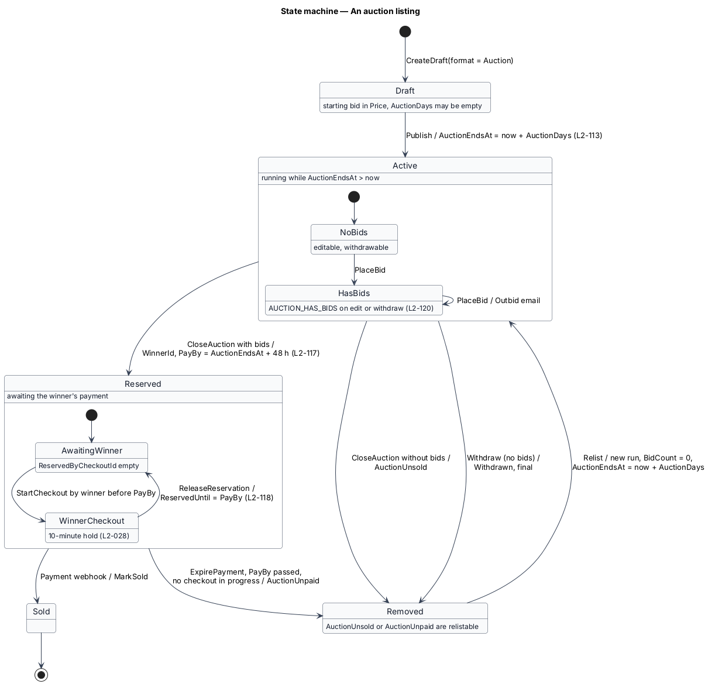
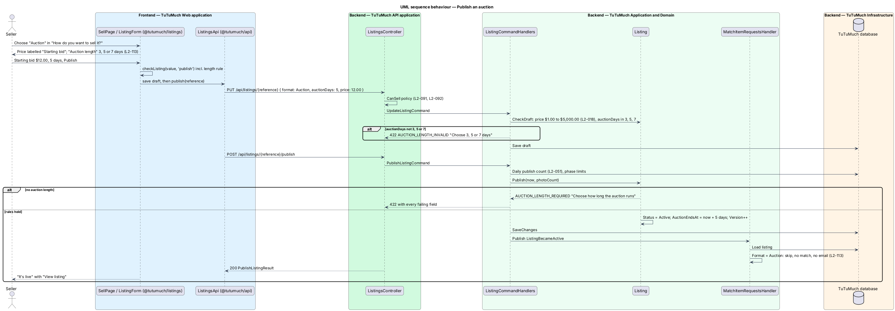
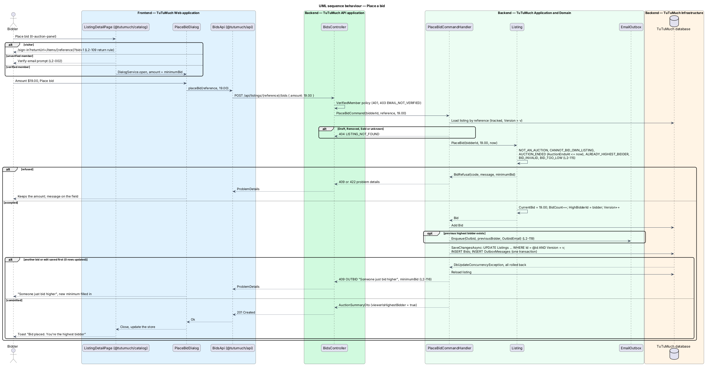
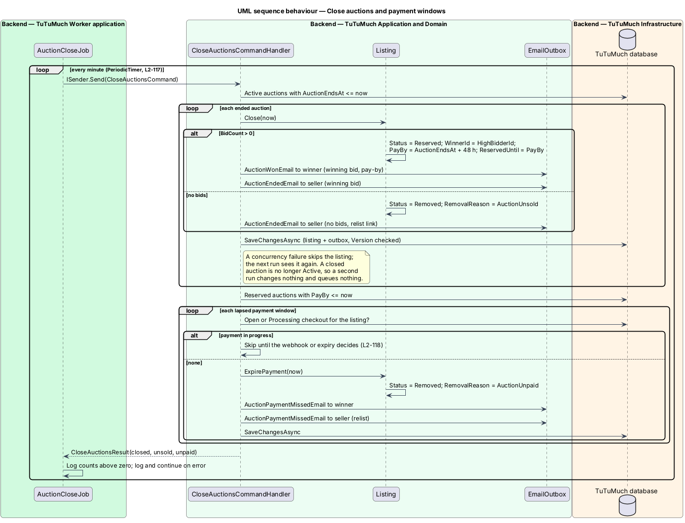
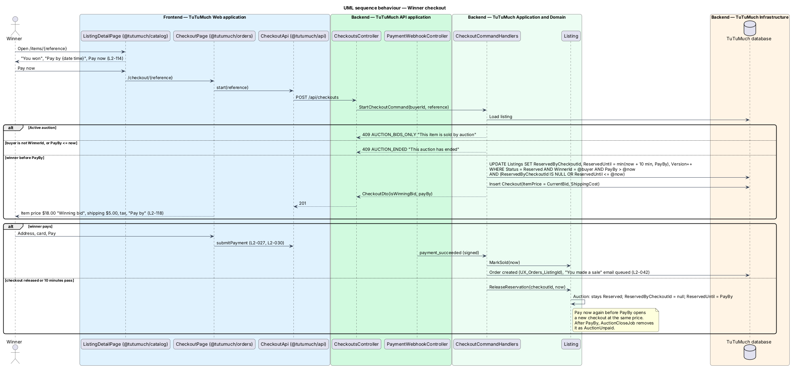

# Auction listings

## Overview

TuTuMuch sells every item at a fixed price set by its seller. This feature adds a second way to sell: an **auction**. The seller creates, photographs and publishes an auction like any listing, but sets a starting bid and a length of 3, 5 or 7 days instead of a price. While the auction runs, verified members other than the seller bid on it. When the time runs out, the highest bidder wins and pays the winning bid plus shipping and tax through the usual checkout within 48 hours. After payment, the order follows the usual lifecycle (`L1-025`).

The feature sits in the listings subsystem because an auction is a format of the `Listing` aggregate, not a separate aggregate ([ADR listings/0005](../../../adr/listings/0005-auctions-as-a-listing-format.md)). It extends [create-listing](../create-listing/README.md) and [edit-and-withdraw-listing](../edit-and-withdraw-listing/README.md) with the format choice, [view-listing-detail](../../catalog/view-listing-detail/README.md) and [browse-catalog](../../catalog/browse-catalog/README.md) with the auction panel and card, and [checkout-and-pay](../../orders/checkout-and-pay/README.md) with the winner's checkout ([ADR orders/0009](../../../adr/orders/0009-auction-winner-checkout-and-48-hour-payment-window.md)). Emails go through the outbox of [send-email-notifications](../../notifications/send-email-notifications/README.md). Launch phases apply as to any listing ([launch-phases](../../platform/launch-phases/README.md)).

Terms used in this design:

- **listing format** — way a listing is sold: `FixedPrice` (the default, today's listing) or `Auction`
- **auction** — listing of format `Auction`, sold to the highest bidder when its time runs out
- **starting bid** — lowest first bid of an auction, kept in the listing's price field under the $1.00 to $5,000.00 rule of `L2-018`
- **auction length** — number of days an auction runs: 3, 5 or 7
- **end time** — instant an auction stops taking bids, `AuctionEndsAt`, set to the publish or relist time plus the length
- **run** — one period of bidding from a publish or relist to the end time; a relist starts a new run with no bids
- **bid** — one member's offer of an amount on an auction, stored as a row in `Bids`
- **current bid** — highest bid of the current run; null while there are no bids
- **current price** — current bid when there is one, otherwise the starting bid; the catalog shows, filters and sorts by it
- **minimum bid** — lowest acceptable next bid: the starting bid when there are no bids, otherwise the current bid plus $1.00
- **highest bidder** — member who placed the current bid, `HighBidderId`
- **winner** — highest bidder when the auction closes, `WinnerId`
- **closing** — worker step that ends an auction after its end time: Reserved for the winner, or Removed as unsold
- **payment window** — 48 hours from the end time during which only the winner may pay; it ends at `PayBy`

Bids race. Two members who read the same current bid both believe their bid is the highest. The database decides between them with the listing's `Version` concurrency token, the same token that decides between an edit and a checkout (`L2-020`, `L2-029`). No bidder is ever named to anyone: a member learns only whether they themselves are the highest bidder, outbid or the winner (`L2-120`).

## Description

The slice runs from the sell form in `@tutumuch/listings` and the detail page in `@tutumuch/catalog` through `TuTuMuch API` and `TuTuMuch Worker` to the `Listings` and `Bids` tables in `TuTuMuch database`. Screens, states and copy come from the auction states of `docs/mocks/pages/sell/`, the `auction*` states of `docs/mocks/pages/listing-detail/`, `docs/mocks/pages/catalog/auctions.html`, `docs/mocks/dialogs/place-bid/` and `docs/mocks/notifications/auction-toasts/`, and from `L2-113` to `L2-120`. `docs/screen-composition.md` names the library components of each state; before any frontend code is written, it shall hold an entry for every auction state and `docs/design-system/` shall document `tl-auction-panel`, as `AGENTS.md` requires. Where a mock and this design differ in copy, the mock wins.

### Frontend (`TuTuMuch Web`)

- **DTOs and `BidsApi`** (`@tutumuch/api`):
  - `src/lib/listings/listings-api.ts` — `ListingDetails` gains `format` (`FixedPrice` or `Auction`) and `auctionDays`; `MyListing` gains `format`, `auctionDays`, `auctionEndsAt`, `currentBid`, `bidCount` and `canRelist`; `MyListingRow` gains `format`, `currentBid`, `bidCount`, `auctionEndsAt`, `removalReason` and `canRelist`; `RemovalReason` adds `AuctionUnsold` and `AuctionUnpaid`. `ListingsApi.relist(reference)` calls the relist endpoint.
  - `src/lib/catalog/catalog-api.ts` — `ListingCard` gains `format` and `auction: AuctionCard` (`startingBid`, `bidCount`, `endsAt`; the card's `price` is the current price). `ListingDetail` gains `format` and `auction: AuctionSummary` (`currentPrice`, `startingBid`, `bidCount`, `endsAt`, `minimumBid`, `ended`, `viewerIsHighestBidder`, `viewerHasBid`, `viewerIsWinner`, `payBy`). Money is a two-place decimal string (`L2-018`).
  - `src/lib/listings/bids-api.ts` — `BidsApi.placeBid(reference, amount)` sends `POST /api/listings/{reference}/bids` and resolves to `ApiResult<AuctionSummary>`; a refusal carries the problem with the message on `amount`.
  - `src/lib/orders/checkout-api.ts` — `Checkout` gains `auctionPayBy`, set when the buyer won the auction.
- **Library** (`@tutumuch/components`):
  - `tl-auction-panel` (new, `src/lib/auction-panel/`) — presentational: `label` ("Current bid", "Starting bid" or "Winning bid"), `amount`, `bids` ("No bids yet", "1 bid", "3 bids"), `timeLeft` and `soon`, `endsAt` and `ended` (the end date and time in the viewer's time zone), `shipping`, and `status` (`{ tone, heading, text }`, tones info, warning, success and neutral) shown in a `role="status"` line. It takes the price block's place; Place bid and Pay now stay in `tl-buy-bar`.
  - `timeLeft(endsAt, now)` and `auctionTime(iso)` (same folder) format "Ends in 2d 4h", "Ends in 5h 10m", "Ends in 42 min" (`soon`) or "Ended", and "Tue 27 Oct at 7:30 PM EDT".
  - `tl-listing-card` gains `auction` (`{ label, timeLeft, soon }`): the "Auction" stamp, a visually hidden "Current bid" or "Starting bid" before the price and the time left under it. `tl-buy-bar` gains `caption` (default "incl. shipping"); `tl-order-summary` gains `itemLabel` (default "Item"). The auction panel, card line and `.order-list__row` styles are copied from `docs/design-system/assets/components.css`.
- **Sell and edit form** (`@tutumuch/listings`, `src/lib/listing-form/`) — a draft shows "How do you want to sell it?" as `tl-segmented` ("Fixed price", the default, and "Auction"). With Auction, the price field reads "Starting bid" (help "Bids start here.") and "Auction length" appears as `tl-radio-group` with "3 days", "5 days" and "7 days". `listing-rules.ts` adds "Choose how long the auction runs" on publish and sends `format` and `auctionDays`. A published listing shows no format choice; a published auction shows "Auction · {n} days · ends {date}" with "Set when published". `EditListingPage` shows "This auction has bids, so it can’t be changed" for an auction with bids or a 409 `AUCTION_HAS_BIDS` (`L2-120`).
- **`ListingDetailPage` and `ListingDetailStore`** (`@tutumuch/catalog`, `src/lib/listing-detail/`) — `primaryAction` gains `place-bid`, `sign-in-to-bid`, `pay-now` and `your-listings`. The page maps the auction to `tl-auction-panel` with a 30-second `now` signal, so the time left counts down and Place bid disappears once the end time passes. "Place bid" opens `PlaceBidDialog` for a member and links a visitor to `/sign-in?returnUrl=/items/{reference}`. "Pay now" links the winner to `/checkout/{reference}`. The seller manages an auction only while it has no bids, and an ended unsold one links to Your listings. The status line reads "You’re the highest bidder", "You’ve been outbid", "You won", "This auction has ended" or the seller's notices. An auction has no showcase switch and no "In someone’s checkout" alert.
- **`PlaceBidDialog`** (`@tutumuch/catalog`, `src/lib/place-bid/`, local) — `tl-dialog` "Place a bid" with `tl-item-row` ("Current bid $18.00 · 3 bids · Ends in 2d 4h"), one `tl-form-field` "Your bid" in `tl-input-group` (`$`), filled with `minimumBid`, help "Bid {minimumBid} or more". `201` closes it; the page updates the panel and shows the toast "Bid placed. You’re the highest bidder". A 422 or 409 keeps the amount and shows the API's message on the field; `OUTBID` shows "Someone just bid higher", reads the listing again and fills in the new lowest bid; `AUCTION_ENDED` says so and reloads the page on Close; 403 says "Verify your email to bid"; 401 goes to sign in.
- **My listings** (`@tutumuch/listings`, `src/lib/my-listings/`) — an auction row shows the current bid and "Auction · 3 bids · Ends in 2d 4h"; an unsold or unpaid auction shows "Auction ended, no bids" or "Winner didn’t pay" and a "Relist" button that calls the relist endpoint, toasts "Relisted" and reloads the list.
- **`CheckoutPage`** (`@tutumuch/orders`, `src/lib/checkout/`) — with `auctionPayBy`, a success alert "You won this auction" with the pay-by time, the summary labels the price "Winning bid", and "Pay later" links back to the item instead of releasing it; the 10-minute timer still applies. A 409 `AUCTION_ENDED` or `AUCTION_BIDS_ONLY` shows "This auction has ended" with no address or card field.
- **Email settings** (`@tutumuch/accounts`) — the always-on Orders row reads "Sales, shipping, delivery, refunds, auctions" (`L2-119` criterion 5).

### API (`TuTuMuch.Api`)

- **`BidsController`** (new) — `[Authorize(Policy = Policies.VerifiedMember)]`: `401 UNAUTHENTICATED` for a visitor, `403 EMAIL_NOT_VERIFIED` for an unverified member (`L2-115` criterion 8). The bidder comes from the session (`L2-010`).
  - `POST /api/listings/{reference}/bids` — body `{ amount }` as a JSON number with at most 2 decimals. Returns `201 Created` with `Location: /api/catalog/listings/{reference}` and the `AuctionSummaryDto` as the bidder sees it; `404 LISTING_NOT_FOUND`, `409 NOT_AN_AUCTION`, `409 AUCTION_ENDED`, `409 ALREADY_HIGHEST_BIDDER`, `409 OUTBID` with `minimumBid`, `422 BID_TOO_LOW` with `minimumBid`, `422 BID_INVALID`, `422 CANNOT_BID_OWN_LISTING`. Bids count toward the per-member request limit of `L2-051`; there is no separate bid limit.
- **`ListingsController`** (existing) — `POST /api/listings`, `PUT /api/listings/{reference}` and `POST /api/listings/{reference}/publish` accept `format` and `auctionDays` in `ListingDetailsRequest`. After publish, `PUT` ignores both (`L2-113` criterion 8). `PUT` and `POST /api/listings/{reference}/withdraw` answer `409 AUCTION_HAS_BIDS` for an auction with bids (`L2-120`). `POST /api/listings/{reference}/relist` accepts an `AuctionUnsold` or `AuctionUnpaid` auction.
- **`CatalogController`** (existing) — `GET /api/catalog/listings` and `GET /api/catalog/listings/{reference}` add `format` and `auction` to `ListingCardDto` and `ListingDetailDto`. The card's `price` holds the current price. The viewer flags are false on cards, which are the same for every viewer. The price filter and price sort use the current price (`L2-114` criterion 5).
- **`CheckoutsController`** (existing) — `POST /api/checkouts` answers `409 AUCTION_BIDS_ONLY` for a running auction and `409 AUCTION_ENDED` for an ended auction when the caller is not the winner or `PayBy` has passed (`L2-118`).
- **`AdminShowcaseController`** (existing) — `PUT /api/admin/listings/{reference}/showcase` answers `409 SHOWCASE_NOT_ALLOWED` for an auction (`L2-120` criterion 3).
- **Privacy** — no response carries `HighBidderId`, `WinnerId`, a bidder's display name or any bid amount other than the current bid (`L2-054`, `L2-120` criterion 4). The viewer flags are computed on the server from the session.

### Application and domain (`TuTuMuch.Application`, `TuTuMuch.Domain`)

- **`ListingFormat`** (`TuTuMuch.Domain/Listings/ListingFormat.cs`) — enum `FixedPrice`, `Auction`.
- **`Listing`** (`TuTuMuch.Domain/Listings/Listing.cs`, existing) gains:
  - `Format`, `AuctionDays` (`int?`), `AuctionEndsAt`, `CurrentBid`, `BidCount`, `HighBidderId`, `WinnerId`, `PayBy`; constants `AuctionLengths = { 3, 5, 7 }`, `BidIncrement = 1.00m`, `MaxBid = 5000.00m`, `PaymentWindow = 48 h`.
  - `ListingDetails` gains `Format` and `AuctionDays`. `CheckDraft` adds `AUCTION_LENGTH_INVALID` "Choose 3, 5 or 7 days" for a present length that is not 3, 5 or 7; `CheckPublish` adds `AUCTION_LENGTH_REQUIRED` "Choose how long the auction runs" for an auction without a length. `UpdateDetails` sets `Format` and `AuctionDays` only while the listing is a Draft.
  - `Publish(now, photoCount)` sets `AuctionEndsAt = now + AuctionDays` for an auction (`L2-113` criterion 3).
  - `CurrentPrice => CurrentBid ?? Price` and `MinimumBid => CurrentBid is { } bid ? bid + MinBidIncrement : Price`.
  - `IsRunning(now)` — Active auction with `AuctionEndsAt > now`.
  - `PlaceBid(bidderId, amount, now): BidResult` — enforces, in order, `NOT_AN_AUCTION`, `AUCTION_ENDED` (`AuctionEndsAt <= now`, even before closing, `L2-115` criterion 6), `CANNOT_BID_OWN_LISTING`, `ALREADY_HIGHEST_BIDDER`, `BID_INVALID` (not whole cents, or above `MaxBid`), `BID_TOO_LOW` ("Bid {minimumBid} or more"). On success it sets `CurrentBid`, increments `BidCount`, sets `HighBidderId`, bumps `Version` and returns a `BidResult` holding the new `Bid`. A refusal returns a `BidResult` holding the `BidRefusal`, and changes nothing; the handler turns it into the problem code and message with the minimum bid it read. The result's `Outbid` names the member who held the highest bid, for the outbid email.
  - `Close(now)` — Active auction whose end time has passed: with bids, `Reserved` with `WinnerId = HighBidderId`, `PayBy = AuctionEndsAt + 48 h`, `ReservedUntil = PayBy`, no `ReservedByCheckoutId`; without bids, `Removed` with `AuctionUnsold`. Any other state changes nothing, so a second run is a no-op (`L2-117` criterion 5).
  - `ExpirePayment(now)` — Reserved auction with `PayBy <= now` and no checkout in progress: `Removed` with `AuctionUnpaid`, `ReservedUntil` cleared.
  - `ReleaseReservation(checkoutId, now)` — for an auction, clears `ReservedByCheckoutId` and sets `ReservedUntil = PayBy`, keeping it `Reserved` for the winner; a fixed-price listing goes back to `Active` as today.
  - `CanRelist` is true for `OrderCancelled`, `AuctionUnsold` and `AuctionUnpaid`. `Relist(now)` on an auction clears `CurrentBid`, `BidCount`, `HighBidderId`, `WinnerId` and `PayBy`, and sets `AuctionEndsAt = now + AuctionDays` (`L2-117` criterion 3).
  - `EditRefusal` returns `AUCTION_HAS_BIDS` for an Active auction with `BidCount > 0`; `Withdraw` checks it too. `CanBeShowcase` is false for an auction.
  - `CanBePurchasedBy(buyerId)` stays the seller check; the auction rules of checkout live in the handler.
- **`ListingRemovalReason`** gains `AuctionUnsold` and `AuctionUnpaid`, both relistable.
- **`Bid`** (`TuTuMuch.Domain/Listings/Bid.cs`, new) — `Id`, `ListingId`, `BidderId`, `Amount`, `PlacedAt`; created only by `Listing.PlaceBid`. A bid belongs to the current run when `PlacedAt` is after the run's start (`AuctionEndsAt − AuctionDays`), so a relist needs no extra column.
- **`Auctions.cs`** (`TuTuMuch.Application/Listings/`, new):
  - `PlaceBidCommand(BidderId, Reference, Amount) : IRequest<Result<AuctionSummaryDto>>` handled by `PlaceBidCommandHandler(ITuTuMuchDbContext, IEmailOutbox, TimeProvider)`. It loads the listing tracked by reference; a Draft, Removed, Sold or unknown listing is `404 LISTING_NOT_FOUND` (`L2-115` criterion 7). It remembers the previous `HighBidderId`, calls `PlaceBid`, adds the `Bid`, queues `OutbidEmail` to the previous highest bidder when there is one (`L2-119` criterion 1), and calls `SaveChangesAsync` once. The listing update, the bid insert and the outbox row commit together or not at all. A `DbUpdateConcurrencyException` means another bid or an edit changed the listing since it was read: the handler reloads the listing and answers `409 OUTBID` "Someone just bid higher" with the new `minimumBid` (`L2-116`).
  - `CloseAuctionsCommand : IRequest<int>` handled by `CloseAuctionsCommandHandler(ITuTuMuchDbContext, IEmailOutbox, TimeProvider)`. It reads the ids of Active auctions with `AuctionEndsAt <= now` and of Reserved auctions awaiting their winner with `PayBy <= now`, then loads and saves each one on its own. `Close(now)` closes an ended auction and queues `AuctionWonEmail` to the winner and `AuctionEndedEmail` to the seller (`L2-119` criteria 2 and 3); otherwise `ExpirePayment(now)` ends a payment window with no live checkout holding the listing and queues `AuctionPaymentMissedEmail` to the winner and the seller (`L2-119` criterion 4). A concurrency failure clears the change tracker and leaves that listing to the next run. It returns how many listings changed.
  - `AuctionSummaryDto` and `AuctionViews.Summarize(listing, viewerId, viewerHasBid, now)`, shared by the catalog and detail queries and the bid response.
- **`ListingCommandHandlers`** (existing) — create, update and publish carry `Format` and `AuctionDays`. A showcase draft saved as an auction stops being a showcase listing (`UpdateDetails` clears `IsShowcase`), since an auction is never one (`L2-120`).
- **`RelistListingCommandHandler`** (existing) — relists an unsold or unpaid auction and publishes `ListingBecameActive`.
- **`MatchItemRequestsHandler`** (existing) — skips an auction, so publishing or relisting one records no match and queues no email (`L2-113` criterion 6).
- **`BrowseCatalogQueryHandler`, `CatalogCriteria`, `CountCatalogListingsQueryHandler`** (existing) — filter and sort by `CurrentBid ?? Price`; project `format` and `auction`.
- **`GetListingDetailQueryHandler`** (existing) — fills `Format` and `Auction`; reads `viewerHasBid` with one `Bids` query for the viewer and the current run.
- **`CheckoutCommands.cs`** (`TuTuMuch.Application/Checkouts/`, existing):
  - `StartCheckoutCommand` — after the visibility and own-listing checks, an auction answers `AuctionBidsOnly` (`409 AUCTION_BIDS_ONLY` "This item is sold by auction") while Active, and `AuctionEnded` (`409 AUCTION_ENDED` "This auction has ended") when the caller is not `WinnerId` or `PayBy <= now`. The winner's checkout starts at `CurrentBid` plus shipping. The conditional update for an auction matches `Status = Reserved AND WinnerId = @buyer AND PayBy > @now AND (ReservedByCheckoutId IS NULL OR ReservedUntil <= @now)` and sets `ReservedByCheckoutId` and `ReservedUntil = min(now + 10 min, PayBy)`. A fixed-price listing keeps today's update (`L2-029`).
  - `ReleaseCheckoutCommand` and `ExpireReservationsHandler` call `Listing.ReleaseReservation`, which keeps an auction reserved for the winner until `PayBy` (`L2-118` criterion 4).
  - `PaymentWebhook` is unchanged: `MarkSold` accepts a Reserved listing and `UX_Orders_ListingId` still guarantees one order (`L2-118` criterion 6).
- **`CheckoutDto`** (existing) gains `isWinningBid` and `payBy`.
- **Emails** (`TuTuMuch.Application/Notifications/`, existing files):
  - `EmailModels.cs` adds `OutbidEmail(ListingReference, Title, CurrentBid)`, `AuctionWonEmail(ListingReference, Title, WinningBid, PayBy)`, `AuctionEndedEmail(ListingReference, Title, WinningBid?)` (null means no bids) and `AuctionPaymentMissedEmail(ListingReference, Title, ToSeller)`.
  - `EmailTemplates.cs` adds subjects "You've been outbid on {title}", "You won {title}", "Your auction for {title} ended" and "Time to pay ran out for {title}", with links to `/items/{reference}` or `/account/listings`. No template names a bidder (`L2-120` criterion 5).
  - `NotificationType` adds `Outbid`, `AuctionWon`, `AuctionEnded`, `AuctionPaymentMissed`. `NotificationCategories.Of` already maps every unlisted type to `Orders`, which is always on (`L2-043`); the design keeps that and adds a test.
- **`AdminShowcase` handler** (existing) — returns `SHOWCASE_NOT_ALLOWED` through `CanBeShowcase`.

### Worker (`TuTuMuch.Worker`)

- **`AuctionCloseJob`** (new, `AuctionCloseJob.cs`) — `BackgroundService` registered next to `ReservationExpiryJob`. It shapes the same way: `RunOnceAsync` creates a scope and sends `CloseAuctionsCommand` through `ISender`; `ExecuteAsync` runs it on a `PeriodicTimer` of `AuctionJobOptions.CloseJobInterval` (default 1 minute, `L2-117`), logs counts above zero and logs and continues on any exception. Bids are refused once `AuctionEndsAt` has passed, so the outcome never depends on when the job runs.

### Infrastructure and data (`TuTuMuch.Infrastructure`)

- **`Listings` columns** (`ListingConfiguration`, existing) — `Format nvarchar(16)` not null default `'FixedPrice'` (string conversion); `AuctionDays int null`; `AuctionEndsAt datetime2 null`; `CurrentBid decimal(7,2) null`; `BidCount int` not null default 0; `HighBidderId uniqueidentifier null`; `WinnerId uniqueidentifier null`; `PayBy datetime2 null`. `RemovalReason` stays a string column, so the 2 new reasons need no schema change.
- **Checks** — `CK_Listings_CurrentBid` (`CurrentBid IS NULL OR CAST(CurrentBid AS REAL) BETWEEN 1 AND 5000`), `CK_Listings_AuctionDays` (`AuctionDays IS NULL OR AuctionDays IN (3, 5, 7)`), cast to `REAL` like the existing price checks so SQL Server and SQLite behave the same.
- **Indexes** — `IX_Listings_Format_Status_AuctionEndsAt` (closing pass) and `IX_Listings_Format_Status_PayBy` (payment window pass), both filtered on `Format = 'Auction'`.
- **`BidConfiguration`** (new, `Persistence/Configurations/BidConfiguration.cs`) — table `Bids`: `Id` PK, `ListingId` FK to `Listings` cascade, `BidderId` FK to `Members` restrict, `Amount decimal(7,2)`, `PlacedAt datetime2`; index `IX_Bids_ListingId_PlacedAt` (ADR listings/0005) and `IX_Bids_BidderId_ListingId` (`viewerHasBid`).
- **`ITuTuMuchDbContext`** gains `DbSet<Bid> Bids`.
- **Migration `AddAuctions`** — the columns, checks, indexes and the `Bids` table. Every existing listing becomes `FixedPrice` with `BidCount` 0.

### Error codes

| Code | HTTP | Title | When |
|------|-----:|-------|------|
| `AUCTION_LENGTH_INVALID` | 422 | Choose 3, 5 or 7 days | A present `auctionDays` is not 3, 5 or 7 |
| `AUCTION_LENGTH_REQUIRED` | 422 | Choose how long the auction runs | Publishing an auction without a length |
| `BID_TOO_LOW` | 422 | Bid {minimumBid} or more | Amount below the minimum bid |
| `BID_INVALID` | 422 | Enter a bid in dollars and cents, up to $5,000.00 | Amount not in whole cents or above $5,000.00 |
| `CANNOT_BID_OWN_LISTING` | 422 | You can't bid on your own auction | The seller bids |
| `ALREADY_HIGHEST_BIDDER` | 409 | You're already the highest bidder | The highest bidder bids again |
| `AUCTION_ENDED` | 409 | This auction has ended | Bid after the end time; checkout by anyone but the winner, or after `PayBy` |
| `NOT_AN_AUCTION` | 409 | This item has a fixed price | Bid on a fixed-price listing |
| `OUTBID` | 409 | Someone just bid higher | The listing changed between read and save |
| `AUCTION_BIDS_ONLY` | 409 | This item is sold by auction | Checkout of a running auction |
| `AUCTION_HAS_BIDS` | 409 | This auction has bids, so it can't be changed | Edit or withdrawal of an auction with bids |
| `SHOWCASE_NOT_ALLOWED` | 409 | Only a draft or active listing can be a showcase | Marking an auction as a showcase listing |
| `LISTING_NOT_FOUND` | 404 | Not found | Bid on a Draft, Removed, Sold or unknown listing |

### Configuration

| Key | Value | Notes |
|-----|-------|-------|
| `Listing.AuctionLengths` | 3, 5, 7 days | Domain constant, `L2-113` |
| `Listing.MinBidIncrement` | $1.00 | Domain constant, `L2-115`, ADR listings/0005 |
| `Listing.MaxBid` | $5,000.00 | Domain constant, `L2-115` |
| `Listing.PaymentWindow` | 48 hours | Domain constant, `L2-117`, ADR orders/0009 |
| `Auctions:CloseJobInterval` | 00:01:00 | `AuctionJobOptions.CloseJobInterval` of `TuTuMuch.Worker` |

### Tests

- `tests/TuTuMuch.Domain.Tests/AuctionTests.cs` — draft and publish rules for format and length, end time, minimum bid, every `PlaceBid` refusal in order, `Close` with and without bids and when run twice, `ExpirePayment`, `ReleaseReservation` for an auction, relist starting a new run, `EditRefusal` with bids, `CanBeShowcase`.
- `tests/TuTuMuch.Api.Tests/AuctionTests.cs` with `Support/Auctions.cs` — xUnit acceptance tests through `TuTuMuchApiFactory` (SQLite in-memory, fake clock, captured emails, fake payment provider): publishing with an end time and the length errors, every bid refusal, 20 concurrent bids with exactly one stored and the rest refused `OUTBID` or `BID_TOO_LOW`, the outbid email, each viewer's standing and the privacy of the detail response, the catalog price filter on the current bid, closing with and without bids (and twice), relist, the winner-only checkout at the winning bid, a second winner checkout after the first lapses, the unpaid window and its emails, the webhook marking the auction Sold, and edits and withdrawals with and without bids.
- `tests/TuTuMuch.Worker.Tests/AuctionCloseJobTests.cs` — one pass sends one `CloseAuctionsCommand` in its own scope; the job runs at least once a minute.
- `tests/TuTuMuch.Cli.Tests/SeedAuctionsTests.cs` — the seed publishes the two newest demo listings as running 7-day auctions without bids.
- `src/frontend/e2e/tests/auction-listings.spec.ts` with `e2e/pages/place-bid.page.ts`, `sell.page.ts`, `listing-detail.page.ts`, `catalog.page.ts` and `my-listings.page.ts` — Playwright (Chromium) with every `TuTuMuch API` call served by `page.route` fixtures: the format choice and labels and the missing-length error, the card variant, the panel and dialog for the first bid, `BID_TOO_LOW`, `OUTBID` with the new minimum, a visitor's sign-in link, the outbid member with "Ends in 42 min", the seller with and without bids and after an unsold end, the winner and the ended view, the winner's checkout and `AUCTION_ENDED`, and the auction rows of Your listings with Relist. No test runs the backend.

## Requirements

The feature realises the following level-2 (L2) requirements. Each refines the level-1 (L1) requirement cited.

| L2 ID | Refines (L1) | Requirement |
|-------|--------------|-------------|
| `L2-113` | `L1-025`, `L1-004` | The sell and edit forms shall ask "How do you want to sell it?" with the choices Fixed price (the default) and Auction. An auction listing has every field, rule and photo of `L2-015` to `L2-017` and the shipping rule of `L2-018`; in place of the price it has a Starting bid under the same $1.00 to $5,000.00 rule and an Auction length of 3, 5 or 7 days, carried as `format` and `auctionDays`. Publishing sets `auctionEndsAt` to the publish time plus the length. Once published, the format and length cannot change. An auction is never matched against item requests and can never be a showcase listing. |
| `L2-114` | `L1-025`, `L1-006` | An auction's card shall show the "Auction" tag, its current price and the time left. Its detail page shall show "Current bid" or "Starting bid", the number of bids, the time left and the end date and time in the viewer's time zone, and "Place bid" instead of "Buy now". A signed-in bidder sees "You're the highest bidder" or "You've been outbid". The price filter and sort use the current price. The API adds `format` and an `auction` object to the card and detail responses. |
| `L2-115` | `L1-025`, `L1-007` | A verified member other than the seller shall be able to bid on an Active auction before its end time with `POST /api/listings/{reference}/bids` and an `amount`. The lowest acceptable bid is the starting bid when there are no bids, otherwise the current bid plus $1.00, in whole cents and at most $5,000.00. The highest bidder cannot bid again until outbid. A visitor is sent to sign in and back; an unverified member is told in the dialog to verify their email first. The web application asks for the amount in the "Place bid" dialog. Bids count toward the API limits of `L2-051`. |
| `L2-116` | `L1-025`, `L1-007` | Bids that race shall be decided by the database with the listing's concurrency token, not by the client: of two bids read against the same current bid, one is stored and the other is refused with 409 `OUTBID` "Someone just bid higher" and the new lowest acceptable bid. |
| `L2-117` | `L1-025`, `L1-008` | A worker job shall close every Active auction whose end time has passed, at least once a minute. An auction with bids becomes Reserved for its highest bidder, who must pay by 48 hours after the end time (`payBy`). An auction without bids becomes Removed with the reason `AuctionUnsold`. A seller can relist an unsold auction; it becomes Active again with no bids and a new end time of its length from the relist time. |
| `L2-118` | `L1-025`, `L1-007` | Only the winner shall be able to start checkout for an ended auction, and only before `payBy`. Checkout is the one of `L2-027` and `L2-030` with the item price fixed at the winning bid. When the winner's checkout ends unpaid, the auction keeps waiting for the winner until `payBy`. If `payBy` passes without a successful payment and no payment in progress, the auction becomes Removed with the reason `AuctionUnpaid` and the seller can relist it. Once paid, the listing is Sold and the order follows `L2-032` to `L2-036`. |
| `L2-119` | `L1-025`, `L1-011` | The system shall email the outbid member, the winner and the seller when the auction closes, and the winner and the seller when the payment window closes unpaid. They go through the outbox of `L2-042`, link to the listing or to My listings, and count as order emails, which are always on (`L2-043`). |
| `L2-120` | `L1-025`, `L1-014` | A seller shall be able to edit or withdraw an Active auction only while it has no bids; with bids, an edit or withdrawal is refused with 409 `AUCTION_HAS_BIDS`. An auction cannot be marked as a showcase listing. No API response, page or email shall name a bidder, show another member's bid history or reveal a bidder's identity to the seller or to other bidders; a member sees only whether they themselves are the highest bidder, outbid or the winner. |

The table abridges `L2-113` to `L2-120`; [`docs/specs/L2.md`](../../../specs/L2.md) holds the full text and acceptance criteria. Supporting requirements reused unchanged: `L2-019`, `L2-020`, `L2-028`, `L2-029`, `L2-035`, `L2-042`, `L2-043`, `L2-051`, `L2-054`, `L2-091`, `L2-092`, `L2-100`, `L2-107`, `L2-109`.

## Diagrams

### System context

Sellers run auctions and members bid on TuTuMuch. TuTuMuch charges the winner through the payment provider and sends the auction emails through the email provider.

### Containers

`TuTuMuch Web` sends listing, bid and checkout calls to `TuTuMuch API`. `TuTuMuch Worker` closes auctions and payment windows every minute and dispatches the queued emails. Both write the `Listings`, `Bids` and `OutboxMessages` tables of `TuTuMuch database`.

### Components

`BidsController` sends `PlaceBidCommand`; `AuctionCloseJob` sends `CloseAuctionsCommand`; `CheckoutsController` sends `StartCheckoutCommand`, which reserves an ended auction for its winner. Every handler mutates the `Listing` aggregate and writes the outbox in the same unit of work.

### Class structure

`Listing` gains the format, the auction fields and the bid, close, expire and relist behaviour. `Bid` is a new entity owned by one listing and placed by one member. `ListingRemovalReason` gains `AuctionUnsold` and `AuctionUnpaid`, and `NotificationType` gains the 4 auction emails.

### Auction states

An auction uses the existing listing statuses. `Active` covers the running auction, `Reserved` the ended auction awaiting the winner's payment, and `Removed` an unsold or unpaid auction that the seller may relist into a new run.

### Behaviour — publish an auction

The seller chooses "Auction", a starting bid and a length. Publishing applies the listing publish rules plus the length rule, sets the end time and skips item request matching.

### Behaviour — place a bid

The handler checks the bid on the loaded listing, adds the bid and the outbid email, and saves once. The `Version` token lets only one of two racing bids commit; the other receives `409 OUTBID` with the new minimum bid.

### Behaviour — close auctions

Every minute `AuctionCloseJob` sends `CloseAuctionsCommand`. The handler reserves each ended auction with bids for its winner, removes each ended auction without bids, and removes each Reserved auction whose payment window passed with no checkout in progress, queueing the emails each time.

### Behaviour — winner checkout

Only the winner starts checkout, before `PayBy`, at the winning bid. A lapsed or released checkout keeps the auction reserved for the winner until `PayBy`; the payment webhook marks it Sold as for any listing.

## Open questions

- Deferred by [ADR listings/0005](../../../adr/listings/0005-auctions-as-a-listing-format.md): reserve prices, a "Buy it now" price on an auction, automatic (proxy) bidding, extending the end time after a late bid, retracting a bid, ending an auction early with bids, showcase auctions, matching auctions against item requests, a format filter and an "Ending soonest" sort.
- Deferred by [ADR orders/0009](../../../adr/orders/0009-auction-winner-checkout-and-48-hour-payment-window.md): penalties or strikes for a winner who does not pay, and offering the item to the second-highest bidder.
- A visitor who signs in from "Place bid" comes back to the listing, not to an open dialog; a `bid=1` return like the showcase request's `request=1` (`L2-109`) is not built.
- `Bids.BidderId` restricts member deletion. Erasing a closed member's bids belongs to protect-personal-data and is `<TO SUPPLY>` there.
- Saving a showcase draft as an auction clears the showcase flag; the `BID_INVALID` and `NOT_AN_AUCTION` titles and the 30 s countdown tick are chosen here. Each due auction is closed and saved on its own, so one that lost a race does not hold back the others.
