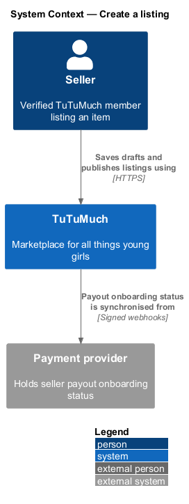
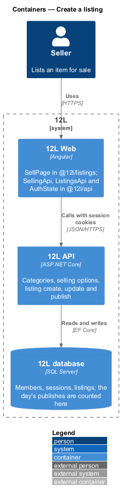
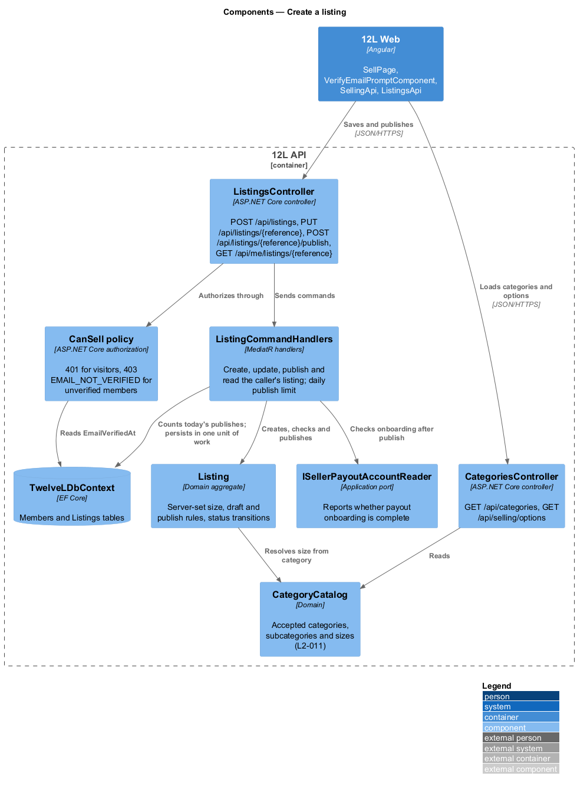
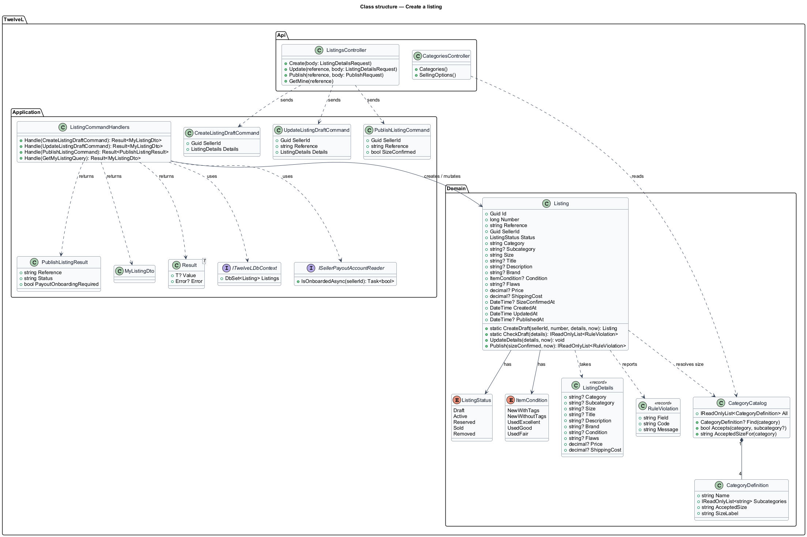
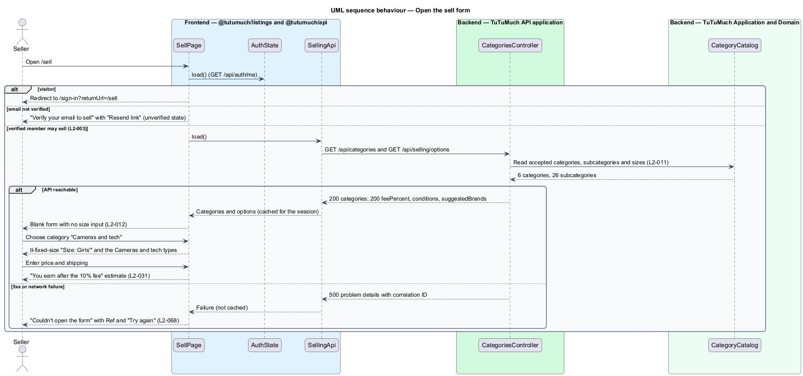
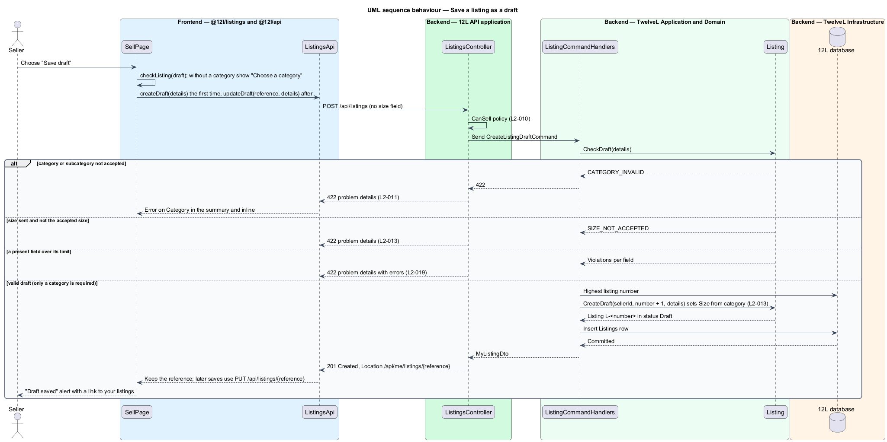
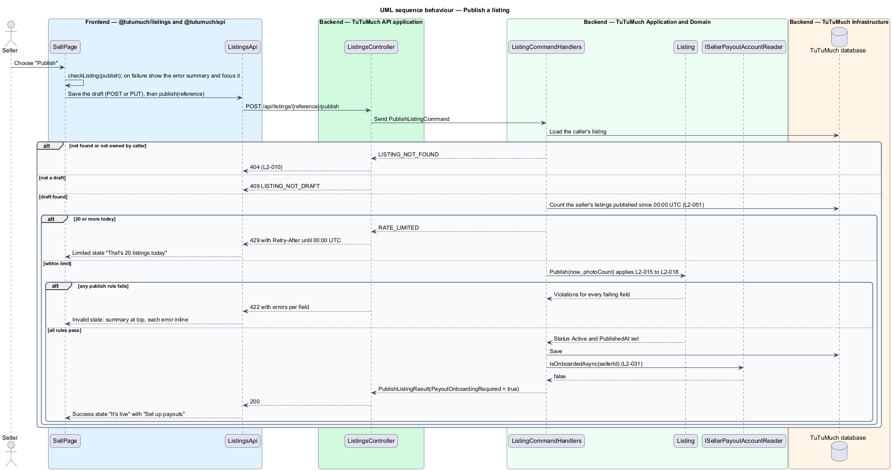

# Create a listing

## Overview

TuTuMuch is a marketplace for all things young girls. Any verified member may sell; there is no seller application or separate seller account (`L2-003`). This feature covers the first half of the listing lifecycle: a seller opens the sell form, describes an item, saves it as a draft, and publishes it to the catalog.

The feature sits in the listings subsystem (`L1-003`, `L1-004`). Photo upload and processing belong to the sibling feature [upload-listing-photos](../upload-listing-photos/README.md); later changes and withdrawal belong to [edit-and-withdraw-listing](../edit-and-withdraw-listing/README.md); the seller's list of listings belongs to [manage-my-listings](../manage-my-listings/README.md).

Terms used in this design:

- **listing** — record of one item offered for sale by one seller, with its details, photos, price and status
- **listing status** — lifecycle state of a listing: `Draft`, `Active`, `Reserved`, `Sold` or `Removed` (`L2-019`)
- **draft** — listing saved before it is complete, visible only to its seller and absent from the catalog
- **publish** — transition of a draft from `Draft` to `Active`, after which the listing appears in the catalog
- **accepted size** — single size TuTuMuch accepts for a category: `Girls'` for every category: Clothing, Shoes, Dance, Sports, Cameras and tech, Toys and crafts (`L2-011`); an audience lock, not a fit ([ADR general/0006](../../../adr/general/0006-all-things-young-girls.md))
- **size confirmation** — seller's explicit statement that the item is for girls, stored as a timestamp (`L2-014`)
- **platform fee** — configurable percentage TuTuMuch keeps from item price plus shipping when an order completes (`L2-031`)
- **listing reference** — public identifier of a listing in the form `L-<number>` (for example `L-20931`), used in routes and API paths instead of the internal `Guid`
- **estimated earnings** — item price plus shipping cost less the platform fee, shown on the form before publishing

The size rule is the reason TuTuMuch exists, so the server, not the browser, owns it. The form never offers a size input. The API sets the stored size from the category and rejects any request that sends a different size (`L2-013`).

## Description

The slice runs from the sell page in the `@tutumuch/listings` library through `TuTuMuch API` to the `Listings` table in `TuTuMuch database`. Screens, states and copy come from the mocks in `docs/mocks/pages/sell/` and `docs/mocks/dialogs/verify-email-prompt/`; the components each state uses are listed in [`docs/screen-composition.md`](../../../screen-composition.md). Signing up, verifying and signing in come from [sign-up-and-sign-in](../../accounts/sign-up-and-sign-in/README.md).

### Frontend (`TuTuMuch Web`, `src/frontend/projects/listings/` and `src/frontend/projects/api/`)

- **`SellPage`** (`@tutumuch/listings`, `src/lib/sell/`) — routed standalone component at `/sell` (new listing) and `/sell/:reference` (continue a draft), exported through the library's lazy route table. It awaits `AuthState.load()` from `@tutumuch/api` and renders one of these states:
  - visitor — redirects to `/sign-in?returnUrl=/sell`.
  - `unverified` — `tl-center-state` "Verify your email to sell", "We sent a link to {email}.", with "Resend link" (opens the verify-email prompt through `DialogService`) and "Back to shop". Also shown when a call answers 403 `EMAIL_NOT_VERIFIED`.
  - `error` — "Couldn't open the form" with the correlation ID ("Ref 5c1d-0e7a") and "Try again", when categories, options or the draft fail to load (`L2-068`).
  - `default` / `filled` — the listing form.
  - `invalid` — `tl-error-summary` at the top, each error inline through `tl-form-field`, focus moved to the summary, which is announced as an alert.
  - `submitting` — "Publish" carries `aria-busy="true"`, "Save draft" is disabled, nothing shifts.
  - `draft-saved` — `tl-alert` success "Draft saved", "Finish it any time from your listings." linking to `/account/listings`.
  - `success` — "It's live" with a `tl-item-row` (title; brand · size · price), "Set up payouts so you're paid when it sells." only when `payoutOnboardingRequired` is true, and the actions "View listing" (`/items/{reference}`) and "Sell another".
  - `limited` — "That's 20 listings today", "You can list more tomorrow. Drafts still save.", action "Your listings", on HTTP 429.
- **Form** — a typed reactive form inside `SellPage`. Sections and controls:
  - Item — `Category` select ("Choose a category"), `Type` select ("Choose a type", disabled until a category is chosen), `tl-fixed-size`, `Title` with an "n / 80" counter, `Brand` input bound to a `<datalist>` of suggested brands (free text allowed), `tl-segmented` "Condition" with exactly the 5 options served by the API, `Describe the flaws` shown only for `Used - Fair` with help "Shown on the listing. At least 10 characters.", `Description` with an "n / 2,000" counter.
  - Price — `Price` and `Shipping` in `tl-input-group` with a `$` addon (`inputmode="decimal"`), shipping help "Flat rate. $0 shows as free shipping.", and `tl-earnings`.
  - Size confirmation — `tl-choice` whose label reads "This item is for girls" for every category, and before a category is chosen.
  - Actions — sticky bar with "Save draft" and "Publish".
  - Photos — not shown yet; the section and its uploader arrive with [upload-listing-photos](../upload-listing-photos/README.md) ([ADR general-0004](../../../adr/general/0004-publish-without-photos-until-upload-listing-photos.md)).
  - The form is not yet a separate component; edit-and-withdraw-listing extracts it when the edit page needs it.
- **`listing-rules.ts`** — pure functions beside the page: `checkListing(value, 'draft' | 'publish')` mirrors the server rules with the same messages ("Choose a category", "Title must be 5 to 80 characters", "Brand must be 1 to 50 characters", "Describe the item's flaws", "Description must be 20 to 2,000 characters", "Enter a price from $1.00 to $5,000.00", "Enter shipping from $0.00 to $100.00", "Confirm this item is for girls"); `toDetails` builds the request body from present fields only and never includes a size; `estimateEarnings` returns `(price + shipping) × (1 − feePercent / 100)` rounded half up to the cent, or `null` (shown as "—") while the price is empty or invalid (`L2-031`). The estimate is display only; seller-payouts computes the fee that counts. Client checks give fast feedback and are never trusted.
- **Save and publish flow** — "Save draft" checks the draft rules, then `POST /api/listings` the first time and `PUT /api/listings/{reference}` afterwards. "Publish" checks the publish rules, saves the same way, then calls `POST /api/listings/{reference}/publish` with `{ "sizeConfirmed": true }`. A 422 from either call maps each `errors` key to its control (`category` and `size` to Category, `shippingCost` to Shipping, `sizeConfirmed` to the confirmation, `condition` to the first condition option). Network failures and 5xx show a danger `tl-alert` ("Couldn't save your draft" or "Couldn't publish your listing", "Check your connection." or the reference) instead of the toast in the mocks, because `ToastService` belongs to responsive-accessible-shell.
- **`VerifyEmailPromptComponent`** (`@tutumuch/listings`, `src/lib/verify-email-prompt/`) — the `dialogs/verify-email-prompt` dialog composed from `tl-dialog`: "Verify your email first", "Open the link we sent to {email} to buy and sell.", "Not now" and "Resend link" (busy while sending). It calls `AccountsApi.requestVerificationEmail`; success shows "Link sent", "Earlier links no longer work." and 429 shows "Too many requests", "You can request 3 links an hour. Try again later.", each with "Done". Escape closes it and focus returns to "Resend link". It moves to a shared place when checkout also opens it.
- **`SellingApi`** (`@tutumuch/api`, `src/lib/listings/`) — loads `GET /api/categories` and `GET /api/selling/options` once per session; a failure is not cached, so "Try again" asks again.
- **`ListingsApi`** (`@tutumuch/api`, `src/lib/listings/`) — typed client for `POST /api/listings`, `PUT /api/listings/{reference}`, `POST /api/listings/{reference}/publish` and `GET /api/me/listings/{reference}`. Every call resolves to `ApiResult<T>`, whose failure carries the problem's status, code, title, correlation ID, field errors and `Retry-After`. The session interceptor sends the cookies and renews an expired access token once.
- **Components** — every element above comes from `@tutumuch/components`: `tl-alert`, `tl-button`, `tl-center-state`, `tl-choice`, `tl-dialog` and `DialogService`, `tl-earnings`, `tl-error-summary`, `tl-fixed-size`, `tl-form-field`, `tl-icon`, `tl-input-group`, `tl-item-row`, `tl-segmented` and `tl-size-tag`, documented in [`docs/design-system/`](../../../design-system/README.md).
- **Rules link** — the rules page at `/rules` will render the same table from `GET /api/categories`; it is not part of this slice.

### API (`TuTuMuch.Api`)

- **`CategoriesController`**
  - `GET /api/categories` — anonymous. Returns `200` with the 6 categories and 26 subcategories of `L2-011`, each with `acceptedSize` ("Girls'") and `sizeLabel` ("Girls"). Sends `Cache-Control: public, max-age=3600`.
  - `GET /api/selling/options` — anonymous. Returns `200` with `feePercent` (from configuration), `conditions` (the 5 display strings of `L2-016`), `suggestedBrands` and `maxPhotos` (8).
- **`ListingsController`** — every action requires the `CanSell` policy of [sign-up-and-sign-in](../../accounts/sign-up-and-sign-in/README.md): `401 UNAUTHENTICATED` for visitors, `403 EMAIL_NOT_VERIFIED` for unverified members (`L2-002`, `L2-003`, `L2-010`).
  - `POST /api/listings` — creates a draft. Body `ListingDetailsRequest`. Returns `201 Created` with `Location: /api/me/listings/{reference}` and the `MyListingDto`; `422` for validation failures.
  - `PUT /api/listings/{reference}` — replaces the fields of the caller's `Draft` under the draft rules. Returns `200`, `404` (missing or not owned), `409 LISTING_NOT_DRAFT` for any other status (editing an active listing belongs to [edit-and-withdraw-listing](../edit-and-withdraw-listing/README.md)), `422`.
  - `POST /api/listings/{reference}/publish` — body `{ "sizeConfirmed": true }`. Returns `200` with `PublishListingResult`, `404`, `409 LISTING_NOT_DRAFT`, `422` with every failing field, `429 RATE_LIMITED` with `Retry-After`.
  - `GET /api/me/listings/{reference}` — the caller's own listing; `404` for anyone else, so a draft's existence is not revealed (`L2-010`, `L2-019`).
- **Daily publish limit** — the handler counts the member's listings with `PublishedAt` since 00:00 UTC; at 20 it answers 429 with `Retry-After` set to the seconds until the next 00:00 UTC (`L2-051`). Drafts are not limited, as the `limited` mock says ([ADR platform-0006](../../../adr/platform/0006-daily-publish-limit-counted-in-database.md)).
- **Mass assignment** — `ListingDetailsRequest` has no seller, status, confirmation time or timestamp members and `System.Text.Json` ignores unknown members, so a client cannot set them (`L2-049`).
- **Problem details** — every failure is RFC 9457 problem details with `title`, `status`, `code`, `correlationId` and, for 422, `errors` keyed by request field with `code` and `message` (`L2-068`).

### Application and domain (`TuTuMuch.Application`, `TuTuMuch.Domain`)

- **Commands and queries** (MediatR 12, [ADR platform-0008](../../../adr/platform/0008-mediatr-12-and-domain-validation.md)) — `CreateListingDraftCommand`, `UpdateListingDraftCommand`, `PublishListingCommand` and `GetMyListingQuery`, handled by `ListingCommandHandlers`; `GetCategoriesQuery` and `GetSellingOptionsQuery`. Handlers return `Result<T>`; the controller writes failures as problem details.
- **`ListingDetails`** — `Category`, `Subcategory`, `Size`, `Title`, `Description`, `Brand`, `Condition`, `Flaws`, `Price` (decimal), `ShippingCost` (decimal), all optional except the category of a draft.
- **Draft rules** (`Listing.CheckDraft`, `L2-019`) — category in the table (`CATEGORY_INVALID`); subcategory, when present, in its category (`CATEGORY_INVALID`); size, when present, equal to the accepted size ignoring case (`SIZE_NOT_ACCEPTED`); title at most 80, description at most 2,000, brand at most 50 and flaws at most 500 characters; condition, when present, one of the 5 values (`CONDITION_INVALID`); price, when present, from 1.00 to 5,000.00 with at most 2 decimals (`PRICE_OUT_OF_RANGE`); shipping, when present, from 0.00 to 100.00 with at most 2 decimals (`SHIPPING_OUT_OF_RANGE`).
- **Publish rules** (`Listing.Publish`, `L2-014` to `L2-018`) — all draft rules plus subcategory required (`SUBCATEGORY_REQUIRED`), title 5 to 80 (`TITLE_LENGTH`), description 20 to 2,000 (`DESCRIPTION_LENGTH`), brand 1 to 50 (`BRAND_LENGTH`), condition required (`CONDITION_REQUIRED`), flaws of at least 10 characters for `Used - Fair` (`FLAWS_REQUIRED`, "Describe the item's flaws"), price and shipping required, and `sizeConfirmed` true (`SIZE_CONFIRMATION_REQUIRED`, "Confirm this item is for girls"). Every failing field is reported together (`L2-015`). The photo rules arrive with upload-listing-photos.
- **Top-level code of a 422** — `CATEGORY_INVALID` or `SIZE_NOT_ACCEPTED` when those rules fail (no listing is created), else the field's own code when only one field fails, else `LISTING_INVALID`.
- **Text handling** — the domain trims title, description, brand and flaws and stores them as plain text; flaws are kept only for `Used - Fair`. Angular interpolation encodes them on output, so `` shows literally (`L2-015`, `L2-049`).
- **`CategoryCatalog`** — domain class holding the `L2-011` table as `CategoryDefinition { Name, Subcategories, AcceptedSize, SizeLabel }`. It is code, not configuration, because the size rule is the product's premise.
- **`Listing`** aggregate — `Id`, `Number`, `Reference` (`L-{Number}`), `SellerId`, `Status`, `Category`, `Subcategory`, `Size`, `Title`, `Description`, `Brand`, `Condition`, `Flaws`, `Price`, `ShippingCost`, `SizeConfirmedAt`, `CreatedAt`, `UpdatedAt`, `PublishedAt`. `Size` has no public setter; `CreateDraft` and `UpdateDetails` set it from `CategoryCatalog` (`L2-013`). `RemovedAt`, `DraftReminderSentAt`, `ReservedUntil`, `RowVersion` and the photos collection are added by the features that write them.
- **Status transitions owned by this feature** — `(new) → Draft` on create; `Draft → Active` on publish (sets `SizeConfirmedAt`, and `PublishedAt` on the first publish). `Active → Reserved → Sold` belong to the orders subsystem; `Active → Removed` and back belong to edit-and-withdraw-listing.
- **`ItemCondition`** enum — `NewWithTags`, `NewWithoutTags`, `UsedExcellent`, `UsedGood`, `UsedFair`, exchanged as "New with tags", "New without tags", "Used - Excellent", "Used - Good", "Used - Fair".
- **`ISellerPayoutAccountReader`** — application port for seller-payouts. Until that feature exists, `NoPayoutAccountsReader` answers "not onboarded" for everyone, so every publish prompts for payouts (`L2-031` criterion 1). Publishing never waits for onboarding.

### Error codes

| Code | HTTP | Raised when |
|------|-----:|-------------|
| `CATEGORY_INVALID` | 422 | Category missing or outside the `L2-011` table, or subcategory not in its category |
| `SIZE_NOT_ACCEPTED` | 422 | A `size` value differs from the category's accepted size |
| `CONDITION_INVALID` | 422 | Condition outside the 5 values (`L2-016`) |
| `SIZE_CONFIRMATION_REQUIRED` | 422 | Publish without `sizeConfirmed: true` (`L2-014`) |
| `LISTING_INVALID` | 422 | Several other field rules fail; `errors` lists each field |
| `LISTING_NOT_FOUND` | 404 | The listing does not exist or belongs to another member |
| `LISTING_NOT_DRAFT` | 409 | Update or publish of a listing that is not a draft |
| `UNAUTHENTICATED` | 401 | No valid session |
| `EMAIL_NOT_VERIFIED` | 403 | Unverified member calls a selling endpoint |
| `RATE_LIMITED` | 429 | A 21st publish in one UTC day |

### Infrastructure and data (`TuTuMuch.Infrastructure`)

- **`Listings` table** (`ListingConfiguration`, migration `InitialCreate`):
  - `Id uniqueidentifier` PK; `Number bigint` with unique index `UX_Listings_Number`; `Reference nvarchar(16)` with unique index `UX_Listings_Reference`; `SellerId uniqueidentifier` FK to `Members`; `Status nvarchar(16)` (string conversion); `Category nvarchar(16)`; `Subcategory nvarchar(24) null`; `Size nvarchar(16)`; `Title nvarchar(80) null`; `Description nvarchar(2000) null`; `Brand nvarchar(50) null`; `Condition nvarchar(20) null`; `Flaws nvarchar(500) null`; `Price decimal(7,2) null`; `ShippingCost decimal(5,2) null`; `SizeConfirmedAt`, `PublishedAt datetime2 null`; `CreatedAt`, `UpdatedAt datetime2`.
  - The first listing is `L-10001`; each new draft takes the highest `Number` plus one, and the unique index rejects a duplicate from two simultaneous creates (the member retries).
  - Prices are `decimal` in C# and SQL Server, never floating point (`L2-018`).
  - Check constraints: `CK_Listings_Size` (`Size = N'Girls'''` for every category) as defence in depth for `L2-013`; `CK_Listings_Price` and `CK_Listings_ShippingCost` cast to `REAL` for the range check so they behave the same on SQL Server and on the SQLite provider the tests use.
  - Indexes: `IX_Listings_SellerId_CreatedAt` and `IX_Listings_SellerId_Status_CreatedAt` (manage-my-listings), `IX_Listings_SellerId_PublishedAt` (daily limit), `IX_Listings_Status_PublishedAt` (catalog).
- **Catalog visibility** — only `Active` and `Reserved` listings appear in the catalog (`L2-019`); browse-catalog reads `Listings` by status, and any cache it adds expires within 5 s.
- **Queries** — EF Core LINQ only, so all SQL is parameterised (`L2-049`).
- **Migrations** — `TuTuMuch.Migrator` applies them when `ConnectionStrings__TuTuMuch` is set; without it, it lists the migrations and exits 2.

### Tests

- `TuTuMuch.Domain.Tests` — `CategoryCatalogTests` and `ListingTests` cover the table, the size rule and every draft and publish rule.
- `TuTuMuch.Api.Tests` — `CatalogueTests`, `ListingDraftTests` and `PublishListingTests` host the API in memory with `WebApplicationFactory`, SQLite in memory, a capturing email sender and a fake clock; no real database or external system is touched.
- `src/frontend/e2e/tests/sell.spec.ts` with `pages/sell.page.ts` — every mocked state on Chromium against the built app, with `TuTuMuch API` answered by `page.route` fixtures.

### Configuration

| Key | Value | Notes |
|-----|-------|-------|
| `Selling:PlatformFeePercent` | 10 | Shown by `GET /api/selling/options`; seller-payouts reads the same key |
| `Selling:PublishesPerDay` | 20 | Per member per UTC day (`L2-051`) |
| `Selling:SuggestedBrands` | Carter's, OshKosh B'gosh, Gap Kids, Old Navy, Hanna Andersson, Mini Boden, Janie and Jack, Tea Collection, Zara Kids, H&M Kids | From the mocks |

### Decisions and open questions

- Size confirmation is stored as `SizeConfirmedAt` on each publish; the earlier draft has none.
- `Cache-Control: max-age=3600` on categories, the 500-character flaws limit and the `L-10001` start are chosen here; change them in this design if the product owner decides otherwise.
- Earnings round half up to the cent (`Math.round` on cents).
- Deferred: photos (upload-listing-photos), editing an active listing and withdrawing (edit-and-withdraw-listing), the seller's list of listings (since built by manage-my-listings at `/account/listings`; the library is now mounted at `/`), the payout onboarding flow behind "Set up payouts" (seller-payouts), the toast after a failed draft save (responsive-accessible-shell), the anti-forgery header of `L2-050` (harden-http-and-api; `SameSite=Strict` cookies apply meanwhile) and the `RowVersion` concurrency token (checkout-and-pay).

## Requirements

The feature realises the following level-2 (L2) requirements. Each refines the level-1 (L1) requirement cited.

| L2 ID | Refines (L1) | Requirement |
|-------|--------------|-------------|
| `L2-003` | `L1-001` | Every verified member shall be able to both buy and sell. There shall be no seller application, approval or separate seller account. |
| `L2-011` | `L1-003` | TuTuMuch shall accept only the categories and sizes in this table. The list is held on the server and served to the client. |
| `L2-012` | `L1-003` | The listing form shall not offer a size choice. Once the seller picks a category, the form shall show the accepted size for that category as fixed, read-only text. |
| `L2-013` | `L1-003` | The API shall be the source of truth for the size rule. It shall reject any listing create or update request whose size does not match the accepted size for its category, whatever the client sends. The stored size shall always be set by the server from the category. |
| `L2-014` | `L1-003` | Before publishing, the seller shall confirm that the item is for girls, in every category (many items, such as cameras and bikes, have no clothing label). A listing shall not be published without this confirmation. |
| `L2-015` | `L1-004` | A listing shall have a title (5 to 80 characters), a description (20 to 2,000 characters), a category and subcategory (L2-011), a brand (1 to 50 characters, chosen from a suggested list or typed freely), a condition (L2-016), 1 to 8 photos (L2-017), a price and a shipping cost (L2-018). All text shall be trimmed and stored as plain text. |
| `L2-016` | `L1-004` | The seller shall choose one condition: New with tags, New without tags, Used - Excellent, Used - Good, or Used - Fair. A Used - Fair listing shall include a description of its flaws of at least 10 characters. |
| `L2-018` | `L1-004` | The item price shall be between $1.00 and $5,000.00 inclusive, with at most two decimal places. The seller shall set a flat shipping cost between $0.00 and $100.00 inclusive. TuTuMuch shall operate in the United States only, in US dollars. |
| `L2-019` | `L1-004` | A listing shall have one of these statuses: Draft, Active, Reserved, Sold or Removed. A seller shall be able to save an incomplete listing as a Draft and publish it later. Only Active and Reserved listings appear in the catalog. Validation rules L2-014 to L2-018 apply when publishing; drafts only need a category, and any field a draft does contain must be within its limits. |
| `L2-031` | `L1-007` | Before their first sale is paid out, a seller shall complete payout onboarding with the payment provider. The sale amount less the TuTuMuch fee shall be released to the seller when the order is Completed. The fee percentage shall be configurable and shown to the seller before they publish a listing. |
| `L2-051` | `L1-013` | The API shall limit requests to 120 per minute per IP address for anonymous callers and 300 per minute per member, with stricter limits for sign-in (L2-007), registration (5 per hour per IP) and listing creation (20 published listings per member per UTC day; saving drafts is not limited). Callers over a limit shall receive HTTP 429 with a `Retry-After` header. |

`L2-031` and `L2-051` are supporting requirements here: this feature shows the fee and estimated earnings, prompts for payout onboarding after publishing, and applies the listing creation limit. Payout release and the general request limits belong to the orders and platform subsystems. The 1 to 8 photos of `L2-015` are enforced by upload-listing-photos.

## Diagrams

### System context

The seller lists items through TuTuMuch. TuTuMuch reads the seller's payout onboarding status, which the payment provider maintains, to decide whether to prompt for payout setup after publishing.

### Containers

`TuTuMuch Web` calls `TuTuMuch API`, which stores listings in `TuTuMuch database` and counts the day's publishes there.

### Components

`ListingsController` checks the `CanSell` policy and sends commands through MediatR to `ListingCommandHandlers`. The handlers check the daily limit, resolve the size through `CategoryCatalog`, mutate the `Listing` aggregate and persist through `TuTuMuchDbContext`.

### Class structure

`Listing` owns its status and server-set size and checks its own draft and publish rules. `CategoryCatalog` holds the 4 `CategoryDefinition` records. The handlers depend on the commands, the aggregate, `ITuTuMuchDbContext` and the `ISellerPayoutAccountReader` port.

### Behaviour — open the sell form

`SellPage` first asks `AuthState` whether a verified member is signed in, then loads categories and options through `SellingApi`. It renders the form with no size input, shows the fixed size once a category is chosen, and shows estimated earnings once a valid price is entered.

### Behaviour — save a draft

A draft needs only an accepted category. The handler sets the size from the category and stores the listing as `Draft`. Category, size and field-limit failures return `422`.

### Behaviour — publish a listing

The page saves the draft first. The handler then checks the daily limit, applies the `L2-014` to `L2-018` rules on the aggregate, reports every failing field together, commits the `Draft → Active` transition and reports whether payout onboarding is still required.

