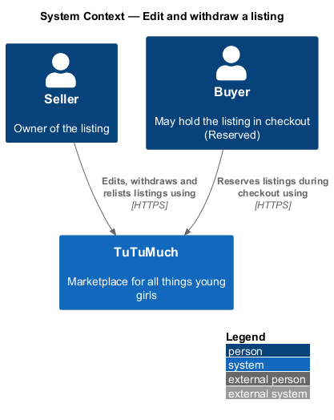
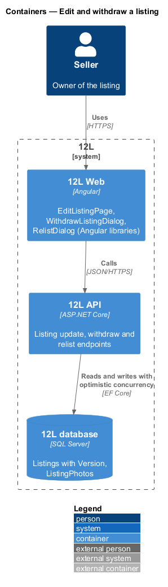
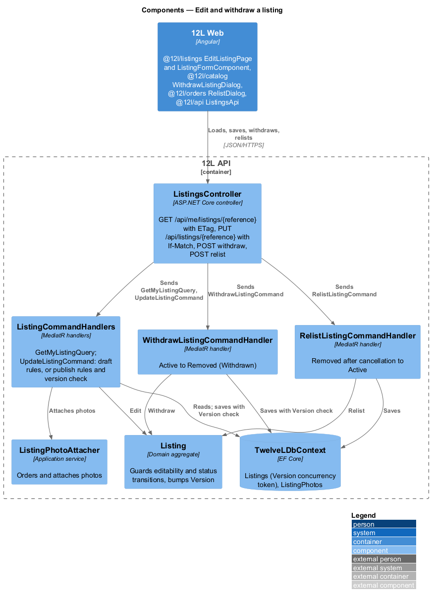
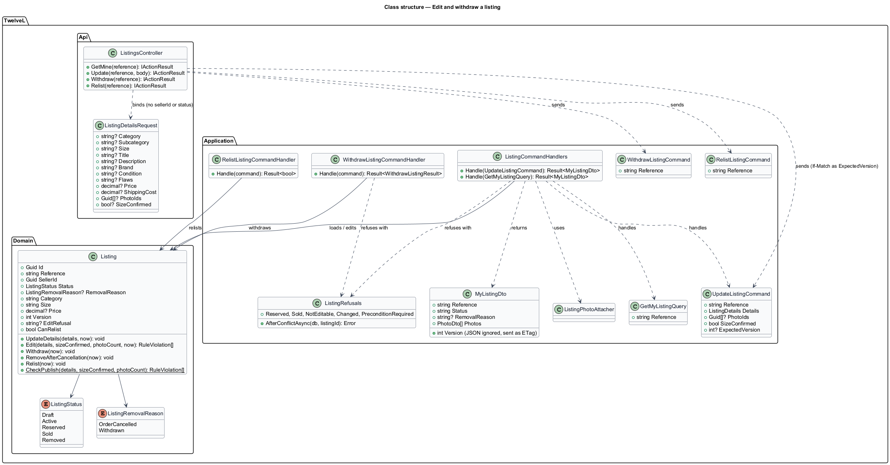
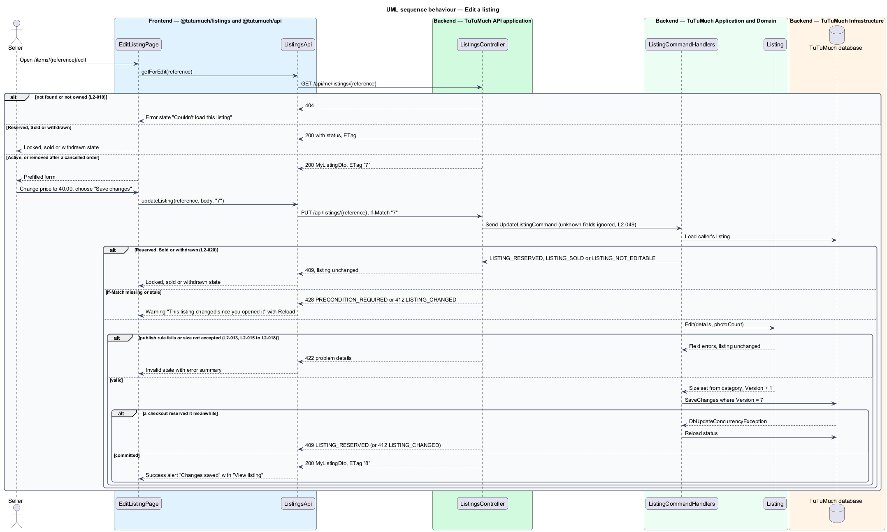
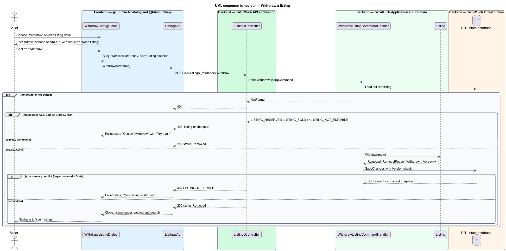
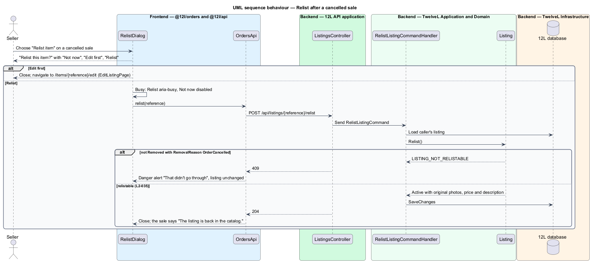

# Edit and withdraw a listing

## Overview

After a listing is published, a seller often corrects a detail, changes the price, or takes the item off sale. This feature lets the seller edit an `Active` listing, withdraw it, and relist an item whose sale was cancelled. It also guarantees that a listing a buyer is paying for, or has bought, cannot change under that buyer (`L2-020`).

The feature sits in the listings subsystem (`L1-003`, `L1-004`). It reuses the listing form, validators and photo handling of [create-listing](../create-listing/README.md) and [upload-listing-photos](../upload-listing-photos/README.md). The `Reserved` and `Sold` statuses are set by the checkout and payment features of the orders subsystem; this feature only reads them to refuse changes.

Terms used in this design:

- **editable listing** — listing in status `Draft` or `Active`, or `Removed` after a cancelled sale; only these accept an update
- **reserved listing** — listing held for 10 minutes for one buyer in checkout (`L2-028`), neither editable nor withdrawable
- **withdraw** — seller action that moves an `Active` listing to `Removed` and takes it out of the catalog and search; it cannot be undone
- **removal reason** — recorded cause of a `Removed` status: `Withdrawn` or `OrderCancelled`
- **relist** — seller action that returns a listing removed after a cancelled order to `Active` with its original details (`L2-035`)
- **ETag** — opaque version of a listing, the value of its `Version` counter as a strong tag such as `"7"`, that the client sends back in `If-Match` so a stale form cannot overwrite newer data

## Description

Screens, states and copy come from `docs/mocks/pages/edit-listing/` (default, loading, error, invalid, submitting, success, locked, changed, sold, withdrawn), `docs/mocks/dialogs/withdraw-listing/`, `docs/mocks/dialogs/relist/` and the `own` state of `docs/mocks/pages/listing-detail/`. Decisions are recorded in [ADR listings/0003](../../../adr/listings/0003-edit-with-a-version-etag-and-withdraw-from-the-detail-page.md).

### Frontend (`TuTuMuch Web`, `@tutumuch/listings`, `@tutumuch/catalog`, `@tutumuch/orders`, `@tutumuch/api`)

- **`EditListingPage`** — `@tutumuch/listings` `src/lib/edit-listing/`, routed at `/items/:reference/edit`. Its header shows the listing title as a link back to the listing, the heading "Edit listing" and `tl-status`. It hosts the local `ListingFormComponent` with actions "Cancel" (back to the listing) and "Save changes". A `Draft` opens the sell form at `/sell/{reference}` instead. States:
  - `loading` — skeleton for 3 photo tiles and 4 fields, `aria-busy="true"`.
  - `error` — "Couldn't load this listing", "Your listing is safe. Try again in a moment.", the correlation reference, "Try again" and "Your listings" (`L2-068`).
  - `default` — every field prefilled, including flaws for `Used - Fair`, and photos.
  - `invalid` — error summary plus inline errors, for example "Describe the item's flaws" and "Enter a price from $1.00 to $5,000.00"; client checks stop the request, and a `422` lands on the same fields.
  - `submitting` — "Save changes" shows `aria-busy="true"`.
  - `success` — success alert "Changes saved" with a "View listing" link; the new ETag replaces the old one.
  - `changed` — after `412`: warning alert "This listing changed since you opened it", "Reload to see the latest version, then make your changes again." and "Reload", which reads the listing again.
  - `locked` — the listing is `Reserved` on load or on save: "This item is in someone's checkout", "You can edit it again if they don't finish within 10 minutes.", action "Back to listing" (`L2-020`).
  - `sold` — "This item has sold", "Sold listings can't be edited.", "Your sales" and "Your listings".
  - `withdrawn` — "This listing was withdrawn", "Withdrawn listings can't be edited or relisted.", "Your listings".
- **`ListingFormComponent`** and **`ListingFormModel`** — `@tutumuch/listings` `src/lib/listing-form/`, shared by the sell page and the edit page: the photos, item and price sections, the photo tiles, client checks (`listing-rules.ts`) and server field errors.
- **`WithdrawListingDialog`** — `@tutumuch/catalog` `src/lib/withdraw-listing/`, opened through `DialogService` by "Withdraw" on the seller's own Active listing detail page. Title "Withdraw “{title}”?", icon `trash` in the danger tone, description "It leaves the shop right away. This can't be undone.", buttons "Keep listing" (focused) and "Withdraw" (danger). States:
  - `busy` — "Withdraw" shows `aria-busy="true"`, "Keep listing" is disabled.
  - `failed` — danger alert "Couldn't withdraw", "Your listing is still live.", the danger button reads "Try again".
  On success the dialog closes and the app navigates to `/account/listings`.
- **`RelistDialog`** — `@tutumuch/orders`, built by cancel-order. This feature adds "Edit first", a link that closes the dialog and opens `/items/:reference/edit`.
- **`ListingsApi`** (`@tutumuch/api`) — adds `getForEdit(reference)` and `updateListing(reference, details, etag)`, which return the listing with the `ETag` response header and send it as `If-Match`, and `withdraw(reference)`. `MyListing` gains `removalReason`.

### API (`TuTuMuch.Api`)

Every action is on `ListingsController` under the `CanSell` policy (`L2-003`, `L2-010`). A listing owned by another member returns `404`.

- `GET /api/me/listings/{reference}` — `200` with `MyListingDto` and an `ETag` header for any status; `404` otherwise.
- `PUT /api/listings/{reference}` — body `ListingDetailsRequest`, header `If-Match` for a published listing. Returns `200` with `MyListingDto` and a new `ETag`. A `Draft` keeps the draft rules and needs no `If-Match`. Errors are checked in this order: `404`; `409` `LISTING_RESERVED` ("This item is in someone's checkout"), `LISTING_SOLD` or `LISTING_NOT_EDITABLE`, with the listing unchanged; `428` `PRECONDITION_REQUIRED` when `If-Match` is missing; `412` `LISTING_CHANGED` when it is stale; `422` with field errors, `CATEGORY_INVALID` or `SIZE_NOT_ACCEPTED`.
- `POST /api/listings/{reference}/withdraw` — `200` with `{ reference, status: "Removed" }`. A repeat call on a withdrawn listing returns `200`. Errors: `404`; `409` `LISTING_RESERVED`, `LISTING_SOLD`, or `LISTING_NOT_EDITABLE` for a draft or a listing removed after a cancelled order.
- `POST /api/listings/{reference}/relist` — unchanged from cancel-order: `204`, `404`, or `409` `LISTING_NOT_RELISTABLE`, which now includes a withdrawn listing.
- **Mass assignment** (`L2-049`) — `ListingDetailsRequest` holds only editable fields (`category`, `subcategory`, `size`, `title`, `description`, `brand`, `condition`, `flaws`, `price`, `shippingCost`, `photoIds`). Unknown members such as `"sellerId"` or `"status": "Sold"` are ignored by `System.Text.Json` and cannot reach the entity.

### Application and domain (`TuTuMuch.Application`, `TuTuMuch.Domain`)

- **`GetMyListingQuery`** — returns `MyListingDto` (with `removalReason`) and its `Version`, which the controller writes as the ETag and leaves out of the body.
- **`UpdateListingCommand`** (`ListingCommandHandlers`) — loads the caller's listing. A draft takes the draft path of create-listing. Otherwise it refuses through `ListingRefusals` (`409`), compares `ExpectedVersion` with `Version` (`428`, `412`), attaches photos with `ListingPhotoAttacher`, calls `Listing.Edit` and saves with `Version` as the concurrency token.
  - On `DbUpdateConcurrencyException` it reloads the status and returns `LISTING_RESERVED` (or `LISTING_SOLD`) when a checkout won, otherwise `LISTING_CHANGED`.
- **`Listing.Edit(details, photoCount, now)`**:
  - only for `Active`, or `Removed` with reason `OrderCancelled`; `EditRefusal` names `LISTING_RESERVED`, `LISTING_SOLD` or `LISTING_NOT_EDITABLE` otherwise (`L2-020`);
  - applies `CheckPublish`, the publish rules of `L2-015` to `L2-018` plus the draft rules, including `SIZE_NOT_ACCEPTED` for a size other than the category's (`L2-013`);
  - on success sets the size from the category, trims text and bumps `Version`.
- **`WithdrawListingCommand`** / **`WithdrawListingCommandHandler`** — calls `Listing.Withdraw(now)`, which allows only `Active → Removed`, sets `RemovalReason = Withdrawn` and bumps `Version`, and saves with the version check.
- **`Listing.RemoveAfterCancellation`** and **`Listing.Relist`** — built by cancel-order. `CanRelist` stays limited to reason `OrderCancelled`, so a withdrawn listing cannot come back, matching "This can't be undone."
- **Status transitions owned or guarded here**:

| From | To | Trigger | Guard |
|------|----|---------|-------|
| `Active` | `Active` | Update | Current `If-Match`, publish rules pass |
| `Removed` (`OrderCancelled`) | `Removed` | Update | Current `If-Match`, publish rules pass |
| `Draft` | `Draft` | Update | Draft rules pass |
| `Active` | `Removed` (`Withdrawn`) | Withdraw | None beyond status |
| `Reserved`, `Sold`, `Removed` (`Withdrawn`) | — | Update or withdraw | Refused with `409` (a repeat withdraw answers `200`) |

### Infrastructure and data (`TuTuMuch.Infrastructure`)

- **`Listings` table** — migration `EditAndWithdrawListing` adds `Version int not null default 0`, the EF Core concurrency token for edit and withdraw. `RemovalReason` (`nvarchar(24)`) gains the value `Withdrawn`.
- **Reservation** — the checkout's conditional `ExecuteUpdate` that reserves a listing also sets `Version = Version + 1`, so a checkout and an edit racing on the same listing cannot both succeed (`L2-029`).
- **Catalog freshness** — the catalog and search read `Listings` filtered to `Active` and `Reserved`, and the detail page hides `Removed` from everyone but the seller, so a price change shows at once and a withdrawn listing leaves search.

### Error codes

| Code | HTTP | Raised when |
|------|-----:|-------------|
| `LISTING_RESERVED` | 409 | Update or withdraw of a `Reserved` listing; title "This item is in someone's checkout" |
| `LISTING_SOLD` | 409 | Update or withdraw of a `Sold` listing; title "This item has sold" |
| `LISTING_NOT_EDITABLE` | 409 | Update of a withdrawn listing, or withdraw of a draft or of a listing removed after a cancelled order |
| `LISTING_NOT_RELISTABLE` | 409 | Relist of a listing that was not removed after a cancelled order |
| `LISTING_CHANGED` | 412 | `If-Match` does not match the current version |
| `PRECONDITION_REQUIRED` | 428 | `PUT` of a published listing without `If-Match` |
| `CATEGORY_INVALID`, `SIZE_NOT_ACCEPTED`, `LISTING_INVALID` | 422 | As in [create-listing](../create-listing/README.md) |
| `SELLING_NOT_OPEN` | 403 | Edit, withdraw or relist in launch Phase 1 or 2 by anyone but an administrator ([launch-phases](../../platform/launch-phases/README.md), `L2-091`); `/items/{reference}/edit` then loads `SellingNotOpenPage`. Editing is never limited by the Phase 1 product limit |

## Requirements

The feature realises the following level-2 (L2) requirements. Each refines the level-1 (L1) requirement cited.

| L2 ID | Refines (L1) | Requirement |
|-------|--------------|-------------|
| `L2-020` | `L1-004` | A seller shall be able to edit or withdraw an Active listing. A Reserved or Sold listing shall not be editable or withdrawable. A withdrawn listing shall become Removed and leave the catalog. |
| `L2-013` | `L1-003` | The API shall be the source of truth for the size rule. It shall reject any listing create or update request whose size does not match the accepted size for its category, whatever the client sends. The stored size shall always be set by the server from the category. |
| `L2-049` | `L1-013` | The API shall validate every input on the server for type, length, range and format, whatever the client checks. Database access shall use parameterised queries only. User content shall be encoded on output. Unknown fields in a request body shall be ignored and shall never change protected fields such as owner, status or price paid (mass assignment). |
| `L2-035` | `L1-008` | Before an order is Shipped, the seller shall be able to cancel it, and the buyer shall be able to ask the seller to cancel it. A cancelled order shall be refunded in full and its listing shall not return to the catalog unless the seller relists it. |

`L2-013` is enforced here on update; its create path is in [create-listing](../create-listing/README.md). `L2-035` is a supporting requirement: this feature provides the listing-side relist transition and the `RelistDialog`, while order cancellation and refund belong to the orders subsystem.

## Diagrams

### System context

The seller edits, withdraws and relists listings in TuTuMuch. A buyer in checkout can hold the same listing, which is why edits are refused while it is reserved.

### Containers

`TuTuMuch Web` calls `TuTuMuch API`, which writes `Listings` in `TuTuMuch database` under optimistic concurrency.

### Components

`ListingsController` loads the listing for the form with its ETag and sends the update, withdraw and relist commands. Each handler mutates the `Listing` aggregate and saves with a `Version` check.

### Class structure

`Listing` holds `ListingStatus`, `ListingRemovalReason` and `Version` and guards every transition. The API binds `ListingDetailsRequest`, which has no owner or status members, and the handlers translate it into commands.

### Behaviour — edit a listing

The page loads the listing with its ETag and shows the locked state for a reserved listing. The handler refuses `Reserved`, `Sold` and withdrawn listings with `409` and a stale ETag with `412`, applies the size and publish rules, and turns a concurrent checkout into `409` rather than a lost update.

### Behaviour — withdraw a listing

The dialog confirms with the safe action focused. The handler allows only `Active → Removed`. A reserved or sold listing, or a concurrent reservation, leaves the listing unchanged and shows "Couldn't withdraw".

### Behaviour — relist after a cancelled sale

From a cancelled sale, the seller either edits first or relists at once. Only a listing removed because its order was cancelled returns to `Active`, with its original details.

## Testing

- `tests/TuTuMuch.Api.Tests/EditListingTests.cs` — xUnit acceptance tests through `TuTuMuchApiFactory` with the SQLite in-memory database and fakes: the ETag on read, a save with the current ETag reaching the catalog, `412` for a stale ETag, `428` without `If-Match`, `409` for a reserved and a sold listing, the publish rules, `SIZE_NOT_ACCEPTED`, the size set from a new category, ignored protected fields and `404` for another member.
- `tests/TuTuMuch.Api.Tests/WithdrawListingTests.cs` — withdraw removes the listing from the catalog and the detail page, a repeat answers `200`, a withdrawn listing cannot be edited or relisted, and reserved, sold, draft and foreign listings are refused.
- `tests/TuTuMuch.Domain.Tests/EditAndWithdrawListingTests.cs` — `Listing.Edit`, `Withdraw`, `EditRefusal` and the `Version` bump.
- `src/frontend/e2e/tests/edit-and-withdraw-listing.spec.ts` with `e2e/pages/edit-listing.page.ts` — Playwright (Chromium) with every `TuTuMuch API` call served by `page.route` fixtures: the prefilled form, saving with `If-Match`, the stale save and Reload, client checks, the locked, sold, withdrawn and error states, the Withdraw dialog with its busy and failed states, and "Edit first" in the Relist dialog.

## Open questions

- The price-only "Undo" toast is deferred until `ToastService` exists (ADR listings/0003).
- Edit history is deferred.
- Deleting a draft is not in the specs; a draft cannot be withdrawn.
