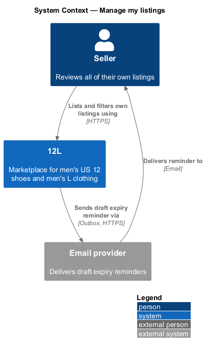
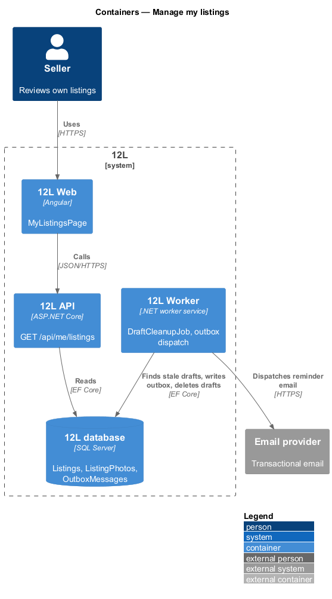
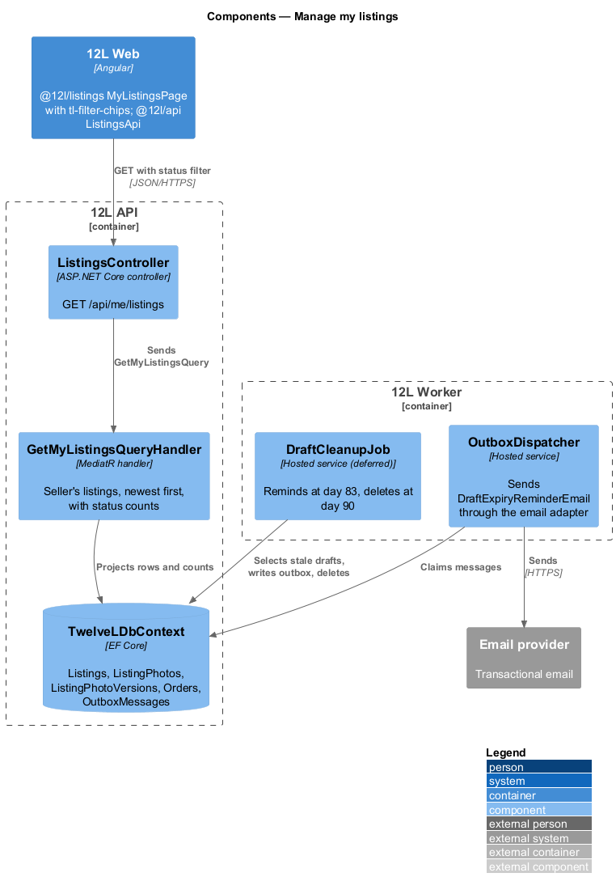
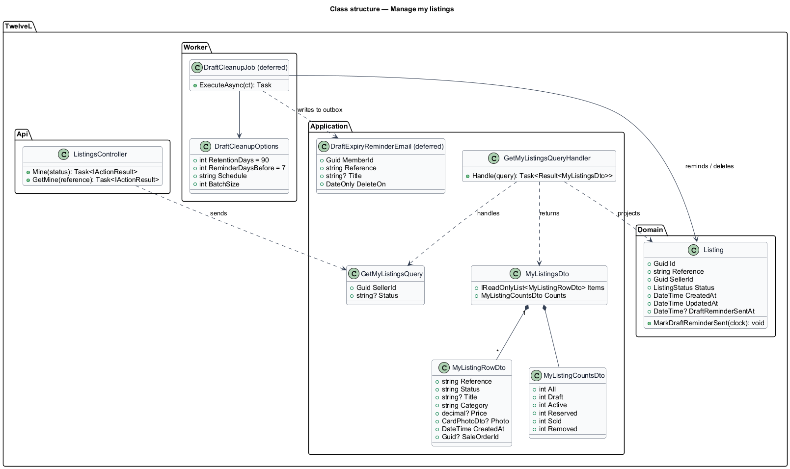
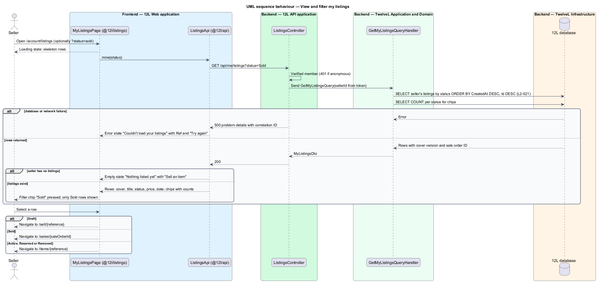
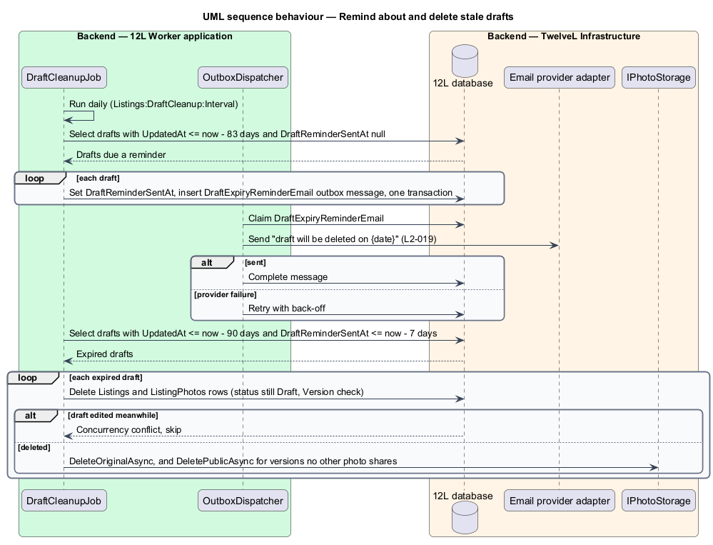

# Manage my listings

## Overview

A TuTuMuch seller may have drafts in progress, live listings, items in a buyer's checkout, sold items and withdrawn ones. This feature gives the seller one page, "Your listings", that shows every listing they own in each status. The seller can filter the page by status and open any listing from it (`L2-021`). The feature also enforces the draft lifecycle: a draft not edited for 90 days is deleted together with its photos, and the seller is emailed 7 days before (`L2-019`).

The feature sits in the listings subsystem (`L1-004`). It reads the `Listings` table written by [create-listing](../create-listing/README.md) and [edit-and-withdraw-listing](../edit-and-withdraw-listing/README.md), and photo versions produced by [upload-listing-photos](../upload-listing-photos/README.md). The payout banner of the seller-payouts feature stays in the app shell above the page.

Terms used in this design:

- **"Your listings" page** — account page at `/account/listings` that lists every listing the signed-in member owns, newest first; "My listings" in the specs
- **status filter** — chip group that limits the list to one listing status, with the count of listings in each status
- **listing reference** — public identifier of a listing in the form `L-<number>`, used in routes
- **stale draft** — draft whose `UpdatedAt` is more than 90 days in the past
- **draft expiry reminder** — transactional email sent 7 days before a stale draft is deleted

## Description

Screens, states and copy come from `docs/mocks/pages/my-listings/` and `docs/mocks/notifications/payout-banner/`. The info toast "Drafts older than 90 days are deleted" of `docs/mocks/notifications/toast/` is shown through `ToastService`.

### Frontend (`TuTuMuch Web`, `@tutumuch/listings` in `src/frontend/projects/listings/src/lib/my-listings/`)

- **`MyListingsPage`** — routed standalone component at `/account/listings`, inside the app shell. The listings library is mounted at `/` and owns `/sell`, `/sell/{reference}` and `/account/listings`. A visitor gets the error state from the `401` until the account shell adds a guard. The header shows "Your listings", a subtitle such as "5 listings · 1 active", and a primary "Sell an item" button with a plus icon that links to `/sell`. States:
  - `loading` — the filter chips plus 4 skeleton rows matching thumbnail, title and price, `aria-busy="true"`, `aria-label="Loading listings"`; no subtitle.
  - `default` — all listings, newest first.
  - `filtered` — one chip pressed, for example "Sold", with only the matching rows.
  - `empty` — tag icon, "Nothing listed yet", "List a pair of 12s or something in L." and a primary "Sell an item" action, without chips (`L2-021`).
  - `error` — refresh icon, "Couldn't load your listings", "Try again in a moment." with the correlation reference ("Ref …") and a "Try again" button (`L2-068`).
  - A filter that matches nothing shows the chips with a count of 0 and no rows; its copy is `<TO SUPPLY>`.
- **Status filter** — `tl-filter-chips` from `@tutumuch/components`: `role="group"` with `aria-label="Filter by status"`, 6 toggle chips ("All", "Draft", "Active", "Reserved", "Sold", "Removed"), each with its count and `aria-pressed`. The chosen status is kept in the URL query (`?status=sold`), so the filter survives reload and back navigation; each change asks the API again with that status.
- **Rows** — `tl-item-row` in the `.order-list`, with `tl-status` projected under the title:
  - the cover's 400 px WebP and JPEG versions in a `picture`, with explicit `width` and `height`, or the `image` icon when the listing has no photo;
  - the title, or "Untitled draft · {Category}" for a draft without one;
  - the status in the tone of the status (`draft`, `active`, `reserved`, `sold`, `removed`);
  - the price as whole dollars when the cents are zero (for example "$60"), or "—" when no price is set;
  - the date first saved as "Today", "Yesterday" or "Sat 24 Oct", by UTC calendar day like the order pages.
  The row links by status: `Draft` to `/sell/{reference}`; `Sold` to `/sales/{saleOrderId}`; `Active`, `Reserved` and `Removed` to `/items/{reference}`.
- **Draft expiry toast** — when the first load of a visit finds `counts.draft` above 0, the page shows one info toast through `ToastService`: "Drafts older than 90 days are deleted", "We’ll email you a week before." Changing the filter does not show it again.
- **Payout banner** — stays in the app shell above the top bar ([ADR orders/0005](../../../adr/orders/0005-seller-payouts-payout-port-fee-snapshot-and-shell-banner.md)), so it shows on this page too. Moving it into the page would make `@tutumuch/listings` import `@tutumuch/orders`, which the workspace forbids ([ADR listings/0002](../../../adr/listings/0002-my-listings-unpaged-list-and-deferred-draft-clean-up.md)).
- **`ListingsApi.mine(status?)`** in `@tutumuch/api` — typed call to `GET /api/me/listings`.

### API (`TuTuMuch.Api`)

- **`ListingsController`** — requires a verified member (`CanSell`), like every listings endpoint; anonymous calls return `401`.
  - `GET /api/me/listings?status={Draft|Active|Reserved|Sold|Removed}` — returns `200` with `MyListingsDto { items, counts }`. The status is case-insensitive. Errors: `400 VALIDATION_FAILED` for an unknown status; `401`.
  - Every listing of the seller is returned; paging waits for a supplied page size and copy (ADR listings/0002).
  - `GET /api/me/listings/{reference}` serves the edit form with its ETag and is described in [edit-and-withdraw-listing](../edit-and-withdraw-listing/README.md).

### Application and domain (`TuTuMuch.Application`, `TuTuMuch.Domain`)

- **`GetMyListingsQuery`** / **`GetMyListingsQueryHandler`** — reads the seller ID from the authenticated principal, never from the request (`L2-010`). It runs:
  1. a grouped count of `Listings` by `Status` where `SellerId` equals the caller, for the chips;
  2. a projection of the seller's `Listings`, optionally filtered by `Status`, ordered by `CreatedAt DESC, Id DESC`;
  3. the cover photo (lowest `Position`) of each row with its versions, and the order of each `Sold` row for `saleOrderId`.
- **`MyListingRowDto`** — `reference`, `status`, `title?`, `category`, `price?`, `photo?` (the catalog's `CardPhotoDto`: `width`, `height`, `src`, `webp` and `jpeg` srcsets), `createdAt`, `saleOrderId?`.
- **`MyListingCountsDto`** — `all`, `draft`, `active`, `reserved`, `sold`, `removed`.
- **Sort order** — "newest first" means by `CreatedAt`, the date the listing was first saved. The row shows the same date.
- **Draft reminder reset** — `Listing.UpdateDetails` clears `DraftReminderSentAt` whenever a draft is saved, so an edited draft restarts its 90-day period and earns a fresh reminder.

### Worker and infrastructure (`TuTuMuch.Worker`, `TuTuMuch.Infrastructure`)

The draft clean-up landed after the page as its own slice ([ADR listings/0004](../../../adr/listings/0004-draft-clean-up-deletes-photo-files-directly.md)). The indexes `IX_Listings_SellerId_CreatedAt` and `IX_Listings_SellerId_Status_CreatedAt` already exist from create-listing.

- **`DraftCleanupJob`** — hosted service that sends `CleanUpDraftsCommand` once every `Listings:DraftCleanup:Interval` (one day). `CleanUpDraftsHandler` (`TuTuMuch.Application/Listings/CleanUpDrafts.cs`):
  1. **reminds** — selects drafts with `UpdatedAt` at or before now − (90 − 7) days, that is 83 days, and `DraftReminderSentAt` null. For each draft, one save sets `DraftReminderSentAt` (bumping `Version`, not `UpdatedAt`) and queues a `DraftExpiryReminderEmail { listingReference, title, deleteOn }` through `IEmailOutbox`; a draft edited meanwhile loses the race on `Version` and is skipped;
  2. **deletes** — selects drafts with `UpdatedAt` at or before now − 90 days and `DraftReminderSentAt` at or before now − 7 days. One save deletes the `Listings` row and its `ListingPhotos` rows with the `Version` check, and skips a draft edited meanwhile. After the commit it deletes each photo's original through `IPhotoStorage.DeleteOriginalAsync` and its versions through `DeletePublicAsync`, unless another photo still shares them by content hash. A failed file delete is logged and leaves an orphan file, never a broken listing.
  The second condition guarantees that the email was sent at least 7 days before deletion, even after a missed run (`L2-019`).
- **`OutboxDispatcher`** (shared, baseline) — sends `DraftExpiryReminderEmail` through the email provider adapter with retry and back-off (`L2-042`). The template "Your draft {title} will be deleted on {day}" links to `/sell/{reference}`. `NotificationType.DraftExpiryReminder` falls in the always-on transactional category, so the dispatcher's preference check (`L2-043`) lets it through even with marketing off.
- **Indexes on `Listings`** — `IX_Listings_SellerId_CreatedAt` (`SellerId`, `CreatedAt DESC`, `Id DESC`) including `Status`, `Title`, `Price`, `Category`, `Reference`; `IX_Listings_SellerId_Status_CreatedAt` (`SellerId`, `Status`, `CreatedAt DESC`, `Id DESC`) with the same included columns; and the filtered index `IX_Listings_Draft_UpdatedAt` (`UpdatedAt`) `WHERE Status = 'Draft'` for the clean-up job.
- **Query safety** — EF Core LINQ only, so filter values are parameterised (`L2-049`).

### Configuration

| Key | Value | Notes |
|-----|-------|-------|
| `Listing.DraftRetentionDays` | 90 | Domain constant, `L2-019` |
| `Listing.DraftReminderDaysBefore` | 7 | Domain constant, `L2-019` |
| `Listings:DraftCleanup:Interval` | `1.00:00:00` | How often the job runs |

## Requirements

The feature realises the following level-2 (L2) requirements. Each refines the level-1 (L1) requirement cited.

| L2 ID | Refines (L1) | Requirement |
|-------|--------------|-------------|
| `L2-021` | `L1-004` | A seller shall have a "My listings" page showing all of their listings with cover photo, title, price, status and date, filterable by status and sorted newest first. |
| `L2-019` | `L1-004` | A listing shall have one of these statuses: Draft, Active, Reserved, Sold or Removed. A seller shall be able to save an incomplete listing as a Draft and publish it later. Only Active and Reserved listings appear in the catalog. Validation rules L2-014 to L2-018 apply when publishing; drafts only need a category. |

This feature covers the parts of `L2-019` that concern seeing drafts by status and the 90-day draft clean-up. Saving and publishing drafts belong to [create-listing](../create-listing/README.md).

## Diagrams

### System context

The seller reviews their listings in TuTuMuch. TuTuMuch emails the seller through the email provider before a stale draft is deleted.

### Containers

`TuTuMuch Web` reads the list from `TuTuMuch API`. `TuTuMuch Worker` finds stale drafts in `TuTuMuch database`, writes reminder emails to the outbox and deletes expired drafts.

### Components

`MyListingsController` sends `GetMyListingsQuery` to its handler, which projects rows and counts through `TuTuMuchDbContext`. In the worker, `DraftCleanupJob` writes reminders that `OutboxDispatcher` delivers.

### Class structure

`GetMyListingsQueryHandler` returns a `MyListingsPage` of `MyListingSummaryDto` rows with `MyListingCounts`. `DraftCleanupJob` reads `DraftCleanupOptions`, updates `Listing` and writes `DraftExpiryReminderEmail` messages.

### Behaviour — view and filter my listings

The page shows skeleton rows, then the seller's listings newest first with per-status counts. It shows the empty state when the seller has none and the error state with a reference on failure. Each row opens the place that fits its status.

### Behaviour — remind about and delete stale drafts

The daily job first records and queues reminders for drafts 83 days old. It then deletes drafts at least 90 days old whose reminder is at least 7 days old, with their photos and stored files.

## Testing

- `tests/TuTuMuch.Api.Tests/MyListingsTests.cs` — xUnit acceptance tests through `TuTuMuchApiFactory` with the in-memory database and fakes: every status newest first with counts and the sale order, the Sold filter, the empty page, `400` for an unknown status and `401` for a visitor.
- `tests/TuTuMuch.Api.Tests/DraftCleanupTests.cs` — the reminder at 83 days, once, linking to the draft; deletion at 90 days with photo rows and files; a missed reminder buys 7 more days; an edit restarts the period; versions shared by content are kept; the reminder is sent with marketing off.
- `tests/TuTuMuch.Worker.Tests/DraftCleanupJobTests.cs` — each pass sends `CleanUpDraftsCommand`; the job runs at least daily.
- `src/frontend/e2e/tests/manage-my-listings.spec.ts` with `e2e/pages/my-listings.page.ts` — Playwright (Chromium) with every `TuTuMuch API` call served by `page.route` fixtures: rows, dates and prices, links by status, the filter in the URL across a reload, empty, error with retry, loading, and the draft expiry toast once per visit only for a seller with drafts.

## Open questions

- Paging: page size and "Load more" copy are `<TO SUPPLY>`; the API returns every listing until then.
- Copy for a filter that matches nothing is `<TO SUPPLY>`.
