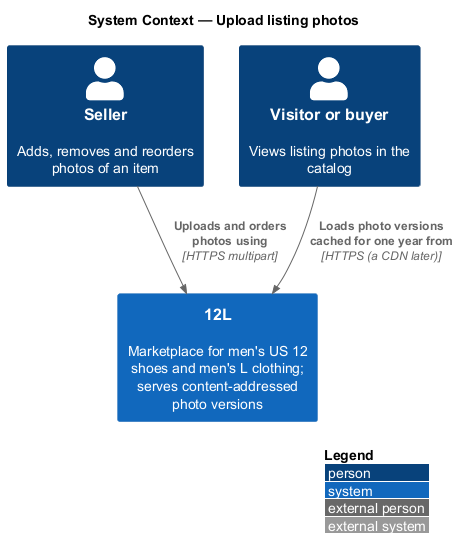
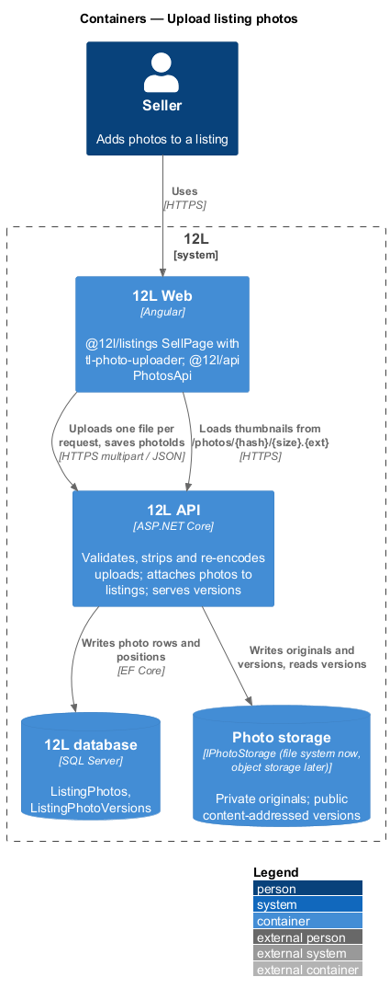
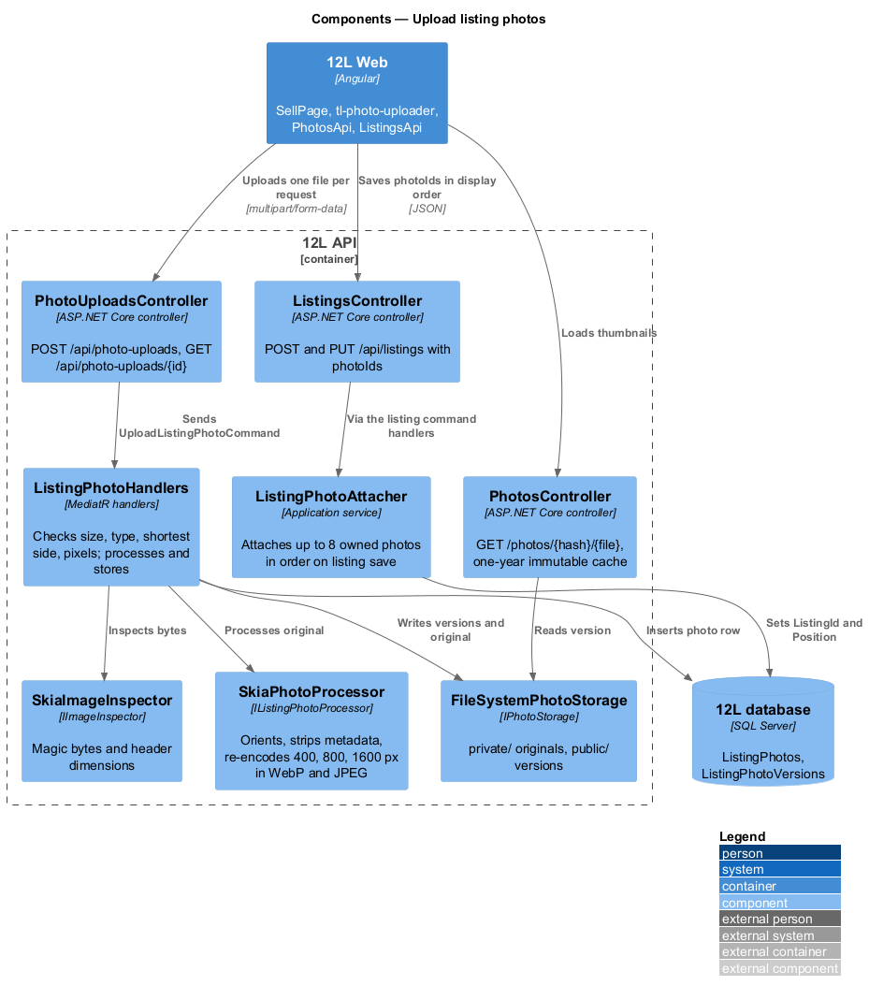
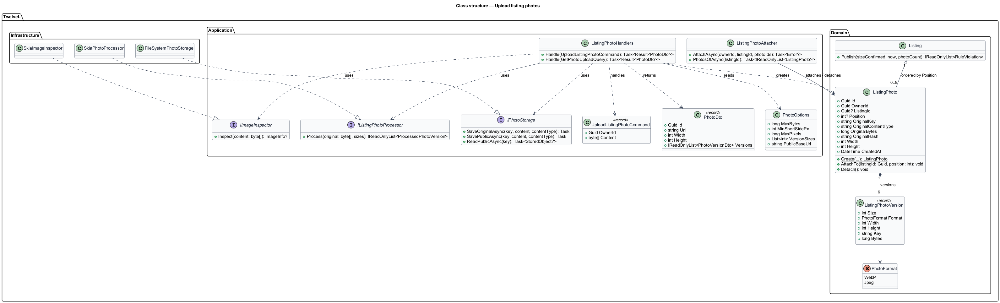
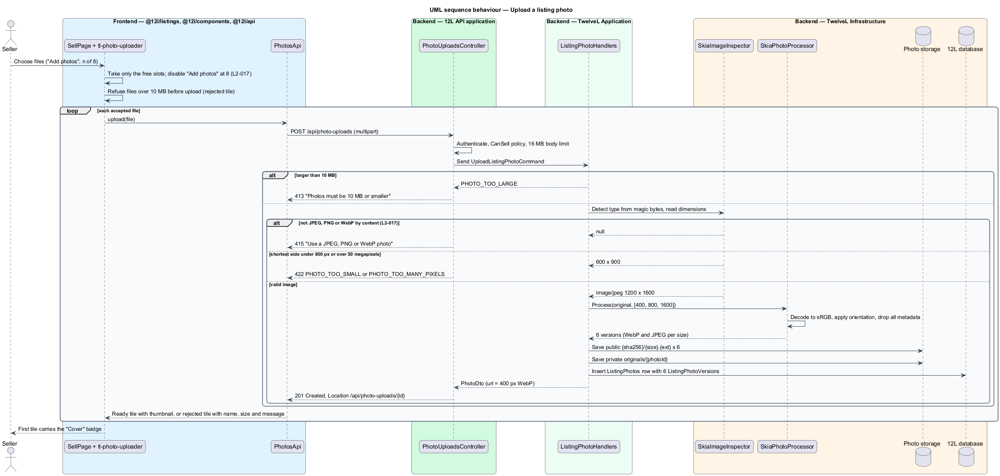
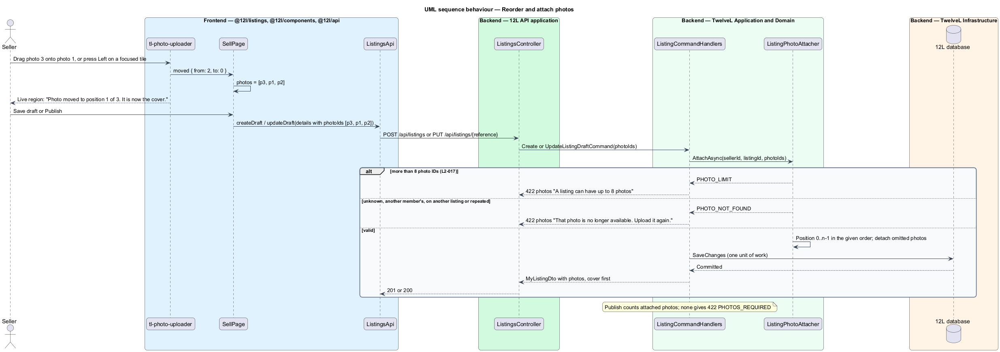

# Upload listing photos

## Overview

Every Tutu Much listing shows between 1 and 8 photos of the actual item (`L2-015`, `L2-017`). Buyers judge used shoes and clothing almost entirely from photos, and phone cameras embed location and device data in every file. This feature lets a seller add, remove and reorder photos on the listing form. It also makes every stored photo safe to publish and fast to deliver.

The feature sits in the listings subsystem (`L1-004`). The listing form that hosts the uploader belongs to [create-listing](../create-listing/README.md) and [edit-and-withdraw-listing](../edit-and-withdraw-listing/README.md). Catalog pages consume the processed versions through `srcset`; that delivery markup belongs to the catalog subsystem, and this feature produces the versions it needs (`L2-059`).

Terms used in this design:

- **photo upload** — one image file sent by a seller and stored as a `ListingPhoto` record before or after it is attached to a listing
- **original** — uploaded file exactly as received, kept in private storage and never served to visitors
- **photo version** — re-encoded, metadata-free copy of a photo at one width (400, 800 or 1600 px) in one format (WebP or JPEG)
- **content-addressed key** — storage key `{hash}/{width}.{ext}` derived from the SHA-256 hash of the uploaded original, so a key never changes meaning and can be cached for one year
- **cover** — photo at position 0 of a listing, shown on catalog cards and the "My listings" page
- **unattached photo** — photo upload not yet referenced by any listing save
- **content sniffing** — detection of the file type from the first bytes of the file (magic bytes) rather than from its name or declared content type

Photos upload independently of the listing. The seller can therefore add photos before choosing a category, which is all a draft needs. The listing save then references the uploaded photo IDs in display order.

## Description

Screens, states and copy come from `docs/mocks/pages/sell/` (`default`, `filled`, `invalid`) and `docs/mocks/pages/edit-listing/`. Photos are processed in the upload request ([ADR listings/0001](../../../adr/listings/0001-process-photos-in-the-upload-request.md)) with SkiaSharp ([ADR platform/0009](../../../adr/platform/0009-skiasharp-for-photo-processing.md)), so a stored photo is always ready and there is no status to poll.

### Frontend (`Tutu Much Web`)

- **`tm-photo-uploader`** (`@tutumuch/components`, `src/lib/photo-uploader/`) — presentational. Inputs `tiles` (`key`, `state` uploading, ready or rejected, `src`, `name`, `size`), `max` (8), `error`, `inputId` (`photos`); outputs `filesSelected`, `removed`, `moved { from, to }`. It renders:
  - a tile per photo with the 400 px WebP thumbnail, alt text "Photo {n}", and a remove button "Remove photo {n}";
  - the "Cover" badge on the first tile;
  - a spinner tile, announced as "Uploading {file name}", while a file uploads; it counts towards the limit;
  - a rejected tile showing the file name and size (for example "IMG_4471.jpg", "11.4 MB") with a remove button "Remove {file name}";
  - the add tile "Add photos" with "{n} of 8", backed by `<input type="file" accept="image/jpeg,image/png,image/webp" multiple>`, disabled at 8 photos (`L2-017`);
  - the help text "JPEG, PNG or WebP up to 10 MB. Drag to reorder; the first is the cover." and, when invalid, an inline error linked by `aria-describedby`.
- **Reordering** — tiles reorder by native HTML drag and drop. On a focused photo tile the Left and Right arrow keys move it one place; focus follows the tile and a polite live region announces "Photo moved to position {n} of {m}.", adding "It is now the cover." at position 1 (`L2-065`).
- **`SellPage`** (`@tutumuch/listings`, `src/lib/sell/`) — owns the tiles. Chosen files fill only the free slots; a file over 10 MB becomes a rejected tile with "Photos must be 10 MB or smaller" and is not sent. Each other file uploads at once, one request per file. A `413`, `415` or `422` shows the problem title for a rejected tile; other failures show "Couldn’t upload {file name}. Try again.". Saves send `photoIds` of ready photos in display order; while a file is uploading, saving shows "Wait for your photos to finish uploading". Publishing with no photo shows "Add at least one photo" in the summary and inline; the inline error appends the last rejection reason ("Add at least one photo. Photos must be 10 MB or smaller."). A draft opened at `/sell/{reference}` shows its photos.
- **`PhotosApi`** (`@tutumuch/api`, `src/lib/listings/photos-api.ts`) — `upload(file)` posts `multipart/form-data` and returns `ApiResult<Photo>`. `ListingDetails` carries `photoIds`; `MyListing` carries `photos`, cover first.

### API (`TutuMuch.Api`)

- **`PhotoUploadsController`** — requires the `CanSell` policy (`L2-010`).
  - `POST /api/photo-uploads` — one `file` part. The body limit is 16 MB, above the 10 MB photo limit, so an oversized photo reaches the handler and gets a problem body; this endpoint is the exception to the 1 MB JSON body limit of `L2-049`. Returns `201 Created` with `PhotoDto { id, url, width, height, versions[] }` and `Location: /api/photo-uploads/{id}`; `413` `PHOTO_TOO_LARGE`; `415` `PHOTO_TYPE_UNSUPPORTED` (also when no file is sent); `422` `PHOTO_TOO_SMALL` or `PHOTO_TOO_MANY_PIXELS`; `401`; `403`.
  - `GET /api/photo-uploads/{id}` — `200` with `PhotoDto`; `404` when the photo belongs to another member (`L2-010`).
- **`PhotosController`** — anonymous `GET /photos/{hash}/{size}.{ext}`; the key must be 64 hex characters, a size and `webp` or `jpg`. Served from `IPhotoStorage` with `Cache-Control: public, max-age=31536000, immutable` and the format's content type (`L2-059`). A CDN can front this origin later without change.
- **Attaching** — `POST /api/listings` and `PUT /api/listings/{reference}` accept `photoIds` in display order; leaving it out keeps the current photos. `MyListingDto` returns `photos`, cover first.

### Application and domain (`TutuMuch.Application`, `TutuMuch.Domain`)

- **`UploadListingPhotoCommand`** / **`ListingPhotoHandlers`** — in order:
  1. rejects content longer than `Photos:MaxBytes` with `PHOTO_TOO_LARGE`;
  2. calls `IImageInspector.Inspect`, which reads magic bytes and the header only. Content that is not JPEG, PNG or WebP gets `PHOTO_TYPE_UNSUPPORTED` and HTTP 415, whatever its name;
  3. rejects a shortest side under `Photos:MinShortSidePx` (800) with `PHOTO_TOO_SMALL`, and more than `Photos:MaxPixels` with `PHOTO_TOO_MANY_PIXELS` (decompression-bomb guard);
  4. computes the SHA-256 of the bytes, calls `IListingPhotoProcessor.Process` and saves the 6 versions to public storage under `{hash}/{size}.{ext}`;
  5. saves the original to private storage under `originals/{photoId}` and inserts the `ListingPhoto` row with its versions.
- **`ListingPhotoAttacher`** — called by the create and update draft handlers:
  - more than 8 IDs gives `PHOTO_LIMIT` (`422`, field `photos`), so a ninth photo is refused even when the client control is bypassed (`L2-017`);
  - every photo must be owned by the caller and unattached or already on this listing, without repeats (`PHOTO_NOT_FOUND`, `422`, field `photos`);
  - it then sets `ListingId` and `Position` (0 to n − 1) in the given order and detaches photos the request omits.
- **Publish rule** — `Listing.Publish(sizeConfirmed, now, photoCount)` adds `PHOTOS_REQUIRED` "Add at least one photo" on field `photos` when no photo is attached. The maximum is enforced on attach.
- **`ListingPhoto`** entity — `Id`, `OwnerId`, `ListingId?`, `Position?`, `OriginalKey`, `OriginalContentType` (sniffed), `OriginalBytes`, `OriginalHash`, `Width`, `Height` (as displayed, after orientation), `CreatedAt` and the owned `Versions`.
- **`ListingPhotoVersion`** value — `Size` (target width 400, 800 or 1600), `Format` (`WebP`, `Jpeg`), `Width`, `Height` (actual, never upscaled), `Key`, `Bytes`.
- **Ports** — `IImageInspector`, `IListingPhotoProcessor`, `IPhotoStorage` (`SaveOriginalAsync`, `SavePublicAsync`, `ReadPublicAsync`).

### Infrastructure (`TutuMuch.Infrastructure`)

- **`SkiaImageInspector`** — magic bytes (`FF D8 FF` JPEG, `89 50 4E 47 0D 0A 1A 0A` PNG, `RIFF....WEBP` WebP), then `SKCodec` for the header dimensions; axes swap for rotated EXIF orientations.
- **`SkiaPhotoProcessor`** — decodes to sRGB, applies the EXIF orientation to the pixels, and for each size scales (never upscaling) onto an opaque white bitmap without a colour space, encoding WebP at quality 80 and JPEG at quality 82. Only pixels are encoded, so no EXIF, XMP, IPTC, GPS or ICC block survives (`L2-017`). Settings are fixed, so the same original always gives the same bytes under the same key.
- **`FileSystemPhotoStorage`** — development adapter: `private/` for originals and `public/` for versions under `PhotoStorage:RootPath`; keys cannot leave the root. Real object storage and the CDN replace it behind `IPhotoStorage` (deferred).
- **Tables** (migration `AddListingPhotos`):
  - `ListingPhotos` — `Id` PK, `OwnerId` FK to `Members` (restrict), `ListingId` FK to `Listings` (nullable, `ON DELETE SET NULL`), `Position int null` with check `CK_ListingPhotos_Position` (`Position IS NULL OR Position BETWEEN 0 AND 7`), `OriginalKey nvarchar(200)`, `OriginalContentType nvarchar(32)`, `OriginalBytes`, `OriginalHash nchar(64)`, `Width`, `Height`, `CreatedAt`. Indexes `IX_ListingPhotos_ListingId_Position` and `IX_ListingPhotos_OwnerId_CreatedAt`. Position is not unique in the database because a reorder updates several rows in one save; the attacher keeps positions 0 to n − 1.
  - `ListingPhotoVersions` — owned by `ListingPhotos` (`PhotoId` FK, cascade delete); PK (`PhotoId`, `Size`, `Format`); `Format nvarchar(8)`, `Width`, `Height`, `Key nvarchar(80)`, `Bytes`.
- **Delivery URL** — `{Photos:PublicBaseUrl}/{hash}/{size}.{ext}`; the DTO `url` is the 400 px WebP version.

### Testing

- xUnit (`tests/TutuMuch.Api.Tests/PhotoUploadTests.cs`, `ListingPhotoAttachTests.cs`) hosts the API with SQLite in-memory and `FakePhotoStorage` in place of `IPhotoStorage`; test images are made in memory, including a JPEG carrying Exif GPS and XMP blocks.
- Playwright (`src/frontend/e2e/tests/upload-listing-photos.spec.ts`) serves `POST /api/photo-uploads` and `/photos/**` through `page.route` fixtures.

### Error codes

| Code | HTTP | Message shown |
|------|-----:|---------------|
| `PHOTO_TOO_LARGE` | 413 | "Photos must be 10 MB or smaller" |
| `PHOTO_TYPE_UNSUPPORTED` | 415 | "Use a JPEG, PNG or WebP photo" |
| `PHOTO_TOO_SMALL` | 422 | "Photos must be at least 800 pixels on the shortest side" |
| `PHOTO_TOO_MANY_PIXELS` | 422 | "Photos must be 50 megapixels or fewer" |
| `PHOTO_LIMIT` | 422 | "A listing can have up to 8 photos" |
| `PHOTO_NOT_FOUND` | 422 | "That photo is no longer available. Upload it again." |
| `PHOTOS_REQUIRED` | 422 | "Add at least one photo" |

### Configuration

| Key | Value | Notes |
|-----|-------|-------|
| `Photos:MaxBytes` | 10485760 | 10 MB read as 10 MiB |
| `Photos:MinShortSidePx` | 800 | `L2-017` |
| `Photos:MaxPixels` | 50000000 | Decompression-bomb guard |
| `Photos:VersionSizes` | 400, 800, 1600 | `L2-017` |
| `Photos:PublicBaseUrl` | `/photos` | Becomes the CDN origin when one exists |
| `PhotoStorage:RootPath` | system temp `tutumuch-photos` | Development adapter only |

### Deferred

- The outbox, `PhotoProcessingJob` and the `PhotoCleanupJob` that deletes unattached photos and unreferenced versions (ADR listings/0001).
- Real object storage, its credentials (`PhotoStorage:ConnectionString`) and the CDN.
- Editing an active listing's photos belongs to edit-and-withdraw-listing; it reuses `tm-photo-uploader` and `ListingPhotoAttacher`.

## Requirements

The feature realises the following level-2 (L2) requirements. Each refines the level-1 (L1) requirement cited.

| L2 ID | Refines (L1) | Requirement |
|-------|--------------|-------------|
| `L2-017` | `L1-004` | A listing shall have 1 to 8 photos. Each photo shall be JPEG, PNG or WebP, at most 10 MB, and at least 800 pixels on its shortest side. The file type shall be checked from the file's content, not its name. The server shall strip all metadata (including GPS location), re-encode the image and produce thumbnail (400px), medium (800px) and large (1600px) versions. The first photo is the cover and the seller can reorder photos. |
| `L2-059` | `L1-015` | Photos shall be served from a CDN in WebP with a JPEG fallback, sized to the space they fill using `srcset`, with explicit width and height to avoid layout shift. Photos below the first screen shall be lazy loaded. Photo URLs shall be content-addressed and cached for at least one year. |

`L2-059` is a supporting requirement here: this feature generates the WebP and JPEG versions, stores their dimensions, assigns content-addressed keys and sets the one-year cache header. The `srcset`, `width`/`height` and lazy-loading markup belongs to the catalog subsystem.

## Diagrams

### System context

Sellers upload photos to Tutu Much. Visitors load the processed versions, cached for one year.

### Containers

`Tutu Much API` validates each upload, produces the versions and stores them with the original behind `IPhotoStorage`; it also serves the versions.

### Components

`PhotoUploadsController` hands each file to `ListingPhotoHandlers`, which inspects it with `SkiaImageInspector`, processes it with `SkiaPhotoProcessor` and stores it. `ListingPhotoAttacher` links photos to a listing when the listing is saved. `PhotosController` serves versions.

### Class structure

A `ListingPhoto` owns 6 `ListingPhotoVersion` values and belongs to at most one `Listing`, which holds up to 8 ordered photos. SkiaSharp and file-system classes implement the `IImageInspector`, `IListingPhotoProcessor` and `IPhotoStorage` ports.

### Behaviour — upload a photo

The handler checks size, sniffed type and dimensions in that order and returns `413`, `415` or `422` on the first failure. A valid file is stripped and re-encoded in the request; the versions, the original and the row are stored before `201`.

### Behaviour — reorder and attach photos

The order of `photoIds` in a listing save sets each photo's `Position`; position 0 becomes the cover. More than 8 IDs, or an ID the caller does not own, returns `422`.

