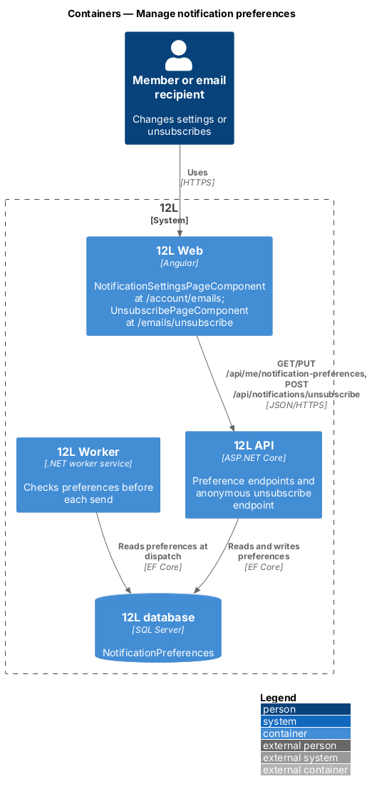
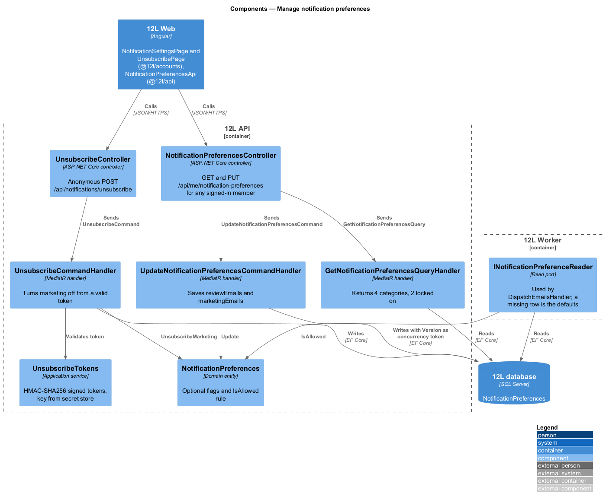
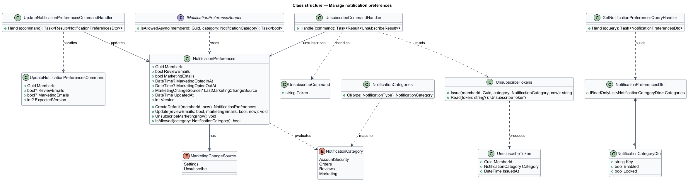
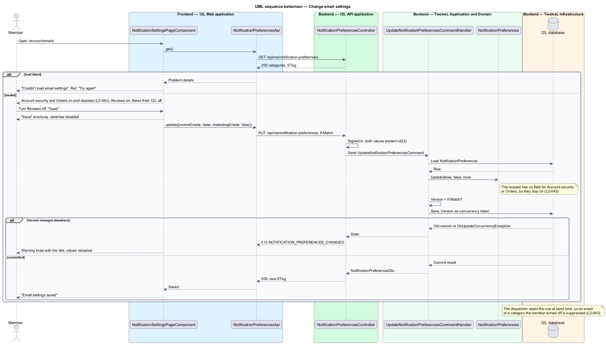
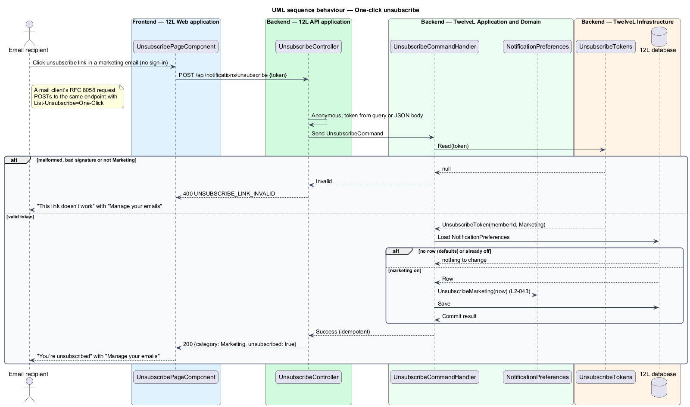

# Manage notification preferences

## Overview

TuTuMuch sends email about events that affect a member's account, listings and orders (see
[send-email-notifications](../send-email-notifications/README.md)). Some of those emails
are essential, and some are optional. This feature lets a member choose which optional
emails they receive. It also lets anyone holding a marketing email leave the marketing
list in one click, without signing in (`L2-043`).

Terms used throughout:

- **notification category** — group of email types that shares one setting: Account security, Orders, Reviews or Marketing
- **always-on category** — category that cannot be turned off: Account security and Orders
- **optional category** — category the member can turn off: Reviews, which is on by default, and Marketing, which is off by default
- **opt-in** — member's explicit choice to turn marketing email on
- **unsubscribe token** — signed, opaque value in a marketing email that identifies the member and the Marketing category without a session
- **one-click unsubscribe** — removal from marketing email by following the link in the email, or by the mail client's RFC 8058 `List-Unsubscribe-Post` request, with no sign-in

The settings page appears in the account area under the navigation label "Emails". Its
route is `/account/emails`. The dispatcher in
[send-email-notifications](../send-email-notifications/README.md) reads the stored
preferences at send time, so a change applies to every email not yet sent.

## Description

The slice runs from the "Emails" page and the unsubscribe page of `TuTuMuch Web`, through
`TuTuMuch API`, to the `NotificationPreferences` table in `TuTuMuch database`. Screens, states and
copy come from `docs/mocks/pages/notification-settings/` (states *default*, *loading*,
*error*, *submitting* and *success*). The unsubscribe page is not mocked
(`docs/mocks/README.md`); its copy was written with the implementation and is listed below.

### Frontend (`@tutumuch/accounts`, `src/frontend/projects/accounts/src/lib/`)

The pages sit in the `accounts` feature library, because the settings page renders in the
account area next to "Profile" and "Settings". Composition follows
[screen-composition](../../../screen-composition.md).

- **Route** `account/emails` (app shell) → **`NotificationSettingsPage`**
  (`notification-settings/`) — heading "Emails" with the lead "Security and order emails are
  always on." A form holds a `.settings-list` of 4 rows. Each row has a title, a description and
  a `tl-switch`:

  | Row | Description | Switch |
  |-----|-------------|--------|
  | Account security | Sign-in alerts, password resets | on, disabled, labelled "Account security emails, always on" |
  | Orders | Sales, shipping, delivery, refunds | on, disabled, labelled "Order emails, always on" |
  | Reviews | When someone reviews you | bound to `reviewEmails`, labelled "Review emails" |
  | News from TuTuMuch | New arrivals in your size, now and then | bound to `marketingEmails`, labelled "Marketing emails" |

  A primary "Save" button submits the form. States:
  - *loading* — 4 skeleton rows in a `.settings-list` with `aria-busy="true"`.
  - *default* — values from the API.
  - *submitting* — "Save" carries `aria-busy="true"` and both optional switches are
    disabled.
  - *success* — `tl-alert` success "Email settings saved" above the list, announced through
    `role="status"`.
  - *error* — `tl-empty-state` (error tone) "Couldn’t load email settings" with "Something went
    wrong on our side.", the reference "Ref {correlationId}" and a "Try again" button
    (`L2-068`).
  - *save failed* — not mocked. A danger toast from `ToastService` shows "Something went wrong"
    with the reference and "Try again", and the switches keep the member's unsaved choice.
  - *changed elsewhere* — not mocked. A 412 shows a warning toast with the API's title and
    "Check them and save again.", and reloads the values and the ETag.
  - A visitor (401) is sent to `/sign-in?returnUrl=/account/emails`.
- **`NotificationPreferencesApi`** (`@tutumuch/api`, `src/lib/accounts/`) — typed `HttpClient`
  wrapper with `get()`, `update(update, etag)` and `unsubscribe(token)`. It sends the `ETag` it
  received as `If-Match`.
- **Route** `emails/unsubscribe` (auth shell, public) → **`UnsubscribePage`** (`unsubscribe/`).
  On load it reads `token` from the query string and calls `POST /api/notifications/unsubscribe`
  once. The call runs from script on page load because mail scanners prefetch links with `GET`;
  a `GET` alone never changes state. States:
  - *working* — "Unsubscribing" with the spinner "Turning off news from TuTuMuch…".
  - *unsubscribed* — "You’re unsubscribed", "You won’t get news from TuTuMuch any more. Account
    security and order emails still arrive.", "Back to shop" and "Manage your emails"
    (`/account/emails`, to opt back in after signing in).
  - *invalid link* — "This link doesn’t work", "It may be incomplete. You can turn off news
    from TuTuMuch in your email settings." and "Manage your emails".
  - *error* — "Couldn’t unsubscribe you", "Something went wrong on our side.", the reference
    and "Try again".

### API (`TuTuMuch.Api`)

`NotificationPreferencesController` handles the signed-in endpoints and
`UnsubscribeController` handles the anonymous one. Errors are RFC 9457 problem details
with a correlation ID (`L2-068`).

| Verb and path | Policy | Purpose | Responses |
|---------------|--------|---------|-----------|
| `GET /api/me/notification-preferences` | any signed-in member | Read the 4 categories | 200 `NotificationPreferencesDto` with `ETag`; 401 |
| `PUT /api/me/notification-preferences` | any signed-in member | Save the two optional settings | 200 `NotificationPreferencesDto` with the new `ETag`; 401; 412 `NOTIFICATION_PREFERENCES_CHANGED` when `If-Match` is out of date; 422 `NOTIFICATION_PREFERENCES_INVALID` when a value is missing; 428 `PRECONDITION_REQUIRED` without `If-Match` |
| `POST /api/notifications/unsubscribe` | anonymous | One-click marketing unsubscribe, from the page or a mail client's RFC 8058 POST | 200 `{ "category": "Marketing", "unsubscribed": true }`; 400 `UNSUBSCRIBE_LINK_INVALID` |

- The settings endpoints accept unverified members too, because account security email
  reaches them. Responses carry `Cache-Control: no-store`.
- `NotificationPreferencesDto` lists the 4 categories as `{ key, enabled, locked }` with the
  keys `accountSecurity`, `orders`, `reviews` and `marketing`. `accountSecurity` and `orders`
  always carry `enabled: true, locked: true` (`L2-043`). The `ETag` is the row's version, `"0"`
  for a member who never saved.
- `UpdateNotificationPreferencesRequest` carries only `reviewEmails` and
  `marketingEmails`. The contract has no field for the always-on categories, so no request
  can turn them off; unknown fields are ignored (`L2-049`).
- The unsubscribe endpoint accepts the token in the query string (`?token=…`, for RFC 8058
  clients, whose body is the form `List-Unsubscribe=One-Click`) or in a JSON body. It needs no
  anti-forgery token because it uses no cookie authentication. It answers 200 for every valid
  token, even when the member was already unsubscribed or no longer exists, so the call is
  idempotent. The response never names the member or the email address.

### Application and domain (`TuTuMuch.Application`, `TuTuMuch.Domain`)

- **`NotificationCategory`** (`AccountSecurity`, `Orders`, `Reviews`, `Marketing`) and
  **`NotificationCategories.Of(NotificationType)`**: `EmailVerification` is account security,
  `Marketing` is marketing, and every order email is orders. No notification type is a review
  email yet, because review authoring is deferred (ADR general/0001); the Reviews setting is
  stored and honoured as soon as such a type exists.
- **`NotificationPreferences`** (entity, one per member):
  - Fields: `Guid MemberId`, `bool ReviewEmails`, `bool MarketingEmails`,
    `DateTime? MarketingOptedInAt`, `DateTime? MarketingOptedOutAt`,
    `MarketingChangeSource? LastMarketingChangeSource` (`Settings`, `Unsubscribe`),
    `DateTime UpdatedAt`, `int Version`.
  - `CreateDefault(memberId, now)` sets `ReviewEmails = true` (mock *default*) and
    `MarketingEmails = false` (`L2-043`).
  - `Update(reviewEmails, marketingEmails, now)` records the opt-in or opt-out time and the
    source `Settings` when marketing changes, and increments `Version`.
  - `UnsubscribeMarketing(now)` sets `MarketingEmails = false` with the source `Unsubscribe`.
  - `IsAllowed(NotificationCategory)` returns `true` for `AccountSecurity` and `Orders`
    always, and returns the stored flag for `Reviews` and `Marketing`.
- **No row at registration.** Every reader treats a missing row as `CreateDefault`, so a new
  member starts with marketing off (`L2-043`), and the first save inserts the row
  ([ADR notifications/0002](../../../adr/notifications/0002-notification-preferences-defaults-and-unsubscribe-tokens.md)).
- **`GetNotificationPreferencesQuery`** and its handler — return the DTO for the calling
  member, the defaults when the row is missing.
- **`UpdateNotificationPreferencesCommand`** (`MemberId`, `ReviewEmails`, `MarketingEmails`,
  `ExpectedVersion`) and its handler — refuse a missing value (422) or version (428), load or
  create the row, compare the version (412), call `Update` and save with `Version` as the
  concurrency token, so a race also ends in 412.
- **`UnsubscribeCommand`** (`Token`) and its handler — read the token through
  `UnsubscribeTokens`, load the member's row and, when marketing is on, call
  `UnsubscribeMarketing` and save. A missing row (defaults, so marketing is already off) or a
  member who no longer exists changes nothing and still succeeds.
- **`INotificationPreferenceReader`** / **`NotificationPreferenceReader`** — read port used by
  the email dispatcher. It loads the row and calls `IsAllowed`; a missing row is the defaults.
- **`UnsubscribeTokens`** — issues and reads tokens.
  - A token is the base64url of `memberId (16 bytes) | category (1 byte) | issuedAt (Unix
    seconds, 8 bytes)`, a dot, and the base64url HMAC-SHA256 of those bytes.
  - The signing key `Notifications:UnsubscribeSigningKey` lives in the secret store
    (`L2-052`); development settings carry a development-only key.
  - The signature is compared in constant time.
  - The token holds no email address. Tokens do not expire, so an old marketing email still
    unsubscribes; a lifetime and key rotation are open questions.
- **Marketing email integration.** `NotificationType.Marketing` with the model
  `MarketingEmail(Subject, Text)` exists so that the dispatcher honours the setting; nothing
  queues it until marketing campaigns are built (deferred). For every `Marketing` email the
  dispatcher in [send-email-notifications](../send-email-notifications/README.md) issues a
  token and:
  - appends "Unsubscribe from news from TuTuMuch in one click:
    `{App:BaseUrl}/emails/unsubscribe?token=…`" to the body;
  - sets `List-Unsubscribe: <{App:BaseUrl}/api/notifications/unsubscribe?token=…>` and
    `List-Unsubscribe-Post: List-Unsubscribe=One-Click` through `EmailMessage.Headers`
    (`L2-043`). TuTuMuch Web serves `TuTuMuch API` under the same origin.
- **Dispatcher check.** Before rendering, the dispatcher asks
  `INotificationPreferenceReader` about the message's category. When the member turned it off,
  the outbox message is `Suppressed` with the reason `preference_off` and nothing is sent.

### Infrastructure and data (`TuTuMuch.Infrastructure`)

- Table **`NotificationPreferences`** (migration `NotificationPreferences`):
  - Primary key `MemberId`, also a foreign key to `Members` with cascade delete.
  - `ReviewEmails bit NOT NULL` and `MarketingEmails bit NOT NULL`, written from the domain
    defaults rather than column defaults.
  - The two marketing timestamps, `LastMarketingChangeSource nvarchar(16) NULL` and
    `UpdatedAt`.
  - `Version int` as the concurrency token. The API exposes it as the `ETag`.
- Erasure of a closed account (`L2-005`) deletes the row with the member.

### Configuration

| Setting | Value | Source |
|---------|-------|--------|
| `Notifications:UnsubscribeSigningKey` | secret store; a development-only value in `appsettings.Development.json` of the API and the worker | `L2-052` |
| Unsubscribe token lifetime | none: tokens do not expire (open question) | |

### Tests

- `tests/TuTuMuch.Domain.Tests/NotificationPreferencesTests.cs` — defaults, `IsAllowed`,
  opt-in and unsubscribe, and the category of every notification type.
- `tests/TuTuMuch.Api.Tests/NotificationPreferencesTests.cs` — the endpoints, If-Match, the
  dispatcher check, the unsubscribe link and headers, and the anonymous unsubscribe through
  JSON and the RFC 8058 form POST, on SQLite in-memory with the captured email sender.
- `src/frontend/e2e/tests/manage-notification-preferences.spec.ts` and
  `src/frontend/e2e/tests/unsubscribe.spec.ts`, with the page objects `email-settings.page.ts`
  and `unsubscribe.page.ts`; every API call is a `page.route` fixture.

### Open questions

- Unsubscribe token lifetime and signing key rotation (a key ID in the token).
- Rate limiting the anonymous unsubscribe endpoint (`L2-051`) waits for the shared rate
  limiter; no endpoint has one yet.
- How marketing campaigns are authored and scheduled (deferred).

## Requirements

The feature realizes the following level-2 (L2) requirement. It refines a level-1 (L1)
requirement, cited by identifier.

| L2 ID | Refines (L1) | Requirement |
|-------|--------------|-------------|
| `L2-043` | `L1-011` | Account security and order emails shall always be sent. Members shall be able to turn off review and marketing emails. Marketing emails shall be off until the member opts in, and every marketing email shall include a one-click unsubscribe link. |

## Diagrams

### System context

Members change email settings in TuTuMuch. A recipient of a marketing email can unsubscribe
from the link, or the mail client can send the RFC 8058 one-click request, with no
sign-in. Marketing emails reach the member through the email provider.

### Containers

`TuTuMuch Web` hosts the settings page and the unsubscribe page, and `TuTuMuch API` stores the
preferences. `TuTuMuch Worker` reads them before each send.

### Components

Two controllers send commands that mutate the `NotificationPreferences` entity. The
unsubscribe path validates a signed token instead of a session, and the dispatcher reads
the entity through `INotificationPreferenceReader`.

### Class structure

`NotificationPreferences` owns the two optional flags and the always-on rule in
`IsAllowed`. `UnsubscribeTokens` issues and reads unsubscribe tokens.

### Behaviour — change email settings

The member turns review emails off and saves. Account security and order emails stay
locked on, because the request has no field for them (`L2-043`).

### Behaviour — one-click unsubscribe

The unsubscribe page posts the token from the email link. A valid token turns marketing
off without a session, and a tampered or unknown token is refused (`L2-043`).

