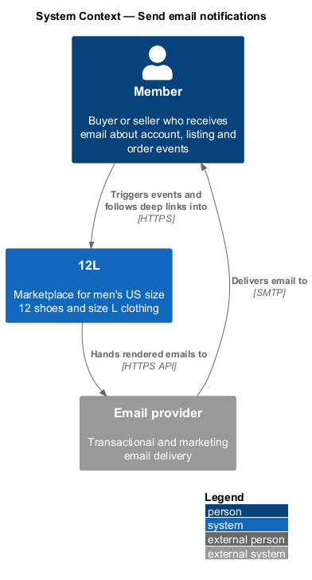
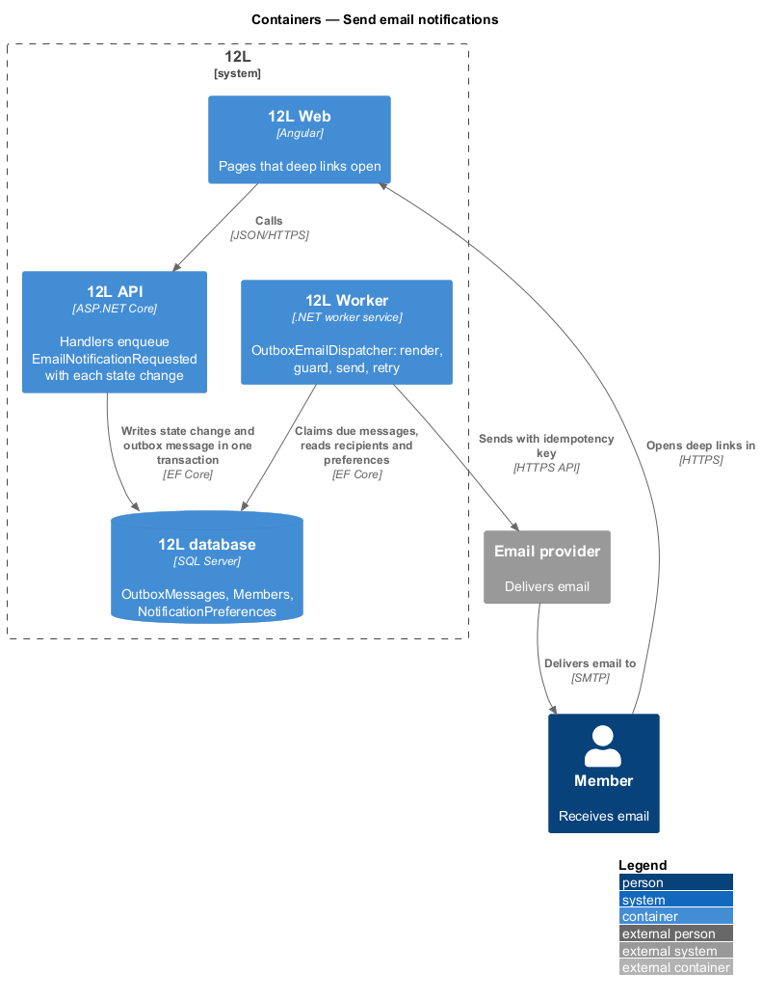
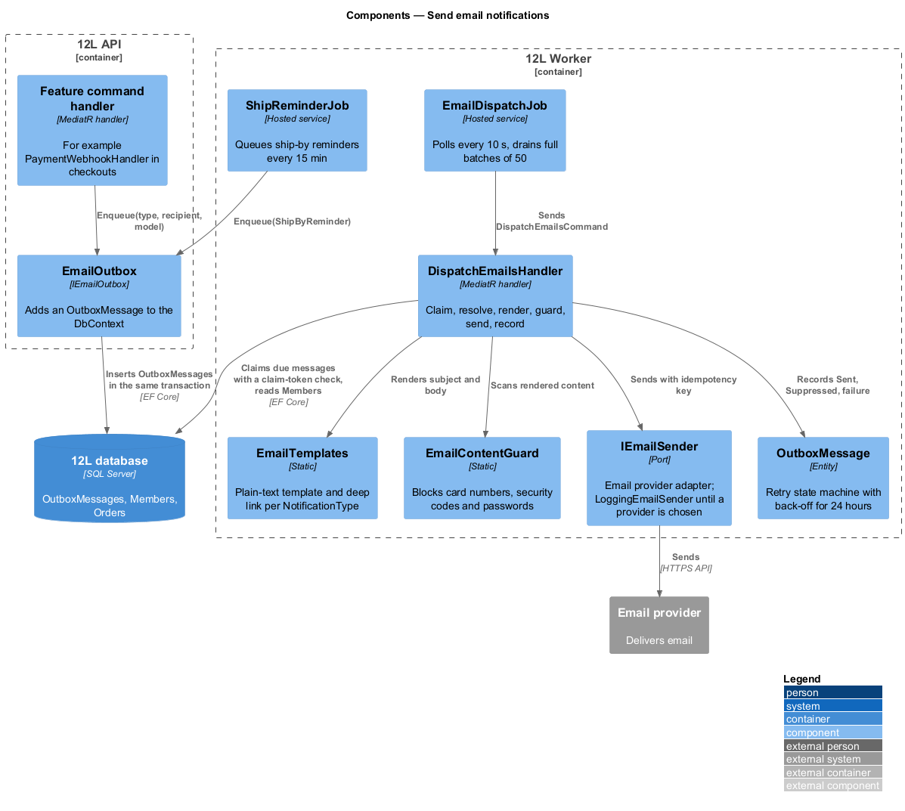
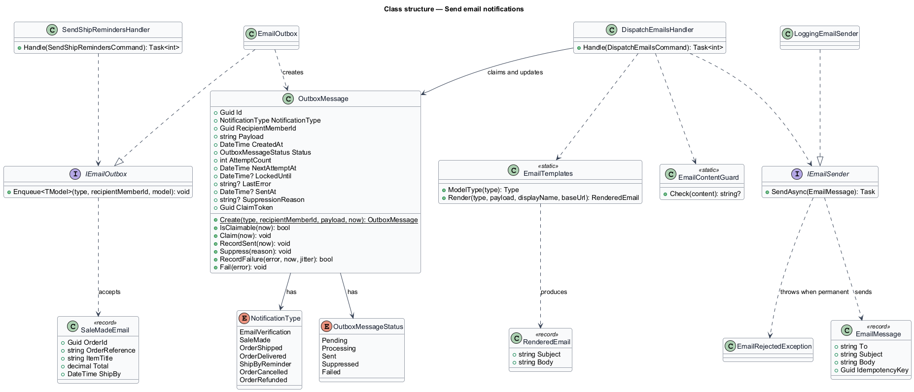
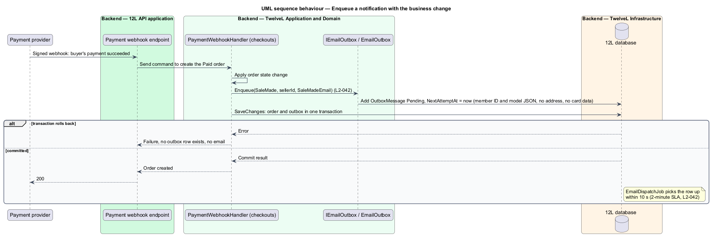
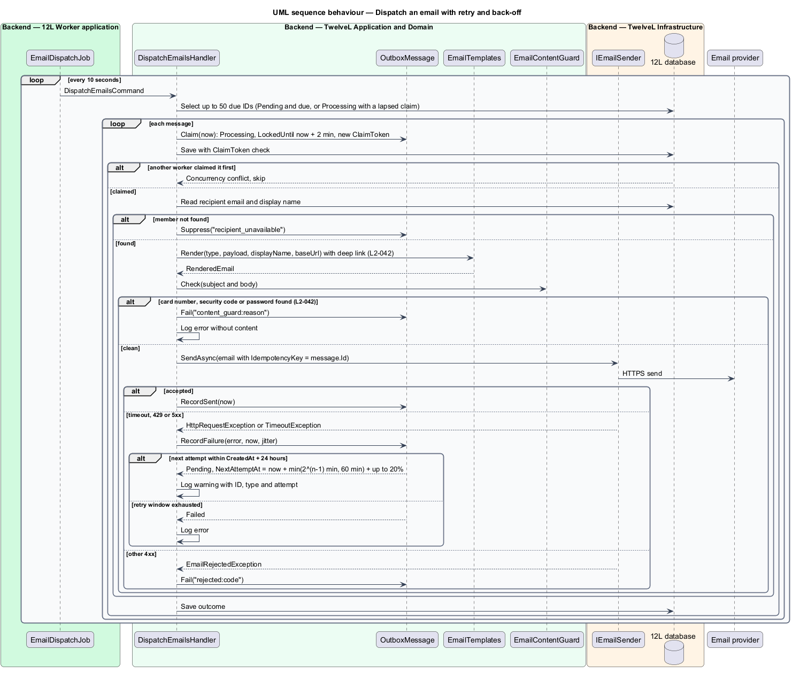

# Send email notifications

## Overview

TuTuMuch tells members by email about events that affect their account, their listings and
their orders (`L1-011`). Email is the only notification channel. There is no in-app
notification centre (see the open questions in `docs/mocks/README.md`). In-app feedback
uses toasts and banners, which each feature designs for itself.

This feature is the shared mechanism that every other feature uses to send an email. A
feature never calls the email provider directly. Instead, its handler records an
*email notification request* in the *outbox*, in the same database transaction as the
state change. A background dispatcher in `TuTuMuch Worker` then renders the email from a
*template* and hands it to the external email provider. The dispatcher retries failures
with back-off for up to 24 hours (`L2-042`).

Terms used throughout:

- **notification type** — named kind of email, such as `SaleMade` or `ReviewReceived`, each with its own template, category and deep link
- **notification category** — group of notification types that shares one preference: Account security, Orders, Reviews or Marketing (`L2-043`)
- **outbox** — `OutboxMessages` table that holds messages written in the same transaction as the business change that caused them, so an email is never lost or sent for a change that rolled back
- **email notification request** — outbox message of type `EmailNotificationRequested` that names the notification type, the recipient member and the template data
- **template** — subject, HTML body and plain-text body for one notification type, filled from a typed model
- **deep link** — absolute URL in an email that opens the related page in TuTuMuch (`L2-042`)
- **dispatch** — one attempt by the worker to render and send one outbox message
- **delivery SLA** — upper bound of 2 minutes between the event and the email being handed to the provider (`L2-042`)

The design makes three guarantees:

1. An email is sent at least once for every committed event. Because the provider receives
   an idempotency key, the member receives the email once.
2. Email content never carries a password, a full card number or a security code.
3. Each email links back to the page it is about.

## Description

The slice has no screen of its own; emails are not mocked (`docs/mocks/README.md`). Final
email copy is `<TO SUPPLY>`. The subject "You made a sale" for `SaleMade` comes from
`L2-042`. The only user-facing UI this feature touches is the "Emails" settings page,
designed in
[manage-notification-preferences](../manage-notification-preferences/README.md).

### Notification types and categories

`NotificationType` (enumeration in `TuTuMuch.Domain`) lists each email that `L2-042` and
the related L2 requirements name. Each type maps to exactly one `NotificationCategory`.
Only the Reviews and Marketing categories honour a member's opt-out (`L2-043`); the other
two are always sent.

| `NotificationType` | Recipient | Category | Source | Deep link |
|--------------------|-----------|----------|--------|-----------|
| `EmailVerification` | new member | AccountSecurity | `L2-002` | `/verify?token=…` |
| `PasswordReset` | member | AccountSecurity | `L2-009` | `/reset-password?token=…` |
| `PasswordChanged` | member | AccountSecurity | `L2-009` | `/account/settings` |
| `AccountLocked` | member | AccountSecurity | `L2-007` | `/forgot-password` |
| `DraftExpiring` | seller | AccountSecurity | `L2-019` | `/account/listings` |
| `SaleMade` | seller | Orders | `L2-042` | `/sales/{orderId}` |
| `OrderShipped` | buyer | Orders | `L2-033` | `/orders/{orderId}` |
| `OrderDelivered` | buyer | Orders | `L2-042` | `/orders/{orderId}` |
| `ShipByReminder` | seller | Orders | `L2-042` | `/sales/{orderId}` |
| `OrderCancelled` | buyer or seller | Orders | `L2-035`, `L2-033` | `/orders/{orderId}` or `/sales/{orderId}` |
| `CancellationRequested` | seller | Orders | `L2-035` | `/sales/{orderId}` |
| `OrderRefunded` | buyer | Orders | `L2-042` | `/orders/{orderId}` |
| `ProblemReported` | seller and every administrator | Orders | `L2-036` | `/sales/{orderId}`, or `/admin/problems/{reference}` for administrators |
| `ProblemResolved` | buyer and seller | Orders | `L2-036` | `/orders/{orderId}` or `/sales/{orderId}` |
| `ReviewReceived` | reviewed member | Reviews | `L2-042` | `/members/{displayName}` |
| `Marketing` | opted-in member | Marketing | `L2-043` | per campaign, `<TO SUPPLY>` |

`DraftExpiring` falls under AccountSecurity because `L2-043` permits turning off only
review and marketing email. Administrator alerts for a reported problem (`L2-036`) go to
every member holding the Administrator role through the same outbox ([ADR orders/0007](../../../adr/orders/0007-order-problems-administrator-flag-private-photos-and-two-outcomes.md)). The ship-by reminder schedule belongs to `orders`.

### What is built

The types that `L2-042` names and whose events exist in the code are built:
`EmailVerification`, `SaleMade`, `OrderShipped`, `OrderDelivered`, `ShipByReminder`,
`OrderCancelled`, `OrderRefunded`, (added by cancel-order) `CancellationRequested` and (added by
resolve-order-problems) `ProblemReported` and `ProblemResolved`. The `NotificationType` enumeration in
`TuTuMuch.Domain` holds only these. The other rows of the table above are added, each with its
model and template, by the feature that raises the event (password reset, lockout, draft
expiry, reviews and marketing). See
[ADR notifications/0001](../../../adr/notifications/0001-email-outbox-plain-text-templates-and-provider-port.md).

| Event in the code | Raised by | Recipients |
|-------------------|-----------|------------|
| Member registers or asks for a new link | `VerificationEmails` | new member |
| Payment webhook creates the Paid order | `PaymentWebhookHandler` | seller (`SaleMade`, subject "You made a sale") |
| Seller adds tracking | `AddTrackingCommandHandler` | buyer, with carrier, number and tracking link |
| Carrier reports delivery | `CarrierWebhookHandler` | buyer |
| No tracking 3 business days after payment | `SendShipRemindersHandler` (`ShipReminderJob`) | seller, once |
| Ship deadline passes | `CancelUnshippedOrdersHandler` | buyer and seller (`OrderCancelled`), then buyer (`OrderRefunded`) when the provider issues the refund |
| Seller cancels, or accepts the buyer's request | `OrderCancellation` (cancel-order) | buyer (`OrderCancelled` with the reason and note), then buyer (`OrderRefunded`) |
| Buyer asks to cancel | `RequestCancellationCommandHandler` (cancel-order) | seller (`CancellationRequested` with the message) |

A buyer who confirms receipt of a Shipped order gets no delivery email, because they made the
change themselves.

### Producing a notification (`TuTuMuch.Application`)

- **`IEmailOutbox`** — application port with one method:
  `Enqueue<TModel>(NotificationType type, Guid recipientMemberId, TModel model)`.
  `TModel` is the closed record of the type, for example `SaleMadeEmail(OrderId,
  OrderReference, ItemTitle, Total, ShipBy)`; `Enqueue` refuses any other model. Handlers call
  it before `SaveChangesAsync`. The design first named it `INotificationPublisher`, which
  clashes with MediatR's interface of the same name in every handler file.
- **`EmailOutbox`** (in `TuTuMuch.Application.Notifications`) — implements the port. It
  serializes the model as JSON and adds an `OutboxMessage` to the current `ITuTuMuchDbContext`.
  The message commits or rolls back with the business change.
- **Template models carry no secrets.** No model type has a property for a password, a
  card number or a security code. Card details appear only as brand and last 4 digits,
  for example `Visa ending 4242` (`L2-042`). Single-use tokens appear only inside the
  verification link that `L2-002` requires.
- **Recipient addresses are resolved at dispatch**, not at enqueue. The message stores the
  member ID only, so the outbox holds no email addresses.

### Dispatching (`TuTuMuch.Worker`, `TuTuMuch.Application`)

- **`EmailDispatchJob`** — hosted service. Every `Notifications:PollInterval` (10 seconds) it
  sends one `DispatchEmailsCommand`, and sends it again at once while a pass returns a full
  batch, so a backlog drains between ticks. The 10-second poll leaves most of the 2-minute
  delivery SLA for the provider call and one quick retry.
- **`DispatchEmailsHandler`** — one pass. It selects up to 50 due message IDs (Pending with
  `NextAttemptAt <= now`, or Processing with a lapsed `LockedUntil`) and handles them one at a
  time:
  1. Claims the message: `Status = Processing`, `LockedUntil = now + 2 minutes` and a new
     `ClaimToken`, saved with a check on the old token. A worker that loses the race gets a
     concurrency conflict and skips the message, so any number of workers can share the work
     without sending a message twice.
  2. Reads the recipient's email and display name from `Members`; marks the message
     `Suppressed` with reason `recipient_unavailable` when the member no longer exists.
  3. Renders the template through `EmailTemplates.Render`.
  4. Runs `EmailContentGuard` over the rendered subject and body.
  5. Sends through `IEmailSender` with the idempotency key `OutboxMessage.Id`.
  6. Records the outcome.
- **`EmailTemplates`** — plain-text subject and body per notification type, written in C#
  with string interpolation. Each body greets the member by display name, says what happened,
  links to the related page and ends with the footer link to `/account/emails`. Final copy is
  `<TO SUPPLY>`; HTML bodies, the logo layout and Liquid templates wait for that copy.
- **Deep links** are built from `App:BaseUrl` plus the route in the table above, for example
  `https://{host}/sales/{orderId}` (`L2-042`). A template test fails when a type renders
  without its link.
- **`EmailContentGuard`** — scans the rendered content for a 13- to 19-digit number, written
  with or without single spaces or dashes, that passes the Luhn check, for `password:` or
  `password=` followed by a value, and for `CVV`, `CVC` or "security code" followed by 3 or 4
  digits. It first blanks out IDs (GUIDs) and the identifiers the template names (the
  tracking number and URL, the verification link), whose digits could otherwise pass the Luhn
  check. A hit fails the message permanently, without sending it, and logs an error with the
  message ID and type but not the content (`L2-042`).
- **`IEmailSender`** — port for the external `Email provider` (provider `<TO SUPPLY>`). A
  send that throws `HttpRequestException`, `TimeoutException` or a timeout
  `TaskCanceledException` is *transient*; one that throws `EmailRejectedException` (any HTTP
  4xx other than 429, such as a rejected address) is *permanent*. Until a provider is chosen,
  `LoggingEmailSender` writes each email to the log, as before; tests use a capturing fake.

### Ship-by reminder (`L2-033` criterion 3)

`Orders.ShipReminderDue` is set at payment to 3 US business days later, and
`Orders.ShipReminderSentAt` records the reminder. `ShipReminderJob` sends
`SendShipRemindersCommand` every `Notifications:ShipReminderJobInterval` (15 minutes); the
handler queues one `ShipByReminder` email for each Paid order that is due and not yet
reminded, and saves the mark with the email. Status is the order's concurrency token, so an
order shipped or cancelled meanwhile gets no reminder. The migration marks orders paid before
it as already reminded.

### Retry with back-off (`L2-042`)

`OutboxMessage.RecordFailure(error, now, jitter)` increments `AttemptCount` and sets
`NextAttemptAt` to `now + min(2^(AttemptCount − 1) minutes, 60 minutes)`, plus random
jitter of up to 20 percent. The resulting schedule is 1, 2, 4, 8, 16, 32 and then every
60 minutes. When the next attempt would fall after `CreatedAt + 24 hours`, the message
becomes `Failed`. A permanent result fails the message at once.

Each transient failure is logged as a warning with the message ID, the notification type,
`AttemptCount`, the provider status (for example `http_503`) and the next attempt time. A
final failure is logged as an error. The recipient address and the content are never logged
by the dispatcher.

### State machine

`OutboxMessageStatus`:

- `Pending` → `Processing` (claimed).
- `Processing` → `Sent`, `Suppressed`, or back to `Pending` with a later `NextAttemptAt`
  (transient failure).
- `Processing` → `Failed` (permanent failure, guard hit, or retry window exhausted).

A `Processing` message whose `LockedUntil` has passed is claimable again, which recovers
messages from a crashed worker. `Sent`, `Suppressed` and `Failed` are terminal.

### Data (`TuTuMuch.Infrastructure`)

- Table **`OutboxMessages`**, for email requests only. Columns:
  - `Id uniqueidentifier` primary key.
  - `NotificationType nvarchar(40)`.
  - `RecipientMemberId uniqueidentifier`.
  - `Payload nvarchar(max)`, the model as JSON.
  - `CreatedAt datetime2`.
  - `Status nvarchar(16)`.
  - `AttemptCount int`.
  - `NextAttemptAt datetime2`.
  - `LockedUntil datetime2 NULL`.
  - `LastError nvarchar(1000) NULL`, provider status or reason only.
  - `SentAt datetime2 NULL`.
  - `SuppressionReason nvarchar(50) NULL`.
  - `ClaimToken uniqueidentifier`, the concurrency token.
- Index **`IX_OutboxMessages_Due`** on (`Status`, `NextAttemptAt`), filtered to
  `Status IN ('Pending', 'Processing')`.
- `Orders` gains `ShipReminderDue datetime2` and `ShipReminderSentAt datetime2 NULL`, with
  `IX_Orders_Status_ShipReminderDue`.

### Configuration

| Setting | Value | Source |
|---------|-------|--------|
| `Notifications:PollInterval` | 10 seconds | design, sized for the 2-minute SLA |
| `Notifications:ShipReminderJobInterval` | 15 minutes | design |
| Batch size | 50 | `DispatchEmailsCommand.BatchSize` |
| Retry window | 24 hours | `L2-042`, `OutboxMessage.RetryWindow` |
| Maximum back-off | 60 minutes | design, `OutboxMessage.MaxBackoff` |
| `App:BaseUrl` | `<TO SUPPLY>` | hosting |
| `Notifications:FromAddress` | `<TO SUPPLY>` | with the provider |
| Email provider API key | secret store | `L2-052`, with the provider |

### Deferred

- Built by [manage-notification-preferences](../manage-notification-preferences/README.md):
  before rendering, `DispatchEmailsHandler` asks `INotificationPreferenceReader` about the
  message's category (`NotificationCategories.Of`) and suppresses it with the reason
  `preference_off` when the member turned it off (`L2-043`). Every `Marketing` email gets the
  one-click unsubscribe link in its body and the `List-Unsubscribe` and
  `List-Unsubscribe-Post` headers through `EmailMessage.Headers`. `NotificationType.Marketing`
  exists; marketing campaigns that queue it are deferred.
- The real provider adapter, the from address and the API key wait for the provider choice.
- HTML bodies with the shared layout and logo wait for the final copy.
- `OutboxRetentionJob`, the dispatch metrics and the delay alert (`L2-069`) wait for the
  observability work of the platform subsystem.
- Parallel dispatch within one pass: one pass sends one message at a time, and several worker
  instances share the work through the claim.
- A refund email for a duplicate payment (`L2-029` criterion 2): that buyer has no order to
  link to, and the email waits for its copy.

## Requirements

The feature realizes the following level-2 (L2) requirement. It refines a level-1 (L1)
requirement, cited by identifier.

| L2 ID | Refines (L1) | Requirement |
|-------|--------------|-------------|
| `L2-042` | `L1-011` | The system shall send email for: email verification, password reset, account lockout, a new sale (to the seller), shipping with tracking (to the buyer), delivery, cancellation, refund, ship-by reminders, problem reported and resolved, and review received. Emails shall be sent within 2 minutes of the event and shall not contain passwords or full card details. |

## Diagrams

### System context

Members receive email from TuTuMuch through the external email provider. Each email links
back to the related page in TuTuMuch.

### Containers

`TuTuMuch API` writes outbox messages in `TuTuMuch database` in the same transaction as each
business change. `TuTuMuch Worker` claims and sends them through the email provider.

### Components

A handler in any subsystem calls `IEmailOutbox`. In `TuTuMuch Worker`, `EmailDispatchJob`
runs `DispatchEmailsHandler`, which claims, renders, guards and sends each message.

### Class structure

`OutboxMessage` owns the retry state machine. `DispatchEmailsHandler` uses the templates,
the content guard and the `IEmailSender` port.

### Behaviour — enqueue a notification with the business change

The purchase handler and the outbox write commit together, so a rolled-back purchase
sends no email and a committed purchase cannot lose its "You made a sale" email
(`L2-042`).

### Behaviour — dispatch with retry and back-off

The dispatcher claims due messages, drops those without a recipient, renders and guards the content,
and sends. Transient failures are retried with back-off until 24 hours after creation
(`L2-042`).

