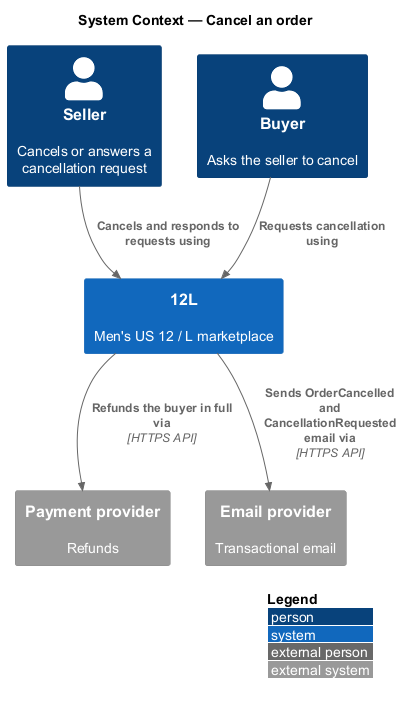
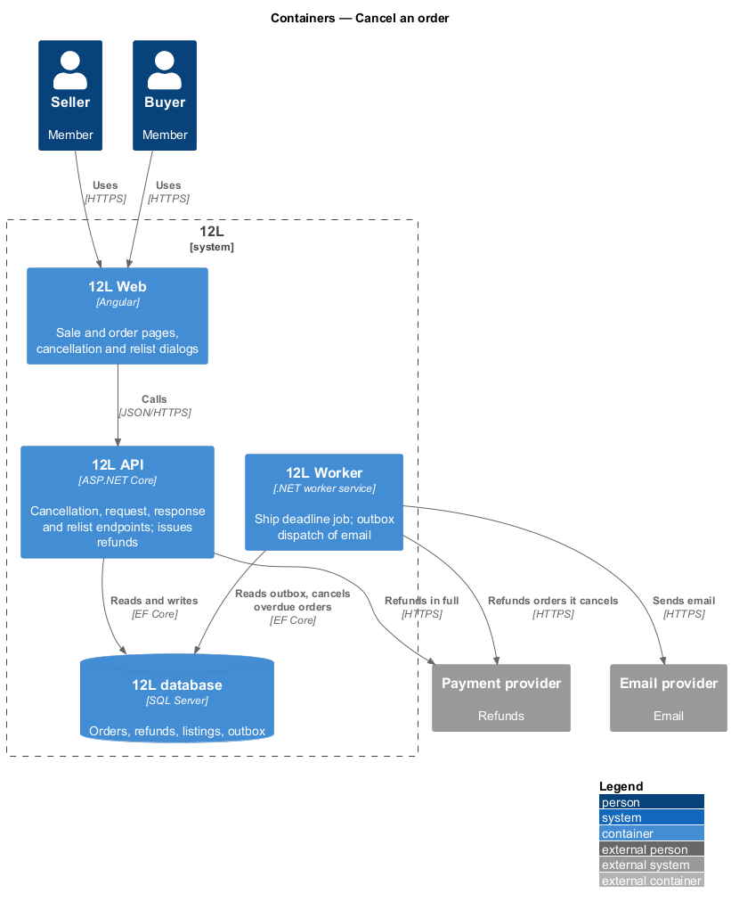
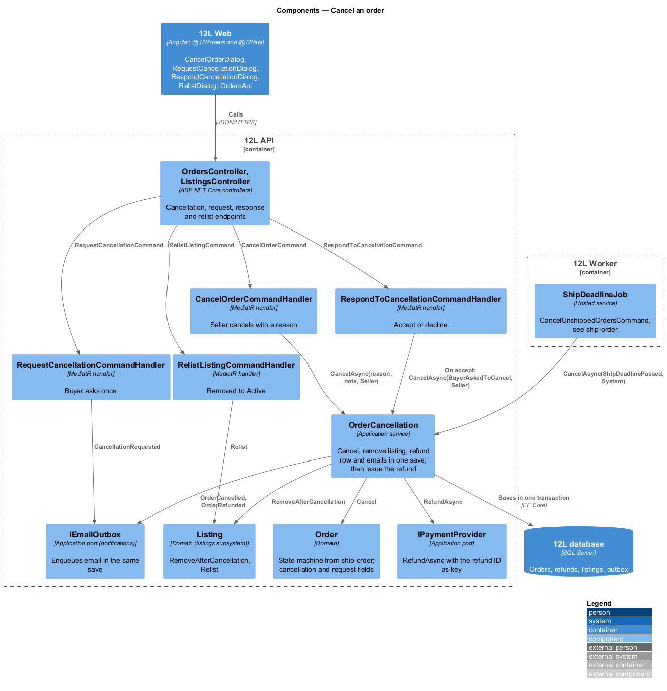
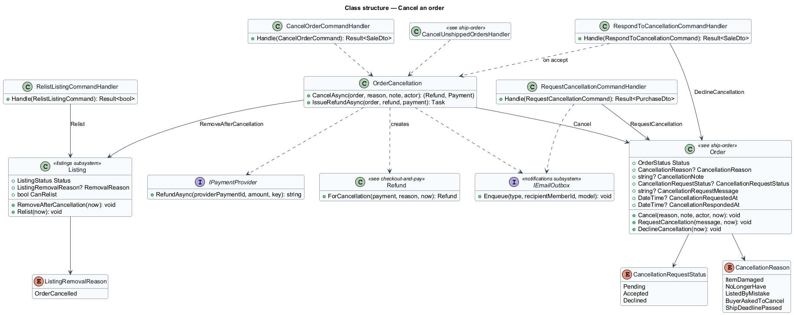
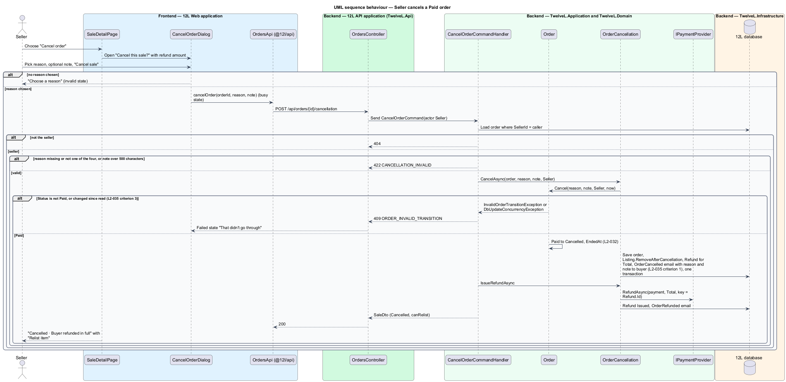
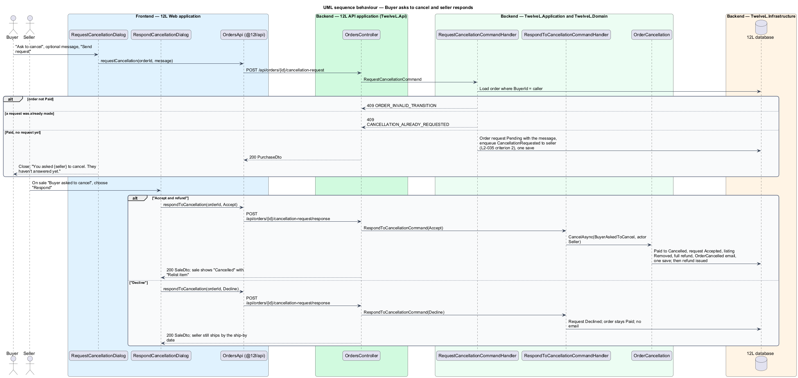

# Cancel an order

## Overview

TuTuMuch is a marketplace for new and used girls' clothing. Sometimes a
sale should not go ahead: the seller finds damage while packing, or the buyer ordered
the wrong item. This feature lets the seller cancel a `Paid` order before it ships, and
lets the buyer ask the seller to cancel. A cancelled order is refunded to the buyer in
full, and its listing stays off the catalog until the seller relists it.

Cancellation is the `Paid → Cancelled` transition of the order state machine defined
in [ship-order](../ship-order/README.md). Three callers share one application service,
`OrderCancellation`:

- the seller, directly (`CancelOrderCommandHandler`) or by accepting a buyer's request (`RespondToCancellationCommandHandler`);
- `ShipDeadlineJob` from ship-order (`CancelUnshippedOrdersHandler`), when no tracking arrives in 5 business days.

Once an order is `Shipped`, cancellation is neither offered nor accepted. Decisions are
recorded in [ADR orders/0006](../../../adr/orders/0006-cancel-order-one-path-request-on-the-order-and-relist.md).

Terms used in this design:

- **seller cancellation** — seller-initiated `Paid → Cancelled` transition with a required reason and an optional note to the buyer
- **cancellation request** — buyer's one message asking the seller to cancel a Paid order; the seller accepts or declines it
- **full refund** — refund of the order `Total`: item price, shipping and sales tax
- **relist** — seller action that returns the listing of a cancelled order to `Active` with its original details

## Description

### Frontend (`src/frontend/projects/orders/src/lib/`, HTTP through `@tutumuch/api`)

- **`SaleDetailPage`** (`sale-detail/`, route `/sales/:id`, mock `docs/mocks/pages/sale-detail/`) — this feature owns three of its states:
  - `default` (Paid) — ghost button "Cancel order" next to "Add tracking".
  - `cancel-requested` (Paid with a Pending request) — heading "Buyer asked to cancel", the buyer's message in `tl-quote`, primary "Respond", and the "Ship to" block. "Add tracking" and "Cancel order" are hidden until the seller answers.
  - `cancelled` — heading "Cancelled", info alert "Cancelled · Buyer refunded in full" / "The listing stays off the catalog until you relist it.", primary "Relist item" while `canRelist`. Once relisted the button goes and the alert reads "The listing is back in the catalog."
- **`CancelOrderDialog`** (`cancel-order/`, mock `docs/mocks/dialogs/cancel-order/`) — danger-icon dialog "Cancel this sale?". The description reads "{buyer} is refunded {total} in full. The listing stays off the catalog until you relist." A required "Reason" `tl-radio-group` offers "Item damaged", "No longer have it", "Listed by mistake" and "Buyer asked me to cancel", followed by an optional "Note to buyer". Buttons are "Keep sale" and danger "Cancel sale". States: `default`; `invalid` ("Choose a reason", shown without calling the API); `busy`; `failed` ("Try again", choices kept).
- **`RequestCancellationDialog`** (`request-cancellation/`, mock `docs/mocks/dialogs/request-cancellation/`) — opened from "Ask to cancel" on `OrderDetailPage` state `paid`. Title "Ask to cancel?", optional "Message to {seller}". The description reads "If {seller} accepts, you're refunded in full. Until then the order stays as is." Buttons are "Keep order" and "Send request". States: `default`, `busy`, `failed` (message kept).
- **`RespondCancellationDialog`** (`respond-cancellation/`, mock `docs/mocks/dialogs/respond-cancellation/`) — title "{buyer} asked to cancel", the quoted message. The description reads "Accepting refunds {total} in full. Declining keeps the order — you still ship by {shipBy}." Buttons are "Decline" and primary "Accept and refund". States: `default`, `busy` (the chosen button), `failed`.
- **`RelistDialog`** (`relist/`, mock `docs/mocks/dialogs/relist/`) — "Relist this item?" with the item, "{price} · {shipping} shipping", "Not now" and primary "Relist". It lives in `@tutumuch/orders` because feature libraries do not import each other; "Edit first" waits for [edit-and-withdraw-listing](../../listings/edit-and-withdraw-listing/README.md), which builds the edit page.
- **`OrderDetailPage`** (`order-detail/`) — `paid` adds "Ask to cancel" while the buyer has never asked; `cancel-requested` shows "You asked {seller} to cancel. They haven't answered yet."; `cancel-declined` shows "{seller} declined to cancel. They still ship by {shipBy}."; `cancelled` shows the info alert "Refunded in full" / "{total} back to {brand} ending {last4}. Allow 5–10 days.", the seller's note in `tl-quote` and "Shop similar items" (the catalog home; the order does not carry the category).
- **`OrdersApi`** (`@tutumuch/api`, `src/lib/orders/orders-api.ts`) — `cancelOrder`, `requestCancellation`, `respondToCancellation` and `relist`; `Sale` and `Purchase` carry `cancellation` and `cancellationRequest`, and `Sale` carries `canRelist`.

### API (`TuTuMuch.Api`)

Order endpoints use policy `VerifiedMember`; relist uses `CanSell`. A non-party receives `404` (`L2-010`).

- `POST /api/orders/{id}/cancellation` — seller; body `{ reason, note? }`. `200` `SaleDto`; `422` `CANCELLATION_INVALID` (`reason`: `REASON_REQUIRED`, or `note`: `NOTE_LENGTH` over 500 characters); `404`; `409` `ORDER_INVALID_TRANSITION` (not Paid, `L2-035` criterion 3).
- `POST /api/orders/{id}/cancellation-request` — buyer; body `{ message? }`. `200` `PurchaseDto`; `422` `CANCELLATION_INVALID` (`message`: `MESSAGE_LENGTH`); `404`; `409` `ORDER_INVALID_TRANSITION`; `409` `CANCELLATION_ALREADY_REQUESTED`.
- `POST /api/orders/{id}/cancellation-request/response` — seller; body `{ decision: "Accept" | "Decline" }`. `200` `SaleDto`; `422` `CANCELLATION_INVALID` (`decision`); `404`; `409` `CANCELLATION_NO_PENDING_REQUEST`; `409` `ORDER_INVALID_TRANSITION`.
- `POST /api/listings/{reference}/relist` — seller; `204`; `404` `LISTING_NOT_FOUND`; `409` `LISTING_NOT_RELISTABLE` unless the listing is `Removed` with `RemovalReason = OrderCancelled`.

### Application and domain

- **`Order.Cancel(reason, note, actor, now)`** — the state machine allows `Paid → Cancelled` for Seller and System only. It records `CancellationReason` (`ItemDamaged`, `NoLongerHave`, `ListedByMistake`, `BuyerAskedToCancel`, `ShipDeadlinePassed`) and the note, and marks a Pending request `Accepted`. `CancelOrderCommandHandler` accepts only the first four reasons from a seller.
- **`OrderCancellation.CancelAsync`** — in one save:
  1. calls `Order.Cancel`;
  2. calls `Listing.RemoveAfterCancellation(now)` (`Sold → Removed`, `RemovalReason = OrderCancelled`) so the listing stays off the catalog until relisted (`L2-035`);
  3. adds `Refund.ForCancellation` for the payment amount (the order `Total`), reason `OrderCancelled` (or `ShipDeadlinePassed`);
  4. enqueues `NotificationType.OrderCancelled` to the buyer with the reason and note (`L2-035` criterion 1); for `ShipDeadlinePassed` the seller receives it too (`L2-033` criterion 2).
  `IssueRefundAsync` then refunds through `IPaymentProvider` with `Refund.Id` as idempotency key, marks it `Issued` and enqueues `OrderRefunded`; a provider failure leaves it `Pending`.
- **Payout** — the Held payout of a cancelled order is never released ([seller-payouts](../seller-payouts/README.md), ADR orders/0005).
- **Cancellation request** — columns on `Order`: `CancellationRequestStatus` (`Pending`, `Accepted`, `Declined`), `CancellationRequestMessage`, `CancellationRequestedAt`, `CancellationRespondedAt`. One request per order: after a decline the buyer cannot ask again.
- **`RequestCancellationCommandHandler`** — requires a Paid order and no earlier request. It records the request and enqueues `NotificationType.CancellationRequested` to the seller with the message (`L2-035` criterion 2).
- **`RespondToCancellationCommandHandler`** — `Accept` calls `OrderCancellation` with `BuyerAskedToCancel` and actor Seller. `Decline` sets the request to `Declined` and leaves the order `Paid`. The buyer sees the outcome on the order page; `L2-042` names no decline email.
- **`RelistListingCommandHandler`** — `Listing.Relist(now)`: `Removed → Active`, clearing `RemovalReason`, with every other detail unchanged (`L2-035` criterion 4).

### Data

| Table | Key columns and constraints |
|-------|-----------------------------|
| `Orders` | adds `CancellationReason nvarchar(24) null`, `CancellationNote nvarchar(500) null`, `CancellationRequestStatus nvarchar(16) null`, `CancellationRequestMessage nvarchar(500) null`, `CancellationRequestedAt`, `CancellationRespondedAt`; `UX_Orders_ListingId` is filtered to `Status <> 'Cancelled'` so a relisted listing can sell again |
| `Listings` | adds `RemovalReason nvarchar(24) null` |
| `Refunds` | defined in [checkout-and-pay](../checkout-and-pay/README.md); `Reason = OrderCancelled` |

Migration `AddOrderCancellation` backfills earlier deadline cancellations: their reason, and their sold listings as removed.

### Error codes

| Code | HTTP | Meaning |
|------|------|---------|
| `ORDER_INVALID_TRANSITION` | 409 | Order is not Paid (for example already Shipped), or changed while the request ran |
| `CANCELLATION_INVALID` | 422 | No or unknown reason, a note or message over 500 characters, or an unknown decision |
| `CANCELLATION_ALREADY_REQUESTED` | 409 | The buyer already asked to cancel this order |
| `CANCELLATION_NO_PENDING_REQUEST` | 409 | Response sent with no pending request |
| `LISTING_NOT_RELISTABLE` | 409 | The listing was not removed by a cancellation |

### Tests

- xUnit acceptance tests in `tests/TuTuMuch.Api.Tests/CancelOrderTests.cs` run the API on SQLite in memory with `FakePaymentProvider` and `CapturingEmailSender`; domain tests in `tests/TuTuMuch.Domain.Tests/OrderTests.cs`.
- Playwright tests in `src/frontend/e2e/tests/cancel-order.spec.ts` serve every `TuTuMuch API` call through `page.route`, with page objects in `e2e/pages/cancel-order.page.ts`, `sale-detail.page.ts` and `order-detail.page.ts`.

## Requirements

| L2 ID | Refines (L1) | Requirement |
|-------|--------------|-------------|
| `L2-035` | `L1-008` | Before an order is Shipped, the seller shall be able to cancel it, and the buyer shall be able to ask the seller to cancel it. A cancelled order shall be refunded in full and its listing shall not return to the catalog unless the seller relists it. |

## Diagrams

### System context

The seller and the buyer act through TuTuMuch. TuTuMuch refunds through the payment provider and
emails both parties.

### Containers

`TuTuMuch API` performs the cancellation and issues the refund. `TuTuMuch Worker` dispatches the email
from the outbox, and runs the ship deadline job that also cancels orders.

### Components

Every path converges on `OrderCancellation`. It cancels the order, removes the listing from
sale, records the refund and enqueues the email in one transaction, then issues the refund.

### Class structure

`Order` holds the reason, the note and at most one request; `Listing` knows why it was removed.

### Behaviour — seller cancels

A reason is required. A non-Paid order returns HTTP 409, and a Paid order becomes
Cancelled with a full refund.

### Behaviour — buyer request and seller response

The buyer's request notifies the seller. Accepting reuses the cancellation path,
and declining leaves the order Paid.

