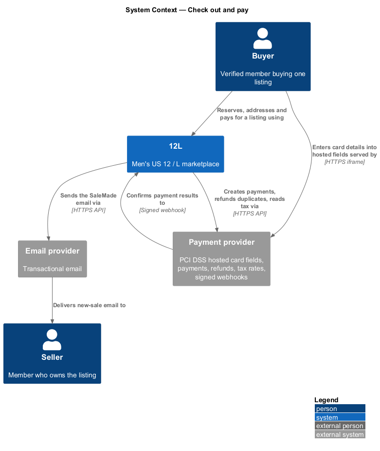
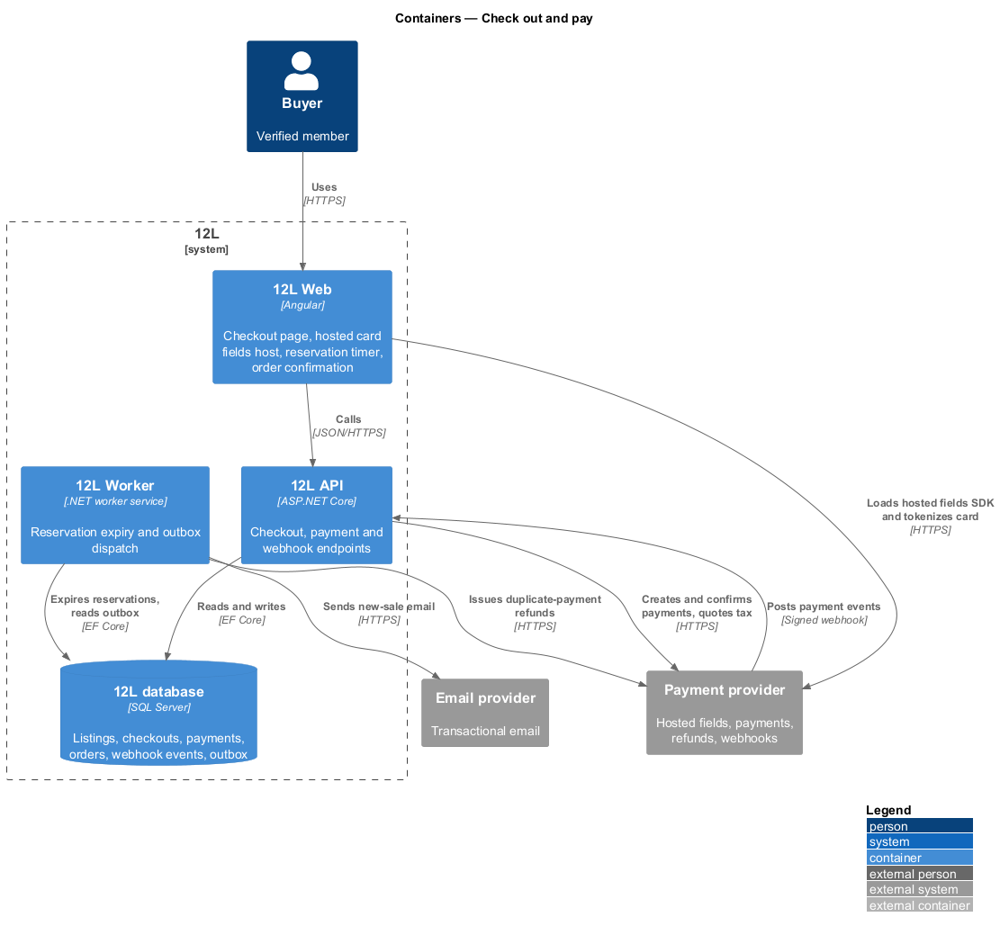
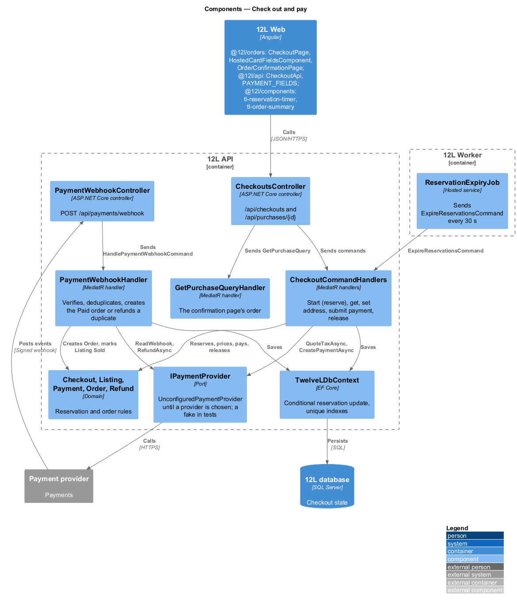
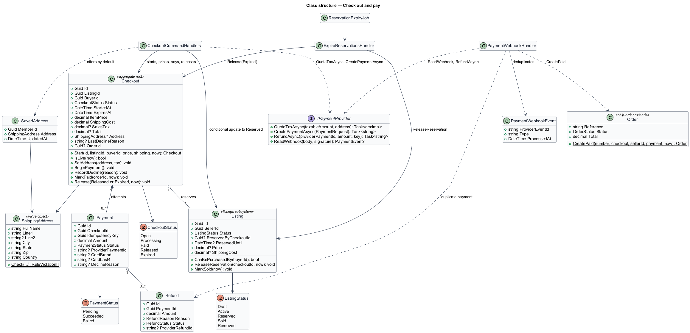
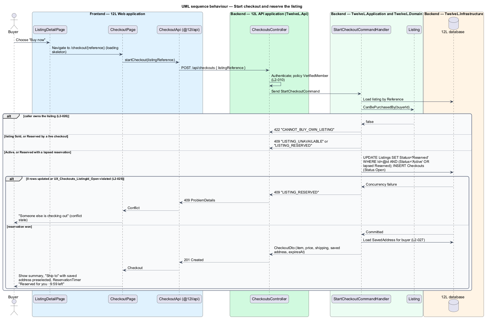
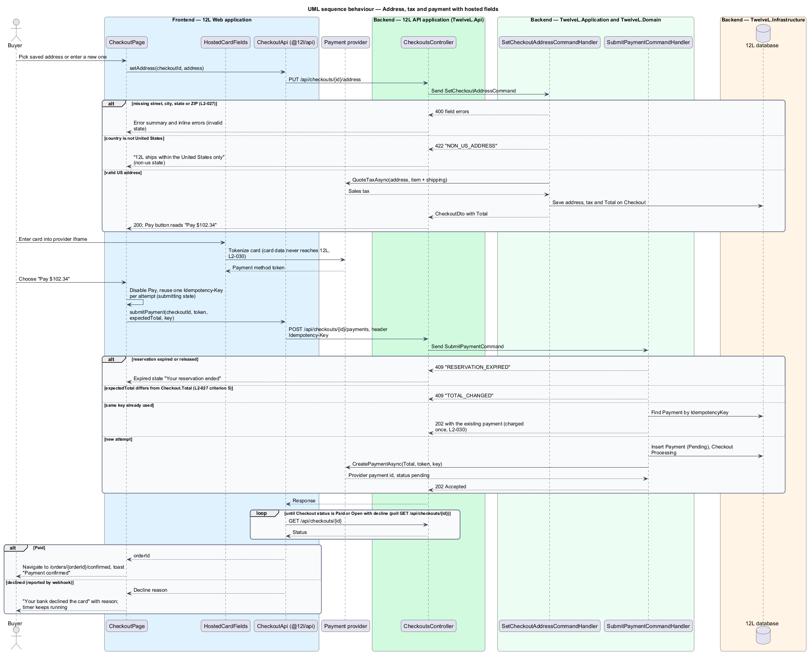
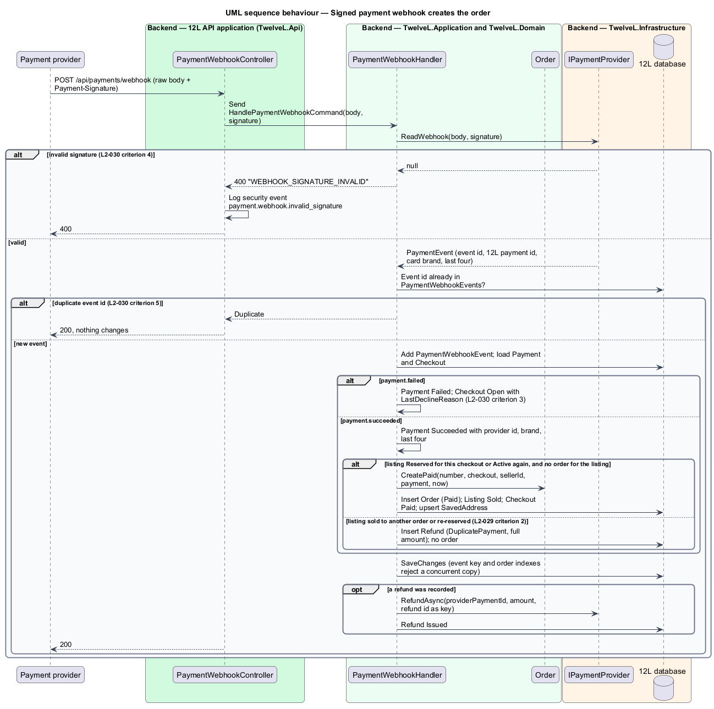
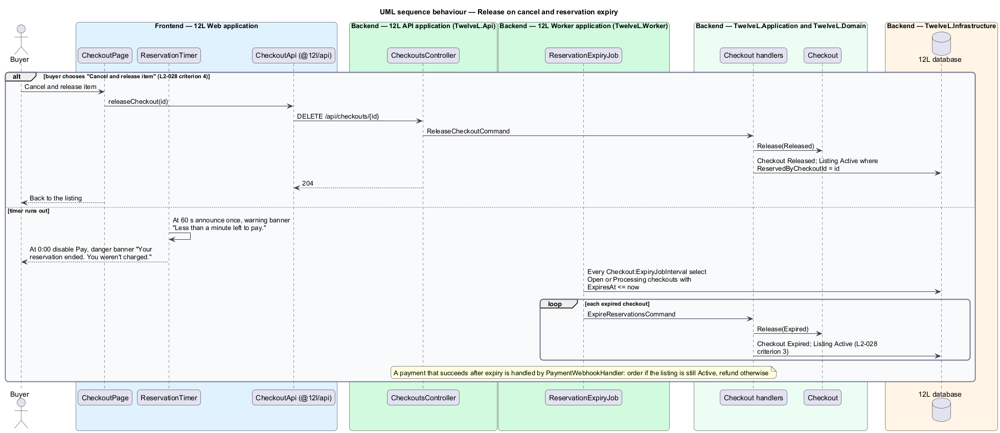

# Check out and pay

## Overview

TuTuMuch is a marketplace for all things young girls. Every
listing is a single physical item, so a listing can be sold only once. This feature
covers buying it: a verified member chooses "Buy now", TuTuMuch holds the item for them
for 10 minutes, the member gives a US shipping address and pays by card, and TuTuMuch
creates the order when the payment provider confirms the payment.

The feature starts on the listing detail page (catalog subsystem) and ends with a
`Paid` order. From there [ship-order](../ship-order/README.md), which defines the
order state machine, takes over.

Terms used in this design:

- **checkout** — record of one buyer's attempt to buy one listing, from "Buy now" to payment or release
- **reservation** — exclusive 10-minute hold a checkout places on a listing, shown as listing status `Reserved`
- **hosted card fields** — card inputs served in an iframe by the payment provider, so card numbers and security codes never reach TuTuMuch servers
- **payment method token** — opaque reference the provider returns for card details entered in hosted fields
- **idempotency key** — client-generated identifier sent with a payment request so a repeated request charges once
- **signed webhook** — HTTPS callback from the payment provider whose body carries a signature TuTuMuch verifies
- **duplicate payment** — successful payment for a listing that already has an order, or for a checkout whose listing was lost; refunded automatically

Three guarantees shape the design. First, exactly one buyer can hold the listing, and
the database enforces this through a conditional update on the listing's status and a
filtered unique index (`L2-029`); the browser plays no part in it. Second, the payment result
comes only from the provider's signed webhook, never from the browser (`L2-030`).
Third, double submission and duplicate webhooks change nothing: the idempotency key
and a webhook event table absorb repeats.

## Description

Screens and copy come from `docs/mocks/pages/checkout/` (states `default`, `new-address`, `invalid`, `non-us`, `submitting`, `declined`, `expired`, `conflict`, `loading`, `error`), `docs/mocks/pages/order-confirmation/` (`default`, `loading`, `error`) and `docs/mocks/notifications/reservation-timer/` (`info`, `warning`, `danger`, `success`). The payment provider stays behind a port until it is chosen ([ADR orders/0001](../../../adr/orders/0001-payment-provider-behind-a-port-until-chosen.md)); the reservation guard is the conditional update and filtered unique index of [ADR orders/0002](../../../adr/orders/0002-reserve-with-a-conditional-update-and-a-filtered-unique-index.md).

### Frontend — `TuTuMuch Web`, feature library `@tutumuch/orders` (`src/frontend/projects/orders/src/lib/`)

- **Routes** — the orders library is mounted at `/` and declares `checkout/:reference` (`CheckoutPage`, title "Checkout · TuTuMuch") and `orders/:id/confirmed` (`OrderConfirmationPage`, title "Order confirmed · TuTuMuch"). `reference` is the listing's `L-…` reference from "Buy now". No route guard: a 401 from starting checkout sends a visitor to `/sign-in?returnUrl=/checkout/{reference}`.
- **`CheckoutPage`** with **`CheckoutStore`** (`checkout/`) — on init `POST /api/checkouts`. States:
  - `loading` — skeletons in the two-column layout (`aria-label="Loading checkout"`).
  - `default` — the saved address preselected with "New address" beside it; when the checkout has no address yet the store sets the saved one at once so the summary shows tax and total. Primary "Pay $102.34" (or "Continue" while no total is known), ghost "Cancel and release item".
  - `new-address` — "Full name" (prefilled from the saved address), "Street address", "Apartment, suite" (optional), "City", "State" (50 states and DC by name, code sent), "ZIP code" (`inputmode="numeric"`), "Country" (United States, Canada, Mexico).
  - `invalid` — a 422 `ADDRESS_INVALID` marks each field and lists them in `tl-error-summary`, which takes focus.
  - `non-us` — a 422 `NON_US_ADDRESS` shows the danger alert "TuTuMuch ships within the United States only" / "Choose a US address to continue." and marks Country.
  - `submitting` — Pay is `aria-busy`, "Confirming with your bank…" shows as a status and further clicks are ignored.
  - `declined` — "Your bank declined the card" with the provider's reason and "Try another card — the item is still reserved for you."
  - `expired` — "Your reservation ended" with "Back to the item" and "Keep shopping", on `RESERVATION_EXPIRED` or when polling finds the checkout Expired.
  - `conflict` — 409 `LISTING_RESERVED`: "Someone else is checking out".
  - `error` — "Couldn’t start checkout", reference, "Try again", "Back to the item".
  - A start refused with 404, `LISTING_UNAVAILABLE` or `CANNOT_BUY_OWN_LISTING` returns to `/items/{reference}`, which shows Sold, unavailable or the seller's view.
- **Paying** — the store sets the address first when it changed. If that changes a total the buyer had already seen, it stops with the warning "The total changed", so the buyer only pays a total they saw (`L2-027` criteria 5 and 6). It then asks the card fields for a token and sends `POST /api/checkouts/{id}/payments` with `{ paymentMethodToken, expectedTotal }` and one `crypto.randomUUID()` `Idempotency-Key` per attempt, kept for a retry when the request may not have arrived. After the 202 it polls `GET /api/checkouts/{id}` once a second, up to 60 times: Paid goes to `/orders/{orderId}/confirmed`, Open shows the decline, Expired the expired state.
- **`HostedCardFieldsComponent`** (`checkout/`) — the "Card" field and the note "Card details go straight to our payment provider. TuTuMuch never sees them." It mounts the fields created by `PAYMENT_FIELDS` from `@tutumuch/api` and exposes `tokenize()`. Until a provider is chosen the default is `TestModePaymentFields`, a "Test card" select of `tok_visa` and `tok_chargeDeclined`.
- **`tl-reservation-timer`** (`@tutumuch/components`) — `role="timer"` "Reserved for you · 9:41 left" counted from the server's `expiresAt`; it emits its phase. In the last minute the page shows the warning banner "Less than a minute left to pay. After that, the item goes back on sale."; at zero the danger banner "Your reservation ended. You weren’t charged." with "Start again", and Pay is disabled. Each is announced once through a polite status.
- **`tl-order-summary`** (`@tutumuch/components`) — the "Summary" panel: item row, Item, Shipping ("Free" at $0.00), Sales tax ("With your address" before one is set), Total. Reused by order pages.
- **`OrderConfirmationPage`** (`order-confirmation/`) — loads `GET /api/purchases/{id}`: `loading` "Confirming your payment", `default` "Order TM-10001", "It’s yours.", "Paid $102.34 · Visa ending 4242", the three next steps with the seller's name, "View order" and "Keep shopping"; `error` "We couldn’t show your order" with "Try again" and "Go to purchases". The "Payment confirmed" toast waits for `ToastService` (responsive-accessible-shell).
- **`CheckoutApi`** (`@tutumuch/api`, `src/lib/orders/checkout-api.ts`) — `start`, `get`, `setAddress`, `pay`, `release`, `purchase`.

### API — `TuTuMuch.Api`

- **`CheckoutsController`** (policy `VerifiedMember`: 401 `UNAUTHENTICATED`, 403 `EMAIL_NOT_VERIFIED`)
  - `POST /api/checkouts` — body `{ listingReference }`. `201` `CheckoutDto` (`id`, `status`, `expiresAt`, `item` with reference, title, brand, size, condition and cover photo, `itemPrice`, `shippingCost`, `salesTax`, `total`, `address`, `savedAddress`, `lastDeclineReason`, `orderId`; money as two-place strings). Opening checkout again during the buyer's own live reservation returns it unchanged. Errors: `404 LISTING_NOT_FOUND`, `422 CANNOT_BUY_OWN_LISTING`, `409 LISTING_RESERVED`, `409 LISTING_UNAVAILABLE`.
  - `GET /api/checkouts/{id}` — `200` `CheckoutDto`; its status reads `Expired` as soon as the 10 minutes have passed. `404 CHECKOUT_NOT_FOUND` for anyone but the buyer.
  - `PUT /api/checkouts/{id}/address` — body `{ fullName, line1, line2, city, state, zip, country }`. `200` with `salesTax` and `total`; `422 NON_US_ADDRESS`; `422 ADDRESS_INVALID` with field errors; `409 RESERVATION_EXPIRED`, `PAYMENT_IN_PROGRESS` or `CHECKOUT_PAID`.
  - `POST /api/checkouts/{id}/payments` — header `Idempotency-Key` (UUID), body `{ paymentMethodToken, expectedTotal }`. `202` `PaymentDto` (`id`, `status`); a repeated key returns the first payment. `400 IDEMPOTENCY_KEY_REQUIRED`; `409 ADDRESS_REQUIRED`, `TOTAL_CHANGED`, `RESERVATION_EXPIRED`, `PAYMENT_IN_PROGRESS`; `502 PAYMENT_PROVIDER_UNAVAILABLE`.
  - `DELETE /api/checkouts/{id}` — releases the reservation; `204`; `404` for non-buyers; `409 CHECKOUT_PAID`.
  - `GET /api/purchases/{id}` — the buyer's order for the confirmation page (`PurchaseDto`: reference, item, total, card brand and last four, seller display name, paid time; [ship-order](../ship-order/README.md) adds the item, shipping and tax lines, ship-by date, timeline and tracking for the buyer's order page); `404 ORDER_NOT_FOUND` for anyone else. order-history extends this endpoint.
- **`PaymentWebhookController`** — `POST /api/payments/webhook`, anonymous, reads the raw body and the `Payment-Signature` header. `200` for processed, repeated and ignored events; `400 WEBHOOK_SIGNATURE_INVALID`, logged as security event `payment.webhook.invalid_signature` (`L2-030` criterion 4).

### Application and domain — `TuTuMuch.Application/Checkouts`, `TuTuMuch.Domain/Orders`

- **`Checkout`** — `Start`, `IsLive(now)`, `SetAddress(address, tax)` (total = item + shipping + tax), `BeginPayment`, `RecordDecline(reason)` (Processing back to Open), `MarkPaid`, `Release(Released | Expired)`. `ReservationDuration` is 10 minutes (`L2-028`).
- **`ShippingAddress`** — value object with `Check` (full name, street, city, a US state or DC code, ZIP `^\d{5}(-\d{4})?$`) and `IsOutsideUnitedStates`.
- **`Listing`** (listings subsystem) — gains `ReservedByCheckoutId`, `ReservedUntil`, `CanBePurchasedBy(buyerId)` (`L2-026` criterion 2), `ReleaseReservation(checkoutId, now)` and `MarkSold(now)`. Active to Reserved is the conditional update below.
- **`CheckoutCommandHandlers`** — `StartCheckoutCommand` refuses the seller with `CANNOT_BUY_OWN_LISTING` before writing anything, then in one transaction runs `UPDATE Listings SET Status='Reserved', ReservedByCheckoutId, ReservedUntil WHERE Id=@id AND (Status='Active' OR (Status='Reserved' AND ReservedUntil <= @now))`, expires any checkout still holding the listing, and inserts the `Checkout`. Zero rows or a violation of `UX_Checkouts_ListingId_Open` answer 409, so exactly one of 50 concurrent requests wins (`L2-029` criterion 1). `SetCheckoutAddressCommand` validates and calls `IPaymentProvider.QuoteTaxAsync` on item plus shipping. `SubmitPaymentCommand` returns the existing payment for a repeated key, checks the reservation, the address and `expectedTotal == Total` to the cent, inserts `Payment` (Pending), moves the checkout to Processing and calls `CreatePaymentAsync` with the same key. `ReleaseCheckoutCommand` releases the checkout and the listing.
- **`PaymentWebhookHandler`** — `ReadWebhook` verifies the signature; a known event id changes nothing. A failure sets `Payment` Failed and the decline reason on the checkout. A success stores the provider id, card brand and last four (the only card details kept, `L2-030`). When the listing is still Reserved for this checkout, or Active again, and has no order, it creates `Order.CreatePaid` (reference `TuTuMuch-` and a number from 10001), marks the listing Sold and the checkout Paid and saves the address to `SavedAddress`. Otherwise it records a `Refund` (`DuplicatePayment`, full amount) and calls `RefundAsync` with the refund id as key (`L2-029` criterion 2).
- **`ExpireReservationsCommand`** — releases Open and Processing checkouts past `ExpiresAt` and their listings (`L2-028` criterion 3).
- **`IPaymentProvider`** — `QuoteTaxAsync`, `CreatePaymentAsync`, `RefundAsync`, `ReadWebhook`. Payout methods arrive with [seller-payouts](../seller-payouts/README.md).

### Infrastructure, worker and data

- **`UnconfiguredPaymentProvider`** (`TuTuMuch.Infrastructure/Payments/`) — registered until a provider adapter exists: no tax, no charge, every webhook rejected. Tests replace the port with `FakePaymentProvider`.
- **`ReservationExpiryJob`** (`TuTuMuch.Worker`) — every `Checkout:ExpiryJobInterval` (30 seconds) sends `ExpireReservationsCommand`.
- **Migration `AddCheckoutAndPayment`**:

| Table | Key columns and constraints |
|-------|-----------------------------|
| `Listings` | adds `ReservedByCheckoutId`, `ReservedUntil`; index `IX_Listings_Status_ReservedUntil` |
| `Checkouts` | `Id` PK; `ListingId`, `BuyerId`, `Status`, `StartedAt`, `ExpiresAt`, `EndedAt`, amounts `decimal(10,2)`, `Shipping*` address columns, `LastDeclineReason`, `OrderId`; filtered unique `UX_Checkouts_ListingId_Open` on `ListingId` where `Status IN ('Open','Processing')`; `IX_Checkouts_Status_ExpiresAt`; `IX_Checkouts_BuyerId` |
| `Payments` | `Id` PK; `CheckoutId` FK; unique `UX_Payments_IdempotencyKey`; `Amount`, `Status`, `ProviderPaymentId`, `CardBrand`, `CardLast4`, `DeclineReason` |
| `PaymentWebhookEvents` | `ProviderEventId` PK; `Type`, `ProcessedAt` |
| `Refunds` | `Id` PK; `PaymentId` FK; `Amount`, `Reason`, `Status`, `ProviderRefundId` |
| `SavedAddresses` | `MemberId` PK and FK; address columns |
| `Orders` | `Id` PK; unique `Reference`, `Number`, `UX_Orders_CheckoutId`, `UX_Orders_ListingId`; buyer, seller, payment, amounts, `Shipping*` address, `PaidAt`. [ship-order](../ship-order/README.md) adds the later states |

Address columns are plain until [protect-personal-data](../../privacy/protect-personal-data/README.md) adds the field encryptor (`L2-054`).

### Error codes

| Code | HTTP | Raised when |
|------|------|-------------|
| `LISTING_NOT_FOUND` | 404 | the reference is unknown or hidden from the buyer |
| `CANNOT_BUY_OWN_LISTING` | 422 | the seller starts checkout for their own listing (`L2-026`) |
| `LISTING_RESERVED` | 409 | another live checkout holds the listing (`L2-028`, `L2-029`) |
| `LISTING_UNAVAILABLE` | 409 | the listing is Sold |
| `CHECKOUT_NOT_FOUND` | 404 | the checkout is unknown or another member's |
| `NON_US_ADDRESS` | 422 | the country is not the United States |
| `ADDRESS_INVALID` | 422 | a field is missing or malformed; field errors name each |
| `RESERVATION_EXPIRED` | 409 | the 10 minutes have passed or the checkout was released |
| `PAYMENT_IN_PROGRESS` | 409 | a payment is being confirmed |
| `CHECKOUT_PAID` | 409 | the checkout is already paid |
| `ADDRESS_REQUIRED` | 409 | payment before an address was set |
| `TOTAL_CHANGED` | 409 | the submitted total differs from the server total |
| `IDEMPOTENCY_KEY_REQUIRED` | 400 | the `Idempotency-Key` header is missing or not a UUID |
| `PAYMENT_PROVIDER_UNAVAILABLE` | 502 | the provider could not be reached |
| `WEBHOOK_SIGNATURE_INVALID` | 400 | the webhook signature does not verify |
| `ORDER_NOT_FOUND` | 404 | the order is unknown or another member's |

### Open questions and deferred work

- The payment provider, its SDK, webhook format and credentials are not chosen. The held `Payout`, the `SaleMade` notification and the `Payouts:FeePercent` snapshot on the order arrive with seller-payouts and send-email-notifications.
- A refund the provider refuses stays `Pending`; retrying it belongs to the outbox, which no feature has built yet.
- The "Payment confirmed" toast waits for `ToastService`.
- The mocks show the reservation banners above the top bar; they render at the top of checkout until the shell has a banner slot.

## Requirements

| L2 ID | Refines (L1) | Requirement |
|-------|--------------|-------------|
| `L2-027` | `L1-007` | A verified member shall be able to buy one Active listing at a time. Checkout shall collect a US shipping address and show the item price, shipping cost, sales tax where it applies, and the total before payment. |
| `L2-028` | `L1-007` | When a buyer starts checkout, the listing shall become Reserved for that buyer for 10 minutes. While Reserved, no other member shall be able to start checkout for it. If payment does not succeed within 10 minutes, the listing shall return to Active. |
| `L2-029` | `L1-007` | Concurrent purchase attempts for the same listing shall result in exactly one order. This shall be guaranteed by the database (for example by optimistic concurrency on the listing), not by the client. |
| `L2-030` | `L1-007` | Payment shall be taken through a PCI DSS compliant third-party payment provider using the provider's hosted fields or hosted page. Card numbers and security codes shall never pass through or be stored on TuTuMuch servers. TuTuMuch shall store only the provider's payment reference, card brand and last four digits. Payment results shall be confirmed from the provider's signed webhook, not from the browser. |

## Diagrams

### System context

The buyer types card details into the payment provider's hosted fields. TuTuMuch talks to
the provider for payments, tax and refunds, and receives results by signed webhook.

### Containers

`TuTuMuch Web` hosts the provider iframe and calls `TuTuMuch API`. `TuTuMuch API` owns the
reservation and the order. `TuTuMuch Worker` expires reservations and dispatches refunds
and email.

### Components

`CheckoutsController` dispatches one command per step. `PaymentWebhookController`
drives order creation, and `IPaymentProvider` is the only component that calls the
provider.

### Class structure

A `Checkout` reserves one `Listing` and owns its `Payment` attempts. A `Payment` may
carry `Refund` rows. `ConfirmPaymentCommandHandler` creates the `Order` defined in
ship-order.

### Behaviour — start checkout

The conditional update and the unique index decide which concurrent request reserves
the listing. Every loser receives HTTP 409.

### Behaviour — address and payment

Card data goes from the hosted fields to the provider only. The API accepts the token
with an idempotency key and returns 202, and the page polls until the webhook settles
the result.

### Behaviour — payment webhook

The handler verifies the signature through the port and deduplicates by provider event ID.
It then creates the Paid order or refunds a duplicate payment.

### Behaviour — release and expiry

"Cancel and release item" frees the listing at once. Otherwise `ReservationExpiryJob`
frees it after 10 minutes while the timer tells the buyer.

