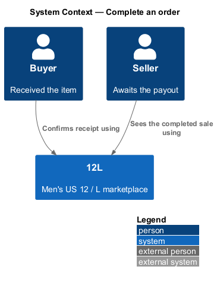
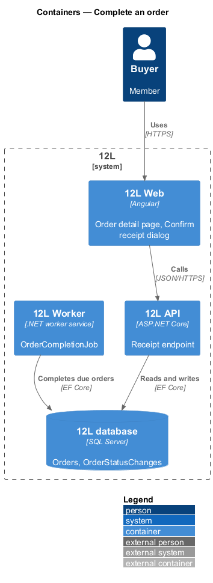
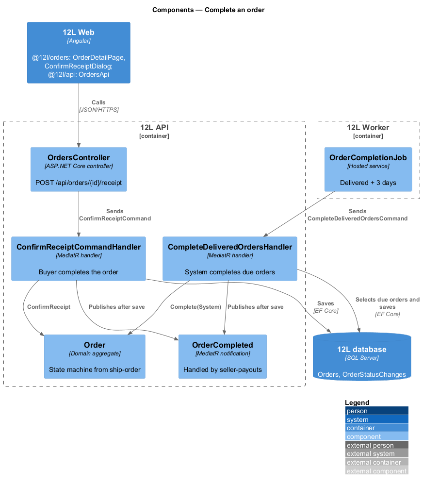
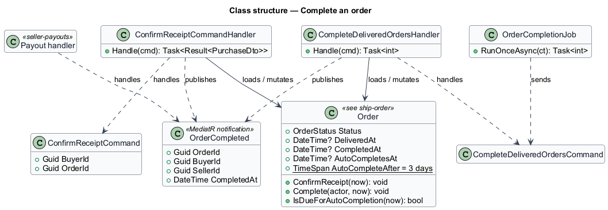
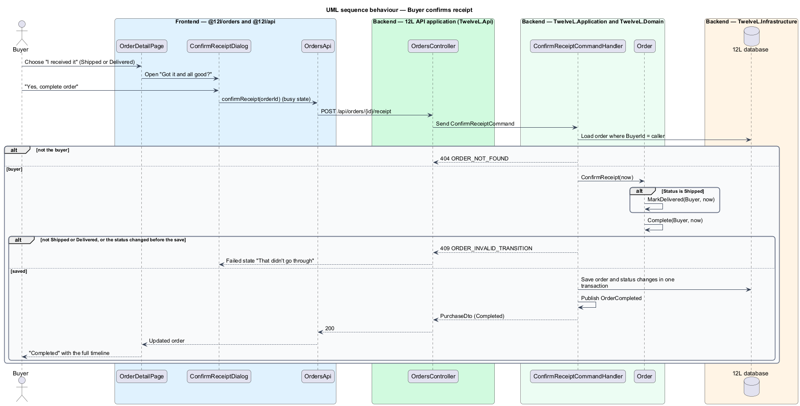
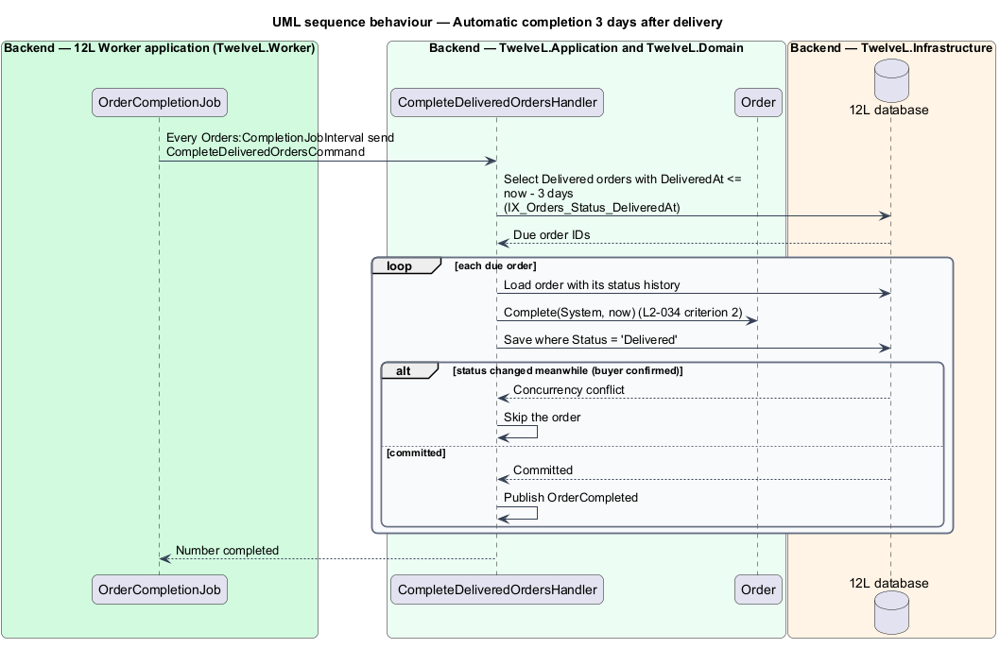

# Complete an order

## Overview

Tutu Much is a marketplace for men's US size 12 shoes and men's size L clothing. An order
is *complete* when the buyer has the item and the sale is final: the seller is paid
and both parties may review each other. This feature moves an order into the
`Completed` status in two ways. The buyer can confirm receipt, or Tutu Much can complete
the order automatically 3 days after delivery when the buyer has not reported a
problem.

Completion is the hinge between three other features. It is a transition of the
order state machine defined in [ship-order](../ship-order/README.md). It makes the
payout releasable in [seller-payouts](../seller-payouts/README.md) through the
`OrderCompleted` event. An open problem from
[resolve-order-problems](../resolve-order-problems/README.md) blocks automatic
completion and confirming receipt.

Terms used in this design:

- **confirm receipt** — buyer action "I received it" that completes a Shipped or Delivered order
- **auto-completion** — system transition `Delivered → Completed` once 3 days have passed since `DeliveredAt`
- **auto-completion time** — `DeliveredAt` plus `Order.AutoCompleteAfter` (3 days), shown to the buyer as "Completes automatically on Tue 27 Oct"
- **open problem** — `OrderProblem` with status `Open` on the order (resolve-order-problems)

## Description

### Frontend (`src/frontend/projects/orders/src/lib/`, `@tutumuch/orders`)

- **`OrderDetailPage`** (`order-detail/`, route `/orders/:id`, mock `docs/mocks/pages/order-detail/`) — buyer view built by ship-order. This feature adds:
  - `default` (Shipped) and `delivered` — primary "I received it", opening the Confirm receipt dialog through `DialogService`, because `L2-034` permits confirming a Shipped order.
  - `delivered` — "Completes automatically on {date} unless you report a problem.", from `autoCompletesAt`.
  - `completed` — heading "Completed", the full timeline and no actions. Review authoring is deferred ([ADR 0001](../../../adr/general/0001-defer-moderation-reviews-and-data-export.md)), so no review panel is shown.
  - "Report a problem" sits beside "I received it" while `canReportProblem`; resolve-order-problems builds its dialog.
- **`ConfirmReceiptDialog`** (`confirm-receipt/`, mock `docs/mocks/dialogs/confirm-receipt/`) — `tm-dialog` with `size="sm"`, titled "Got it and all good?", showing the item in `tm-item-row`. The description reads "This completes the order and pays {seller}. You can't report a problem afterwards." Buttons are "Not yet" and primary "Yes, complete order". States: `default`; `busy` (primary `aria-busy`, "Not yet" disabled); `failed` ("That didn't go through", primary becomes "Try again"). It has no `invalid` state because it has no inputs. It closes with the completed order, which the page then shows.
- **`OrdersApi`** (`@tutumuch/api`, `src/lib/orders/orders-api.ts`) — `confirmReceipt(orderId)` returns `Purchase`. `Purchase` gains `autoCompletesAt`.

### API (`TutuMuch.Api`)

- **`OrdersController`**
  - `POST /api/orders/{id}/receipt` — no body. Policy `VerifiedMember`. Responses: `200` `PurchaseDto` with `status: "Completed"`; `401`; `404` `ORDER_NOT_FOUND` when the caller is not the buyer (`L2-010`); `409` `ORDER_INVALID_TRANSITION` when the order is not Shipped or Delivered, or its status changed between the read and the write.
- **`GET /api/purchases/{id}`** (checkout-and-pay) — `PurchaseDto` gains `autoCompletesAt`: `DeliveredAt` plus 3 days while Delivered, otherwise `null`.

### Application and domain

- **`Order.ConfirmReceipt(now)`** — when the status is `Shipped`, first calls `MarkDelivered(Buyer, now)`, since the state machine has no direct `Shipped → Completed` transition. It then calls `Complete(Buyer, now)`. Both changes are recorded with the buyer as actor (`L2-032`, `L2-034` criteria 1 and 4).
- **`Order.Complete(actor, now)`** — the state machine permits `Delivered → Completed` for Buyer, System and Administrator (the last from resolve-order-problems). It sets `CompletedAt`; the state machine sets `EndedAt`.
- **`Order.AutoCompletesAt`** and **`IsDueForAutoCompletion(now)`** — `DeliveredAt + AutoCompleteAfter` while Delivered, otherwise null. `AutoCompleteAfter` is a domain constant of 3 days ([ADR orders/0004](../../../adr/orders/0004-complete-order-in-process-event-and-fixed-3-day-window.md)).
- **`ConfirmReceiptCommand`** / **`ConfirmReceiptCommandHandler`** — loads the order filtered by `BuyerId = caller`, calls `ConfirmReceipt`, saves, publishes `OrderCompleted` and returns the buyer's `PurchaseDto`. An invalid transition or a concurrency conflict on the status token answers `409`.
- **`CompleteDeliveredOrdersCommand`** / **`CompleteDeliveredOrdersHandler`** — selects Delivered orders with `DeliveredAt <= now − 3 days`, completes each with `Complete(System, now)` and publishes `OrderCompleted` for each (`L2-034` criterion 2). An order whose status changed meanwhile is skipped. Returns how many were completed.
- **`OrderCompleted`** (MediatR notification: `OrderId`, `BuyerId`, `SellerId`, `CompletedAt`) — published once after the save. seller-payouts' `OrderCompletedPayoutHandler` marks the payout releasable, and its release job also catches up on a completed order whose event was lost ([ADR orders/0005](../../../adr/orders/0005-seller-payouts-payout-port-fee-snapshot-and-shell-banner.md)).
- The open-problem guard (`L2-034` criterion 3): the completion job skips Delivered orders with an open `OrderProblem`, and confirming receipt answers `409` `ORDER_PROBLEM_OPEN` (resolve-order-problems).
- No completion email is sent: `L2-042` does not list one.

### Worker (`TutuMuch.Worker`)

- **`OrderCompletionJob`** — runs every `Orders:CompletionJobInterval` (5 minutes) and sends `CompleteDeliveredOrdersCommand` in its own scope. The mocks count calendar days: delivered Sat 24 Oct gives completion Tue 27 Oct.

### Data

One migration (`AddCompleteOrder`) adds the nullable `Orders.CompletedAt` column and the index `IX_Orders_Status_DeliveredAt` for the job. The feature writes `Orders.Status`, `CompletedAt`, `EndedAt` and, for a Shipped order, `DeliveredAt`, plus one `OrderStatusChanges` row, or two when confirming a Shipped order. `Status` is the concurrency token ([ADR orders/0003](../../../adr/orders/0003-ship-order-status-token-weekday-deadline-and-carrier-port.md)).

### Error codes

| Code | HTTP | Meaning |
|------|------|---------|
| `ORDER_NOT_FOUND` | 404 | No such order, or the caller is not its buyer |
| `ORDER_INVALID_TRANSITION` | 409 | Order is not Shipped or Delivered, or changed since it was read |

### Testing

- `tests/TutuMuch.Domain.Tests/OrderTests.cs` — confirm receipt from Shipped and Delivered, refusal otherwise, and the 3-day window.
- `tests/TutuMuch.Api.Tests/CompleteOrderTests.cs` — the endpoint, `autoCompletesAt` and the completion command on SQLite in memory with a fake clock; a recording `OrderCompleted` handler stands in for seller-payouts.
- `tests/TutuMuch.Worker.Tests/OrderCompletionJobTests.cs` — each pass sends the command.
- `src/frontend/e2e/tests/complete-order.spec.ts` — the page and the dialog against `page.route` fixtures.

## Requirements

| L2 ID | Refines (L1) | Requirement |
|-------|--------------|-------------|
| `L2-034` | `L1-008` | The buyer shall be able to confirm receipt of a Shipped or Delivered order. An order shall complete automatically 3 days after it becomes Delivered unless the buyer has reported a problem. Criterion 3 (open problem) came with resolve-order-problems. |

## Diagrams

### System context

The buyer confirms receipt through Tutu Much. Completion makes the seller's payout
releasable; the release itself belongs to seller-payouts.

### Containers

`Tutu Much API` handles the buyer's confirmation. `Tutu Much Worker` runs auto-completion.

### Components

Both paths reach `Order.Complete` and publish `OrderCompleted`, which seller-payouts
handles.

### Class structure

The two command handlers mutate the shared `Order` aggregate and publish
`OrderCompleted` for the payout handler of seller-payouts.

### Behaviour — confirm receipt

A Shipped order passes through Delivered on the way to Completed, with both changes
recorded against the buyer. A wrong status returns HTTP 409.

### Behaviour — auto-completion

The job completes Delivered orders 3 days after delivery and skips an order the
buyer completed meanwhile.

