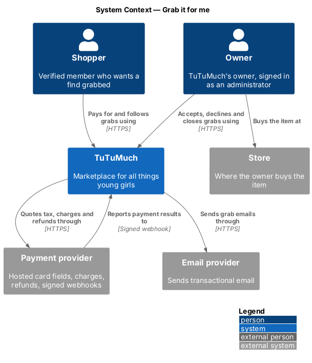
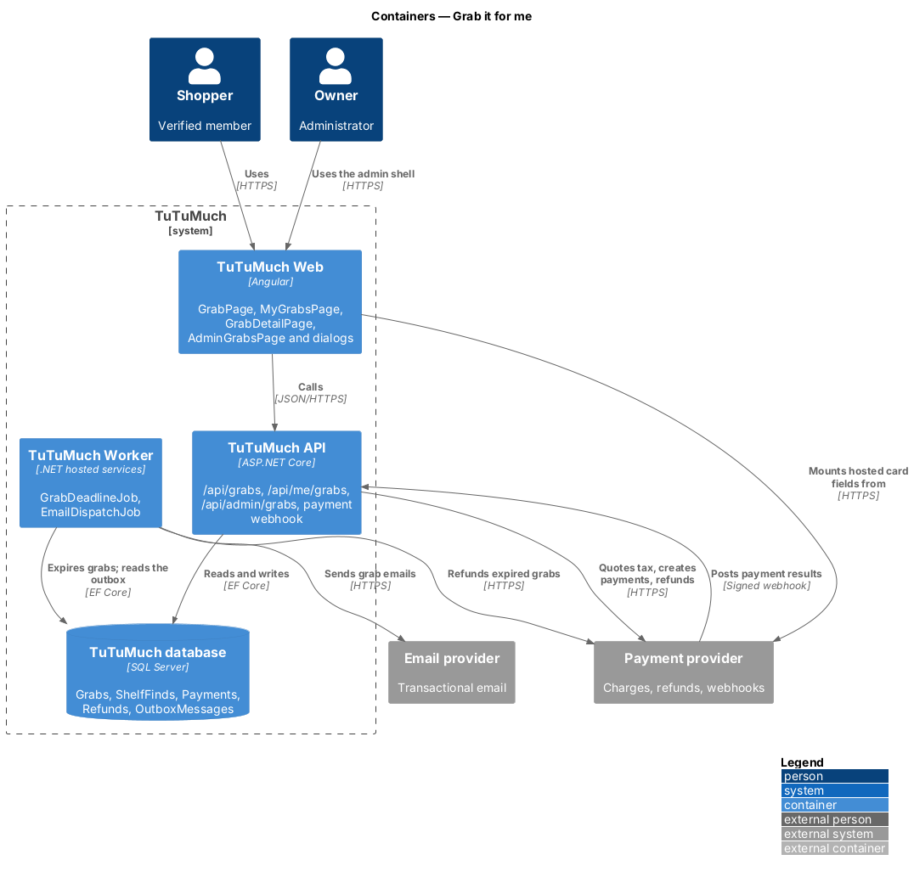
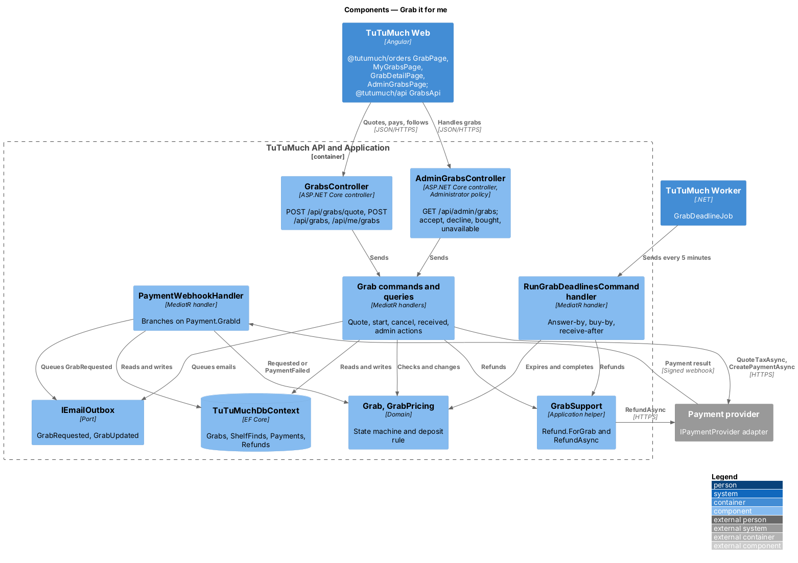
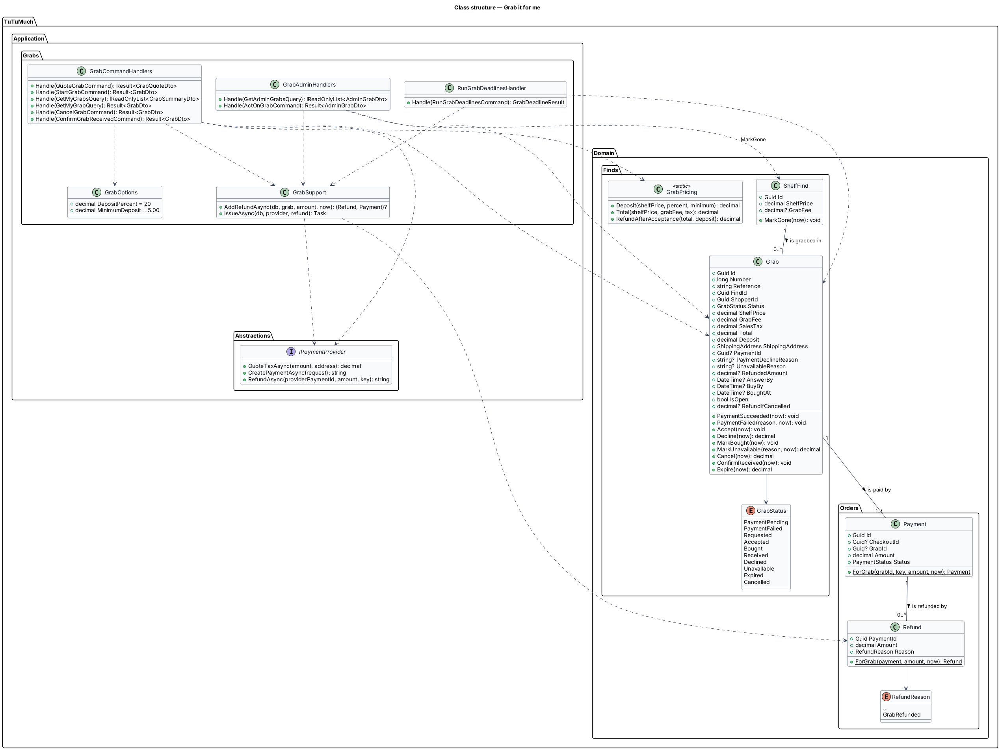
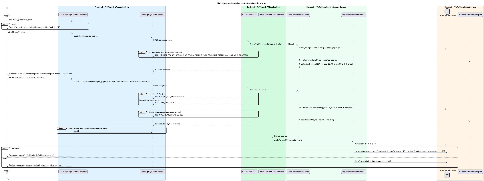
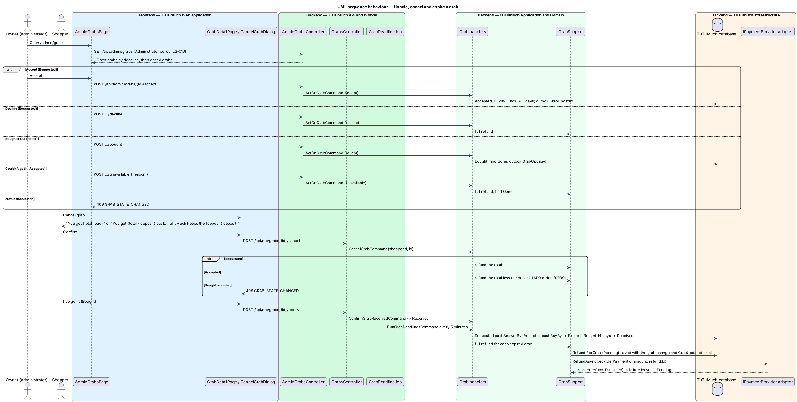

# Grab it for me

## Overview

A [shelf find](../../catalog/shelf-finds/README.md) tells shoppers where an item for girls sits in a store. Not every shopper can get to that store. On finds posted by TuTuMuch's owner, signed in as an administrator, the owner offers to go to the store, buy the item and send it on: **Grab it for me** (`L1-025`). A verified member pays the whole total up front through the payment provider: the shelf price, the owner's grab fee and sales tax. A stated part of that total, the **deposit**, is kept only if the shopper cancels after TuTuMuch has accepted the grab. Every other ending refunds the shopper in full.

The feature sits in the orders subsystem because it takes payment, issues refunds and follows a purchase to the shopper's door, but a grab is not an order of [ship-order](../ship-order/README.md): it has its own small state machine, no listing, no tracking, no problem report and no payout, because only administrators offer grabs and TuTuMuch keeps the money ([ADR orders/0009](../../../adr/orders/0009-grab-it-for-me-fee-and-non-refundable-deposit.md)). It reuses the payment port, the `Payment` and `Refund` tables and the webhook of [checkout-and-pay](../checkout-and-pay/README.md), the address rules of `L2-027`, the outbox of [send-email-notifications](../../notifications/send-email-notifications/README.md) and the admin shell.

Terms used in this design:

- **grab** — one shopper's paid request that TuTuMuch buy one find and send it; reference `GR-{number}`
- **grab fee** — the amount the poster set on the find, $1.00 to $50.00
- **deposit** — 20% of the shelf price, at least $5.00, never more than the shelf price, rounded to the cent; the part of the total kept when the shopper cancels an Accepted grab
- **open grab** — a grab that is PaymentPending, Requested, Accepted or Bought; a find has at most one
- **answer-by** — 48 hours after payment; a Requested grab not accepted by then expires
- **buy-by** — 3 days after acceptance; an Accepted grab not bought by then expires

## Description

Screens, states and copy come from the grab mocks under `docs/mocks/pages/` and `docs/mocks/dialogs/` (the grab page from address to paid, the shopper's grabs and grab detail, the admin list, the cancel and "Couldn't get it" dialogs and the toasts). `docs/screen-composition.md` names the library components of each.

### State machine

| From | Event | To | Money |
|------|-------|----|-------|
| (new) | `POST /api/grabs` | PaymentPending | Payment created at the provider |
| PaymentPending | webhook success | Requested | — |
| PaymentPending | webhook failure | PaymentFailed | Nothing charged |
| Requested | administrator accepts | Accepted | — |
| Requested | administrator declines | Declined | Full refund |
| Requested | shopper cancels | Cancelled | Full refund |
| Requested | answer-by passes (job) | Expired | Full refund |
| Accepted | administrator: Bought it | Bought | — (the find becomes Gone) |
| Accepted | administrator: Couldn't get it | Unavailable | Full refund (the find becomes Gone) |
| Accepted | shopper cancels | Cancelled | Total less the deposit |
| Accepted | buy-by passes (job) | Expired | Full refund |
| Bought | shopper: I've got it | Received | — |
| Bought | 14 days after buying (job) | Received | — |

Any other event answers `409 GRAB_STATE_CHANGED`. PaymentFailed, Received, Declined, Unavailable, Expired and Cancelled are terminal.

### Frontend (`TuTuMuch Web`)

- **`GrabsApi`** and **`AdminGrabsApi`** (`@tutumuch/api`, `src/lib/finds/grabs-api.ts`) — `quote(findReference, address)`, `start(payment, idempotencyKey)`, `mine()`, `get(id)`, `cancel(id)` and `received(id)`; `list()`, `act(id, 'accept' | 'decline' | 'bought')` and `unavailable(id, reason)`, returning `ApiResult`, with the types `GrabQuote`, `Grab`, `GrabRow` and `AdminGrab` and the shared `grabStatusWords` and `grabStatusLabel`.
- **`GrabPage`** (`@tutumuch/orders`, `src/lib/grab/`) at `/finds/:reference/grab`. A visitor is sent to `/sign-in?returnUrl=%2Ffinds%2F{reference}%2Fgrab` (`safeReturnUrl`, `L2-109`); an unverified member sees "Verify your email to ask for a grab". Steps (`L2-117`):
  1. **Address** — the US address form of `CheckoutPage` (its `ADDRESS_FIELDS` and `us-states`); there is no saved address for grabs in this release. "See the total" calls `quote`; `422 NON_US_ADDRESS` and `ADDRESS_INVALID` show as on checkout; `409 GRAB_IN_PROGRESS` shows a `tl-center-state` with "Back to the find"; `409 GRAB_NOT_OFFERED`, `422 CANNOT_GRAB_OWN_FIND` and `404 FIND_NOT_FOUND` go back to the find page. Changing the address drops the quote.
  2. **Summary and pay** — `tl-order-summary` with Shelf price, Grab fee, Sales tax and Total, and the line "Non-refundable deposit: {deposit}"; the box "How the deposit works": "You pay the total now. If TuTuMuch can't grab it, you get everything back. If you cancel after TuTuMuch accepts, you get everything back except the {deposit} deposit."; the checkbox "I understand the {deposit} deposit is non-refundable once TuTuMuch accepts". The hosted card fields of `L2-030` and "Pay {total}" appear with the quote; pressing "Pay" unticked shows "Tick the box to confirm you understand the deposit" and sends nothing.
  3. **Paying** — `start` with a new idempotency key, then `get(id)` every second, for up to a minute, until the status leaves PaymentPending. Requested navigates to `/account/grabs/{id}`; PaymentFailed shows the decline reason and lets the member pay again with a new key, keeping the address and the tick; `409 TOTAL_CHANGED` asks for a new quote.
- **`MyGrabsPage`** (`@tutumuch/orders`, `src/lib/my-grabs/`) at `/account/grabs` — the member's grabs, newest first, each with the find's title, store, total, status words and deadline; `empty` ("No grabs yet", "See shelf finds"), `loading` and `error` (`L2-119`).
- **`GrabDetailPage`** (`@tutumuch/orders`, `src/lib/grab-detail/`) at `/account/grabs/:id` — the find's title linking to it, the store, the summary with the deposit, the status words of `L2-119` with the deadline and refunded amount, and the shipping address. Requested and Accepted show "Cancel grab"; Bought shows "I've got it". `404 GRAB_NOT_FOUND` shows the not-found state.
- **`CancelGrabDialog`**, **`GrabReceivedDialog`**, **`DeclineGrabDialog`** and **`GrabUnavailableDialog`** (`@tutumuch/orders`, `src/lib/grab-dialogs/`). Cancel: "Cancel this grab?" with "TuTuMuch hasn't accepted yet, so you get all {total} back." before acceptance, or "You get {total − deposit} back. TuTuMuch keeps the {deposit} deposit." after; confirming shows the toast "Grab cancelled". `409 GRAB_STATE_CHANGED` reloads the grab.
- **`AdminGrabsPage`** (`@tutumuch/orders`, `src/lib/admin-grabs/`) at `/admin/grabs`, route `data.shell = 'admin'`. One block per grab: `GR-{number}`, the find's title and store, the shopper's display name and `mailto:` email, total, deposit, status and deadline, and the address for Accepted and Bought grabs. Actions by status: Requested — "Accept", "Decline"; Accepted — "Bought it", "Couldn't get it" (opens **`GrabUnavailableDialog`** with the radio choice "Gone from the shelf" or "Price went up"). States: `loading`, `empty` ("No grabs yet", "When a shopper asks TuTuMuch to grab a find, it shows up here."), `error` and `forbidden` (`403`: "You can't open this"); `401` goes to `/sign-in?returnUrl=%2Fadmin%2Fgrabs` (`L2-118`).
- **Reaching the pages** — the grab flow lands on the grab and every grab email links to it; `/account/grabs` lists them; the poster's "asked TuTuMuch to grab" email links to `/admin/grabs`. An account-menu entry waits for the account menu, which is not composed yet (`docs/screen-composition.md`).

### API (`TuTuMuch.Api`)

- **`GrabsController`** — `[Authorize(Policy = VerifiedMember)]` for quote and start, `[Authorize]` for the `/api/me/grabs` routes; the member comes from the session (`L2-010`).
  - `POST /api/grabs/quote` — body `{ findReference, address: { fullName, line1, line2, city, state, zip, country } }`; `200` with `GrabQuoteDto { findReference, findTitle, storeName, shelfPrice, grabFee, salesTax, total, deposit, refundAfterAcceptance }`.
  - `POST /api/grabs` — header `Idempotency-Key` (a UUID, as checkout), body `{ findReference, address, depositAcknowledged, paymentMethodToken, expectedTotal }`; `201` with `GrabDto` in PaymentPending. A repeated idempotency key returns the first grab.
  - `GET /api/me/grabs` — `200` with `GrabSummaryDto[] { id, reference, status, findReference, findTitle, storeName, total, deadline, createdAt }`.
  - `GET /api/me/grabs/{id}` — `200` with `GrabDto { id, reference, status, findReference, findTitle, category, storeName, storeAddress, shelfPrice, grabFee, salesTax, total, deposit, refundIfCancelled, refundedAmount, unavailableReason, paymentDeclineReason, answerBy, buyBy, boughtAt, createdAt, address }`.
  - `POST /api/me/grabs/{id}/cancel` and `POST /api/me/grabs/{id}/received` — `200` with `GrabDto`.
- **`AdminGrabsController`** — `[Authorize(Policy = Administrator)]`: `401` for a visitor, `403 ADMINISTRATOR_REQUIRED` for anyone else.
  - `GET /api/admin/grabs` — `200` with `AdminGrabDto[] { id, reference, status, findReference, findTitle, storeName, shopperDisplayName, shopperEmail, total, deposit, deadline, address, createdAt }`: open grabs first by their next deadline, then ended grabs newest first; PaymentPending and PaymentFailed grabs are left out; `address` is set for Accepted and Bought grabs only.
  - `POST /api/admin/grabs/{id}/accept`, `/decline`, `/bought` and `/unavailable` (body `{ reason: "Gone" | "PriceWentUp" }`) — `200` with `AdminGrabDto`.
- **`PaymentWebhookController`** (existing) — unchanged; the handler branches on the payment.

Amounts in responses are strings such as `"56.55"`; amounts in request bodies are numbers; timestamps are UTC ISO 8601.

### Application and domain (`TuTuMuch.Application`, `TuTuMuch.Domain`)

- **`GrabPricing`** (`TuTuMuch.Domain/Finds/GrabPricing.cs`) — `Deposit(shelfPrice, percent, minimum)` = `min(shelfPrice, max(minimum, round(percent% × shelfPrice, 2)))`, midpoint away from zero; `Quote(shelfPrice, grabFee, tax, percent, minimum)` returns `GrabAmounts` with the total and `RefundAfterAcceptance` = total − deposit. A $40.00 shelf price gives an $8.00 deposit, $12.00 gives $5.00 and $3.00 gives $3.00.
- **`Grab`** (`TuTuMuch.Domain/Finds/Grab.cs`) — `Id`, `Number`, `Reference` (`GR-{number}`), `FindId`, `ShopperId`, `Status`, `ShelfPrice`, `GrabFee`, `SalesTax`, `Total`, `Deposit` (amounts snapshotted at the start), `Address`, `PaymentId?`, `PaymentDeclineReason?`, `UnavailableReason?`, `RefundedAmount?`, `CreatedAt`, `PaidAt?`, `AnswerBy?`, `AcceptedAt?`, `BuyBy?`, `BoughtAt?`, `EndedAt?`. Methods `PaymentSucceeded(now)`, `PaymentFailed(reason, now)`, `Accept(now)`, `Decline(now)`, `MarkBought(now)`, `MarkUnavailable(reason, now)`, `Cancel(now)` (returns the refund amount: total before acceptance, total − deposit after), `ConfirmReceived(now)` and `Expire(now)` each check the table above and throw on a wrong status; `IsOpen` and `RefundIfCancelled`. `AnswerWithin = 48 h`, `BuyWithin = 3 days`, `ReceivedAfter = 14 days`.
- **`GrabOptions`** (`TuTuMuch.Application/Grabs/`, section `Grabs`) — `DepositPercent = 20`, `MinimumDeposit = 5.00`.
- **`GrabCommands`** (`TuTuMuch.Application/Grabs/GrabCommands.cs`):
  - `QuoteGrabCommand(ShopperId, FindReference, Address)` — loads an Active, unexpired find of an open poster (`404 FIND_NOT_FOUND`), refuses the poster (`422 CANNOT_GRAB_OWN_FIND`), a find without a grab fee (`409 GRAB_NOT_OFFERED`) and an open grab (`409 GRAB_IN_PROGRESS`), validates the address with `ShippingAddress.Check` (`422 NON_US_ADDRESS`, `ADDRESS_INVALID`), asks `IPaymentProvider.QuoteTaxAsync(shelfPrice + grabFee, address)` and returns the amounts.
  - `StartGrabCommand(ShopperId, FindReference, Address, DepositAcknowledged, PaymentMethodToken, ExpectedTotal, IdempotencyKey)` — returns the grab of a repeated key; refuses `depositAcknowledged: false` with `422 DEPOSIT_NOT_ACKNOWLEDGED`; repeats the quote and refuses a different total with `409 TOTAL_CHANGED`; inserts the grab (PaymentPending) and its `Payment` (`GrabId` set) in one save, where the filtered unique index on open grabs per find turns a race into `409 GRAB_IN_PROGRESS` (`L2-029`); then calls `IPaymentProvider.CreatePaymentAsync`. A `HttpRequestException` marks the payment and the grab failed and answers `502 PAYMENT_PROVIDER_UNAVAILABLE`.
  - `GetMyGrabsQuery`, `GetMyGrabQuery(ShopperId, Id)` — another member's grab answers `404 GRAB_NOT_FOUND` (`L2-121`).
  - `CancelGrabCommand(ShopperId, Id)` and `ConfirmGrabReceivedCommand(ShopperId, Id)`.
- **`GrabAdmin`** (`TuTuMuch.Application/Grabs/GrabAdmin.cs`) — `GetAdminGrabsQuery` and `ActOnGrabCommand(Id, Action, Reason?)` with `GrabAction` Accept, Decline, Bought (also `ShelfFind.MarkGone`) and Unavailable (needs the reason; refund in full and `ShelfFind.MarkGone`).
- **`GrabSupport`** (`TuTuMuch.Application/Grabs/GrabSupport.cs`) — `AddRefundAsync` creates `Refund.ForGrab(payment, amount, now)` with `RefundReason.GrabRefunded`, saves it with the grab change and its email, then `IssueAsync` calls `IPaymentProvider.RefundAsync(providerPaymentId, amount, refund.Id)`; a failure leaves the refund Pending, as for orders.
- **`GrabDeadlines`** (`TuTuMuch.Application/Grabs/GrabDeadlines.cs`) — `RunGrabDeadlinesCommand`, at the time of the injected `TimeProvider`, returning `GrabDeadlineResult(Expired, Received)`: Requested grabs past `AnswerBy` and Accepted grabs past `BuyBy` expire with a full refund; Bought grabs 14 days after `BoughtAt` become Received. Each grab is saved on its own; a concurrency conflict (the administrator moved it first) skips it.
- **`PaymentWebhookHandler`** (existing, [checkout-and-pay](../checkout-and-pay/README.md)) — when the payment's `GrabId` is set: success → `Grab.PaymentSucceeded`, `Payment.Succeed`, `GrabRequested` email to the poster; failure → `Grab.PaymentFailed`, which frees the find. Duplicate deliveries are dropped by `PaymentWebhookEvents` as today, so one email is queued (`L2-120` criterion 3).
- **`Payment`** and **`Refund`** (existing) — `Payment.CheckoutId` becomes `Guid?` and `Payment.GrabId` (`Guid?`) is added with `Payment.ForGrab(grabId, key, amount, now)`; `RefundReason.GrabRefunded` and `Refund.ForGrab`.
- **Emails** — `NotificationType.GrabRequested` with `GrabRequestedEmail` to the find's poster, and `NotificationType.GrabUpdated` with `GrabUpdatedEmail` to the shopper on accepted, declined, bought, unavailable, expired and cancelled, giving the status words, the refunded amount and, after an Accepted cancellation, the deposit kept. Both are transactional and cannot be turned off (`L2-120`).

### Worker (`TuTuMuch.Worker`)

- **`GrabDeadlineJob`** — a hosted job every 5 minutes that sends `RunGrabDeadlinesCommand` in its own scope, like `ItemRequestCleanupJob` (`Grabs:Deadlines:Interval`).

### Infrastructure and data (`TuTuMuch.Infrastructure`)

- **`GrabConfiguration`** — table `Grabs`: amounts `decimal(10,2)`, `Status nvarchar(16)` as a concurrency token, the shipping address as an owned type like `Orders`, `UnavailableReason nvarchar(16) null`, `PaymentDeclineReason nvarchar(200) null`. Unique indexes on `Number` and `Reference`; the filtered unique index `UX_Grabs_FindId_Open` on `FindId` where `Status IN ('PaymentPending','Requested','Accepted','Bought')`; indexes on `(ShopperId, CreatedAt)` and on `Status` for the job. The foreign key to `Members` (shopper) cascades, so erasing a member erases their grabs (`L2-121`); the one to `ShelfFinds` restricts, which leaves a single cascade path from a member.
- **`Payments`** — `CheckoutId` nullable, new nullable `GrabId` with an index and no foreign key, so erasing a shopper keeps the payment record.
- **Migration `AddShelfFindsAndGrabs`** — `ShelfFinds`, `Grabs` and the `Payments` change.

### Configuration

| Key | Value | Notes |
|-----|-------|-------|
| `Grabs:DepositPercent` | 20 | Percent of the shelf price (`L2-117`) |
| `Grabs:MinimumDeposit` | 5.00 | Never more than the shelf price |
| `Grab.AnswerWithin` | 48 hours | Domain constant (`L2-118`, `L2-119`) |
| `Grab.BuyWithin` | 3 days | Domain constant |
| `Grab.ReceivedAfter` | 14 days | Domain constant |
| `GrabDeadlineJob` interval | 5 minutes | Worker |

### Error codes

| Code | HTTP | Title | When |
|------|------|-------|------|
| `FIND_NOT_FOUND` | 404 | Not found | Gone, expired, withdrawn, unknown or a closed poster's find |
| `GRAB_NOT_OFFERED` | 409 | TuTuMuch doesn't grab this one | The find has no grab fee |
| `CANNOT_GRAB_OWN_FIND` | 422 | You can't grab your own find | The poster asks |
| `GRAB_IN_PROGRESS` | 409 | Someone already asked TuTuMuch to grab this one | An open grab exists, or lost the race |
| `DEPOSIT_NOT_ACKNOWLEDGED` | 422 | Tick the box to confirm you understand the deposit | `depositAcknowledged` is false |
| `TOTAL_CHANGED` | 409 | The total changed. Check it and pay again | The quote moved since it was shown |
| `NON_US_ADDRESS`, `ADDRESS_INVALID` | 422 | As `L2-027` | Address rules |
| `PAYMENT_PROVIDER_UNAVAILABLE` | 502 | We couldn't reach the payment provider | The provider call failed |
| `GRAB_NOT_FOUND` | 404 | Not found | Unknown or another member's grab |
| `GRAB_STATE_CHANGED` | 409 | This grab has moved on | The action does not fit the status |
| `EMAIL_NOT_VERIFIED`, `ADMINISTRATOR_REQUIRED` | 403 | As `L2-010` | Policy refusals |

## Requirements

The feature realises the following level-2 (L2) requirements. Each refines the level-1 (L1) requirement cited.

| L2 ID | Refines (L1) | Requirement |
|-------|--------------|-------------|
| `L2-117` | `L1-025`, `L1-007`, `L1-002` | A verified member shall be able to ask TuTuMuch to grab a find that offers it, seeing the shelf price, grab fee, tax, total and non-refundable deposit, ticking the deposit acknowledgement and paying the total once; one open grab per find. |
| `L2-118` | `L1-025`, `L1-002`, `L1-008` | An administrator shall see every grab at `/admin/grabs` and accept, decline, mark bought or mark unavailable with a reason; declines and unavailable grabs are refunded in full. |
| `L2-119` | `L1-025`, `L1-007`, `L1-008` | The shopper shall see their grabs, cancel a Requested grab with a full refund or an Accepted one with the total less the deposit, and confirm receipt; a job expires late grabs with full refunds and completes old Bought grabs. |
| `L2-120` | `L1-025`, `L1-011` | Grab events shall send transactional emails to the poster when a grab is paid and to the shopper on every later change, stating any refund and deposit kept. |
| `L2-121` | `L1-014`, `L1-025` | A grab, its address and the shopper's email shall be visible only to the shopper and administrators, and erased with the shopper's personal data. |

## Diagrams

### System context

A shopper pays TuTuMuch to grab a find; TuTuMuch's owner handles the grab; the payment provider charges and refunds; the email provider tells both sides.

### Containers

`TuTuMuch Web` quotes and starts grabs through `TuTuMuch API`, which talks to the payment provider and the database; `TuTuMuch Worker` runs the deadline job and sends the queued emails.

### Components

`GrabsController` and `AdminGrabsController` send the grab commands; the existing webhook handler branches on `Payment.GrabId`; `GrabDeadlineJob` sends `RunGrabDeadlinesCommand`.

### Class structure

A `Grab` belongs to one find and one shopper, holds a snapshot of the amounts and owns its payment and refunds.

### Behaviour — quote and pay

The shopper enters an address, sees the amounts and the deposit, ticks the acknowledgement and pays; the webhook makes the grab Requested and emails the poster.

### Behaviour — handle, cancel and expire

The administrator accepts, declines, buys or cannot get the item; the shopper cancels or confirms receipt; the job expires late grabs. Each refund goes through the payment provider once.

## Testing

- `tests/TuTuMuch.Domain.Tests/GrabTests.cs` — the deposit rule at $40.00, $12.00 and $3.00; every transition of the state machine and each refused one; the cancel refund before and after acceptance.
- `tests/TuTuMuch.Api.Tests/GrabsTests.cs` — xUnit acceptance tests through `TuTuMuchApiFactory` (SQLite in-memory, `FakePaymentProvider`, fake email): quote amounts and refusals, the acknowledgement, a changed total, a repeated key, 20 concurrent starts with one grab stored, the webhook success and failure and a duplicate delivery, admin actions with refunds and `409`, shopper cancel before and after acceptance, received, `404` for another member's grab, `403` for non-administrators, the deadline command and erasure by cascade.
- `tests/TuTuMuch.Worker.Tests/GrabDeadlineJobTests.cs` — the job sends the command on its interval.
- `src/frontend/e2e/tests/grab-it-for-me.spec.ts` with page objects under `e2e/pages/` — Playwright (Chromium) with every `TuTuMuch API` call served by `page.route` fixtures: visitor to sign in and back, the address step and quote, the unticked box, a declined card and a retry, a successful payment to the grab detail, My grabs in every state, cancel before and after acceptance, "I've got it", and the admin list with every action and its states.

## Open questions

- Grabs offered by members, paying a poster through payouts, tracking numbers and problem reports for grabs are deferred ([ADR orders/0009](../../../adr/orders/0009-grab-it-for-me-fee-and-non-refundable-deposit.md)).
- A refund the provider does not accept stays Pending, as for orders; dispatching pending refunds belongs to the outbox design.
- Whether the payment provider adapter treats the grab fee as taxable is `<TO SUPPLY>` with the provider choice; the design asks for tax on shelf price plus grab fee.
