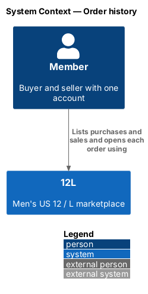
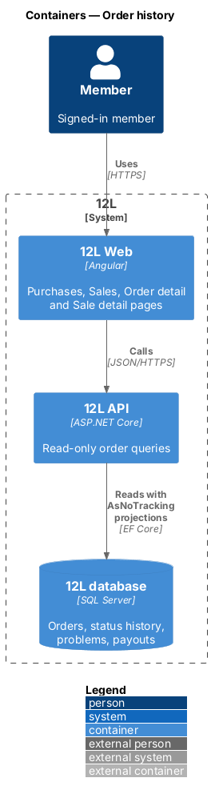
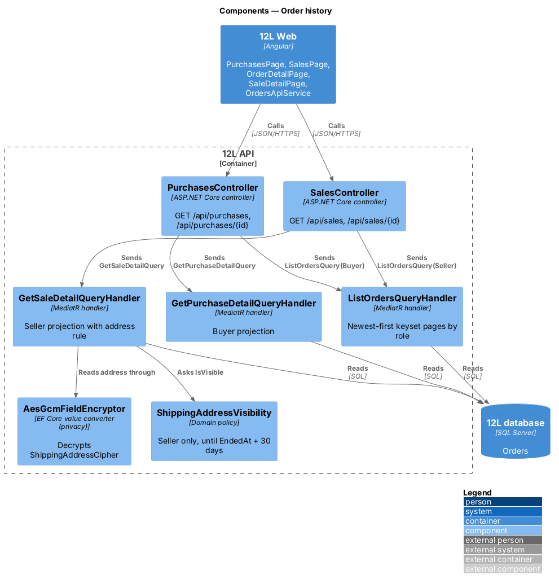
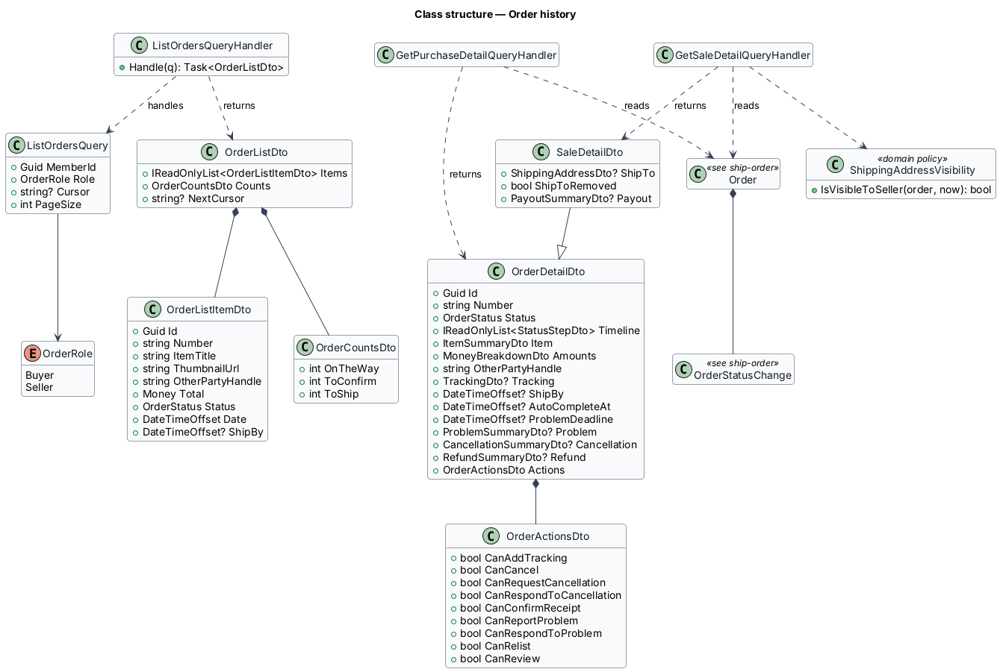
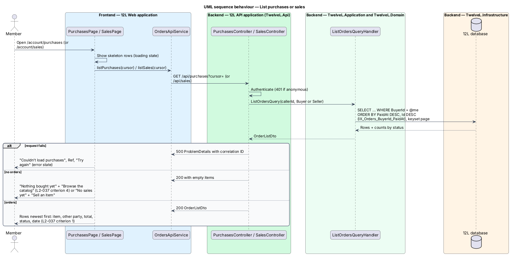
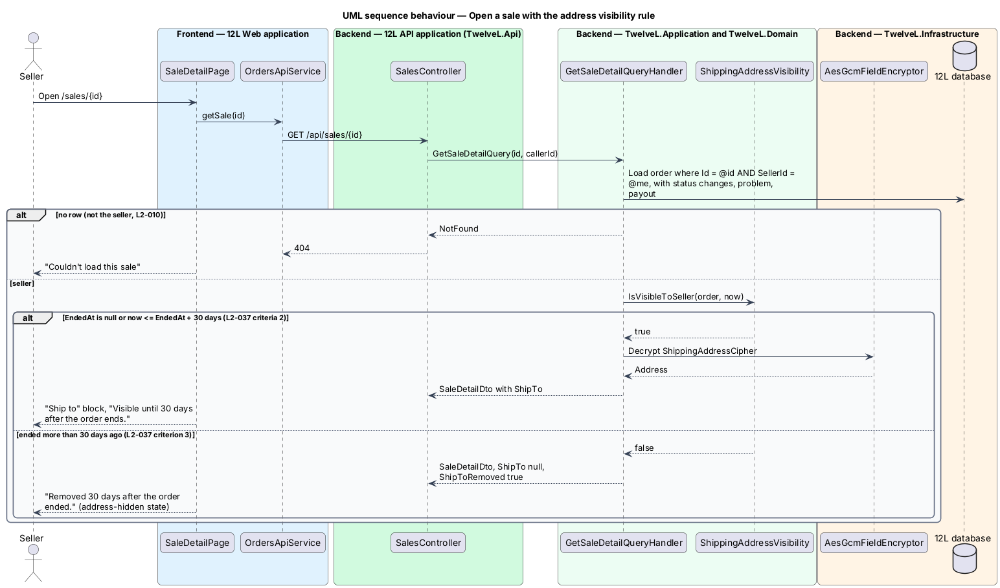

# Order history

## Overview

TuTuMuch is a marketplace for all things young girls, where every
member can both buy and sell with one account (`L2-003`). This feature gives each member
two lists of their orders, "Purchases" and "Sales", and the two detail pages behind
them: the buyer's order page and the seller's sale page. The detail pages show the
order's progress, its amounts, the other party, and the actions the order's current
status allows.

The feature is read-only. Every action button on the detail pages opens a dialog
designed in another orders feature, and every status shown comes from the state
machine of [ship-order](../ship-order/README.md). This feature also enforces the
privacy rule for the buyer's shipping address: only the seller of that order sees it,
and only until 30 days after the order ends.

Terms used in this design:

- **purchase** — order in which the member is the buyer
- **sale** — order in which the member is the seller
- **other party** — the seller on a purchase, the buyer on a sale, shown by handle
- **order end** — time the order reached a terminal status (`Completed`, `Cancelled` or `Refunded`), stored as `Order.EndedAt`
- **address window** — period during which the seller sees the buyer's address: from payment until `EndedAt` plus 30 days
- **available actions** — flags the API computes from status, role and time, which the pages use to show or hide buttons

## Description

### Frontend (`@tutumuch/orders`, `src/frontend/projects/orders/src/lib/`)

- **`OrderHistoryPage`** (`order-history/`) serves both lists below, chosen by route data `list`.
- **Purchases** (route `/account/purchases`, account area, mock `docs/mocks/pages/purchases/`) — heading "Purchases" with a subtitle from counts, for example "1 on the way · 1 to confirm" (Shipped and Delivered counts). Each `tl-item-row` row links to `/orders/:id`. A row shows thumbnail, title, "from {seller} · {date}", total and `tl-status`. States: `loading` (3 skeleton rows); `empty` ("Nothing bought yet", "Everything in the catalog is for girls.", "Browse the catalog"); `error` ("Couldn't load purchases", reference code, "Try again", account navigation kept).
- **Sales** (route `/account/sales`, mock `docs/mocks/pages/sales/`) — heading "Sales", subtitle "{n} to ship" (Paid count). Rows read "to {buyer} · ship by {date}" for Paid orders and link to `/sales/:id`. States: `loading`; `empty` ("No sales yet", "Sold items show up here with what to do next.", "Sell an item"); `error` ("Couldn't load sales").
- **`OrderDetailPage`** (route `/orders/:id`, mock `docs/mocks/pages/order-detail/`) — breadcrumb "Purchases › {number}", eyebrow "Order {number} · {date}", `OrderTimelineComponent`, and a side `OrderSummaryPanelComponent` with the seller. One state per status, each reading the `actions` flags:
  - `paid` — "Waiting to ship", "{seller} ships by {date}. If not, you're refunded automatically.", "Ask to cancel" (cancel-order);
  - `default` (Shipped) — "On its way", tracking link, "Report a problem" (resolve-order-problems);
  - `delivered` — "I received it" and "Report a problem" (complete-order);
  - `completed` — review panel (reviews subsystem);
  - `cancelled`, `refunded`, `problem` — described in cancel-order and resolve-order-problems;
  - `loading` and `error` ("Couldn't load this order", "Back to purchases").
- **`SaleDetailPage`** (route `/sales/:id`, mock `docs/mocks/pages/sale-detail/`) — same layout with the buyer in the side panel, breadcrumb "Sales". It shows the "Ship to" block while the address is visible. The `address-hidden` state shows "Removed 30 days after the order ended." with an eye-off icon. Status-specific states are designed in ship-order (`default`, `shipped`), cancel-order (`cancel-requested`, `cancelled`), resolve-order-problems (`problem`) and seller-payouts (`completed`).
- **`tl-status`** (`@tutumuch/components`) — the status name after a coloured square: info while open, active when Completed, removed when Cancelled or Refunded.
- **`OrdersApi`** (`@tutumuch/api`, `src/lib/orders/orders-api.ts`) — `purchases()`, `sales()` and `sale(id)`; the buyer's order is read through `CheckoutApi`.

### API (`TuTuMuch.Api`)

All endpoints require a signed-in member. An order the caller is not party to returns `404` (`L2-010` criterion 2).

- **`OrdersController`**
  - `GET /api/purchases` — `200` `OrderListDto` (`items`, `counts`); `401`.
  - `GET /api/sales` — `200` `OrderListDto`; `401`.
  - `GET /api/sales/{id}` — `200` `SaleDto`, `shipTo` null after the address window; `401`; `404`.
- **`CheckoutsController`** — `GET /api/purchases/{id}` (checkout-and-pay) — `200`; `401`; `404`.

`{id}` is the order `Id` (`Guid`); the order `Number` (`TM-48213`) is display-only.
Lists are not paged yet ([ADR orders/0008](../../../adr/orders/0008-order-history-unpaged-lists-and-address-window-on-read.md)):
the page size and "Show more" copy are `<TO SUPPLY>`, so every order is returned in keyset order.

### Application and domain

- **`ListOrdersQuery`** / **`ListOrdersQueryHandler`** — `AsNoTracking` projection filtered by `BuyerId` or `SellerId`. It orders by `PaidAt DESC, Id DESC` (newest first, `L2-037` criterion 1) (`Orders/OrderHistory.cs`, `OrderRole` Buyer or Seller). It joins the listing title and cover thumbnail URL, plus the other party's handle. It returns `OrderCountsDto` (`OnTheWay` = Shipped, `ToConfirm` = Delivered, `ToShip` = Paid). The row date is `PaidAt`.
- **`GetPurchaseDetailQuery`** / handler and **`GetSaleDetailQuery`** / handler — load one order by `Id` and the caller's role. They return:
  - the timeline from `OrderStatusChanges`;
  - amounts (item, shipping, sales tax, total);
  - the other party, tracking, `ShipBy`, `AutoCompleteAt`, `ProblemDeadline`;
  - problem, cancellation and refund summaries;
  - for the seller, the payout summary;
  - `OrderActionsDto`, computed from the same domain rules the commands enforce (`Order.CanReportProblem`, status checks), so the page never offers an action the API would refuse with 409.
- **`ShippingAddressVisibility.IsVisibleToSeller(order, now)`** — applied by `GetSaleQueryHandler`; true when `EndedAt` is null or `now <= EndedAt + 30 days` (`L2-037` criteria 2 and 3). The purchase projection never includes the address, and no public API returns it (`L2-054`). Whether `ShippingAddressCipher` is also erased after the window is a retention decision for the privacy subsystem, `<TO SUPPLY>`.
- **Shipping address storage** — the address is read from `Orders.ShippingAddressCipher` through the `AesGcmFieldEncryptor` value converter defined in [protect-personal-data](../../privacy/protect-personal-data/README.md).

### Data

No new tables. The queries use `IX_Orders_BuyerId_PaidAt` and `IX_Orders_SellerId_PaidAt`
(both including `Id`, `Status`, `Total`, `ListingId`) and
`IX_OrderStatusChanges_OrderId_OccurredAt`, all defined in ship-order. The 30-day window is the constant `ShippingAddressVisibility.AfterEnd`.

## Requirements

| L2 ID | Refines (L1) | Requirement |
|-------|--------------|-------------|
| `L2-037` | `L1-008` | A member shall have a "Purchases" page and a "Sales" page listing their orders newest first with item, other party, total, status and date. The buyer's shipping address shall be visible only to the seller of that order, and only until 30 days after the order ends. |

## Diagrams

### System context

The context is a single member reading their own orders from TuTuMuch. No external system
takes part in this slice.

### Containers

`TuTuMuch Web` calls read-only endpoints on `TuTuMuch API`, which projects from `TuTuMuch database`.

### Components

Two controllers share one list query handler and use one detail handler per role. The
sale detail handler consults `ShippingAddressVisibility` before decrypting the address.

### Class structure

`OrderDetailDto` carries the timeline, amounts and `OrderActionsDto`. `SaleDetailDto`
adds the address and the payout.

### Behaviour — list purchases or sales

The list query reads newest first through the role-specific index. The page renders
rows, the empty state or the error state with its reference code.

### Behaviour — open a sale

A non-seller receives HTTP 404. The seller sees the decrypted address until 30 days
after the order ends, and the "Removed" note afterwards.

## Testing

- `tests/TuTuMuch.Api.Tests/OrderHistoryTests.cs` (xUnit, in-memory database, fake clock): newest
  first, the other party, counts, sales separate from purchases, 401 for visitors, and the address
  shown 30 days and hidden 31 days after the order ended.
- `src/frontend/e2e/tests/order-history.spec.ts` (Playwright, `page.route` fixtures only): both
  lists and their links, empty, error with reference and retry, loading skeletons, and the
  address-hidden sale.

## Open questions

- Page size and "Show more" copy (`<TO SUPPLY>`); lists are unpaged until supplied (ADR orders/0008).
- Whether the stored address cipher is erased after the window (privacy subsystem).
