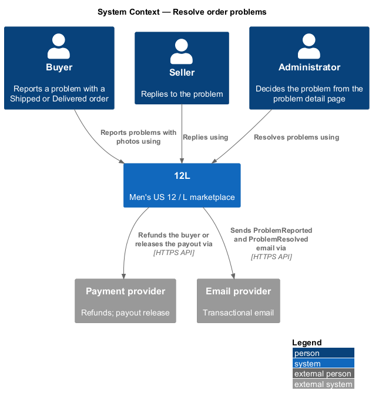
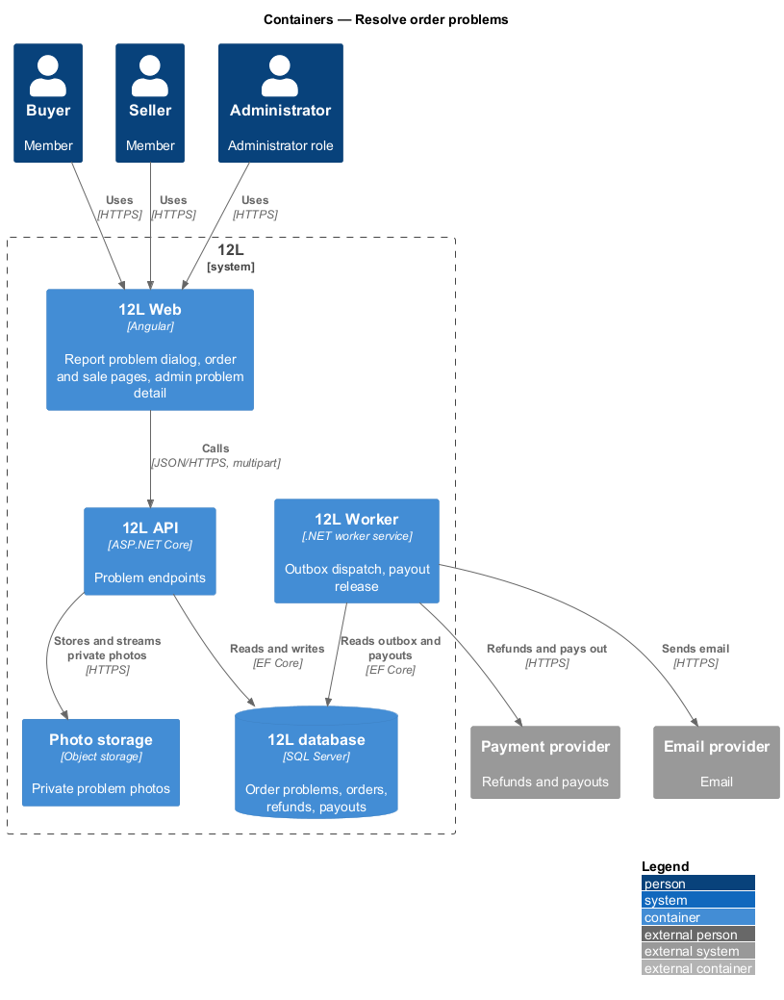
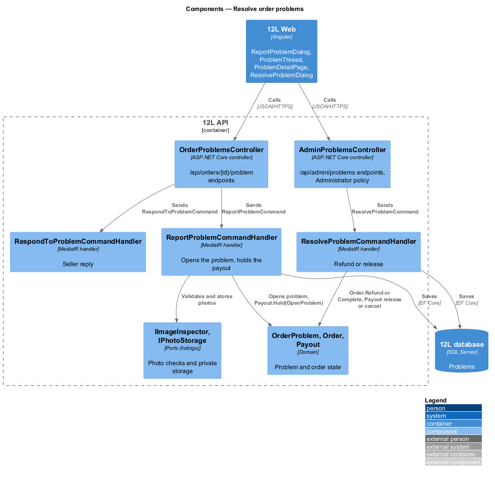
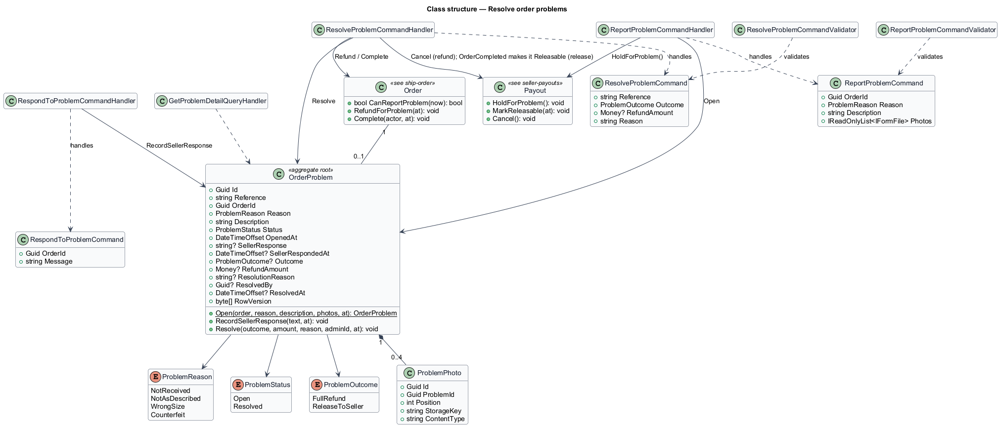
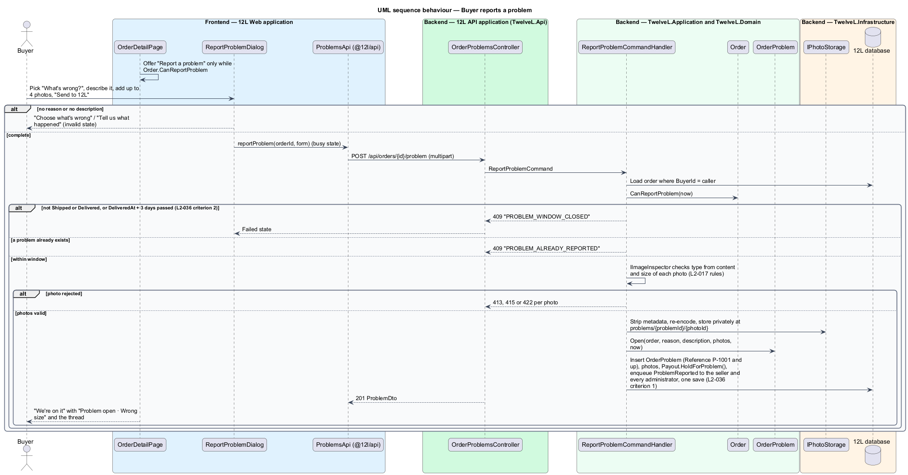
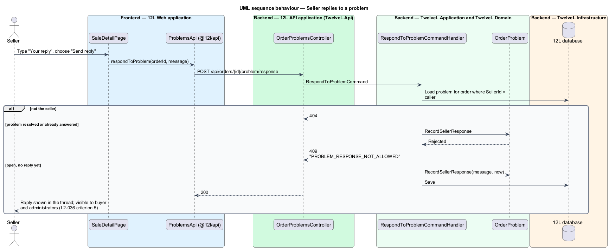
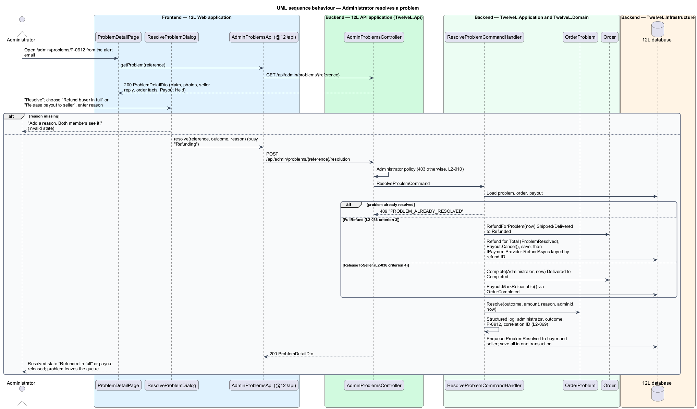

# Resolve order problems

## Overview

Tutu Much is a marketplace for new and used girls' clothing. Parents buy for a
child who needs it now, so an item that arrives in the wrong size, differs from its
description, never arrives or is counterfeit needs a clear remedy. This feature lets a
buyer report a problem on a `Shipped` or `Delivered` order, lets the seller reply, and
lets an administrator decide the outcome: a full refund or release of the payment to the
seller. Decisions are recorded in [ADR orders/0007](../../../adr/orders/0007-order-problems-administrator-flag-private-photos-and-two-outcomes.md).

The whole problem lives here, including the administrator's problem detail page at
`/admin/problems/:id` and the resolve dialog. An administrator reaches a problem from
the email sent to every administrator when it is opened. A moderation queue, the
audit log and administrator second factor are deferred
([ADR 0001](../../../adr/general/0001-defer-moderation-reviews-and-data-export.md)).

Terms used in this design:

- **order problem** — buyer's claim on a Shipped or Delivered order, identified by a reference such as `P-0912`
- **problem window** — period in which a buyer may report: any time while the order is `Shipped`, and until 3 days after `DeliveredAt` while it is `Delivered`
- **problem reason** — one of not received, not as described, wrong size or counterfeit
- **seller response** — the seller's single written reply, visible to the buyer and administrators
- **resolution** — administrator decision with an outcome (full refund or release) and a reason both members see
- **held payout** — payout blocked while a problem is open (see [seller-payouts](../seller-payouts/README.md))

An open problem has three effects on the rest of the subsystem. It holds the payout. It
stops auto-completion in [complete-order](../complete-order/README.md). It is the only
route to the `Refunded` status in the state machine of
[ship-order](../ship-order/README.md).

## Description

### Frontend — member side (`src/frontend/projects/orders/src/lib/`, HTTP through `@tutumuch/api`)

- **`ReportProblemDialog`** (`report-problem/`, mock `docs/mocks/dialogs/report-problem/`) — opened from ghost "Report a problem" beside "I received it" on `OrderDetailPage` (states `default` and `delivered`); the action renders only while `canReportProblem` is true. It contains:
  - title "Report a problem" and description "Open until {deadline}. We hold the seller's payout while our team looks into it." (a Shipped order has no deadline, so the first sentence is left out);
  - `tm-segmented` "What's wrong?" with "Not received", "Not as described", "Wrong size", "Counterfeit";
  - textarea "Describe it" and `tm-photo-uploader` with `[cover]="false"` under "Photos (up to 4)" with "Add photo"; photos are previewed locally and sent with the report;
  - primary "Send to Tutu Much".

  States: `default`; `invalid` (`tm-error-summary` plus "Choose what's wrong" and "Tell us what happened", without calling the API); `busy` (Cancel disabled); `failed` ("Your photos and description are saved here. Try again."). A photo refused by the API shows its message under the uploader.
- **`OrderDetailPage`** state `problem` (buyer, mock `order-detail/problem`) — heading "We're on it", warning alert (icon `flag`) "Problem open · {reason}" / "We're holding the seller's payout until our team decides. Usually within 2 business days.", and `tm-thread` with the claim ("You · {day}", photos) and the seller's reply. "I received it" and "Report a problem" are hidden. State `refunded` shows the success alert "Refunded in full" / "Our team reviewed the problem. {total} is on its way back to {card}.", "Resolved {day} by Tutu Much support." and "Back to purchases".
- **`SaleDetailPage`** state `problem` (seller, mock `sale-detail/problem`) — heading "Problem reported", warning alert "Problem reported · {reason}" / "Your payout is on hold while our team reviews this.", the thread, textarea "Your reply" with help "Visible to the buyer and to Tutu Much.", and "Send reply" ("Write your reply" when blank). After a reply the form is replaced by the reply in the thread. A sale refunded on a problem shows "Refunded · Buyer refunded in full" with the administrator's reason.
- **`problemThread()`** (`problem-thread.ts`) — maps an `OrderProblem` to `tm-thread` entries for the three pages.
- **`ProblemsApi`** (`@tutumuch/api`, `orders/problems-api.ts`) — `reportProblem(orderId, reason, description, photos)` as `multipart/form-data`, `respondToProblem(orderId, message)`. `Purchase` gains `canReportProblem`, `problemDeadline` and `problem`; `Sale` gains `problem`.

### Frontend — administrator side (`src/frontend/projects/orders/src/lib/problem-detail/`, admin shell)

- **Admin shell** — routes with `data.shell = 'admin'` render in `AppShellComponent` with `tm-top-bar variant="admin"` (logo, "Admin", the member's initials) and no footer.
- **`ProblemDetailPage`** (route `/admin/problems/:reference`, mock `docs/mocks/pages/problem-detail/`) — heading is the reason ("Not as described"), subtitle "Order problem {reference} · opened {day}". The body holds `tm-thread` with the buyer's claim and photos ("{buyer} · buyer · {day}") and the seller's reply ("{seller} · seller · {day}"). A sunken side panel shows "Order {number}", the item (`tm-item-row`), `tm-facts` with Status (`tm-status`), Total, Delivered, Payout ("Held", "Not paid" or "Released") and primary "Resolve". The `resolved` state shows the success alert "Refunded in full" / "{total} back to the buyer. No payout. {day}." (or "Released to the seller") with the reason and no action. Other states are `loading` (skeleton) and `error` ("Couldn't load this problem", reference). The page does not check the role: a 403 shows the error state.
- **`ResolveProblemDialog`** (`resolve-problem/`, mock `docs/mocks/dialogs/resolve-problem/`) — title "Resolve problem {reference}". The "Decision" radios are "Refund buyer in full" ("{total} to {buyer} · no payout") and "Release payout to seller" ("Order completes · {seller} is paid"), followed by the reason field ("Sent to both members."). Buttons are "Cancel" and a primary that reads "Refund buyer" or "Release payout"; it shows busy "Refunding" or "Releasing". States: `default`; `invalid` ("Add a reason. Both members see it."); `busy`; a failure shows a danger alert and "Try again".
- **`AdminProblemsApi`** (`@tutumuch/api`) — `getProblem(reference)`, `resolve(reference, outcome, reason)`.

### API (`TutuMuch.Api`)

- **`OrderProblemsController`** (policy `VerifiedMember`; a non-party receives `404`, `L2-010`).
  - `POST /api/orders/{id}/problem` — buyer; `multipart/form-data` with `reason`, `description`, `photos` (0–4). `201` `ProblemDto`. Errors: `422` `PROBLEM_INVALID` (field errors `reason`, `description`, `photos`); `409` `PROBLEM_WINDOW_CLOSED` (`L2-036` criterion 2); `409` `PROBLEM_ALREADY_REPORTED`; `413` `PHOTO_TOO_LARGE`, `415` `PHOTO_TYPE_UNSUPPORTED`, `422` `PHOTO_TOO_MANY_PIXELS` per photo.
  - `POST /api/orders/{id}/problem/response` — seller; body `{ message }`. `200` `SaleDto`; `422` `PROBLEM_RESPONSE_INVALID`; `404`; `409` `PROBLEM_RESPONSE_NOT_ALLOWED` (resolved or already answered).
  - `GET /api/orders/{id}/problem/photos/{photoId}` — buyer, seller or administrator; streams the private photo with `Cache-Control: private, no-store`; otherwise `404`.
- **`AdminProblemsController`** (policy `Administrator`, the Administrator role check of `L2-010`; `403` `ADMINISTRATOR_REQUIRED`)
  - `GET /api/admin/problems/{reference}` — `200` `ProblemDetailDto`; `404` `PROBLEM_NOT_FOUND`.
  - `POST /api/admin/problems/{reference}/resolution` — body `{ outcome: "FullRefund" | "ReleaseToSeller", reason }`. `200` `ProblemDetailDto`; `422` `PROBLEM_RESOLUTION_INVALID` (`outcome`, `reason`); `409` `PROBLEM_ALREADY_RESOLVED`; `409` `ORDER_INVALID_TRANSITION`.
- `GET /api/purchases/{id}` adds `canReportProblem`, `problemDeadline` and `problem`; `GET /api/sales/{id}` adds `problem`. `POST /api/orders/{id}/receipt` answers `409` `ORDER_PROBLEM_OPEN` while a problem is open.

### Application and domain

- **`OrderProblem`** (aggregate, `TutuMuch.Domain/Orders/`) — `Id`, `Number`, `Reference` (`P-1001` and up: highest number plus one, guarded by a unique index), `OrderId`, `Reason` (`ProblemReason`), `Description`, `Photos` (0–4 `ProblemPhoto`), `Status` (`Open`, `Resolved`), `OpenedAt`, `SellerResponse`, `SellerRespondedAt`, `Outcome`, `RefundAmount`, `ResolutionReason`, `ResolvedBy`, `ResolvedAt`. `RecordSellerResponse` accepts one reply while `Open`. `Resolve` accepts one decision. Texts are trimmed and at most 1000 characters.
- **`Order.CanReportProblem(now)`** — true when `Status = Shipped`, or when `Status = Delivered` and `now < DeliveredAt + 3 days` (`Order.ProblemWindow`). `Order.ProblemDeadline` carries the end of the window. `Order.RefundForProblem(now)` moves Shipped or Delivered to Refunded as the administrator.
- **`Member.IsAdministrator`** — the Administrator role, granted in the database by operations.
- **`ReportProblemCommandHandler`** — loads the order by `BuyerId = caller`, validates, and checks the window. It checks each photo's size (10 MB), sniffed type and pixel count with `IImageInspector` as `L2-017` does, without the 800-pixel minimum. It re-encodes each as one JPEG of at most 1600 pixels (stripping metadata) and stores it privately with `IPhotoStorage.SaveOriginalAsync` under `problems/{problemId}/{photoId}.jpg`. Problem photos are never published. In one save it inserts the problem, calls `Payout.HoldForProblem()` and enqueues `NotificationType.ProblemReported` to the seller and to every administrator, linking to `/admin/problems/{reference}` (`L2-036` criterion 1).
- **`RespondToProblemCommandHandler`** — records the seller's reply (`L2-036` criterion 5).
- **`ResolveProblemCommandHandler`** — in one save, by outcome:
  - `FullRefund` — `Order.RefundForProblem(now)` (`Shipped` or `Delivered` → `Refunded`), a `Refund` for `Total` (`ProblemResolved`), `Payout.Cancel()` (`L2-036` criterion 3). After the save the refund is issued through `IPaymentProvider` with the refund ID as key, as cancellations are, and the buyer is emailed `OrderRefunded`.
  - `ReleaseToSeller` — `Order.Complete(Administrator, now)` (`Delivered` → `Completed`), then `OrderCompleted` is published so the payout becomes releasable (`L2-036` criterion 4). A `Shipped` order answers `ORDER_INVALID_TRANSITION`.
  - A partial refund is deferred ([ADR orders/0007](../../../adr/orders/0007-order-problems-administrator-flag-private-photos-and-two-outcomes.md)).

  Each outcome calls `OrderProblem.Resolve`, enqueues `NotificationType.ProblemResolved` with the decision and reason to buyer and seller, and logs the administrator ID, outcome and problem and order references (`L2-069`).
- **`CompleteDeliveredOrdersHandler`** skips orders with an open problem, and `ConfirmReceiptCommandHandler` refuses them (`L2-034` criterion 3). The payout release job's catch-up also repairs a payout held for a problem whose order completed but lost its event.
- **`GetProblemDetailQuery`** / handler — projects the claim, photos (as API URLs), seller reply, both display names, the order facts, the payout status and, when resolved, the decision.

### Data

| Table | Key columns and constraints |
|-------|-----------------------------|
| `OrderProblems` | `Id` PK; unique `UX_OrderProblems_Reference`, `UX_OrderProblems_Number`, `UX_OrderProblems_OrderId` (one problem per order); `Reason`, `Description`, `Status` (concurrency token), `OpenedAt`, `SellerResponse`, `SellerRespondedAt`, `Outcome`, `RefundAmount decimal(10,2)`, `ResolutionReason`, `ResolvedBy` (FK `Members`), `ResolvedAt`; filtered index `IX_OrderProblems_Open_OpenedAt` where `Status = 'Open'` |
| `ProblemPhotos` | `Id` PK; `ProblemId` FK (cascade); `Position`; `StorageKey`; `ContentType` |
| `Members` | adds `IsAdministrator bit` (default 0) |

`Payouts.Status` gains `Cancelled` and `Payouts.HoldReason` gains `OpenProblem`; `Refunds.Reason`
gains `ProblemResolved`. The problem window is the constant `Order.ProblemWindow` (3 days).

### Error codes

| Code | HTTP | Meaning |
|------|------|---------|
| `PROBLEM_INVALID` | 422 | Reason, description or photo count invalid |
| `PROBLEM_WINDOW_CLOSED` | 409 | Order not Shipped or Delivered, or 3 days or more after delivery |
| `PROBLEM_ALREADY_REPORTED` | 409 | The order already has a problem |
| `PROBLEM_RESPONSE_INVALID` | 422 | Reply blank or too long |
| `PROBLEM_RESPONSE_NOT_ALLOWED` | 409 | Problem resolved or already answered |
| `PROBLEM_RESOLUTION_INVALID` | 422 | Resolution without a reason or with an unknown outcome |
| `PROBLEM_ALREADY_RESOLVED` | 409 | A decision already exists |
| `PROBLEM_NOT_FOUND` | 404 | No problem with that reference |
| `ORDER_PROBLEM_OPEN` | 409 | The buyer confirmed receipt while a problem is open |
| `ADMINISTRATOR_REQUIRED` | 403 | The caller does not hold the Administrator role |

### Tests

- `tests/TutuMuch.Api.Tests/ResolveOrderProblemsTests.cs` — the endpoints end to end on SQLite in-memory, with fake photo storage, payment provider and email sender.
- `tests/TutuMuch.Domain.Tests/OrderProblemTests.cs` — the window, the aggregate and the payout hold.
- `src/frontend/e2e/tests/resolve-order-problems.spec.ts` — the buyer, seller and administrator screens with `page.route` fixtures.

## Requirements

| L2 ID | Refines (L1) | Requirement |
|-------|--------------|-------------|
| `L2-036` | `L1-008` | The buyer shall be able to report a problem on a Shipped or Delivered order until 3 days after delivery. Reasons shall be: not received, not as described, wrong size, or counterfeit. An open problem shall hold the seller payout. An administrator shall resolve it with a full refund or release of payment to the seller. A partial refund is deferred. |

## Diagrams

### System context

Buyer, seller and administrator all act through Tutu Much. Tutu Much refunds or pays out through
the payment provider and emails both members.

### Containers

`Tutu Much API` stores problem photos privately in `Photo storage` and records the decision.
`Tutu Much Worker` carries out refunds, payouts and email.

### Components

Member endpoints and administrator endpoints sit in separate controllers.

### Class structure

An `Order` has at most one `OrderProblem` with up to 4 photos.
`ResolveProblemCommandHandler` changes the problem, the order and the payout together.

### Behaviour — report a problem

The window check returns HTTP 409 after 3 days from delivery. A valid report stores
photos privately, opens the problem and holds the payout in one transaction.

### Behaviour — seller reply

The seller replies once while the problem is open. The reply appears to the buyer and
to administrators.

### Behaviour — administrator resolution

A full refund moves the order to Refunded and cancels the payout. Release completes the
order and frees the payout.

