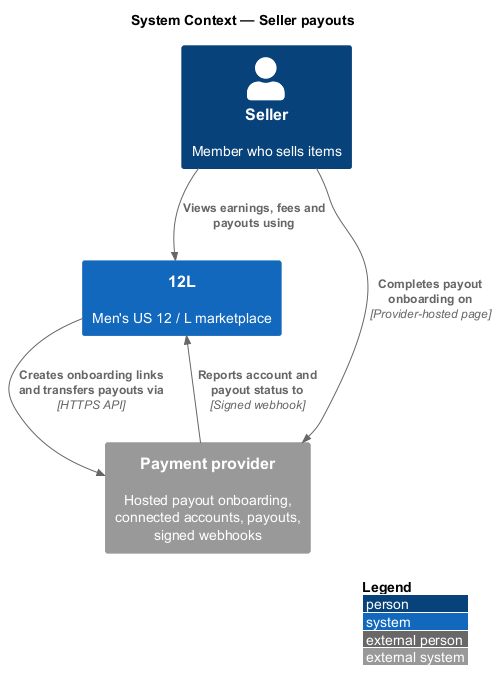
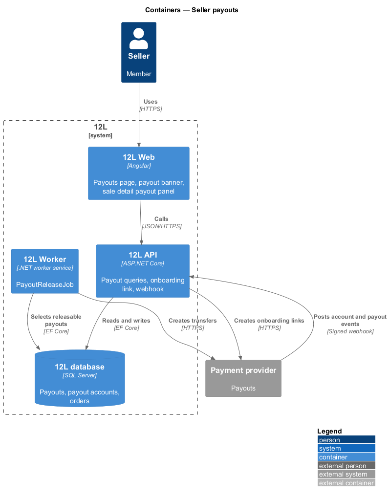
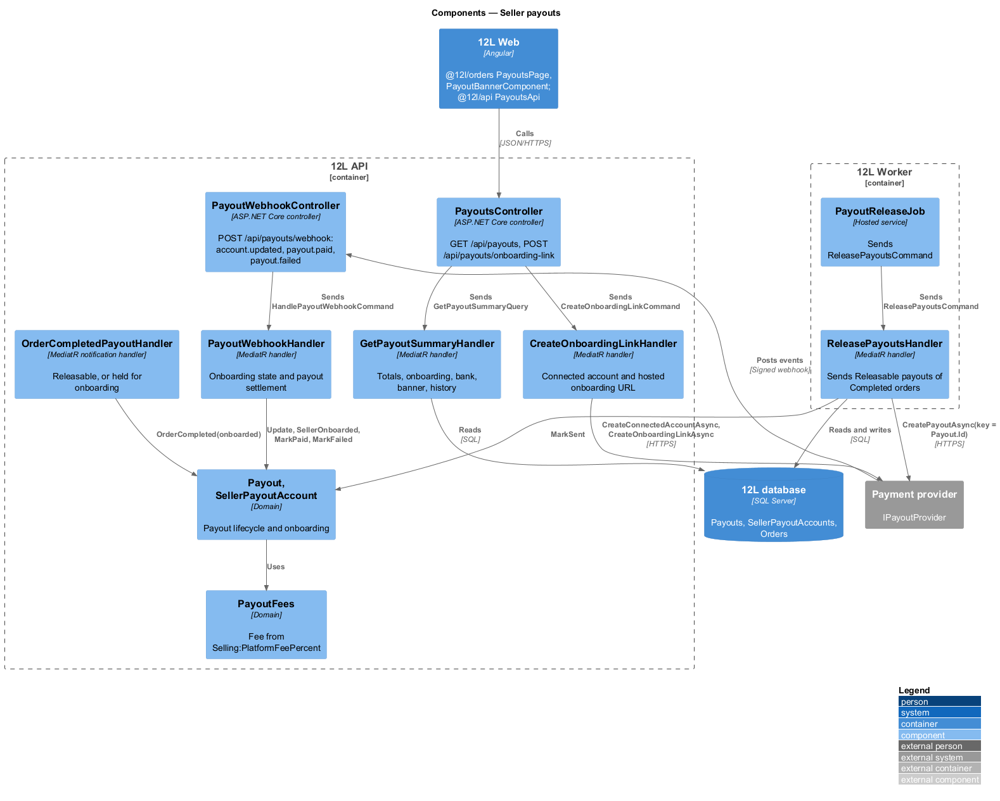
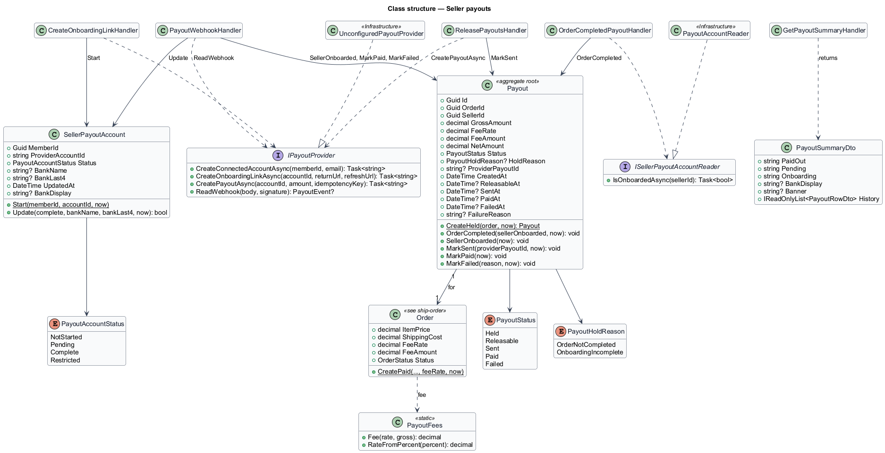
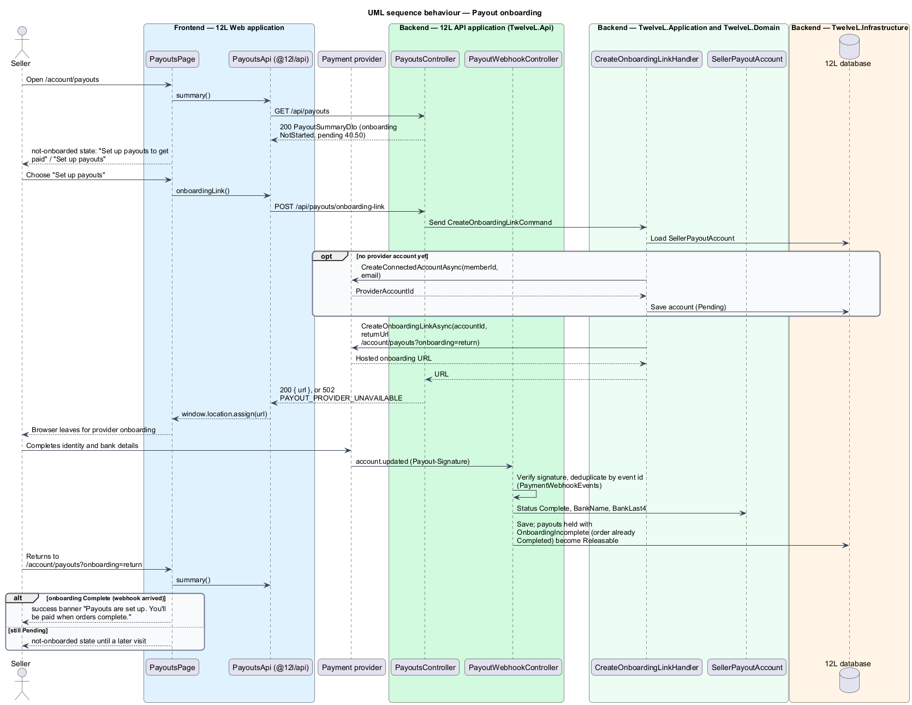
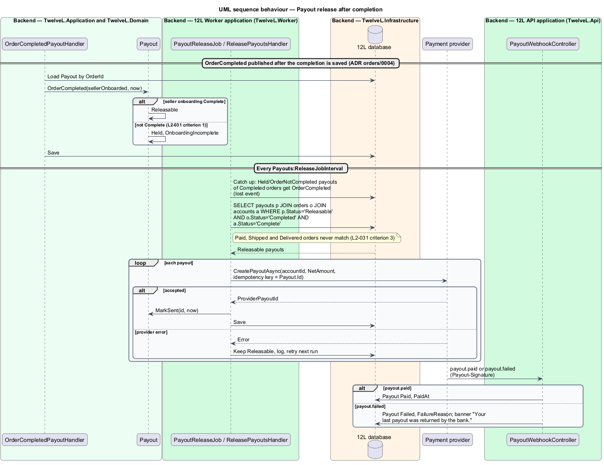

# Seller payouts

## Overview

Tutu Much takes the buyer's payment at checkout but owes most of it to the seller. A
*payout* is the transfer of a sale's proceeds, less the Tutu Much fee, from Tutu Much's payment
provider balance to the seller's bank account. This feature covers the whole payout
path: the seller's one-time onboarding with the payment provider, the fee
calculation, holding the money while the order is open, releasing it once the order
is `Completed`, and showing the seller what is pending and what has been paid.

Terms used in this design:

- **payout onboarding** — provider-hosted process in which a seller gives identity and bank details so the provider can pay them
- **connected account** — the seller's account at the payment provider, referenced by `ProviderAccountId`
- **Tutu Much fee** — configurable percentage of item price plus shipping that Tutu Much keeps from each sale
- **gross amount** — item price plus shipping cost of an order; sales tax is excluded
- **net amount** — gross amount less the Tutu Much fee; the amount paid out
- **held payout** — payout that cannot be released yet because its order is not Completed or the seller has not finished onboarding

Every order gets one payout when it is created (see
[checkout-and-pay](../checkout-and-pay/README.md)). The payout stays held through
`Paid`, `Shipped` and `Delivered`. Only the `Completed` status, defined in the state
machine of [ship-order](../ship-order/README.md) and reached through
[complete-order](../complete-order/README.md), makes it releasable. The payout of a
`Cancelled` or `Refunded` order is never released and is left out of the seller's
summary. Decisions taken while building are in
[ADR orders/0005](../../../adr/orders/0005-seller-payouts-payout-port-fee-snapshot-and-shell-banner.md).

## Description

### Frontend

- **`PayoutsPage`** (`@tutumuch/orders`, `src/lib/payouts/`, route `/account/payouts`, mock `docs/mocks/pages/payouts/`) — account area page "Payouts". States:
  - `default` (onboarding `Complete`) — `tm-stat` "Paid out" and "Pending", a payout method row ("Chase •••• 6021", "Managed by our payment provider", "Change", which opens the provider's onboarding again), and a "History" list. Each row shows the item, a meta line ("TM-48302 · Held until the order completes", "Held until you set up payouts", or "Fee $3.70 · Mon 5 Oct" / "On its way" / "Releasing soon" / "Returned by the bank"), the amount and "Pending", "Paid" or "Failed", and links to `/sales/:id`.
  - `not-onboarded` — warning `tm-alert` "Set up payouts to get paid" / "{pending} is waiting for you." with primary "Set up payouts", then a "Held" list. A provider failure shows a danger alert with the API's message and keeps the seller on the page.
  - `loading` — skeleton stats and a row.
  - `empty` — "No payouts yet", "Your earnings show up here after your first sale.", "Sell an item".
  - `error` — "Couldn't load payouts", reference code, "Try again".
- **`PayoutBannerComponent`** (`@tutumuch/orders`, exported for the app shell; mock `docs/mocks/notifications/payout-banner/`) — `tm-alert` banner above the top bar for verified members, from `PayoutSummaryDto.banner`:
  - `info` — "{amount of Sent payouts} is on its way to {bank}." with a "Payouts" link; dismissible.
  - `success` — "Payouts are set up. You'll be paid when orders complete."; shown by the browser on `/account/payouts?onboarding=return` once onboarding is `Complete`; dismissible.
  - `warning` — "Finish payout setup to receive {pending}." with "Set up payouts"; not dismissible.
  - `danger` — "Your last payout was returned by the bank." with "Update bank details"; not dismissible.
  - On `/account/payouts` only `success` shows, because the page carries the rest. The banner loads the summary once per session after the first navigation; the payouts page refreshes it through `PayoutBannerState`.
- **Sale payout panel** — local to `SaleDetailPage` for a Completed order (mock `sale-detail/completed`): "Item and shipping", "Tutu Much fee (10%)", "Your payout", and "Sent {date} to {bank}.".
- **`PayoutsApi`** (`@tutumuch/api`, `src/lib/orders/payouts-api.ts`) — `summary()`, `onboardingLink()`. `Sale` gains `payout: SalePayout | null`.

### API (`TutuMuch.Api`)

- **`PayoutsController`** (policy `VerifiedMember`)
  - `GET /api/payouts` — `200` `PayoutSummaryDto` (`paidOut`, `pending`, `onboarding`, `bankDisplay`, `banner`, `history[]`); `401`.
  - `POST /api/payouts/onboarding-link` — `200` `{ url }` to the provider-hosted onboarding; `401`; `502` `PAYOUT_PROVIDER_UNAVAILABLE`.
- **`PayoutWebhookController`** (anonymous) — `POST /api/payouts/webhook` with header `Payout-Signature`: `account.updated`, `payout.paid` and `payout.failed` after signature verification and event-ID deduplication in `PaymentWebhookEvents`. `400` `WEBHOOK_SIGNATURE_INVALID`, logged as a security event.
- **`GET /api/sales/{id}`** — `SaleDto.payout` (`gross`, `feePercent`, `fee`, `net`, `status`, `sentAt`, `bankDisplay`).
- The fee shown before publishing (`L2-031` criterion 4) comes from the existing `GET /api/selling/options` (`feePercent`); no separate fee-schedule endpoint.

### Application and domain

- **`Payout`** (`TutuMuch.Domain.Payouts`) — `Id`, `OrderId` (unique), `SellerId`, `GrossAmount`, `FeeRate`, `FeeAmount`, `NetAmount`, `Status` (`Held`, `Releasable`, `Sent`, `Paid`, `Failed`), `HoldReason` (`OrderNotCompleted`, `OnboardingIncomplete`), `ProviderPayoutId`, `CreatedAt`, `ReleasableAt`, `SentAt`, `PaidAt`, `FailedAt`, `FailureReason`. `Status` is the concurrency token.
  - `CreateHeld(order, now)` — created with the order; `Held` with `OrderNotCompleted`.
  - `OrderCompleted(sellerOnboarded, now)` — `Releasable`, or `Held` with `OnboardingIncomplete`.
  - `SellerOnboarded(now)` — releases a payout held only for onboarding.
  - `MarkSent`, `MarkPaid`, `MarkFailed` — only from `Releasable`, `Sent`, `Sent`.
- **`PayoutFees`** — `fee = round(feeRate × (itemPrice + shippingCost), 2)`, midpoint away from zero, and `net = gross − fee`. A 10% fee on $80.00 plus $10.00 shipping gives a $9.00 fee and an $81.00 payout (`L2-031` criterion 2); $37.00 gives $3.70 and $33.30. `Order.CreatePaid` snapshots `FeeRate` from `Selling:PlatformFeePercent` and records `Order.FeeAmount`, so a later configuration change does not alter existing orders.
- **`SellerPayoutAccount`** — `MemberId` (PK), `ProviderAccountId`, `Status` (`Pending`, `Complete`, `Restricted`; no row means `NotStarted`), `BankName`, `BankLast4`, `UpdatedAt`. Tutu Much stores no full bank account number. Only `account.updated` marks it `Complete`.
- **`GetPayoutSummaryHandler`** — sums `NetAmount` of `Paid` payouts as "Paid out" and of `Held`, `Releasable` and `Sent` payouts as "Pending", leaving out payouts of Cancelled or Refunded orders. It lists history newest first and derives `banner`: `danger` when the latest sent payout failed, `warning` when onboarding is not Complete and something is pending, `info` while a payout is `Sent`.
- **`CreateOnboardingLinkHandler`** — creates the connected account on first use, then requests an onboarding link with return URL `{App:BaseUrl}/account/payouts?onboarding=return` and refresh URL `...?onboarding=refresh`.
- **`OrderCompletedPayoutHandler`** — MediatR `INotificationHandler<OrderCompleted>`; complete-order publishes the event once after saving the completion ([ADR orders/0004](../../../adr/orders/0004-complete-order-in-process-event-and-fixed-3-day-window.md)). It calls `Payout.OrderCompleted` with whether the seller is onboarded.
- **`PayoutWebhookHandler`** — `account.updated` updates the account and, when onboarding just became Complete, releases payouts held for it; `payout.paid` and `payout.failed` settle a `Sent` payout. Unknown accounts and payouts are ignored.
- **`IPayoutProvider`** (`TutuMuch.Application.Abstractions`) — `CreateConnectedAccountAsync`, `CreateOnboardingLinkAsync`, `CreatePayoutAsync(accountId, amount, idempotencyKey)`, `ReadWebhook`. `UnconfiguredPayoutProvider` stands in until a provider is chosen; tests use `FakePayoutProvider`.
- **`PayoutAccountReader`** (`TutuMuch.Infrastructure.Payouts`) implements `ISellerPayoutAccountReader`, so publishing a listing stops prompting for payouts once onboarding is Complete (`L2-031` criterion 1).

### Worker (`TutuMuch.Worker`)

- **`PayoutReleaseJob`** — every `Payouts:ReleaseJobInterval` (15 minutes) sends `ReleasePayoutsCommand`. The handler first applies `OrderCompleted` to any payout still `Held` for its order although the order is Completed (a lost event, ADR orders/0004), then selects payouts with `Status = 'Releasable'` joined to an order with `Status = 'Completed'` and an account with `Status = 'Complete'`. A payout whose order is `Paid`, `Shipped` or `Delivered` cannot match (`L2-031` criterion 3). For each match it calls `CreatePayoutAsync` with `Payout.Id` as the idempotency key and marks it `Sent`. A provider error leaves it `Releasable` for the next run.
- Re-sending a `Failed` payout after the seller updates bank details is deferred; the payout stays `Failed` and the danger banner shows.

### Data

| Table | Key columns and constraints |
|-------|-----------------------------|
| `Payouts` | `Id` PK; unique `UX_Payouts_OrderId`; FK `SellerId`; amounts `decimal(10,2)`; `FeeRate decimal(5,4)`; `Status` (concurrency token), `HoldReason`; index `IX_Payouts_Status` (release job), `IX_Payouts_SellerId_Status` (summary) |
| `SellerPayoutAccounts` | `MemberId` PK; unique `UX_SellerPayoutAccounts_ProviderAccountId`; `BankLast4 char(4)` |
| `Orders` | `FeeRate decimal(5,4)`, `FeeAmount decimal(10,2)` |

Migration `AddSellerPayouts`. Configuration: `Selling:PlatformFeePercent` (10) and
`Payouts:ReleaseJobInterval` (Worker, `00:15:00`).

### Error codes

| Code | HTTP | Meaning |
|------|------|---------|
| `PAYOUT_PROVIDER_UNAVAILABLE` | 502 | The provider did not create the account or the onboarding link |
| `WEBHOOK_SIGNATURE_INVALID` | 400 | The payout webhook's signature is not valid |

### Tests

- `tests/TutuMuch.Domain.Tests/PayoutTests.cs` — fee and rounding, hold and release rules, onboarding state.
- `tests/TutuMuch.Api.Tests/PayoutTests.cs` — onboarding link, 502, summary and banners, held payouts, release only for Completed orders, idempotent send, lost completion events, webhook signature and deduplication, sale payout panel. SQLite in-memory and `FakePayoutProvider`; no real database or provider.
- `tests/TutuMuch.Worker.Tests/PayoutReleaseJobTests.cs` — one command per pass.
- `src/frontend/e2e/tests/seller-payouts.spec.ts` — every page state, the four banners and the sale payout panel, with `page.route` fixtures.

### Open questions

- Which payment provider, and its credentials and webhook secret (ADR orders/0001).
- Re-sending a failed payout once the seller changes bank details.
- While a problem is open the payout stays Held with `HoldReason = OpenProblem`; a refund on the problem cancels it (`PayoutStatus.Cancelled`) and release completes the order, which makes it releasable ([resolve-order-problems](../resolve-order-problems/README.md), ADR orders/0007).

## Requirements

| L2 ID | Refines (L1) | Requirement |
|-------|--------------|-------------|
| `L2-031` | `L1-007` | Before their first sale is paid out, a seller shall complete payout onboarding with the payment provider. The sale amount less the Tutu Much fee shall be released to the seller when the order is Completed. The fee percentage shall be configurable and shown to the seller before they publish a listing. |

## Diagrams

### System context

The seller onboards on the payment provider's hosted pages. Tutu Much creates the onboarding
link and the transfers, and learns about account and payout status by signed webhook.

### Containers

`Tutu Much API` serves the payouts page and receives provider events. `Tutu Much Worker` runs the
release job against the provider.

### Components

`OrderCompletedPayoutHandler` makes a payout releasable, and `ReleasePayoutsHandler`,
sent by `PayoutReleaseJob`, transfers it. `PayoutFees` fixes the fee when the order is created.

### Class structure

Each `Payout` belongs to one `Order` and moves through `PayoutStatus`. Release
requires a `SellerPayoutAccount` with `Complete` onboarding.

### Behaviour — onboarding

The seller follows a provider-hosted link. The `account.updated` webhook, not the
browser return, marks onboarding complete.

### Behaviour — release

Completion marks the payout releasable. The job transfers only payouts of Completed
orders, using the payout ID as the idempotency key.

