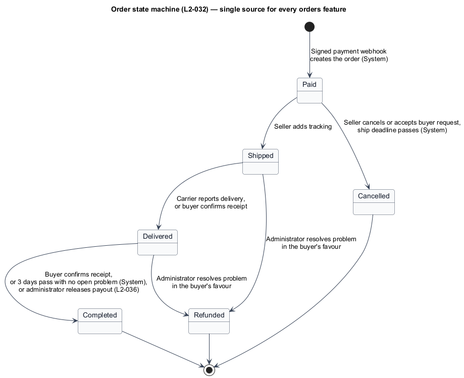
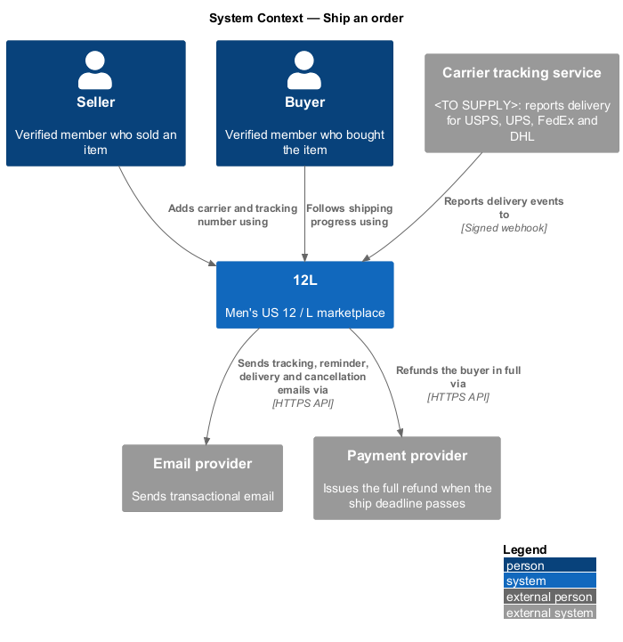
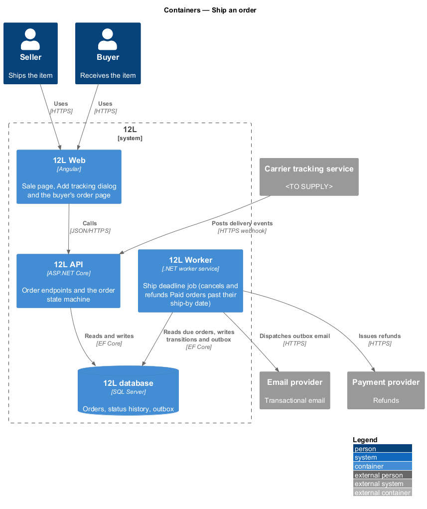
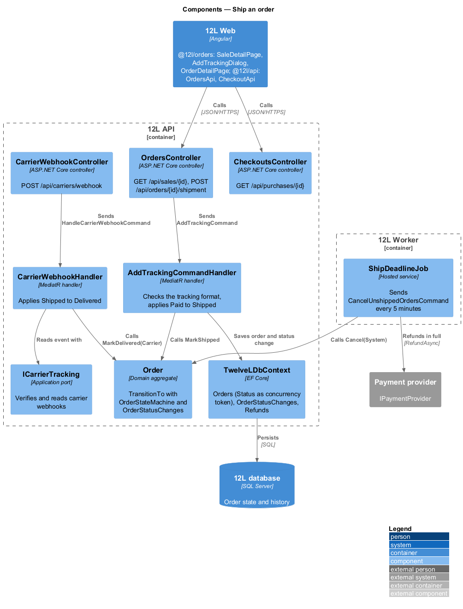
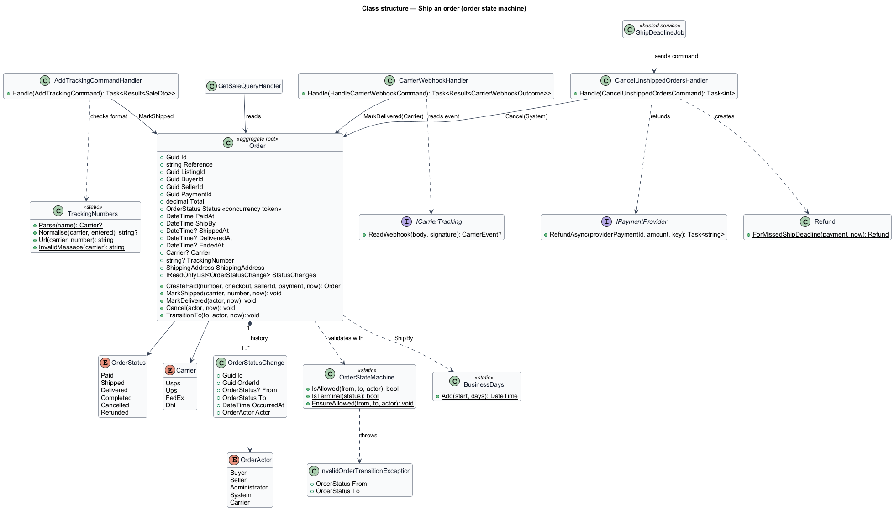
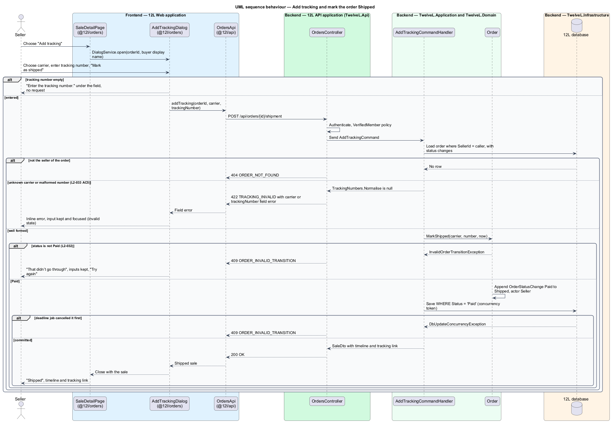
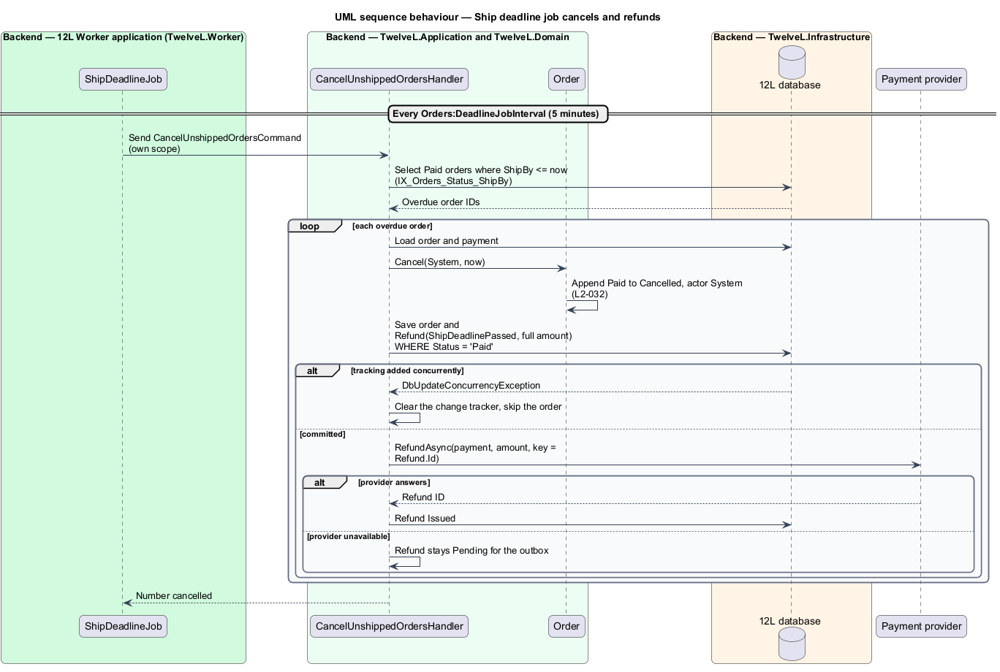
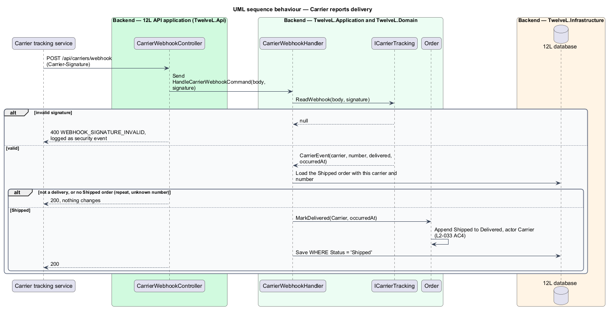

# Ship an order

## Overview

Tutu Much is a marketplace for men's US size 12 shoes and men's size L clothing. An
*order* is the record Tutu Much creates when a buyer's payment for a listing is confirmed;
it ties together one listing, one buyer, one seller, the amounts paid and the
shipping address. This feature covers the stretch of an order's life between payment
and delivery: the seller ships the item, enters a carrier and tracking number, and
the carrier later reports delivery.

This design is also the single home of the **order state machine** — the rule set
that names every order status, every allowed transition and who may trigger it
(`L2-032`). The other six features of the `orders` subsystem (checkout-and-pay,
seller-payouts, complete-order, cancel-order, resolve-order-problems, order-history)
call the `Order` aggregate defined here and do not restate its rules.

Terms used in this design:

- **order status** — one of `Paid`, `Shipped`, `Delivered`, `Completed`, `Cancelled` or `Refunded`
- **terminal status** — status that accepts no further transition: `Completed`, `Cancelled`, `Refunded`
- **status change** — append-only history row holding the old status, new status, time and actor of one transition
- **ship-by date** — instant 5 US business days after payment by which the seller shall add tracking
- **reminder date** — instant 3 US business days after payment at which an unshipped seller is reminded
- **business day** — Monday to Friday; US holidays are not skipped until their list is supplied ([ADR orders/0003](../../../adr/orders/0003-ship-order-status-token-weekday-deadline-and-carrier-port.md))
- **actor** — party recorded against a transition: buyer, seller, administrator, system (a Tutu Much job) or carrier

A Paid order has a ship-by date. The seller adds tracking before it, the order becomes
Shipped and the buyer sees the tracking link on their order page. Without tracking by the
ship-by date, a background job cancels the order and refunds the buyer in full. When the
carrier reports delivery, the order becomes Delivered and the completion clock of
[complete-order](../complete-order/README.md) starts. The tracking, delivery, reminder,
cancellation and refund emails, and the reminder job that only sends email, are built with
[send-email-notifications](../../notifications/send-email-notifications/README.md).

## Description

### Order state machine (shared by every orders feature)

`OrderStateMachine` in `TutuMuch.Domain` (`Orders/OrderStateMachine.cs`) holds the allowed
transitions as a static set of `(from, to, actor)` triples. `Order.TransitionTo` is the only
code path that changes `Order.Status`; it calls `OrderStateMachine.EnsureAllowed`, appends an
`OrderStatusChange` and sets `EndedAt` on a terminal status. Any other `(from, to, actor)`
triple, and any transition out of a terminal status, throws `InvalidOrderTransitionException`.
The handlers map that exception to HTTP 409 with error code `ORDER_INVALID_TRANSITION`
(`L2-032` criteria 1 and 3). `Order.CreatePaid` records the creation as a change from nothing to
`Paid` by the System actor.

| From | To | Allowed actors | Entry point (feature) | Domain method |
|------|----|----------------|------------------------|---------------|
| *(none)* | `Paid` | System | Signed payment webhook (checkout-and-pay) | `Order.CreatePaid(...)` factory |
| `Paid` | `Shipped` | Seller | Add tracking (this feature) | `MarkShipped(carrier, number, now)` |
| `Paid` | `Cancelled` | Seller, System | Seller cancels or accepts a buyer request (cancel-order); ship deadline job (this feature) | `Cancel(reason, note, actor, now)` |
| `Shipped` | `Delivered` | Carrier, Buyer | Carrier delivery event (this feature); buyer confirms receipt (complete-order) | `MarkDelivered(actor, now)` |
| `Delivered` | `Completed` | Buyer, System, Administrator | Buyer confirms receipt; auto-completion job (complete-order); problem resolved in the seller's favour (resolve-order-problems, `L2-036` criterion 4) | `TransitionTo(Completed, ...)`; complete-order adds `Complete` |
| `Shipped`, `Delivered` | `Refunded` | Administrator | Problem resolved in the buyer's favour (resolve-order-problems) | `TransitionTo(Refunded, ...)`; resolve-order-problems adds `Refund` |

The Administrator actor on `Delivered → Completed` comes from `L2-036` criterion 4. Releasing the
payout on a problem opened while the order is still `Shipped` (for example "not received")
would need an Administrator `Shipped → Delivered` step that `L2-032` does not list; the design
refuses that release with `ORDER_INVALID_TRANSITION` until the rule is `<TO SUPPLY>`.
Each transition into a terminal status also sets
`Order.EndedAt`, which drives the 30-day address window in
[order-history](../order-history/README.md).

`Orders.Status` is an EF Core concurrency token: every save of an order runs
`WHERE Status = @original`, so two transitions from the same status (the seller shipping while
the deadline job cancels) cannot both commit. No `RowVersion` column is used, because the tests
run on SQLite in memory ([ADR orders/0003](../../../adr/orders/0003-ship-order-status-token-weekday-deadline-and-carrier-port.md)).

The handlers queue their emails through `IEmailOutbox` in the same save as the change
([send-email-notifications](../../notifications/send-email-notifications/README.md)): add
tracking emails the buyer the carrier and number, a carrier delivery emails the buyer, and the
deadline job emails the cancellation to both and, once the provider issues the refund, the
refund to the buyer. Refunds still go to the payment provider directly, as checkout-and-pay does.

### Frontend (`@tutumuch/orders`, `@tutumuch/api`, `@tutumuch/components`)

- **`SaleDetailPage`** (`projects/orders/src/lib/sale-detail/`, route `/sales/:id`, mock `pages/sale-detail`) — the seller's view of one order from `GET /api/sales/{id}`. Paid (`default`): eyebrow "Order TM-48302 · Sat 24 Oct", "You made a sale", "Ship by **Fri 30 Oct**.", the buyer's address under "Ship to" with "Visible until 30 days after the order ends.", and the primary "Add tracking" button. Shipped, Delivered and Completed (`shipped`): the heading of the status, `tm-order-timeline`, `tm-tracking-link` and the address. Cancelled: the info alert "Cancelled · Buyer refunded in full". `loading` (two-column skeleton) and `error` ("Couldn’t load this sale", reference, "Try again", "Back to sales"). "Cancel order", the cancel-requested state and "Relist item" are added by [cancel-order](../cancel-order/README.md).
- **`AddTrackingDialog`** (`projects/orders/src/lib/add-tracking/`, mock `dialogs/add-tracking`), opened through `DialogService` — "Add tracking", "We’ll email {buyer} the tracking link.", a "Carrier" select (USPS, UPS, FedEx, DHL; focused on open) and "Tracking number". An empty number shows "Enter the tracking number." without a request. `invalid`: the API's field message under the field, the input kept and focused. `busy`: primary `aria-busy`, Cancel disabled. `failed`: "That didn’t go through" alert, inputs kept, primary "Try again". It closes with the shipped sale, which replaces the page's sale.
- **`OrderDetailPage`** (`projects/orders/src/lib/order-detail/`, route `/orders/:id`, mock `pages/order-detail`) — the buyer's order from `GET /api/purchases/{id}`: Paid "Waiting to ship" with the timeline and "{seller} ships by {date}. If not, you’re refunded automatically."; Shipped "On its way" with the tracking link; Delivered; Cancelled "Refunded in full" with "$X back to {card}. Allow 5–10 days."; `loading` and `error` ("Couldn’t load this order", "Back to purchases"). The buyer's actions belong to cancel-order, complete-order and resolve-order-problems.
- **`OrderPartyComponent`** (local, `order-party/`) — avatar, "Buyer" or "Seller" and the profile link, projected into `tm-order-summary` (shown without a visible heading on these pages).
- **`tm-order-timeline`** and **`tm-tracking-link`** in `@tutumuch/components` (design system: Order timeline, Tracking link). Dates read "Sat 24 Oct" in UTC (`order-dates.ts`).
- **`OrdersApi`** in `@tutumuch/api` (`lib/orders/orders-api.ts`) — `sale(id)` and `addTracking(id, carrier, trackingNumber)`, both returning `Sale`; `CheckoutApi.purchase(id)` returns the extended `Purchase`.

### API (`TutuMuch.Api`)

- **`OrdersController`** (policy `VerifiedMember`)
  - `GET /api/sales/{id}` — `200` `SaleDto`; `404 ORDER_NOT_FOUND` when the caller is not the order's seller (`L2-010`).
  - `POST /api/orders/{id}/shipment` — body `{ carrier, trackingNumber }`. `200` `SaleDto`; `422 TRACKING_INVALID` with a `carrier` (`CARRIER_REQUIRED`) or `trackingNumber` (`TRACKING_REQUIRED`, `TRACKING_MALFORMED`) field error; `401` anonymous; `404` when not the seller; `409 ORDER_INVALID_TRANSITION` when the order is not Paid or changed status during the request.
- **`CheckoutsController`** — `GET /api/purchases/{id}` now also returns `itemPrice`, `shippingCost`, `salesTax`, `shipBy`, `timeline` and `tracking`.
- **`CarrierWebhookController`** — `POST /api/carriers/webhook`, anonymous; the `Carrier-Signature` header is verified by `ICarrierTracking`. `200` for a delivery, a repeat or an unrelated event; `400 WEBHOOK_SIGNATURE_INVALID` and a security log entry on an invalid signature. Polling is not built: the carrier tracking service is still to be chosen.

### Application and domain (`TutuMuch.Application/Orders`, `TutuMuch.Domain/Orders`)

- **`Order`** — adds `ShipBy`, `ShippedAt`, `DeliveredAt`, `EndedAt`, `Carrier`, `TrackingNumber` and the `StatusChanges` history to the checkout-and-pay aggregate; methods as in the state machine table. `ShipBy = BusinessDays.Add(PaidAt, 5)`: the same time of day 5 weekdays later (paid Sat 24 Oct gives Fri 30 Oct; paid Thu 22 Oct gives Thu 29 Oct).
- **`OrderStatusChange`** — `Id`, `OrderId`, `From` (null at creation), `To`, `OccurredAt`, `Actor` (`OrderActor`: Buyer, Seller, Administrator, System, Carrier). The actor's member is the order's buyer or seller, so no actor ID is stored.
- **`Carrier`** and **`TrackingNumbers`** — `Usps`, `Ups`, `FedEx`, `Dhl` with their display names; `Normalise` removes spaces and hyphens, upper-cases, and checks the carrier's format (USPS 20 to 22 digits or `AA123456789US`; UPS `1Z` and 16 characters; FedEx 12, 15, 20 or 22 digits; DHL 10 or 11 digits); `InvalidMessage` gives the inline text ("That doesn’t look like a USPS tracking number. It’s usually 22 digits."); `Url` builds the carrier's public tracking page.
- **`GetSaleQuery`**, **`AddTrackingCommand`** — loaded with `SellerId = caller`; the handler checks the carrier and number, calls `MarkShipped` and saves, returning `SaleDto` (`L2-033` criteria 1 and 5).
- **`HandleCarrierWebhookCommand`** — reads the event through `ICarrierTracking.ReadWebhook`; a delivery for the Shipped order with that carrier and number calls `MarkDelivered(Carrier, occurredAt)`; anything else changes nothing, which makes repeats harmless (`L2-033` criterion 4).
- **`CancelUnshippedOrdersCommand`** — selects Paid orders with `ShipBy <= now`; for each it calls `OrderCancellation.CancelAsync(ShipDeadlinePassed, System)` from [cancel-order](../cancel-order/README.md), which cancels the order, removes the listing until the seller relists it, adds the full refund (reason `ShipDeadlinePassed`) and queues the emails in one save; it then refunds through `IPaymentProvider.RefundAsync` with the refund ID as idempotency key. A refund the provider does not accept stays Pending for the outbox; an order shipped meanwhile loses the concurrency check and is skipped.
- **`ICarrierTracking`** — `ReadWebhook(body, signature)`; `UnconfiguredCarrierTracking` in Infrastructure accepts nothing until a service is chosen; tests use `FakeCarrierTracking`.

### Worker jobs (`TutuMuch.Worker`)

- **`ShipDeadlineJob`** — every `Orders:DeadlineJobInterval` (5 minutes) sends `CancelUnshippedOrdersCommand` in its own scope (`L2-033` criterion 2).
- **`ShipReminderJob`** — built with send-email-notifications: every `Notifications:ShipReminderJobInterval` (15 minutes) sends `SendShipRemindersCommand`, which emails the seller of each Paid order 3 business days after payment once, recorded in `ShipReminderDue` and `ShipReminderSentAt` (`L2-033` criterion 3).
- **Deferred:** `DeliveryPollingJob` waits for the carrier tracking service.

### Data (`TutuMuch.Infrastructure`, migration `AddShipOrder`)

- **`Orders`** — adds `ShipBy` (existing rows backfilled to 7 days after payment), `ShippedAt`, `DeliveredAt`, `EndedAt`, `Carrier` (`nvarchar(8)`), `TrackingNumber` (`nvarchar(34)`); `Status` is the concurrency token; indexes `IX_Orders_Status_ShipBy` (deadline job) and `IX_Orders_Carrier_TrackingNumber` (carrier events). cancel-order filters `UX_Orders_ListingId` to orders that are not Cancelled, so a relisted listing can sell again.
- **`OrderStatusChanges`** — append-only, cascade from `Orders`; index `IX_OrderStatusChanges_OrderId_OccurredAt`. No update or delete path exists.
- **`Refunds`** — `Reason` gains `ShipDeadlinePassed`.
- The shipping address stays in plain columns until protect-personal-data encrypts it ([ADR orders/0002](../../../adr/orders/0002-reserve-with-a-conditional-update-and-a-filtered-unique-index.md)).

### Error codes

| Code | HTTP | Meaning |
|------|------|---------|
| `ORDER_INVALID_TRANSITION` | 409 | The requested transition is not in the state machine table, or the order changed status meanwhile |
| `TRACKING_INVALID` | 422 | Carrier unknown, or tracking number empty or not in the carrier's format; field errors say which |
| `ORDER_NOT_FOUND` | 404 | No such order for this caller |
| `WEBHOOK_SIGNATURE_INVALID` | 400 | The carrier webhook signature is not valid |

### Tests

- `tests/TutuMuch.Domain.Tests/OrderTests.cs` — transitions, actors, terminal states, ship-by dates and tracking formats.
- `tests/TutuMuch.Api.Tests/ShipOrderTests.cs` — the endpoints, webhook and deadline command on SQLite in memory with `FakePaymentProvider` and `FakeCarrierTracking`.
- `tests/TutuMuch.Worker.Tests/ShipDeadlineJobTests.cs` — one command per pass.
- `src/frontend/e2e/tests/ship-order.spec.ts` with `pages/sale-detail.page.ts` and `pages/order-detail.page.ts` — every page and dialog state against `page.route` fixtures.

## Requirements

| L2 ID | Refines (L1) | Requirement |
|-------|--------------|-------------|
| `L2-032` | `L1-008` | An order shall move through the statuses Paid, Shipped, Delivered and Completed, or end as Cancelled or Refunded. Only the transitions in this requirement shall be allowed, and every transition shall be recorded with its time and the actor. |
| `L2-033` | `L1-008` | The seller shall ship within 5 business days of payment and enter a carrier and tracking number. If no tracking is added in that time, the order shall be cancelled and the buyer fully refunded. The seller shall be able to see the buyer's shipping address for their order. |

## Diagrams

### Order state machine

The order holds one of six statuses. The arrows are the only transitions the domain
accepts; each label names the trigger and the actor recorded in `OrderStatusChanges`.

### System context

The seller ships through Tutu Much. Tutu Much learns of delivery from a carrier tracking service
(`<TO SUPPLY>`) and refunds missed deadlines through the payment provider; email to the
buyer arrives with send-email-notifications.

### Containers

`Tutu Much Web` calls `Tutu Much API` to read the sale and add tracking. `Tutu Much Worker` runs the ship
deadline job, which cancels and refunds.

### Components

`OrdersController` dispatches `AddTrackingCommand`. The deadline job and the carrier
webhook drive the remaining transitions through the same `Order` aggregate.

### Class structure

`Order` composes its `OrderStatusChange` history and validates every transition
through `OrderStateMachine`. The handlers depend on `TrackingNumbers`, `ICarrierTracking`
and `IPaymentProvider`.

### Behaviour — add tracking

A malformed tracking number gets HTTP 422 with the field message. A non-owner gets
HTTP 404, and a non-Paid order gets HTTP 409. Otherwise the order becomes Shipped and
the page shows the timeline and tracking link.

### Behaviour — ship deadline

The deadline job cancels and refunds at 5 business days, skipping any order that was
shipped in the meantime.

### Behaviour — delivery

Delivery arrives as a signed carrier webhook. Only a Shipped order with that carrier and
number moves to Delivered, so repeats change nothing.

