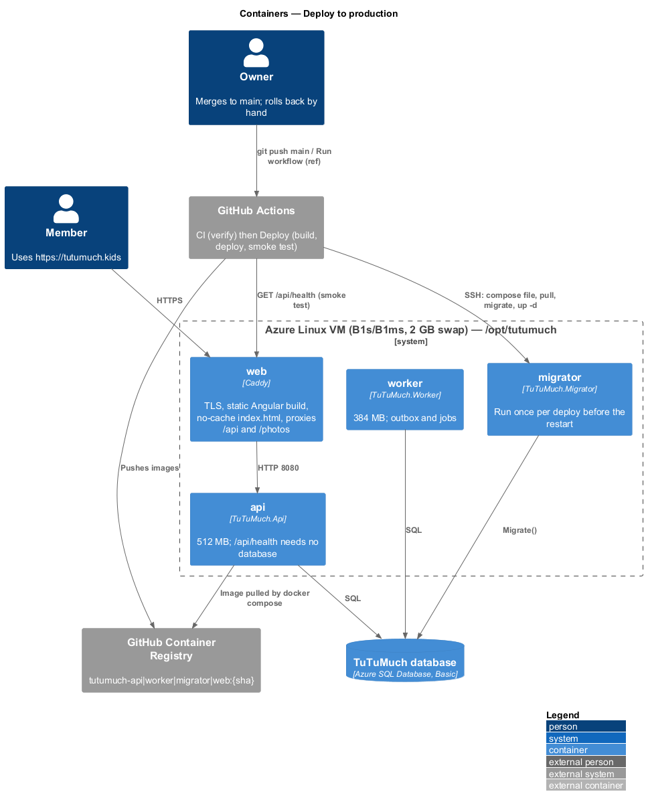
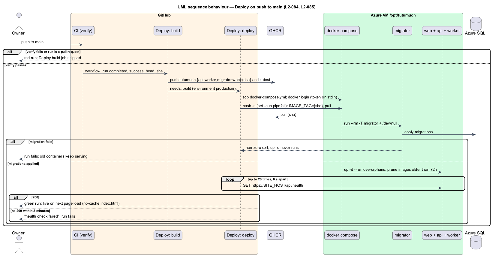
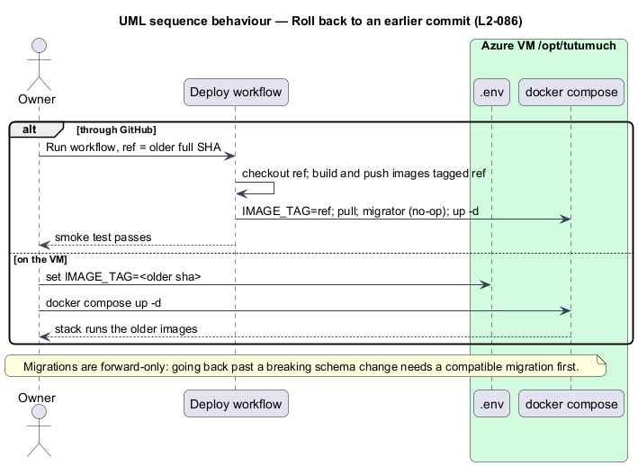

# Deploy to production

## Overview

TuTuMuch is a marketplace for all things young girls, used by only a few members. This
feature, part of the `platform` subsystem, takes every push to `main` that passes CI live
at `https://tutumuch.kids` with no manual step, on one low-cost Azure Linux VM running
Docker Compose, Caddy and an Azure SQL Basic database. It mirrors 12L's pipeline
(12L commits `dac2085` and `56e2df9`) and refines `L1-018` and `L1-019` through `L2-084`
to `L2-086` ([ADR platform/0012](../../../adr/platform/0012-low-cost-single-vm-continuous-deployment.md)).

Terms used below:

- **CI** — `.github/workflows/ci.yml`, whose `verify` job runs `npm run verify` (`L2-071`)
- **Deploy** — `.github/workflows/deploy.yml`
- **the VM** — the B1s or B1ms Ubuntu host built by `deploy/cloud-init.yaml`
- **the stack** — `deploy/docker-compose.yml` in `/opt/tutumuch` on the VM
- **deploy SHA** — the commit deployed: the `ref` input when run by hand, otherwise the
  CI run's `head_sha`

Who uses it: the owner, who merges to `main` and, rarely, rolls back. It adds no API
endpoint and changes no application code. Deliberately left out: staging, blue-green or
zero-downtime deploys, autoscaling, a second VM, Terraform or Bicep, and any load or
performance gate ([ADR general/0002](../../../adr/general/0002-no-load-or-scale-tests.md)).

## Description

### Trigger and gate (`L2-084`)

`deploy.yml` runs on `workflow_run` of `CI` (`types: [completed]`, `branches: [main]`)
and on `workflow_dispatch` with an optional `ref` input. The build job runs only when
the event is `workflow_dispatch`, or the CI run's `event` is `push` and its `conclusion`
is `success`, so a red CI run or a pull request run never deploys. Every job checks out
and tags with `DEPLOY_SHA = inputs.ref || github.event.workflow_run.head_sha || github.sha`.
The `deploy-production` concurrency group queues deploys; none is cancelled.

### Build (`L2-084`, `L2-085`)

A four-way matrix (`api`, `worker`, `migrator` from `deploy/backend.Dockerfile`; `web`
from `deploy/web/Dockerfile`) builds with Buildx and the GitHub Actions cache and pushes
`ghcr.io/quinntynebrown/tutumuch-{name}:{DEPLOY_SHA}` and `:latest`. This is the only job
with `packages: write`.

### Deploy (`L2-084`, `L2-085`)

The deploy job uses `environment: production` (`contents: read`, `packages: read`):

1. **SSH key** — under `umask 077` the key is written from an environment variable with
   `printf`, never `echo`; the host key is added with `ssh-keyscan`, as in 12L.
2. **Compose file** — `scp deploy/docker-compose.yml` to `/opt/tutumuch/`.
3. **Registry login** — the job token is piped over SSH to
   `docker login ghcr.io --password-stdin`; it never appears in the script text.
4. **Migrate and restart** — one `bash -s` script under `set -euo pipefail`: set
   `IMAGE_TAG` in `.env`, `docker compose pull`,
   `docker compose run --rm -T migrator < /dev/null` (without `-T` and `/dev/null` the
   migrator swallows the rest of the script and the restart never runs), then
   `docker compose up -d --remove-orphans`, prune images older than 72 hours and log out.
   A failed migration exits the script before `up -d`, so the old containers keep running.
5. **Smoke test** — poll `https://$SITE_HOST/api/health` 20 times, 6 seconds apart; no 200
   fails the run. The health endpoint needs no database
   ([ADR platform/0004](../../../adr/platform/0004-health-check-without-database.md)).

### Stack on a small VM (`L2-084`)

| Service | Memory limit | Notes |
|---------|-------------:|-------|
| `web` (Caddy) | 128 MB | Ports 80/443, Let's Encrypt; `Cache-Control: no-cache` for `index.html` and SPA routes |
| `api` | 512 MB | TCP health check on 8080; photos on the `photos` volume |
| `worker` | 384 MB | Shares `photos` |
| `migrator` | 384 MB | `profiles: [migrate]`, run once per deploy |

The long-running services total 1 GB, which fits a 1 GB B1s with the 2 GB swap file and
is comfortable on a 2 GB B1ms. Every service logs through `json-file` with
`max-size: 10m` and `max-file: 3`. One replica each; no load balancer.

### Secrets (`L2-085`)

| Secret | Where |
|--------|-------|
| `DEPLOY_HOST`, `DEPLOY_SSH_KEY`, `SITE_HOST` | GitHub `production` environment |
| Connection string, signing keys, `IMAGE_TAG` | `/opt/tutumuch/.env` on the VM (from `deploy/.env.example`) |

### Rollback (`L2-086`)

Run Deploy by hand with `ref` set to an older full SHA: it rebuilds (mostly from cache),
migrates (a no-op when the schema is already newer) and restarts on that tag. On the VM,
setting `IMAGE_TAG=<sha>` in `.env` and running `docker compose up -d` does the same
without CI. Migrations are forward-only; going back past a breaking schema change needs a
compatible migration first.

### Tests (`tests/TuTuMuch.Api.Tests/DeploymentPipelineTests.cs`)

The testing rules forbid Docker and a live database in tests, so the checks are static:
an xUnit test reads `deploy.yml`, `docker-compose.yml` and `Caddyfile` from the
repository and asserts the trigger and gate, the `-T migrator < /dev/null` line before
`up -d`, `set -euo pipefail`, the smoke test, the permissions, `umask 077`, no `echo` of a
secret, the memory limits, the log rotation and the `no-cache` rule.
`HealthEndpointTests` keeps covering `/api/health` without a database.

## Requirements

| L2 ID | Refines (L1) | Requirement |
|-------|--------------|-------------|
| `L2-084` | `L1-018`, `L1-019` | Deploy every green push to `main`; migrate before restart; health check fails the run; small-VM limits; `no-cache` entry page. |
| `L2-085` | `L1-013`, `L1-018` | Secrets only in the `production` environment and the VM `.env`; least permissions. |
| `L2-086` | `L1-018` | Roll back by redeploying an older SHA or setting `IMAGE_TAG`. |

Related requirements applied without restating them: `L2-052` (secrets), `L2-060`
(stateless API), `L2-070` (health checks), `L2-071` (verify command).

## Diagrams

### Containers

### Behaviour — deploy on push

### Behaviour — rollback

## Open questions

- The host key is trusted on first contact by `ssh-keyscan`, as in 12L. Pinning it in a
  `DEPLOY_HOST_KEY` secret would be stricter; deferred while the VM keeps its static IP.
- `L2-066` asks for failover between API instances; one VM cannot give it. Accepted for a
  few users by ADR platform/0012.
- `actionlint` was not available where this was built; the workflow is checked by the
  static test, a YAML parse and by GitHub on push.
