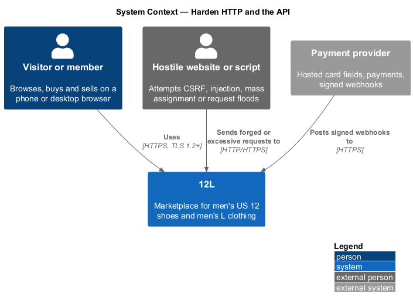
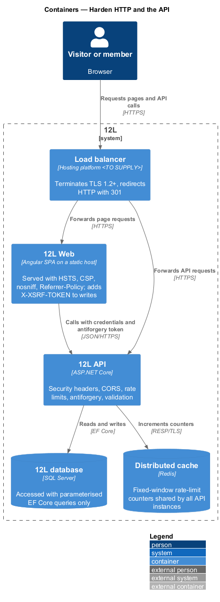
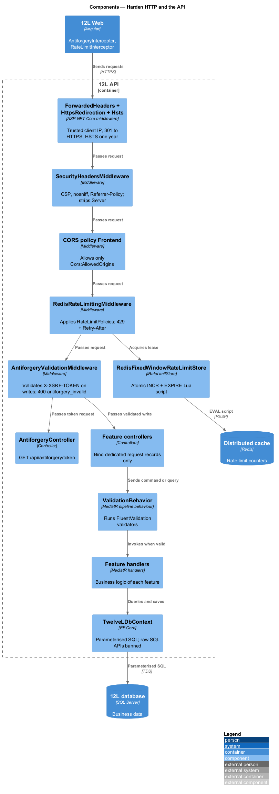
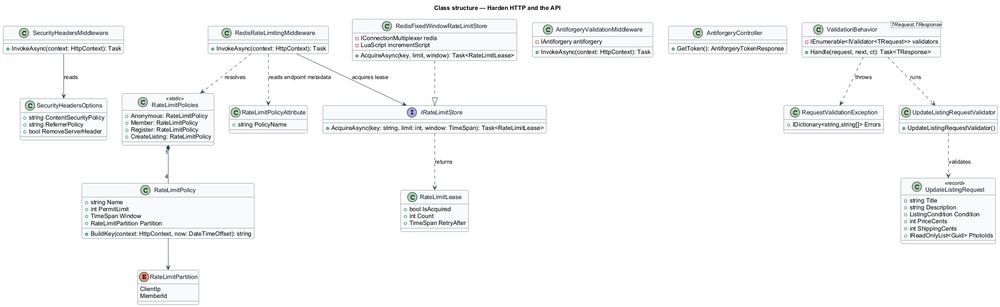
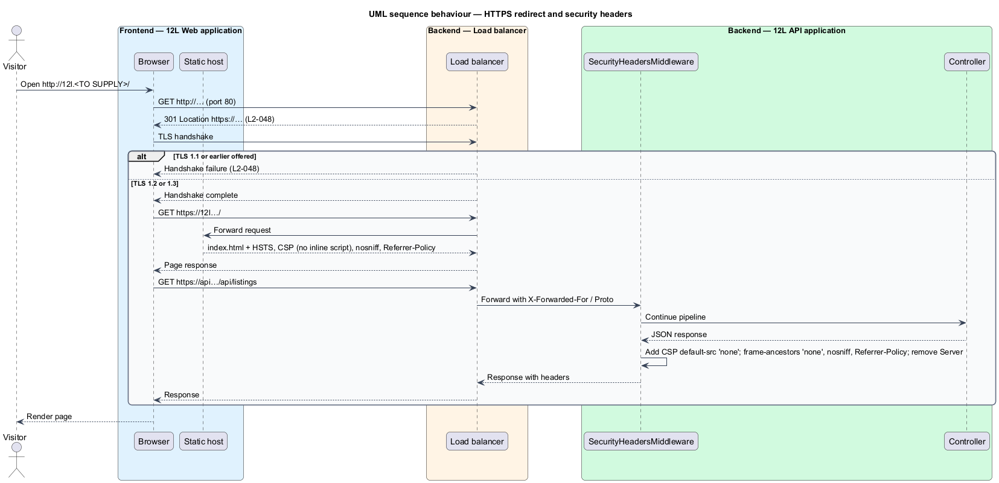
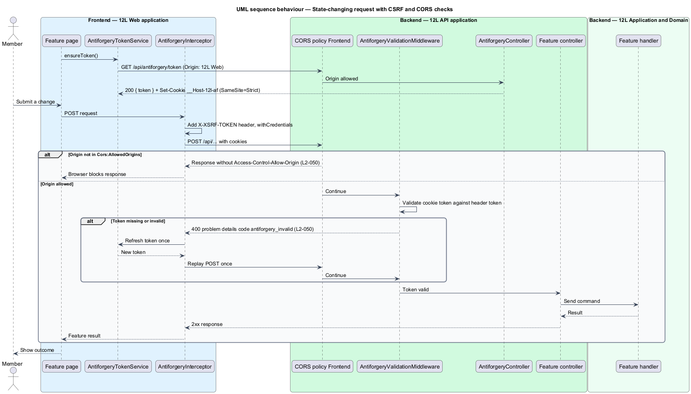
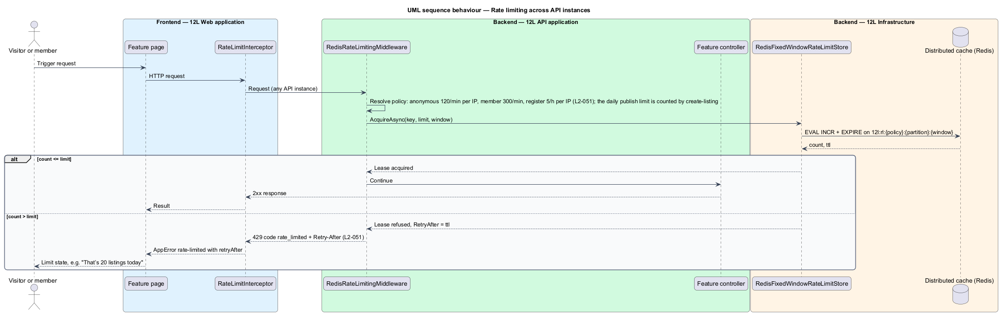
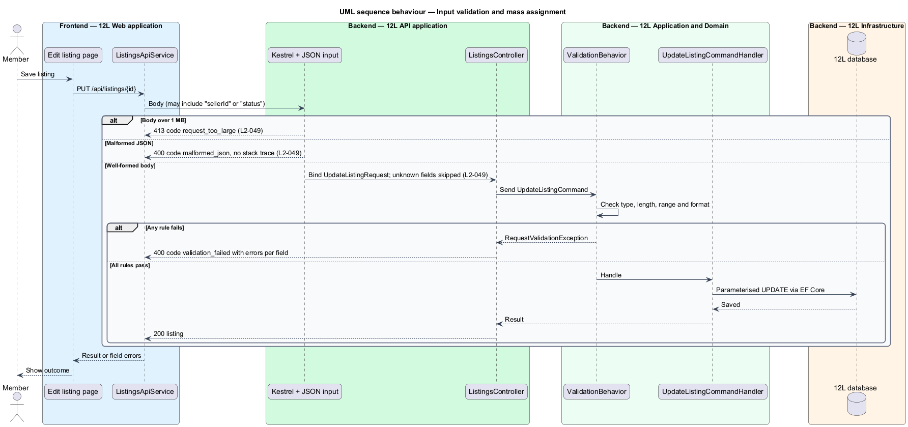

# Harden HTTP and the API

## Overview

TuTuMuch is a marketplace for new and used girls' clothing. Members
sign in, list items, pay for them and leave reviews through the `TuTuMuch Web`
single-page application, which calls the `TuTuMuch API` over HTTPS. Every one of those
calls carries a session cookie and, for writes, changes money or personal data.
This feature is the protective layer that sits in front of every endpoint in the
`TuTuMuch API` and around every page the `TuTuMuch Web` serves.

The feature belongs to the `platform` subsystem, which holds the cross-cutting
capabilities that no single business area owns. It does not add a page or a
business rule. It adds middleware, configuration, shared request types, shared
Angular interceptors and CI checks that every other feature inherits.

The feature covers four concerns, each set by one level-2 requirement:

- **transport security** — the guarantee that traffic travels only over TLS 1.2 or later and that browsers receive headers that stop downgrade, sniffing, framing and inline-script injection (`L2-048`)
- **input validation** — server-side checking of every request field for type, length, range and format, independent of any check in the browser (`L2-049`)
- **mass assignment** — attack in which a client adds fields such as `sellerId` or `status` to a request body to change data it does not own
- **cross-site request forgery (CSRF)** — attack in which another site makes a signed-in member's browser send a state-changing request to TuTuMuch (`L2-050`)
- **cross-origin resource sharing (CORS)** — browser mechanism by which the API declares which other origins may read its responses (`L2-050`)
- **rate limit** — maximum number of requests one caller may make in a fixed time window before the API refuses further requests with HTTP 429 (`L2-051`)

Rate limits are shared across all API instances through the `Distributed cache`
(Redis), because `L2-060` requires the API to be stateless. The stricter sign-in
limit of `L2-007` is owned by the accounts subsystem
([sign-in](../../accounts/sign-in/README.md)); this feature provides the limiter
it plugs into.

## Description

The slice runs from the browser through the load balancer into the ASP.NET Core
middleware pipeline, the MediatR pipeline and EF Core. It ends in CI, where
static checks stop regressions.

### Frontend (`TuTuMuch Web`, `src/frontend/src/app/core/http`)

- **`index.html` and build settings** — the production build emits no inline
  script. `angular.json` sets `optimization.styles.inlineCritical` to `false`,
  because critical-CSS inlining adds an inline `onload` handler that the
  Content Security Policy (CSP) would block. No `<script>` element in
  `index.html` carries inline code.
- **`deploy/security-headers.json`** — single source of the response headers
  for the static host that serves `TuTuMuch Web`. The hosting platform is
  `<TO SUPPLY>`; its header rule set is generated from this file at deploy time.
  The headers are:
  - `Strict-Transport-Security: max-age=31536000; includeSubDomains`
  - `Content-Security-Policy: default-src 'self'; script-src 'self'; style-src 'self' 'unsafe-inline'; img-src 'self' https://<photo CDN host> data:; connect-src 'self' https://<API host>; frame-src https://<payment provider host>; frame-ancestors 'none'; base-uri 'self'; form-action 'self'; object-src 'none'` (hosts `<TO SUPPLY>`; `style-src 'unsafe-inline'` is required for Angular component styles and is allowed because `L2-048` restricts scripts only)
  - `X-Content-Type-Options: nosniff`
  - `Referrer-Policy: strict-origin-when-cross-origin`
- **`AntiforgeryTokenService`** — root-provided Angular service. It calls
  `GET /api/antiforgery/token` once after start and after each sign-in, holds
  the returned token in a signal in memory and never writes it to web storage.
- **`AntiforgeryInterceptor`** — functional `HttpInterceptorFn`. For `POST`,
  `PUT`, `PATCH` and `DELETE` requests to the API origin it adds the
  `X-XSRF-TOKEN` header and sets `withCredentials: true`. When the API answers
  HTTP 400 with code `antiforgery_invalid`, it refreshes the token once and
  replays the request once.
- **`RateLimitInterceptor`** — functional interceptor that converts HTTP 429
  into an `AppError` of kind `rate-limited` carrying the `Retry-After` value in
  seconds. Feature pages render their own limit state from it, for example the
  sell page state "That’s 20 listings today" / "You can list more tomorrow.
  Drafts still save." (`docs/mocks/pages/sell/limited.html`). Endpoints without a
  dedicated state fall back to the warning alert "Too many requests" with "Try
  again later." (pattern from `docs/mocks/dialogs/verify-email-prompt/limited.html`).
- **Output encoding** — templates render user content only through Angular
  interpolation and property binding, which encode on output. The ESLint rule
  set (`src/frontend/eslint.config.js`) forbids `[innerHTML]` bindings and calls
  to `DomSanitizer.bypassSecurityTrust*` through `no-restricted-syntax` rules
  for TypeScript and templates.

### API (`TuTuMuch.Api`)

Middleware order in `Program.cs`: `UseForwardedHeaders` →
`UseHttpsRedirection` → `UseHsts` → `SecurityHeadersMiddleware` →
`CorrelationIdMiddleware` (report-errors-and-observe) → `UseExceptionHandler`
→ `UseCors("Frontend")` → `UseAuthentication` →
`RedisRateLimitingMiddleware` → `UseAuthorization` →
`AntiforgeryValidationMiddleware` → endpoints.

- **TLS and redirect** — Kestrel `ConfigureHttpsDefaults` sets
  `SslProtocols = Tls12 | Tls13`. The load balancer TLS policy shall also refuse
  TLS 1.1 and earlier (policy name `<TO SUPPLY>` per hosting platform).
  `HttpsRedirectionOptions.RedirectStatusCode = 301`. The load balancer listener
  on port 80 answers with HTTP 301 to the `https://` URL for both hosts.
- **`HstsOptions`** — `MaxAge = 365 days`, `IncludeSubDomains = true`, `Preload`
  `<TO SUPPLY>`.
- **`SecurityHeadersMiddleware`** — writes on every API response, including
  errors and health checks: `Content-Security-Policy: default-src 'none';
  frame-ancestors 'none'`, `X-Content-Type-Options: nosniff`,
  `Referrer-Policy: strict-origin-when-cross-origin`, and removes `Server` and
  `X-Powered-By`. Values come from `SecurityHeadersOptions` bound to the
  `Security:Headers` configuration section.
- **`ForwardedHeadersOptions`** — trusts `X-Forwarded-For` and
  `X-Forwarded-Proto` only from the networks in `Network:KnownProxies`
  (`<TO SUPPLY>`), so the client IP used for rate limits cannot be spoofed.
- **Request size** — `KestrelServerLimits.MaxRequestBodySize = 1_048_576`
  bytes (1 MB). Photo upload endpoints (listings subsystem) opt out with
  `[RequestSizeLimit]` set to the photo limit of `L2-017`. An oversized body
  produces HTTP 413 with code `request_too_large`.
- **JSON input** — `JsonSerializerOptions` with
  `UnmappedMemberHandling = Skip` (unknown fields ignored), `NumberHandling =
  Strict`, `MaxDepth = 32`. A malformed body produces HTTP 400 with code
  `malformed_json`; the problem details body never contains a stack trace
  (report-errors-and-observe).
- **Request DTOs** — every endpoint binds a dedicated `record` request type in
  `TuTuMuch.Application` holding only the fields the caller may set, for example
  `UpdateListingRequest(Title, Description, Condition, PriceCents,
  ShippingCents, PhotoIds)`. Protected fields (`SellerId`, `Status`,
  `PricePaid`, `OwnerId`) are never members of a request type, so a body
  carrying `"sellerId"` or `"status": "Sold"` is ignored.
- **`AntiforgeryController`** — `GET /api/antiforgery/token` → 200
  `{ "token": "…" }`. It calls `IAntiforgery.GetAndStoreTokens`, which sets the
  cookie `__Host-tm-af` (`HttpOnly`, `Secure`, `SameSite=Strict`, `Path=/`).
- **`AntiforgeryValidationMiddleware`** — for every `POST`, `PUT`, `PATCH` and
  `DELETE` it calls `IAntiforgery.ValidateRequestAsync` with header name
  `X-XSRF-TOKEN`. Failure → HTTP 400, code `antiforgery_invalid`, before any
  handler runs. Endpoints marked `[IgnoreAntiforgeryToken]` are skipped; the
  only such endpoint is the signed payment webhook
  `POST /api/webhooks/payments` (orders subsystem).
- **CORS policy `Frontend`** — `WithOrigins(Cors:AllowedOrigins)`,
  `AllowCredentials()`, methods `GET, POST, PUT, PATCH, DELETE`, request headers
  `Content-Type, X-XSRF-TOKEN, X-Correlation-ID`, exposed headers
  `Retry-After, X-Correlation-ID`, preflight max age 600 s. An origin outside
  the list receives no `Access-Control-Allow-Origin` header.
- **`RedisRateLimitingMiddleware`** — reads the `RateLimitPolicyAttribute` on
  the matched endpoint (or the default policy), builds a partition key, and asks
  `IRateLimitStore` for a lease. Over the limit it writes HTTP 429, code
  `rate_limited`, and `Retry-After` set to the seconds left in the window.
  Health endpoints and the payment webhook are exempt.

### Application and domain (`TuTuMuch.Application`)

- **`ValidationBehavior<TRequest, TResponse>`** — MediatR pipeline behaviour.
  It runs every `IValidator<TRequest>` and throws `RequestValidationException`
  with a field → messages map when any rule fails; report-errors-and-observe
  maps it to HTTP 400, code `validation_failed`.
- **Validators** — one FluentValidation `AbstractValidator<T>` per command and
  query. Each string has a maximum length, each number a range, each
  identifier a format rule, and each enum an `IsInEnum` rule. Feature designs
  own the specific rules; this feature owns the convention and an architecture
  test that fails when a command or query has no validator.
- **`RateLimitPolicies`** — static catalogue of named policies:

  | Policy | Limit | Partition | Window | Redis key |
  |--------|-------|-----------|--------|-----------|
  | `anonymous` (default, no member) | 120 | client IP | 1 minute | `tutumuch:rl:anon:{ip}:{yyyyMMddHHmm}` |
  | `member` (default, signed in) | 300 | member ID | 1 minute | `tutumuch:rl:member:{memberId}:{yyyyMMddHHmm}` |
  | `register` | 5 | client IP | 1 hour | `tutumuch:rl:register:{ip}:{yyyyMMddHH}` |
  | `sign-in` | per `L2-007` | owned by accounts | per `L2-007` | `tutumuch:rl:sign-in:…` |

  `register` applies in addition to the default policy. The listing creation limit of
  `L2-051` (20 published listings per member per UTC day; drafts are not limited) is not a
  policy here: create-listing enforces it in `PublishListingCommandHandler` by counting the
  member's listings with `PublishedAt` since 00:00 UTC in `TuTuMuch database`, and answers 429
  `RATE_LIMITED` with `Retry-After` set to the seconds until midnight UTC
  ([ADR platform-0006](../../../adr/platform/0006-daily-publish-limit-counted-in-database.md)).
  The default policies still apply to the publish endpoint.

### Infrastructure (`TuTuMuch.Infrastructure`)

- **`RedisFixedWindowRateLimitStore : IRateLimitStore`** — runs one Lua script
  per request: `INCR key`; on the first increment `EXPIRE key window`; returns
  the count and `TTL`. One round trip keeps the counter atomic across API
  instances (`L2-060`). When Redis is unreachable the store fails open and
  increments the metric `tutumuch_rate_limiter_unavailable_total`; whether a
  Redis outage should instead fail closed is `<TO SUPPLY>`.
- **Parameterised data access** — EF Core LINQ only. The Roslyn
  `Microsoft.CodeAnalysis.BannedApiAnalyzers` package with
  `BannedSymbols.txt` bans `FromSqlRaw`, `ExecuteSqlRaw`, `SqlQueryRaw` and
  `SqlCommand.CommandText` setters; `FromSqlInterpolated` remains allowed
  because it parameterises. Keyword search (catalog subsystem) passes the term
  as a parameter, so `' OR 1=1 --` is literal text.

### Tests and CI

- `SecurityHeadersTests` (xUnit + `WebApplicationFactory`) asserts each header
  on a page response, an API response, an error response and a health response.
- `CspBuildTests` scans `dist/tm-web/browser/index.html` for inline scripts and
  `deploy/security-headers.json` for `unsafe-inline` or `unsafe-eval` in
  `script-src`.
- `TlsTests` (deployment smoke step) attempts a TLS 1.1 handshake with
  `openssl s_client -tls1_1` and expects failure.
- `MassAssignmentTests`, `RequestSizeTests`, `MalformedJsonTests`,
  `AntiforgeryTests`, `CorsTests` and `RateLimitTests` cover each acceptance
  criterion. Rate-limit tests replace `IRateLimitStore` with an in-memory fake; no test
  starts Redis or any other external system (`AGENTS.md` testing rules).

### Error codes introduced

`request_too_large` (413), `malformed_json` (400), `validation_failed` (400),
`antiforgery_invalid` (400), `rate_limited` (429).

## Requirements

| L2 ID | Refines (L1) | Requirement |
|-------|--------------|-------------|
| `L2-048` | `L1-013` | All traffic shall use HTTPS with TLS 1.2 or later. HTTP requests shall redirect to HTTPS. Responses shall include `Strict-Transport-Security` (max-age of at least one year), a `Content-Security-Policy` that disallows inline scripts, `X-Content-Type-Options: nosniff`, `Referrer-Policy: strict-origin-when-cross-origin` and `frame-ancestors 'none'`. |
| `L2-049` | `L1-013` | The API shall validate every input on the server for type, length, range and format, whatever the client checks. Database access shall use parameterised queries only. User content shall be encoded on output. Unknown fields in a request body shall be ignored and shall never change protected fields such as owner, status or price paid (mass assignment). |
| `L2-050` | `L1-013` | All state-changing requests shall be protected against cross-site request forgery with an anti-forgery token in addition to `SameSite` cookies. The API shall allow cross-origin requests only from the TuTuMuch frontend origins listed in configuration. |
| `L2-051` | `L1-013` | The API shall limit requests to 120 per minute per IP address for anonymous callers and 300 per minute per member, with stricter limits for sign-in (L2-007), registration (5 per hour per IP) and listing creation (20 published listings per member per UTC day; saving drafts is not limited). Callers over a limit shall receive HTTP 429 with a `Retry-After` header. |

## Diagrams

### System context

Visitors and members reach TuTuMuch only over HTTPS. Requests from other websites can
reach the API, but CSRF and CORS controls stop them from acting on a member's
behalf.

### Containers

The load balancer terminates TLS and redirects HTTP. The static host serves
`TuTuMuch Web` with the header set, `TuTuMuch API` enforces the remaining controls, and the
`Distributed cache` holds the shared rate-limit counters.

### Components

Inside `TuTuMuch API`, requests pass the security-header, CORS, rate-limit and
antiforgery middleware before the controller. The MediatR validation behaviour
runs before each handler, and EF Core issues only parameterised SQL.

### Class structure

`RedisRateLimitingMiddleware` resolves a `RateLimitPolicy` and asks
`IRateLimitStore` for a lease. `ValidationBehavior` runs the validators of each
request type, and request records carry only caller-writable fields.

### Behaviour — HTTPS redirect and security headers

An `http://` request receives HTTP 301 at the load balancer. Every `https://`
response then carries the `L2-048` headers.

### Behaviour — state-changing request with CSRF and CORS checks

The frontend fetches an antiforgery token, then sends it on each write. A missing
or invalid token, or a foreign origin, stops the request before the handler.

### Behaviour — rate limiting across instances

Each request increments a Redis counter for its policy partition. The request
over the limit receives HTTP 429 with `Retry-After`.

### Behaviour — input validation and mass assignment

Oversized and malformed bodies are refused before model binding. Unknown fields
are dropped during binding, and the validation behaviour rejects out-of-range
values before the handler runs.

