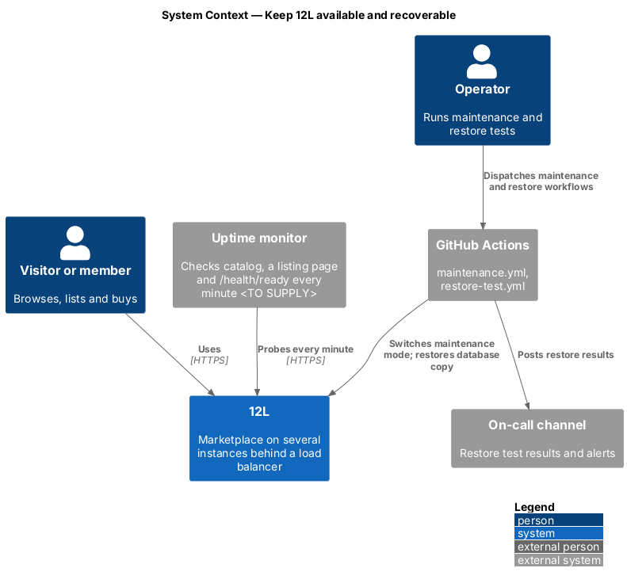
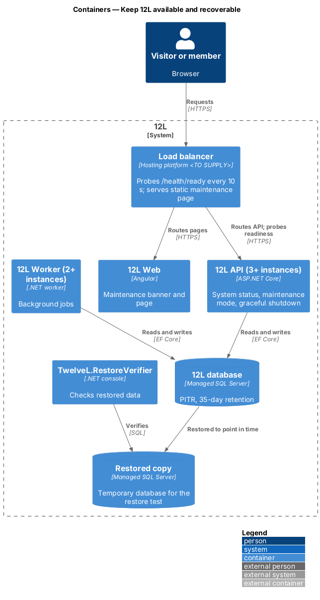
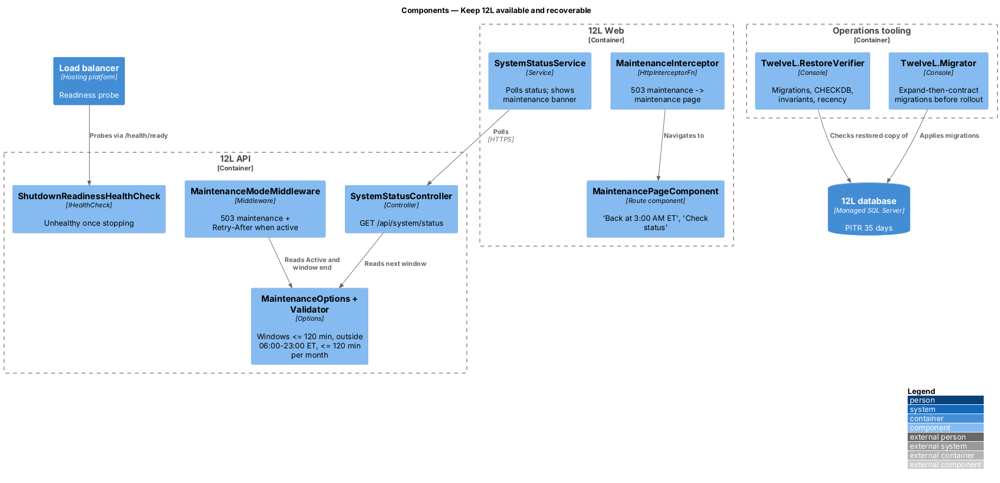
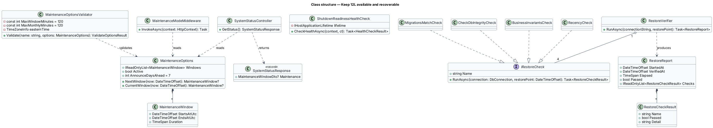
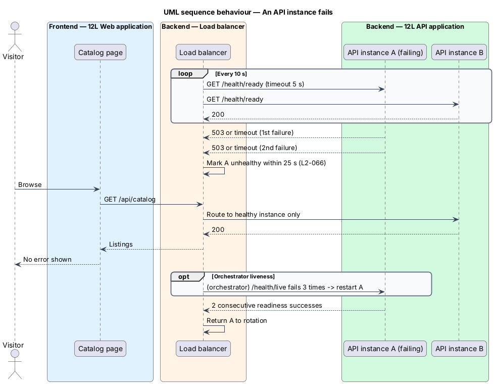
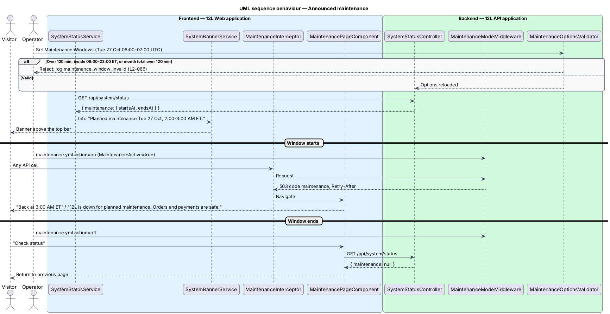
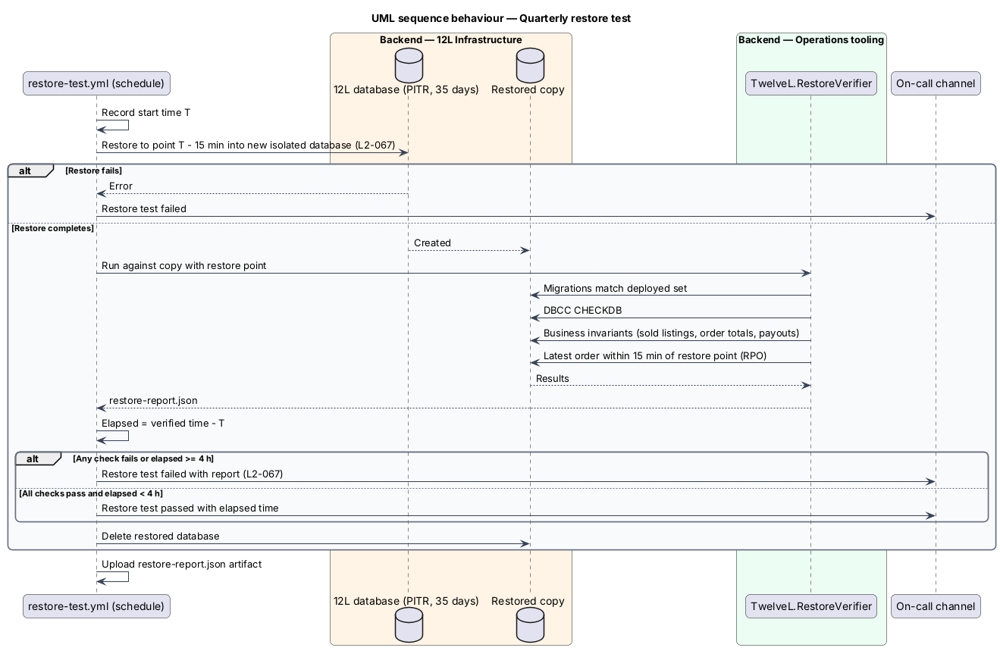

# Keep TuTuMuch available and recoverable

## Overview

Members expect to browse, list and buy on TuTuMuch at any hour, and sellers expect
that a sale, once made, is never lost. This feature, part of the `platform`
subsystem, sets how TuTuMuch stays up when an instance fails, how planned maintenance
is announced and served, and how the database is backed up and restored.

Terms used below:

- **availability** — share of one-minute checks in a calendar month in which the catalog, a listing page and the API health endpoint all answer successfully, excluding announced maintenance; the target is 99.9% (`L2-066`)
- **announced maintenance** — planned outage of at most 2 hours per month, outside 06:00 to 23:00 US Eastern time, shown to visitors in advance (`L2-066`)
- **maintenance window** — start and end time in UTC of one announced maintenance
- **point-in-time recovery (PITR)** — restore of the database to any moment within the retention period from full, differential and transaction log backups (`L2-067`)
- **recovery point objective (RPO)** — maximum data loss measured in time; 15 minutes (`L2-067`)
- **recovery time objective (RTO)** — maximum time from the decision to restore until the restored database serves TuTuMuch; 4 hours (`L2-067`)
- **restore test** — scheduled exercise that restores a copy of the database, checks it, and records the time taken (`L2-067`)

The readiness and liveness endpoints this feature relies on are defined in
[report-errors-and-observe](../report-errors-and-observe/README.md). The stateless
API that allows several instances is defined in
[meet-performance-and-scale](../meet-performance-and-scale/README.md).

## Description

Source mocks: `docs/mocks/pages/maintenance/` and
`docs/mocks/notifications/system-banner/` (`info`).

### Hosting and load balancing (`deploy/`)

The hosting platform is `<TO SUPPLY>`. The design states the settings it shall
support; infrastructure-as-code files live under `deploy/infra/` (tool
`<TO SUPPLY>`).

- **Instances** — at least 3 `TuTuMuch API` instances and 2 `TuTuMuch Worker` instances
  spread across at least 2 availability zones (counts `<TO SUPPLY>`).
  Autoscaling bounds `<TO SUPPLY>`.
- **Load balancer health probe** — `GET /health/ready` every 10 s, timeout 5 s,
  unhealthy after 2 consecutive failures, healthy after 2 consecutive
  successes. A failed instance therefore leaves rotation within 25 s, inside the
  30 s of `L2-066` AC2. Connection draining 30 s.
- **Liveness** — the container orchestrator restarts an instance whose
  `/health/live` fails 3 times at 10 s intervals.
- **Graceful shutdown** — `HostOptions.ShutdownTimeout = 30 s`.
  `ShutdownReadinessHealthCheck` (tag `ready`) reports `Unhealthy` from
  `IHostApplicationLifetime.ApplicationStopping`, so the load balancer stops
  routing to the instance before in-flight requests end.
- **Zero-downtime deployment** — rolling replacement: a new instance joins only
  after `/health/ready` passes; the old instance drains after. Database
  migrations follow expand-then-contract, run by the `TuTuMuch.Migrator` console
  job before the rollout, and stay compatible with the version still running.
- **Uptime monitor** — external monitor (`<TO SUPPLY>` product) checks every
  1 minute from at least 2 regions: `GET https://tutumuch.<TO SUPPLY>/` (catalog),
  `GET https://tutumuch.<TO SUPPLY>/listings/<monitoring listing ID>` (a listing
  page; listing `<TO SUPPLY>`), and `GET https://api.tutumuch.<TO SUPPLY>/health/ready`.
  A check fails on a non-2xx status or a response over 10 s (`<TO SUPPLY>`
  threshold). The monthly report computes successful minutes over total minutes
  after removing announced maintenance windows.

### Maintenance — API (`TuTuMuch.Api`)

- **`MaintenanceOptions`** — bound to `Maintenance`:
  `Windows: [{ StartsAtUtc, EndsAtUtc }]`, `Active: bool`,
  `AnnounceDaysAhead` (default 7, `<TO SUPPLY>` confirmation). Options come from
  configuration refreshed every 60 s, so a window is announced without a
  deployment.
- **`MaintenanceOptionsValidator : IValidateOptions<MaintenanceOptions>`** —
  rejects a window longer than 120 minutes, a window that overlaps 06:00–23:00
  `America/New_York` on any day it touches, and a calendar month whose windows
  sum to more than 120 minutes (`L2-066`). An invalid configuration fails the
  options reload and keeps the previous value; the event `maintenance_window_invalid`
  is logged.
- **`SystemStatusController`** — `GET /api/system/status`, anonymous,
  returns 200 `{ "maintenance": { "startsAt": "…Z", "endsAt": "…Z" } | null }`
  for the next window within `AnnounceDaysAhead`, with
  `Cache-Control: public, max-age=60`. Exempt from antiforgery (read only).
- **`MaintenanceModeMiddleware`** — when `Maintenance:Active` is `true`, every
  request except `/health/live`, `/health/ready` and `/api/system/status`
  returns 503, code `maintenance`, with `Retry-After` set to the seconds until
  `EndsAtUtc` of the current window. Readiness stays healthy so the load balancer
  keeps the instances in rotation and the 503 reaches clients.

### Maintenance — frontend (`TuTuMuch Web`)

- **`SystemStatusService`** — calls `GET /api/system/status` at start and
  every 15 minutes (`<TO SUPPLY>` interval). When a window is announced it shows
  through `SystemBannerService` (responsive-accessible-shell) the info banner
  "Planned maintenance {Ddd D Mmm}, {h:mm}–{h:mm} {AM|PM} ET." (example:
  "Planned maintenance Tue 27 Oct, 2:00–3:00 AM ET."), dismissible; the
  dismissal is remembered in `sessionStorage` per window.
- **`MaintenanceInterceptor`** — on HTTP 503 with code `maintenance`, navigates
  to `MaintenancePageComponent` with the window end.
- **`MaintenancePageComponent`** — bare shell, guest top bar: wrench icon,
  heading "Back at {h:mm AM|PM} ET" (example "Back at 3:00 AM ET"), text "TuTuMuch is
  down for planned maintenance. Orders and payments are safe.", primary "Check
  status" (calls the status endpoint and returns to the previous route when
  maintenance has ended).
- **Static maintenance page** — `src/frontend/public/maintenance/index.html`, a
  self-contained HTML file with a linked stylesheet built from the tokens, no script, and the same copy,
  with the end time filled in at deploy. During a window that also takes the web
  host down, the load balancer serves it for all page routes with HTTP 503 and
  `Retry-After`. The workflow `.github/workflows/maintenance.yml`
  (`workflow_dispatch`, inputs `action: on | off`, `endsAtUtc`) switches the
  load balancer rule and `Maintenance:Active` together.

### Backups and recovery (`TuTuMuch database`)

- **Managed SQL Server** (product `<TO SUPPLY>`) with PITR enabled and backup
  retention 35 days, set in `deploy/infra/` as code. Transaction log backups at
  an interval of 10 minutes or less give an RPO of 15 minutes or less. Backup
  storage redundancy (zone or geo) `<TO SUPPLY>`.
- **`infra-policy` CI check** — parses the infrastructure-as-code plan and
  fails when PITR is disabled or retention is below 35 days (`L2-067` AC1).
- **Restore runbook** — `docs/runbooks/restore-database.md` (written with this
  feature): decide the restore point, restore to a new database, run the
  verifier, switch `ConnectionStrings--TuTuMuch` in the secret store, restart
  instances, replay or reconcile payment provider events received after the
  restore point using the provider's event list (procedure `<TO SUPPLY>`).
- **`TuTuMuch.RestoreVerifier`** — console app run against a restored database.
  Checks: `__EFMigrationsHistory` matches the deployed migration set;
  `DBCC CHECKDB` reports no errors; foreign keys are trusted; business
  invariants hold — each `Sold` listing has exactly one non-cancelled order,
  each order total equals item price plus shipping plus tax, each completed order
  has a payout record or a pending payout; the latest `Orders.CreatedAt` is
  within 15 minutes of the restore point. Writes `restore-report.json` with
  timings and results; exit code non-zero on any failure.
- **Quarterly restore test** — `.github/workflows/restore-test.yml` runs on a
  schedule in the first week of January, April, July and October (exact cron
  `<TO SUPPLY>`) and on manual dispatch. It restores production to a new,
  isolated database at the point 15 minutes before the start, runs
  `TuTuMuch.RestoreVerifier`, records the elapsed time from start to verified
  (shall be under 4 hours), uploads `restore-report.json` as an artifact, posts
  the result to the on-call channel, and deletes the restored database. Access
  to the restored copy is restricted to the operations role because it holds
  personal data.

### Configuration values

`Maintenance:Windows`, `Maintenance:Active`, `Maintenance:AnnounceDaysAhead` = 7,
`HostOptions:ShutdownTimeout` = 30 s, health probe interval 10 s, timeout 5 s,
unhealthy threshold 2.

### Error codes introduced

`maintenance` (503).

## Requirements

| L2 ID | Refines (L1) | Requirement |
|-------|--------------|-------------|
| `L2-066` | `L1-018` | The browsing, listing and purchasing functions shall be available 99.9% of each calendar month, excluding announced maintenance of no more than 2 hours per month outside 06:00 to 23:00 US Eastern time. |
| `L2-067` | `L1-018` | The database shall support point-in-time recovery with no more than 15 minutes of data loss (RPO) and shall be restorable within 4 hours (RTO). Backups shall be kept for 35 days. A restore shall be tested at least once each quarter. |

## Diagrams

### System context

Visitors use TuTuMuch, an external uptime monitor measures it every minute, and
operators run maintenance and restore tests. Backups stay inside the managed
database service.

### Containers

The load balancer spreads traffic over 3 or more API instances and removes any
instance that fails readiness. The managed database keeps 35 days of
point-in-time backups.

### Components

`SystemStatusController` and `MaintenanceModeMiddleware` serve the maintenance
state. `ShutdownReadinessHealthCheck` drains instances on shutdown, and
`TuTuMuch.RestoreVerifier` checks restored databases.

### Class structure

`MaintenanceOptions` holds the windows that `MaintenanceOptionsValidator`
checks against the `L2-066` limits. `RestoreVerifier` runs a list of
`IRestoreCheck` implementations.

### Behaviour — an API instance fails

The load balancer probe fails twice, the instance leaves rotation within 25 s,
and later requests reach healthy instances only.

### Behaviour — announced maintenance

The frontend shows the announcement banner before the window. During the
window, the API answers 503 `maintenance` and the frontend shows the maintenance
page.

### Behaviour — quarterly restore test

The scheduled workflow restores the database to 15 minutes before start,
verifies it, records the time against the 4-hour RTO and reports the result.

