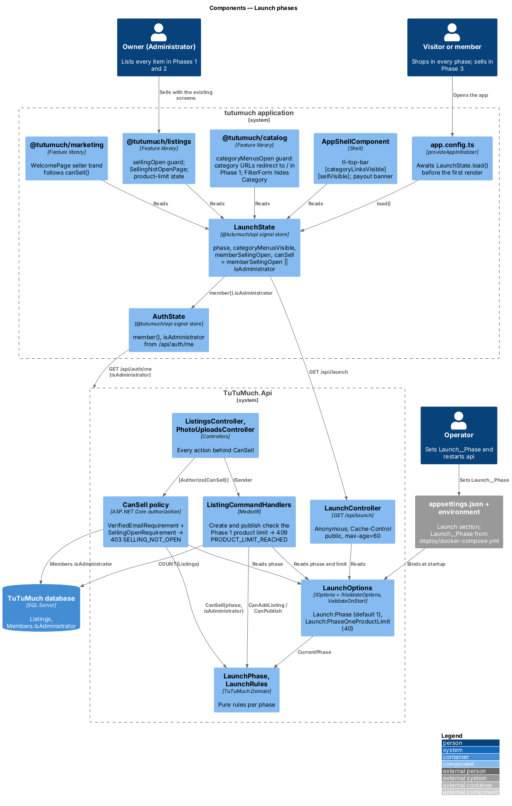
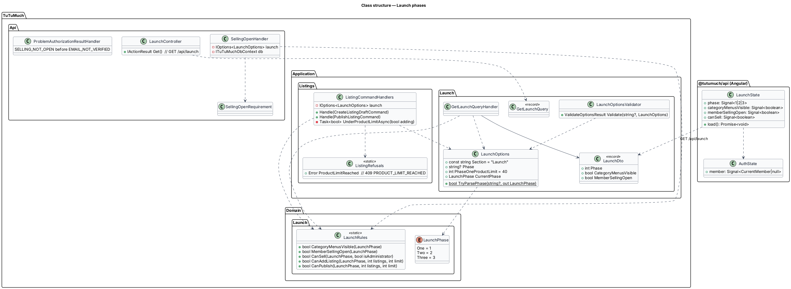
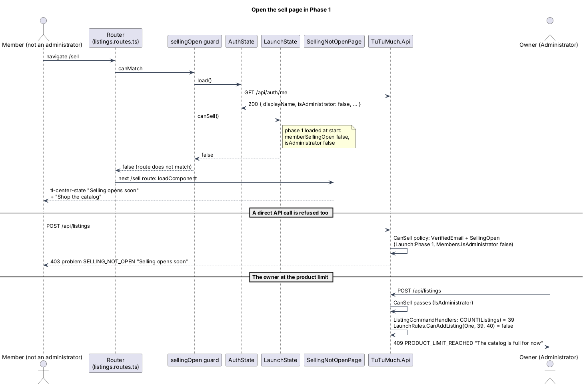
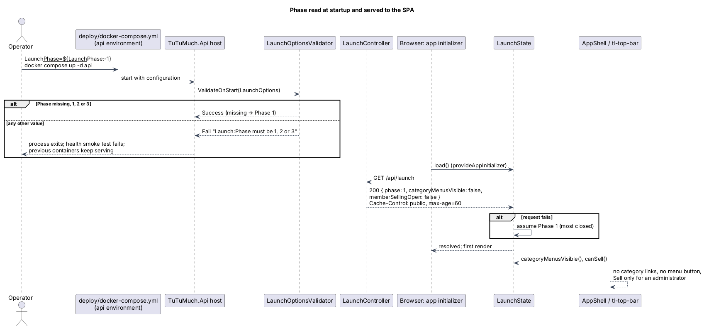

# Launch phases

## Overview

TuTuMuch opens in three launch phases chosen by one configuration setting, `Launch:Phase`
(`Launch__Phase` in the environment). This feature, part of the `platform` subsystem, makes the
API refuse selling to anyone but the owner in Phases 1 and 2, keeps the Phase 1 catalog under
its product limit, and lets the web application hide category menus and seller entry points to
match. It refines `L1-021` through `L2-089` to `L2-095`
([ADR platform/0014](../../../adr/platform/0014-launch-phase-configuration.md)).

| Phase | Who can list | Category menus | Catalog size |
| --- | --- | --- | --- |
| 1 (default) | `Administrator` only | Hidden; one flat catalog at `/` | Fewer than `Launch:PhaseOneProductLimit` (40) listings |
| 2 | `Administrator` only | All six | No limit |
| 3 | Any verified member (`L2-003`) | All six | No limit |

Terms used below:

- **owner** — the member holding the `Administrator` role (`L2-010`); in Phases 1 and 2 the only seller
- **listing count** — every row of `Listings` in any status; a draft deleted by the clean-up job no longer exists
- **can sell** — the phase opens selling to members (Phase 3) or the caller is an administrator

Buying, checkout, orders, payouts, profiles, sign-up and sign-in do not change. Nothing is
migrated: switching phase is a configuration change and a restart of `api`, in either
direction (`L2-095`).

## Description

### Setting and rules (`TuTuMuch.Domain`, `TuTuMuch.Application`)

- **`LaunchPhase`** (`Domain/Launch/LaunchPhase.cs`) — `One = 1`, `Two = 2`, `Three = 3`.
- **`LaunchRules`** — pure functions: `CategoryMenusVisible(phase)` is `phase != One`;
  `MemberSellingOpen(phase)` is `phase == Three`; `CanSell(phase, isAdministrator)`;
  `CanAddListing(phase, listings, limit)` is false only in Phase 1 when `listings + 1 >= limit`;
  `CanPublish(phase, listings, limit)` is false only in Phase 1 when `listings >= limit`.
- **`LaunchOptions`** (`Application/Launch/LaunchOptions.cs`, section `Launch`) — `Phase` is read as
  text so that `two` gets the same clear message as `4`; missing or empty means Phase 1.
  `PhaseOneProductLimit` defaults to 40. `CurrentPhase` parses `Phase`.
- **`LaunchOptionsValidator`** (`IValidateOptions<LaunchOptions>`) — fails with
  `Launch:Phase must be 1, 2 or 3` or `Launch:PhaseOneProductLimit must be 1 or more`.
  `AddInfrastructure` binds the section with `ValidateOnStart`, so the API and the worker refuse
  to start with a bad value (`L2-089`).
- **`GetLaunchQuery`** → `LaunchDto(Phase, CategoryMenusVisible, MemberSellingOpen)`.

### API (`TuTuMuch.Api`)

| Endpoint or rule | Behaviour |
| --- | --- |
| `GET /api/launch` (`LaunchController`) | Anonymous; `LaunchDto` with `Cache-Control: public, max-age=60` (`L2-090`) |
| `GET /api/auth/me` | `CurrentMemberDto` gains `IsAdministrator` |
| `CanSell` policy | Adds `SellingOpenRequirement`; `SellingOpenHandler` succeeds when `LaunchRules.CanSell(phase, Members.IsAdministrator)`, read from TuTuMuch database like `AdministratorHandler`, else fails with reason `SELLING_NOT_OPEN` |
| `ProblemAuthorizationResultHandler` | 403 `SELLING_NOT_OPEN` "Selling opens soon", checked before `EMAIL_NOT_VERIFIED` (`L2-091`) |
| `CreateListingDraftCommand` | Before any rule: in Phase 1, `COUNT(Listings) + 1 >= limit` → 409 `PRODUCT_LIMIT_REACHED` "The catalog is full for now" (`L2-092`) |
| `PublishListingCommand` | After the draft checks: in Phase 1, `COUNT(Listings) >= limit` → the same 409 |

`CanSell` already guards `ListingsController` (create, save, publish, withdraw, relist, My
listings, read one) and `PhotoUploadsController`, so no controller changes. Editing a listing
never changes the count and is not limited.

### Web application

- **`LaunchState`** (`@tutumuch/api`, `src/lib/launch/launch-state.ts`) — signals `phase`,
  `categoryMenusVisible`, `memberSellingOpen` and
  `canSell = computed(() => memberSellingOpen() || auth.member()?.isAdministrator === true)`;
  `load()` calls `GET /api/launch` once and on failure keeps Phase 1. `CurrentMember` gains
  `isAdministrator`.
- **`app.config.ts`** — `provideAppInitializer(() => inject(LaunchState).load())`, so the first
  render already knows the phase (`L2-090` AC5).
- **Shell** — `<tl-top-bar [categoryLinksVisible]="launch.categoryMenusVisible()"
  [sellVisible]="launch.canSell()">`. In `@tutumuch/components`, `categoryLinksVisible` false
  removes the six links and the menu button (the nav-menu sheet holds only categories);
  `sellVisible` false removes Sell for guests and members (`L2-093`, `L2-094`).
- **`@tutumuch/catalog`** — `categoryMenusOpen` (`CanActivateFn`) on the six category routes
  returns `router.createUrlTree(['/'])` in Phase 1; `FilterForm` drops the Category fieldset;
  the empty state shows "Sell an item" only while `canSell()`.
- **`@tutumuch/listings`** — `sellingOpen` (`CanMatchFn`, awaits `AuthState.load()`) on `/sell`,
  `/sell/:reference`, `/items/:reference/edit` and `/account/listings`; the same paths follow
  without the guard and load `SellingNotOpenPage` (`tl-center-state` "Selling opens soon" with
  "Shop the catalog"). `SellPage` shows the product-limit `tl-center-state` when a save answers
  409 `PRODUCT_LIMIT_REACHED`; `MyListingsPage` hides nothing else.
- **`@tutumuch/orders`** — `PayoutBannerComponent` shows nothing and requests nothing while
  `canSell()` is false; the empty sales and payouts states drop "Sell an item".
- **`@tutumuch/accounts`** — `VerifyEmailPage` drops "Sell an item" and reads "Buying is open."
  while `canSell()` is false.
- **`@tutumuch/marketing`** — `WelcomePage` replaces the three "Start selling" links with
  "Selling opens soon." and the seller band copy of the `selling-opens-soon` mock.

### Configuration and operations

- `appsettings.json` gains `"Launch": { "Phase": 1, "PhaseOneProductLimit": 40 }`.
- `deploy/docker-compose.yml` sets `Launch__Phase: ${Launch__Phase:-1}` on `api` and `worker`,
  so the default is 1 and `/opt/tutumuch/.env` may override it. `docs/deployment.md` says how.
- `TuTuMuch.Cli seed` post-configures `Launch:Phase` to 3 for its own run (the demo holds 48 to 80
  listings) and its output ends "Demo data targets launch phase 3." (`L2-095` AC4).

### Tests

| Level | Location | Covers |
| --- | --- | --- |
| Domain | `tests/TuTuMuch.Domain.Tests/LaunchRulesTests.cs` | Every rule per phase, limit − 1, at the limit, Phase 2 |
| Unit | `tests/TuTuMuch.Application.Tests/LaunchOptionsTests.cs` | Default, valid and invalid phase and limit |
| API | `tests/TuTuMuch.Api.Tests/LaunchPhaseTests.cs` | `GET /api/launch` per phase, `isAdministrator`, 403 `SELLING_NOT_OPEN` per action and phase, the Phase 1 limit, data untouched across phases, startup failure |
| CLI | `tests/TuTuMuch.Cli.Tests/SeedLaunchPhaseTests.cs` | Seeding under `Launch:Phase=1` loads the full demo and names Phase 3 |
| e2e | `src/frontend/e2e/tests/launch-phases.spec.ts` | Top bar, nav menu, category redirect, filters, sell routes, welcome, payout banner per phase and role |

`TuTuMuchApiFactory` and the e2e `fixtures.ts` default to Phase 3 so every earlier test keeps
its meaning; Phase 1 and Phase 2 are set explicitly (`new TuTuMuchApiFactory(launchPhase: 1)`,
`serveLaunchPhase(page, 1)`).

## Requirements

| L2 ID | Refines (L1) | Requirement |
|-------|--------------|-------------|
| `L2-089` | `L1-021` | `Launch:Phase` 1, 2 or 3, default 1, invalid value stops startup |
| `L2-090` | `L1-021` | `GET /api/launch`, `isAdministrator` on `/api/auth/me`, loaded before the first render |
| `L2-091` | `L1-021`, `L1-004`, `L1-002` | Only administrators sell in Phases 1 and 2: 403 `SELLING_NOT_OPEN` |
| `L2-092` | `L1-021`, `L1-004` | Phase 1 product limit: 409 `PRODUCT_LIMIT_REACHED` |
| `L2-093` | `L1-021`, `L1-005` | No category menus or category pages in Phase 1 |
| `L2-094` | `L1-021`, `L1-004`, `L1-020` | Seller entry points follow the phase and the role |
| `L2-095` | `L1-021` | Switching phase needs configuration only |

Related requirements applied without restating them: `L2-003` (verified members sell),
`L2-010` (Administrator role), `L2-015` to `L2-021` (listing rules), `L2-051` (daily publish
limit, still applied after the phase rules), `L2-078` (marketing CTAs).

## Diagrams

The PlantUML sources are in `diagrams/`, each with its rendered PNG. Re-render after an edit
with
`python -B -I .claude/skills/writing-software-design-documents/scripts/render_puml.py docs/detailed-designs/platform/launch-phases/diagrams`.

### Components

### Class structure

### Behaviour — open the sell page in Phase 1

### Behaviour — phase read at startup and served to the SPA

## Open questions

- Resolved: an invalid phase stops startup rather than falling back to Phase 1 (ADR platform/0014).
- Resolved: the limit counts listings in every status, so a sold or withdrawn listing still
  counts; the owner moves to Phase 2 to list more.
- Resolved: `/account/payouts` and `/sales/{id}` stay reachable by URL in every phase, because
  they show only the caller's own data; they are simply not offered.
- Deferred: a screen to change the phase, a live switch without restart, per-category limits,
  seller invitations or a waitlist.
