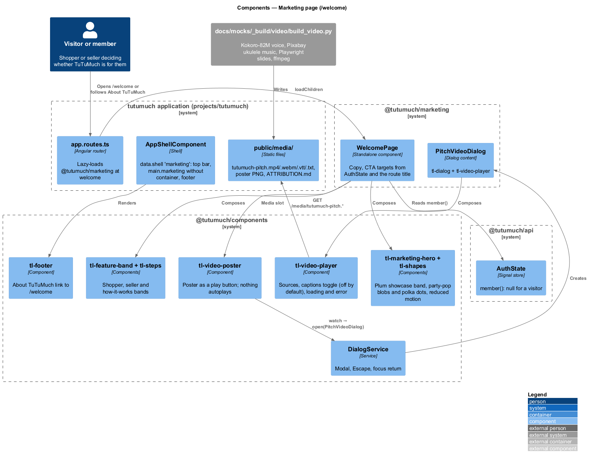
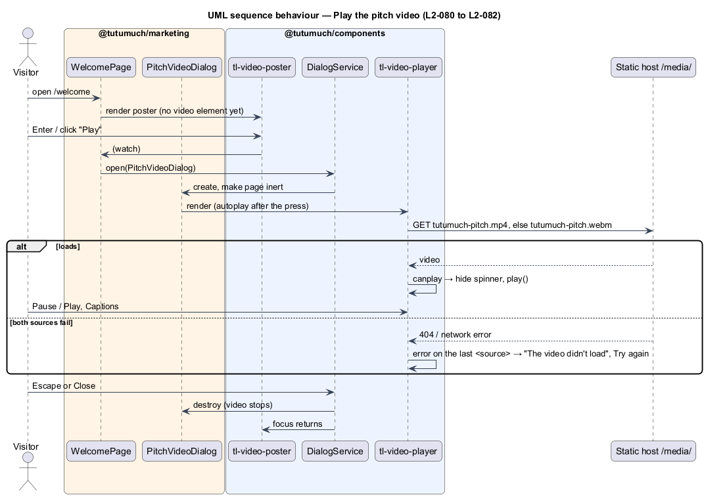

# Marketing page

## Overview

TuTuMuch is a marketplace for all things young girls: new and gently loved clothes, dance and
sports gear, cameras and more, every listing for girls. This feature, part of the `platform`
subsystem, adds a public marketing page at `/welcome` that sells TuTuMuch to shoppers and
sellers, with a short pitch video (under 30 seconds). Anyone can open it, signed in or not. It refines
`L1-020` through `L2-078` to `L2-083`. `/` stays the catalog.

Terms used below:

- **showcase** — the solid blush panel of the hero and the closing band (a plum panel in the
  dark theme), with no gradient or shapes since ADR general/0009
  ([design system](../../../design-system/components/marketing-hero.html))
- **pitch video** — `tutumuch-pitch.mp4` (H.264/AAC) and `tutumuch-pitch.webm` (VP9/Opus),
  15.1 s (under 30 s, `L2-080`), with `tutumuch-pitch.vtt` captions (off until turned on), `tutumuch-pitch-poster.png`
  and `tutumuch-share.jpg`, the 1200×630 link-preview image

The page calls no TuTuMuch API endpoint, except the Phase 1 page (below), which reads the catalog
once for the closet marquee; the shell's `GET /api/auth/me` decides the seller target. Nothing in the size rules, the catalog, sell, accounts or the API changes. The copy
says everything is for girls and never promises boys' or adult sizes
([ADR general/0005](../../../adr/general/0005-marketing-wording.md)).

## Description

### Library, route and shell ([ADR platform/0011](../../../adr/platform/0011-marketing-feature-library.md))

- `src/frontend/projects/marketing/` (alias `@tutumuch/marketing`), built by `build:libs`,
  exports `routes`: `{ path: '', loadComponent: WelcomePage, title: 'Twirl it forward ·
  TuTuMuch', data: { shell: 'marketing' } }`.
- `app.routes.ts` mounts it lazily at `welcome`, before the catalog's empty-path routes.
- `AppShellComponent` gains the `marketing` shell: same payout banner, top bar and footer, but
  `<main id="main" class="marketing" tabindex="-1">` without `.container.page`, so bands are
  full width.

### Components (`@tutumuch/components`)

| Component | Inputs and outputs | Notes |
|---|---|---|
| `tl-marketing-hero` | `eyebrow`, `lede`, `variant: 'hero' \| 'closing'`, `headingId`; slots `[title]`, `[actions]`, `[media]` | h1 in the hero, h2 in the closing band; re-points semantic tokens to the showcase |
| `tl-shapes` | — | Retired by ADR general/0009: no decorative shapes |
| `tl-feature-band` | `eyebrow`, `heading`, `headingId`, `points`, `tone: 'default' \| 'surface'`, `stacked`; slots `[actions]`, body | Section labelled by its h2 |
| `tl-steps` | `steps: { title, text }[]` | Ordered list, h3 titles |
| `tl-video-poster` | `poster`, `label`, `duration`; output `watch` | Native button; no `<video>` on the page |
| `tl-video-player` | `label`, `sources`, `captions`, `poster`, `autoplay` | States: loading, ready, error; Play/Pause, Captions (`aria-pressed`, off by default); error when the last `<source>` fails |

### Presentation (page guidelines)

Since [ADR general/0009](../../../adr/general/0009-page-guidelines-on-the-angular-and-giddy-stack.md)
the markup above is drawn to [`docs/page-guidelines.md`](../../../page-guidelines.md); see
[page-guidelines-conformance](../page-guidelines-conformance/README.md). The hero and the closing band are solid
blush panels: `tl-shapes`, the gradient and the shape motion are gone. Tilly twirls above the video
poster in the hero; "Shop the closet" in the hero is the page's one primary button and every other
call to action is secondary; the shopper band uses the `blush` tone.

### Feature (`@tutumuch/marketing`)

- **`WelcomePage`** — static copy (headlines of 3 to 6 words): hero "Twirl it *forward.*",
  For shoppers "Everything here is for girls.", For sellers "Pass it on to the next girl.",
  How it works "Three steps. That’s it.", closing "Her next favourite thing is *waiting.*";
  `sellHref = computed(() => auth.member() ? '/sell' : '/join')` and `openVideo()` that calls
  `DialogService.open(PitchVideoDialog)`.
- **`PitchVideoDialog`** — `tl-dialog` (`lg`, heading "TuTuMuch video" hidden with `headingHidden`) around
  `tl-video-player` with `autoplay` true: it opens only from the poster press, so playback
  with sound is the visitor's choice. Closing destroys the video, which stops it.
- **Share tags** — crawlers that build link previews do not run scripts, so the meta description,
  Open Graph (`og:title`, `og:description`, `og:type`, `og:site_name`, `og:image` with type, width,
  height and alt, `og:locale`) and Twitter card (`summary_large_image`) tags are static in
  `projects/tutumuch/src/index.html`. The marketing build (served at `https://www.tutumuch.kids/`)
  uses `index.marketing.html` (angular.json `index`), which adds `og:url`, the canonical link and
  the title "Twirl it forward · TuTuMuch". `og:image` is the absolute
  `https://www.tutumuch.kids/media/tutumuch-share.jpg`.

### Media and video build

Media lives in `src/frontend/projects/tutumuch/public/media/` (served at `/media/`) and is
copied to `docs/mocks/assets/media/`. `docs/mocks/_build/video/build_video.py` builds it
(rerun: `python -I docs/mocks/_build/video/build_video.py`; see its
[README](../../../mocks/_build/video/README.md)):

1. Narration: four lines for shoppers only (launch Phase 1: only TuTuMuch sells, `L2-094`),
   each with caption text and spoken text, synthesised by **Kokoro-82M** from Hugging Face
   (`onnx-community/Kokoro-82M-v1.0-ONNX`, or the same weights from the `kokoro-onnx` GitHub
   release when Hugging Face is unreachable), voice **`af_bella`** at speed 1.12, bright and
   upbeat. Model files download to the git-ignored `kokoro/` folder; Python packages are pinned
   in `requirements.txt`.
2. Timing: 0.5 s before the first line, 0.45 s between lines and 1.4 s after the last, so the
   video is as long as the narration needs (15.1 s); the build stops if it would reach 30 s.
3. Slides: four 1920×1080 slides drawn to the page guidelines (cream and blush, Fraunces and
   DM Sans, the wordmark, Tilly in approved poses, the condition-badge colours, no gradients or
   shapes), screenshotted by Playwright Chromium.
4. Music: _Upbeat Ukulele Kids_ by Cold_Fire (Pixabay Content Licence), committed as an
   excerpt, at −9 dB and ducked by a sidechain compressor keyed on the voice.
5. Encode: MP4 (libx264, AAC, faststart) and WebM (VP9, Opus). The WebM exists because
   Playwright's Chromium has no H.264 decoder; browsers pick the first source they can play.
6. Captions from the line timings, poster (last slide), the 1200×630 share image cut from it and
   `ATTRIBUTION.md`.

The committed media are the full build: narrated by `af_bella`, with the music ducked under the
voice.

### Tests (`src/frontend/e2e/`)

`tests/marketing-page.spec.ts` with `pages/welcome.page.ts`, served by the static build; the
media come from the build, and the error state routes `**/media/tutumuch-pitch.*` to 404.
`serve.mjs` learns the media content types. Covers `L2-078` to `L2-083`, including reduced
motion and the footer link.

### Phase 1 page ([ADR general/0010](../../../adr/general/0010-phase-one-marketing-page.md), `L2-112`)

`WelcomePage.phaseOne` is `LaunchState.phase() === 1 && !LaunchState.canSell()`. When it holds,
the page renders the Phase 1 template instead of the bands above. The app shell computes the same
condition for a route with the `marketing` shell (`AppShellComponent.phaseOneMarketing`) and sets
`tl-top-bar`'s `searchVisible` and `signInVisible` false, so the top bar shows the logo and, for a
signed-in member, the account link: no search and no Sign in. The closet-worth calculator is not
on the page.

| Part | Component | Notes |
|---|---|---|
| Hero | `tl-marketing-hero` with `tl-tulle-field` in `[backdrop]` | "Join early" to `/join` for a visitor beside the primary "Shop the closet" |
| Closet marquee | `tl-closet-marquee` | `CatalogApi.listings(1)` once (an `effect` guards the single call); the first 16 cards mapped locally; left out when the call fails or returns fewer than 4 |
| For shoppers | `tl-feature-band` (`blush`) | "Hand-picked, every one for girls." |
| How it works | `tl-steps` with `journey` | Find it, Pay at checkout, It ships to you, with `search`, `card` and `truck` icons |
| Closing | `tl-marketing-hero` `closing` | "Shop the closet" and, for a visitor, "Join early" |

The tulle field and the journey run outside Angular's zone on `requestAnimationFrame`, sleep
offscreen and stop under reduced motion. The top bar logo is larger on every page (`2.25rem` wordmark,
44px mark).

### Launch phases

In launch Phase 2 ([launch-phases](../launch-phases/README.md), `L2-094`; Phase 1 is the page
above), unless the member is an administrator, `WelcomePage` reads `LaunchState.canSell()` and replaces the hero's
"Start selling" with `
Selling opens soon.
`, the seller band's
heading with "Selling opens soon.", its points with "Pass it on soon" and "Join today", and its
button with `
For now, every item is hand-picked by TuTuMuch.
`;
the closing hero keeps only "Shop the closet" (mock `pages/welcome/selling-opens-soon`). This page
calls no endpoint itself: `LaunchState` is loaded by the app initializer.

## Requirements

| L2 ID | Refines (L1) | Requirement |
|-------|--------------|-------------|
| `L2-078` | `L1-020` | Page sections and CTA targets for visitors and members; copy for girls only |
| `L2-079` | `L1-020` | Footer "About TuTuMuch" link |
| `L2-080` | `L1-020` | Poster first, no autoplay, keyboard play and pause |
| `L2-081` | `L1-020` | Captions off by default, Captions toggle |
| `L2-082` | `L1-020` | Video error state; page stays usable |
| `L2-094` | `L1-021`, `L1-020` | Seller CTAs say selling opens soon in launch Phase 2 |
| `L2-112` | `L1-020`, `L1-021` | The Phase 1 page: tulle field, closet marquee, shopper journey, Join early, no search or Sign in |
| `L2-083` | `L1-020` | Contrast over gradients, heading order, reduced motion, title, meta description and link-preview tags |

Related requirements applied without restating them: `L2-061` to `L2-065` (responsive,
accessible shell), `L2-010` (no role needed), `L2-011` to `L2-013` (the girls' size rule the
copy must stay true to).

## Diagrams

The PlantUML sources are in `diagrams/`, each with its rendered PNG. Re-render after an edit
with
`python -B -I .claude/skills/writing-software-design-documents/scripts/render_puml.py docs/detailed-designs/platform/marketing-page/diagrams`.

### Components

### Behaviour — play the pitch video

## Open questions

- Deferred: SEO beyond the title, meta description and link-preview tags, analytics, A/B tests, newsletter
  sign-up, making `/welcome` the home page, translations, and a video cut for sellers once selling
  opens to members (Phase 3).
