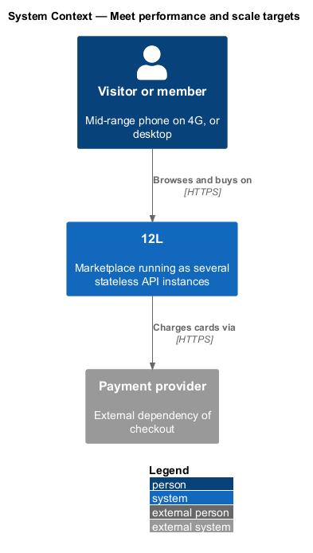
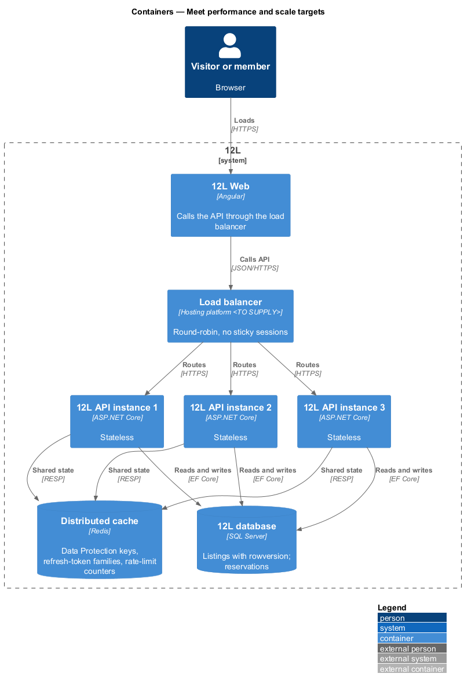
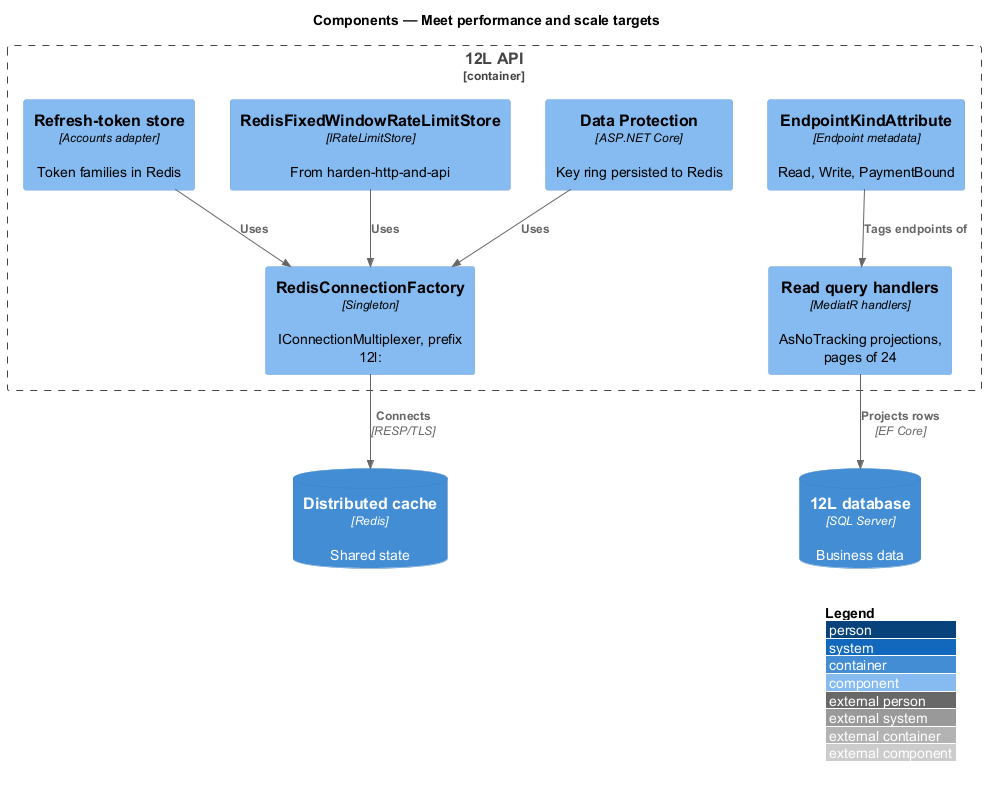
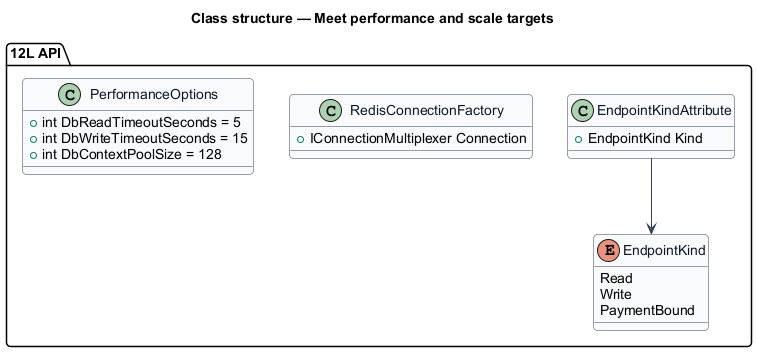
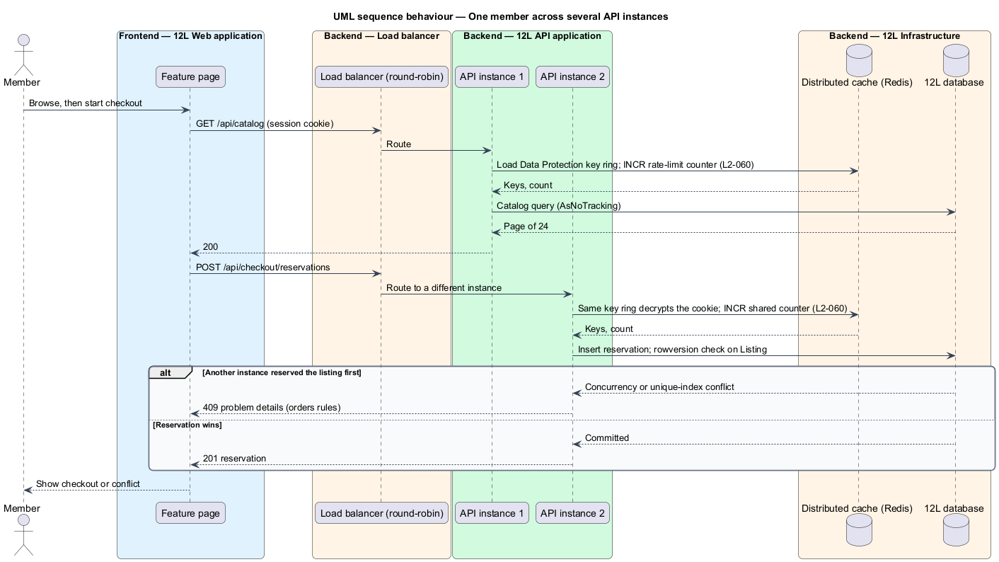

# Meet performance and scale targets

## Overview

TuTuMuch shoppers mostly browse on phones, and a sale lost to a failed request loses
a seller's income. This feature, part of the `platform` subsystem, makes the API
safe to run as several identical instances behind a load balancer. No load test,
performance environment or multi-instance scale test is built
([ADR 0002](../../../adr/general/0002-no-load-or-scale-tests.md)), and no frontend
performance budget, Lighthouse run or Core Web Vitals measurement is built
([ADR 0003](../../../adr/general/0003-no-frontend-performance-testing.md)).

It covers one concern:

- **stateless API** — API that keeps no per-member or per-request state in process memory between requests, so the load balancer may send any request to any instance (`L2-060`)

Terms used below:

- **shared state** — state that every API instance reads and writes in the `Distributed cache` (Redis) or the `TuTuMuch database`

The feature owns the shared-state wiring and the architecture test that guards
it. Query design for each read belongs to its own feature; for example
[browse-catalog](../../catalog/browse-catalog/README.md) owns the catalog query
and its indexes. Image delivery (`L2-059`) belongs to the catalog subsystem.
Lazy-loaded feature routes are a workspace convention
(`AGENTS.md`, [set-up-the-workspace](../set-up-the-workspace/README.md)), not a
measured budget.

## Description

### API (`TuTuMuch.Api`)

- **`EndpointKindAttribute(EndpointKind.Read | Write | PaymentBound)`** —
  endpoint metadata used by the latency metrics of report-errors-and-observe.
  Reads: catalog, search, listing and profile queries. Writes: create-listing,
  update-listing and every other command. `PaymentBound` marks checkout and
  refund endpoints whose time includes the payment provider.
- **Stateless rules** — enforced by an architecture test
  (`StatelessApiTests`, NetArchTest) that fails when `TuTuMuch.Api` or
  `TuTuMuch.Application` registers `IMemoryCache`, `AddSession`,
  `AddDistributedMemoryCache`, or a singleton holding mutable collections.
  Sticky sessions are off at the load balancer.

### Infrastructure (`TuTuMuch.Infrastructure`)

- **`RedisConnectionFactory`** — singleton `IConnectionMultiplexer` from
  `Redis:ConnectionString` (secret store), `AbortOnConnectFail = false`,
  connect timeout 5 s, key prefix `tutumuch:`.
- **Shared state in Redis**:

  | State | Owner | Key pattern | Expiry |
  |-------|-------|-------------|--------|
  | ASP.NET Core Data Protection key ring (cookie and antiforgery encryption) | this feature | `tutumuch:dataprotection-keys` | none (keys rotate every 90 days by default) |
  | Refresh-token families and revocations | accounts ([manage-sessions](../../accounts/manage-sessions/README.md)) | `tutumuch:rt:family:{familyId}` | 14 days |
  | Rate-limit counters | harden-http-and-api | `tutumuch:rl:…` | window length |
  | `IDistributedCache` entries | any feature | `tutumuch:cache:{name}:{key}` | per entry |

  `AddDataProtection().SetApplicationName("TuTuMuch").PersistKeysToStackExchangeRedis(…)`
  makes a cookie or antiforgery token issued by one instance readable by every
  other instance. Protection of the key ring at rest with a key from the secret
  store is `<TO SUPPLY>` (depends on the vault product).
- **Shared state in the database** — listing reservations (`L2-028`) and
  single sale (`L2-029`) rely on the `TuTuMuch database` with a `rowversion`
  concurrency token on `Listings` and a unique index on the active reservation
  (orders subsystem, [checkout-and-pay](../../orders/checkout-and-pay/README.md)).
  This feature owns that wiring.
- **Read-path conventions** — query handlers use `AsNoTracking()`, project to
  DTOs with `Select`, page with `Skip/Take` of 24 (catalog), and avoid N+1 by
  projecting related rows in one query. `DbContext` pooling
  (`AddDbContextPool`, pool size 128) and command timeout 5 s for reads,
  15 s for writes.

### Configuration values

`Redis:ConnectionString` (secret), `Performance:DbReadTimeoutSeconds` = 5,
`Performance:DbWriteTimeoutSeconds` = 15, `Performance:DbContextPoolSize` = 128.

## Requirements

| L2 ID | Refines (L1) | Requirement |
|-------|--------------|-------------|
| `L2-060` | `L1-015` | The API shall be stateless so it can run as several instances behind a load balancer. Sessions, rate limits and reservations shall work across instances. |

## Diagrams

### System context

Shoppers on phones and desktops use TuTuMuch, which runs as several stateless API
instances.

### Containers

Several identical `TuTuMuch API` instances sit behind the load balancer. Session keys,
refresh-token families and rate-limit counters live in the `Distributed cache`;
reservations live in the `TuTuMuch database`.

### Components

The API holds no state in process; Data Protection, the rate-limit store and the
token store all point at Redis.

### Class structure

`EndpointKindAttribute` tags endpoints for latency metrics, and
`RedisConnectionFactory` supplies the multiplexer that every shared-state
component uses.

### Behaviour — one member across several instances

Each request may land on a different instance. Every instance decrypts the
session cookie with the shared Data Protection key ring and counts the request in
the shared rate-limit counter.

