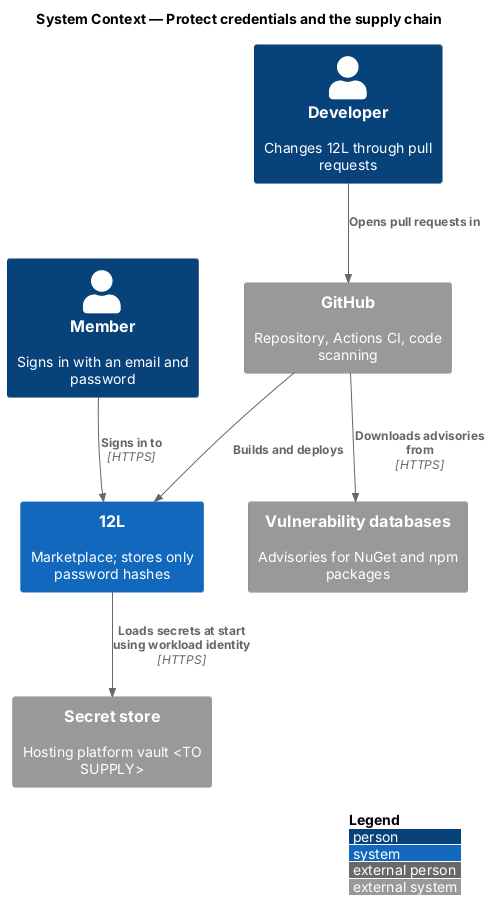
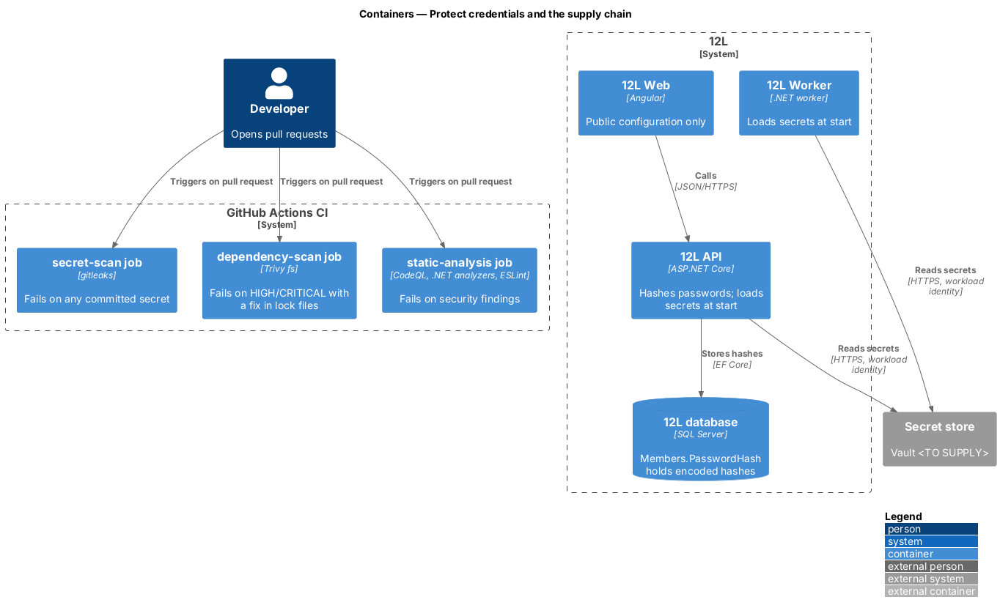
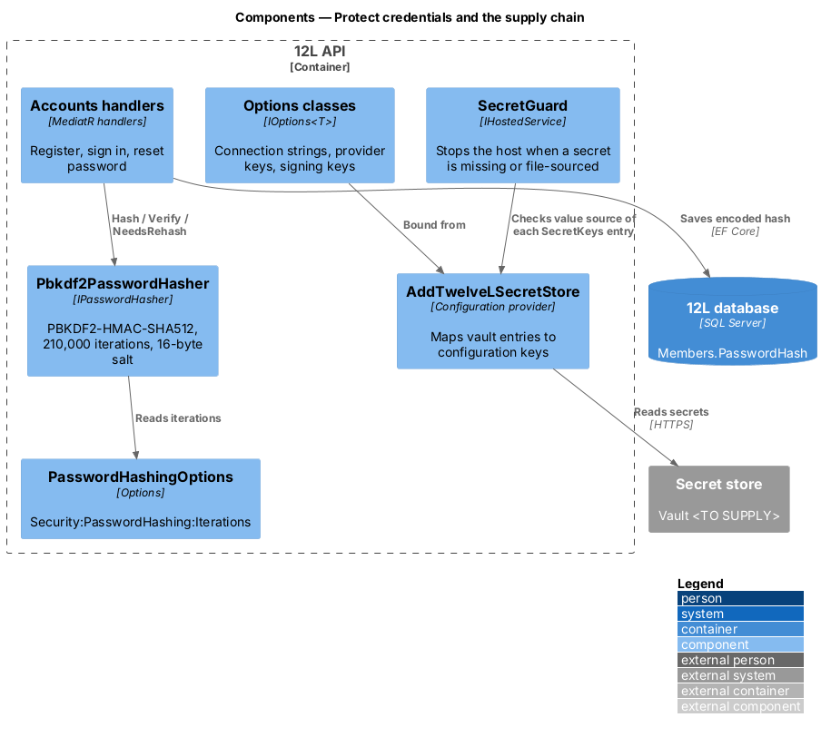
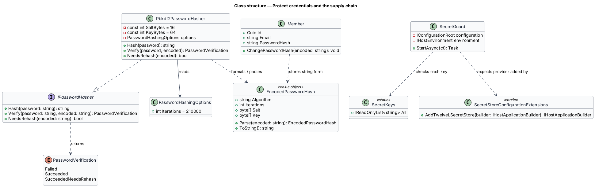
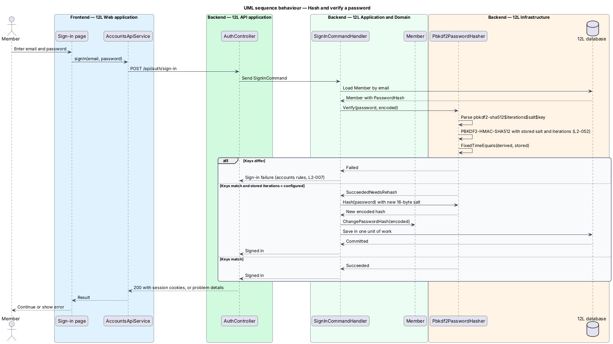
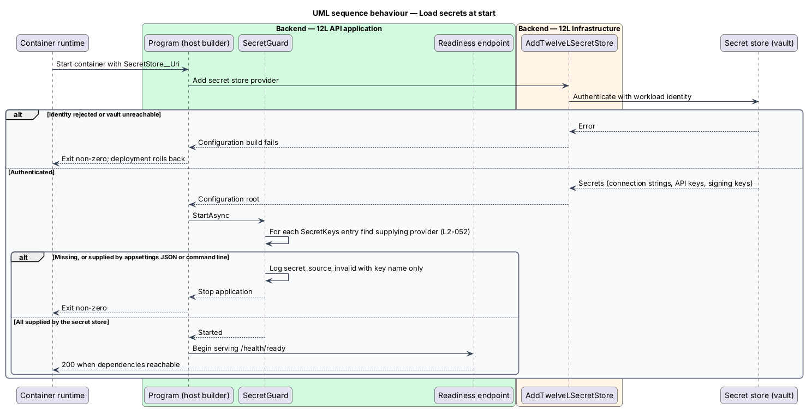
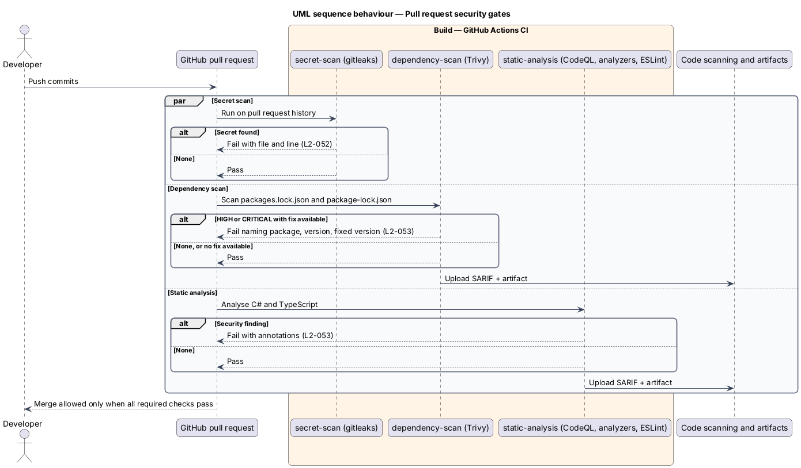

# Protect credentials and the supply chain

## Overview

Tutu Much holds member passwords, a payment provider API key, an email provider API
key, token signing keys and database connection strings. A leak of any one of
them would let an attacker sign in as members, move money or read personal data.
Tutu Much is also built from hundreds of third-party .NET and npm packages, any of which
may carry a known vulnerability.

This feature, part of the `platform` subsystem, covers how Tutu Much keeps those
credentials out of reach and how CI keeps vulnerable code out of the build. It
has three parts:

- **password hashing** — one-way transformation of a password with a random salt and a deliberately slow key-derivation function, so a stolen database does not reveal passwords (`L2-052`)
- **secret store** — managed vault from which `Tutu Much API` and `Tutu Much Worker` load secrets at runtime under their own workload identity, so no secret lives in source control or in deployed configuration files (`L2-052`)
- **supply-chain gates** — CI jobs that scan the repository for committed secrets, scan .NET and npm dependencies for known vulnerabilities, and run static analysis on every pull request (`L2-052`, `L2-053`)

Other features consume these parts. The accounts subsystem calls the password
hasher in [register-account](../../accounts/register-account/README.md),
[sign-in](../../accounts/sign-in/README.md) and
[reset-password](../../accounts/reset-password/README.md). Every adapter in
`TutuMuch.Infrastructure` reads its secret through configuration fed by the
secret store.

## Description

### Application and domain (`TutuMuch.Application`, `TutuMuch.Domain`)

- **`IPasswordHasher`** — application port with three methods:
  `Hash(string password): string`, `Verify(string password, string encoded):
  PasswordVerification`, and `NeedsRehash(string encoded): bool`.
- **`PasswordVerification`** — enumeration `Failed`, `Succeeded`,
  `SucceededNeedsRehash`.
- **`Member.PasswordHash`** — domain field (`string`, max 200 characters) that
  holds only the encoded hash. The `Member` entity is owned by the accounts
  subsystem; this feature fixes the format of the field.

### Infrastructure (`TutuMuch.Infrastructure/Security`)

- **`Pbkdf2PasswordHasher : IPasswordHasher`** — uses
  `Rfc2898DeriveBytes.Pbkdf2` with `HashAlgorithmName.SHA512`, a 16-byte salt
  from `RandomNumberGenerator`, a 64-byte derived key and the iteration count from
  `PasswordHashingOptions.Iterations` (default 210,000, validated at start as
  ≥ 210,000). The encoded form is
  `pbkdf2-sha512$<iterations>$<base64 salt>$<base64 key>`. Verification uses
  `CryptographicOperations.FixedTimeEquals`. `NeedsRehash` returns `true` when
  the stored iteration count is below the configured count, so a later increase
  upgrades hashes at the next successful sign-in. PBKDF2-HMAC-SHA512 is chosen
  over Argon2id because the .NET base library implements it without a
  third-party package; a later switch to Argon2id adds a new prefix
  (`argon2id$…`) that `Verify` dispatches on.
- **`PasswordHashingOptions`** — bound to `Security:PasswordHashing`
  (`Iterations`), validated with `ValidateOnStart`.
- **Database column** — `Members.PasswordHash nvarchar(200) NOT NULL`. No other
  column holds password material, and no plain-text password is logged
  (report-errors-and-observe redacts the `password` property).

### Secret loading (`TutuMuch.Api`, `TutuMuch.Worker`)

- **`SecretStoreConfigurationExtensions.AddTutuMuchSecretStore(builder)`** —
  adds the secret store configuration provider for the hosting platform's vault
  (product `<TO SUPPLY>`). It authenticates with the container's workload
  identity, so no credential for the vault is itself stored in configuration.
  The vault address comes from the environment variable `SecretStore__Uri`. In
  the `Development` environment it adds `dotnet user-secrets` instead.
- **Secret names** — vault entries map to configuration keys with `--` as the
  section separator:

  | Vault entry | Configuration key | Used by |
  |-------------|-------------------|---------|
  | `ConnectionStrings--TutuMuch` | `ConnectionStrings:TutuMuch` | `TutuMuchDbContext` |
  | `Redis--ConnectionString` | `Redis:ConnectionString` | `Distributed cache` client |
  | `PaymentProvider--ApiKey` | `PaymentProvider:ApiKey` | payment adapter |
  | `PaymentProvider--WebhookSigningSecret` | `PaymentProvider:WebhookSigningSecret` | webhook verifier |
  | `EmailProvider--ApiKey` | `EmailProvider:ApiKey` | email adapter |
  | `PhotoStorage--ConnectionString` | `PhotoStorage:ConnectionString` | object storage adapter behind `IPhotoStorage` (not built yet; the development adapter `FileSystemPhotoStorage` needs only the non-secret `PhotoStorage:RootPath`) |
  | `Auth--TokenSigningKey` | `Auth:TokenSigningKey` | access-token issuer (accounts) |

  The secret refresh interval is 30 minutes; rotation procedure per secret is
  `<TO SUPPLY>`.
- **`SecretGuard`** — `IHostedService` that runs at start in every non-
  `Development` environment. For each key in `SecretKeys.All` it asks the
  configuration root which provider supplied the value. When the value is
  missing, or when it came from a JSON file provider (`appsettings*.json`) or
  a command-line provider, the host logs `secret_source_invalid` with the key
  name only and stops with a non-zero exit code. The container then fails its
  readiness probe and the deployment rolls back.
- **`appsettings.json` and `appsettings.Production.json`** — hold no value for
  any key in `SecretKeys.All`; the keys are absent.
- **Frontend configuration** — `src/frontend/src/environments/*.ts` holds only
  public values: API base URL and the payment provider's publishable key. No
  secret is bundled into `Tutu Much Web`.

### CI (`.github/workflows/ci.yml`, job per gate)

Every pull request runs these jobs. Each is a required status check on the
default branch (repository setting).

- **`secret-scan`** — gitleaks with `.gitleaks.toml` (default rules plus rules
  for the payment provider key format `<TO SUPPLY>`). It scans the full diff
  history of the pull request. Any finding fails the job and names the file and
  line. Allow-listed test fixtures are listed by path in `.gitleaks.toml` with a
  reason comment.
- **`dependency-scan`** — runs on lock files only, so transitive packages are
  scanned. `Directory.Build.props` sets `RestorePackagesWithLockFile=true` so
  every .NET project has `packages.lock.json`; `src/frontend/package-lock.json`
  covers npm. Trivy `fs` scans both with `--severity HIGH,CRITICAL
  --ignore-unfixed --exit-code 1`, so a high or critical vulnerability that has
  a fix fails the build and the log names the package, installed version and
  fixed version. Results are written as SARIF.
- **`static-analysis`** — CodeQL for `csharp` and `javascript-typescript` with
  the `security-extended` query suite. In addition, `Directory.Build.props` sets
  `AnalysisLevel=latest-recommended` and `EnforceCodeStyleInBuild=true`, and
  security rules `CA2100`, `CA3001`–`CA3012`, `CA5350`, `CA5351`, `CA5394` are
  errors. ESLint runs with `@angular-eslint` and the restricted-syntax rules of
  harden-http-and-api.
- **Result attachment** — each scanning job uploads its SARIF file to code
  scanning (pull request annotations) and as a build artifact named
  `security-<job>-<run id>`.
- **Suppressions** — `.trivyignore` entries carry a CVE ID, a reason and an
  expiry date; the job fails on an expired entry. Approval of a suppression is
  `<TO SUPPLY>` (code owners).
- **Dependabot** — `.github/dependabot.yml` opens weekly update pull requests
  for `nuget`, `npm` and `github-actions`.

### Error and log codes introduced

`secret_source_invalid` (start-up log event), `password_rehashed` (information
log event, member ID only).

## Requirements

| L2 ID | Refines (L1) | Requirement |
|-------|--------------|-------------|
| `L2-052` | `L1-013` | Passwords shall be stored only as salted hashes using Argon2id or PBKDF2-HMAC-SHA512 with at least 210,000 iterations. Secrets (connection strings, API keys, signing keys) shall not be stored in source control and shall be loaded from a secret store at runtime. |
| `L2-053` | `L1-013` | CI shall scan .NET and npm dependencies and run static analysis on every pull request. A high or critical vulnerability with a fix available shall fail the build. |

## Diagrams

### System context

Developers change Tutu Much through pull requests in GitHub, where CI runs the gates.
At runtime Tutu Much reads its secrets from the secret store of the hosting platform.

### Containers

`Tutu Much API` and `Tutu Much Worker` read secrets from the secret store at start. The CI
pipeline scans the repository and its lock files before any image is built.

### Components

Inside `Tutu Much API`, the secret store configuration provider feeds options, and
`SecretGuard` refuses to start when a secret is missing or misplaced. The
accounts handlers call `IPasswordHasher`, implemented by `Pbkdf2PasswordHasher`.

### Class structure

`Pbkdf2PasswordHasher` realizes `IPasswordHasher` and reads
`PasswordHashingOptions`. `SecretGuard` checks each key in `SecretKeys`.

### Behaviour — hash and verify a password

Registration stores a salted PBKDF2-HMAC-SHA512 hash. Sign-in verifies it in
constant time and rehashes when the stored iteration count is below the
configured count.

### Behaviour — load secrets at start

The host authenticates to the secret store with its workload identity and loads
the secrets. `SecretGuard` stops the host when a secret is missing or came from a
file.

### Behaviour — pull request security gates

Each pull request runs secret scanning, dependency scanning and static analysis
in parallel. Any finding at the failing threshold blocks the merge and names the
cause.

