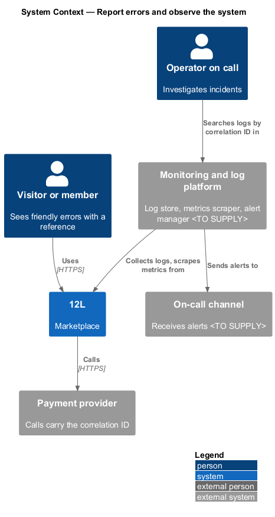
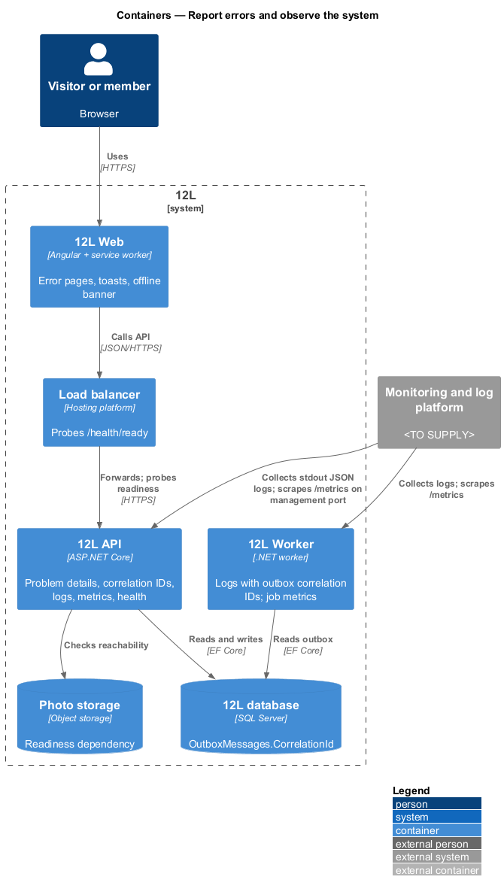
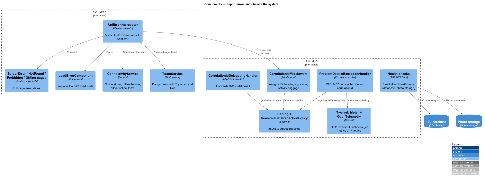
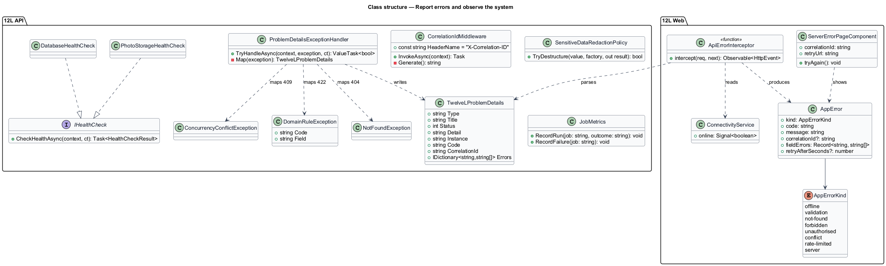
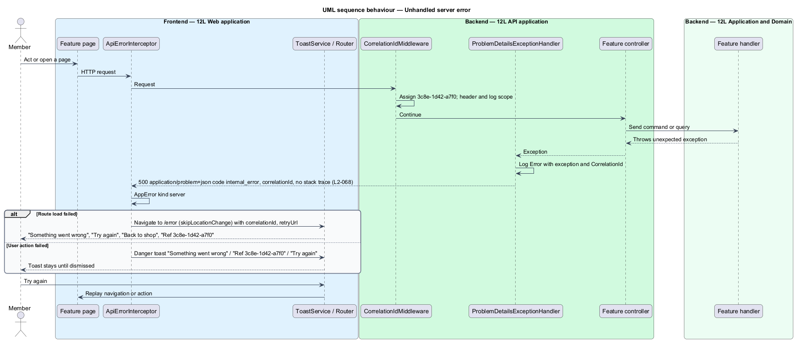
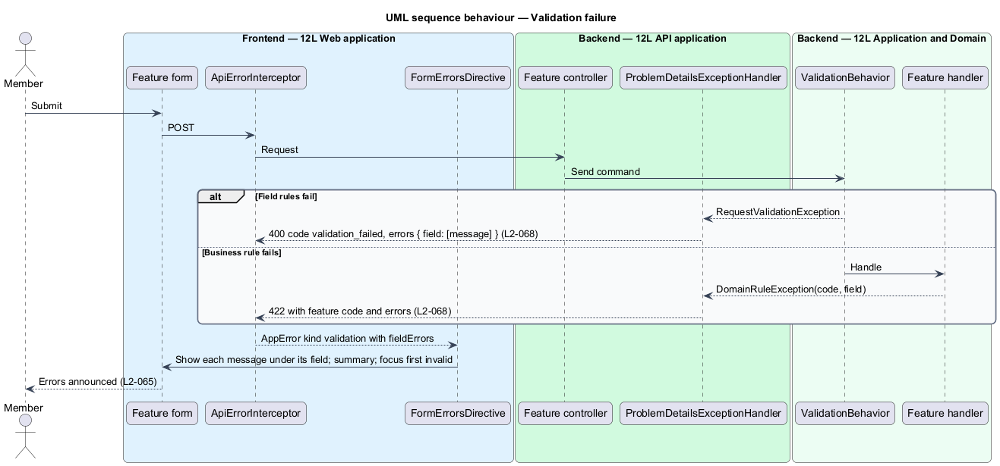
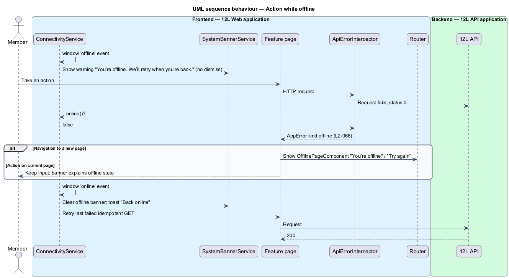
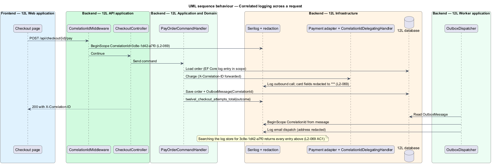
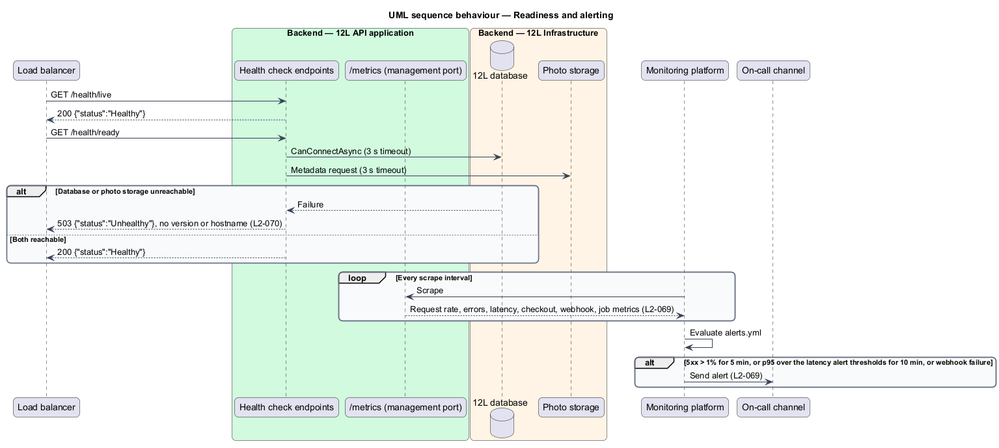

# Report errors and observe the system

## Overview

When something fails in TuTuMuch, two audiences need to know. A visitor needs a
plain message, a way to retry and a reference to quote to support. An operator
needs to find every log line for that failure, see whether it is one request or a
trend, and be alerted before members notice. This feature, part of the `platform`
subsystem, provides both.

Terms used below:

- **problem details** — standard JSON error body defined by RFC 9457, with `type`, `title`, `status`, `detail` and `instance`, which TuTuMuch extends with `code`, `correlationId` and, for validation failures, `errors` (`L2-068`)
- **error code** — stable, lower-snake-case identifier of an error condition that clients may branch on, for example `validation_failed`; it does not change when the message wording changes
- **correlation ID** — identifier assigned to each incoming request, returned in the `X-Correlation-ID` header and the problem details body, attached to every log entry the request causes, and shown to the visitor as "Ref …" (`L2-068`, `L2-069`)
- **structured log** — log entry written as JSON properties rather than free text, so it can be searched by field
- **redaction** — replacement of a sensitive value by a fixed mask before a log entry is written (`L2-069`)
- **liveness** — whether the API process is running and able to answer; a failing liveness check causes a restart (`L2-070`)
- **readiness** — whether the API can serve traffic, which requires the database and photo storage to be reachable; a failing readiness check removes the instance from the load balancer (`L2-070`)

Every feature in TuTuMuch raises errors through the types defined here, and every
frontend page renders failures through the components defined here. The
load balancer of [keep-available-and-recoverable](../keep-available-and-recoverable/README.md)
consumes the readiness endpoint.

## Description

Source mocks: `docs/mocks/pages/server-error/`, `docs/mocks/pages/not-found/`,
`docs/mocks/pages/forbidden/`, `docs/mocks/pages/offline/`,
`docs/mocks/notifications/toast/` (`danger`) and
`docs/mocks/notifications/system-banner/` (`warning`, `success`, `danger`).

### Frontend (`src/frontend/src/app/core/errors`)

- **`AppError`** — discriminated union produced from every failed API call:
  `kind` (`'offline' | 'validation' | 'not-found' | 'forbidden' |
  'unauthorised' | 'conflict' | 'rate-limited' | 'server'`), `code`,
  `message`, `correlationId`, `fieldErrors` (record of field → messages),
  `retryAfterSeconds`.
- **`ApiErrorInterceptor`** — functional `HttpInterceptorFn`. It maps
  `HttpErrorResponse` to `AppError`: status 0 with `ConnectivityService.online()`
  false → `offline`; 400 or 422 with `errors` → `validation`; 401 →
  `unauthorised` (accounts handles session expiry); 403 → `forbidden`; 404 →
  `not-found`; 409 → `conflict`; 429 → `rate-limited`; 5xx or unreadable body →
  `server`. It reads `correlationId` from the body or the `X-Correlation-ID`
  header.
- **Presentation rules** — each `AppError` is shown in one of four ways:
  - Route load fails (resolver or page query) with `server` → navigate to
    `/error` with `skipLocationChange: true`, so the address bar keeps the
    original URL, passing `{ correlationId, retryUrl }`.
  - A section inside a loaded page fails → `LoadErrorComponent` in place:
    "Couldn’t load {what}" / "Something went wrong on our side. Ref {id}" /
    "Try again" (pattern from `docs/mocks/pages/catalog/error.html`).
  - A user action fails with `server` → danger toast "Something went wrong" /
    "Ref {id}" / action "Try again", which replays the action and never
    auto-dismisses (`docs/mocks/notifications/system-banner/danger.html`).
  - `validation` → field errors through `FormErrorsDirective`
    (responsive-accessible-shell).
  - `offline` → "You’re offline" (below), never a generic error (`L2-068` AC4).
- **`ServerErrorPageComponent`** — route `/error`, bare of business data:
  large "500", heading "Something went wrong", text "It’s on our side. Your data
  is safe.", primary "Try again" (re-navigates to `retryUrl`), secondary "Back
  to shop", reference "Ref {correlationId}".
- **`NotFoundPageComponent`** — route `**`: "404", "Page not found", "The link
  may be old or mistyped.", "Shop the closet". Feature pages also show it when the
  API returns 404 for a resource the caller may not see (`L2-010`).
- **`ForbiddenPageComponent`** — route `/403`: "403", "You can’t open this",
  "It belongs to another member’s account.", "Go to your account". Used by role
  guards, for example a member opening `/admin`.
- **`OfflinePageComponent`** — shown when navigation fails with `offline`:
  wifi-off icon, "You’re offline", "Check your connection. We’ll pick up where
  you left off.", "Try again". It renders from the cached shell without a
  request.
- **`ConnectivityService`** — `online: Signal<boolean>` from `navigator.onLine`
  and the `online` / `offline` window events. Going offline shows the
  persistent warning banner "You’re offline. We’ll retry when you’re back."
  through `SystemBannerService` (no dismiss button); coming back shows the
  success toast "Back online" and retries the last failed idempotent `GET`.
- **Service worker** — `provideServiceWorker('ngsw-worker.js')` with
  `ngsw-config.json` asset groups for the app shell (`index.html`, initial
  JavaScript, CSS, icons) so the shell and the offline page load without a
  network. Data caching for the catalog offline state belongs to the catalog
  subsystem.
- **`GlobalErrorHandler implements ErrorHandler`** — catches uncaught client
  exceptions and shows the danger toast "Something went wrong" without a
  reference. Whether client exceptions are also reported to the API is
  `<TO SUPPLY>`.

### API (`TuTuMuch.Api`)

- **`CorrelationIdMiddleware`** — first middleware after forwarded headers. It
  accepts an incoming `X-Correlation-ID` that matches `^[a-f0-9-]{1,64}$`,
  otherwise generates one: 12 random hex characters formatted as
  `xxxx-xxxx-xxxx`, the "Ref 3c8e-1d42-a7f0" form of the server-error mock.
  Some mocks show an 8-character form such as "Ref 7f3a-91c2"; the design
  adopts the 12-character form, and those mocks should be updated. It sets `HttpContext.TraceIdentifier`, adds the value to
  the response header, adds it to the current `Activity` as baggage
  `correlation.id`, and opens a logging scope `{ CorrelationId }`.
- **`CorrelationIdDelegatingHandler`** — `HttpClient` handler registered on the
  payment, email, breached-password and photo storage clients; forwards
  `X-Correlation-ID` and logs the outbound call inside the scope.
- **Outbox propagation** — `OutboxMessages.CorrelationId nvarchar(64)` is
  written with each message. `TuTuMuch Worker` opens a logging scope with that ID
  before dispatching, so email and payout logs join the originating request.
- **`ProblemDetailsExceptionHandler : IExceptionHandler`** with
  `AddProblemDetails(o => o.CustomizeProblemDetails = …)` — every error
  response is `application/problem+json` with `type`
  (`https://tutumuch.<TO SUPPLY>/problems/{code}`), `title`, `status`, `detail`,
  `instance` (request path), `code` and `correlationId`. The developer exception
  page is registered only when the environment is `Development`, so no deployed
  environment returns a stack trace, exception type or SQL text. Mapping:

  | Source | Status | `code` | `detail` |
  |--------|-------:|--------|----------|
  | `RequestValidationException` | 400 | `validation_failed` | "One or more fields are invalid." plus `errors` |
  | `BadHttpRequestException` (JSON) | 400 | `malformed_json` | "The request body is not valid JSON." |
  | Antiforgery failure | 400 | `antiforgery_invalid` | "Refresh the page and try again." |
  | `UnauthenticatedException` | 401 | `unauthenticated` | "Sign in to continue." |
  | `ForbiddenException` | 403 | `forbidden` | "You can’t open this." |
  | `NotFoundException` | 404 | `not_found` | "Not found." |
  | `ConcurrencyConflictException`, `DbUpdateConcurrencyException` | 409 | `conflict` | feature message |
  | Body over limit | 413 | `request_too_large` | "The request is too large." |
  | `DomainRuleException(code, message)` | 422 | rule code from the feature | rule message, plus `errors` when tied to a field |
  | Rate limit | 429 | `rate_limited` | "Too many requests. Try again later." |
  | Maintenance mode | 503 | `maintenance` | "TuTuMuch is down for planned maintenance." |
  | Any other exception | 500 | `internal_error` | "Something went wrong." |

  `errors` is an object of field name (camelCase JSON path) → array of
  messages. 5xx responses log at `Error` with the exception; 4xx log at
  `Information` without it.
- **`ErrorCodes`** — static catalogue in `TuTuMuch.Application/Errors` of every
  platform code above. Feature codes are added by their features; an
  architecture test asserts codes are unique and lower snake case.
- **Health endpoints** — `MapHealthChecks("/health/live", Predicate = _ =>
  false)` returns 200 while the process runs. `MapHealthChecks("/health/ready",
  Predicate = tag "ready")` runs `DatabaseHealthCheck`
  (`DbContext.Database.CanConnectAsync`) and `PhotoStorageHealthCheck` (a
  metadata request on the photo container), each with a 3 s timeout
  (`<TO SUPPLY>` confirmation). Any `Unhealthy` → 503. The response writer
  returns only `{"status":"Healthy"}` or `{"status":"Unhealthy"}` with
  `Cache-Control: no-store`; no check names, versions, hostnames, exception text
  or connection strings. Kestrel `AddServerHeader = false`. Health endpoints
  are anonymous and exempt from rate limiting, antiforgery and request logging.
  Redis is not a readiness dependency; its failure is visible through metrics
  and alerts.

### Logging (`TuTuMuch.Api`, `TuTuMuch.Worker`)

- **Serilog** — `UseSerilog` with `RenderedCompactJsonFormatter` to stdout,
  shipped by the hosting platform to the log store (`<TO SUPPLY>`, retention
  `<TO SUPPLY>`). Enrichers: `CorrelationId`, `MemberId` (GUID only, when
  signed in), `RequestPath` (route template, not raw URL), `Application`
  (`api` or `worker`), `Environment`, `InstanceId` (opaque, not hostname).
  Minimum level `Information`; `Microsoft.AspNetCore` and
  `Microsoft.EntityFrameworkCore` at `Warning`, except EF Core command timing
  at `Information` with parameter values disabled
  (`EnableSensitiveDataLogging` never on).
- **`SensitiveDataRedactionPolicy : IDestructuringPolicy`** and
  **`RedactionEnricher`** — replace with `"***"` the values of properties whose
  name matches, case-insensitively: `password`, `currentPassword`,
  `newPassword`, `token`, `accessToken`, `refreshToken`, `resetToken`,
  `verificationToken`, `authorization`, `cookie`, `setCookie`, `cardNumber`,
  `cvc`, `cvv`, `expiry`, `iban`, `accountNumber`, `addressLine1`,
  `addressLine2`, `street`, `postalCode`, `totpCode`; and any property marked
  `[Sensitive]` on a DTO. Request logging (`UseSerilogRequestLogging`) records
  method, route template, status and elapsed time only: no body, no query
  string, no headers.
- **Log entries for a request** — the `CorrelationId` scope covers controller,
  handler, EF Core and outbound HTTP entries, so a search by correlation ID
  returns every entry (`L2-069` AC1).

### Metrics and alerts

- **OpenTelemetry** — `AddOpenTelemetry().WithMetrics(…)` with ASP.NET Core,
  `HttpClient`, runtime and EF Core instrumentation, exported through the
  Prometheus exporter at `GET /metrics` on a separate management port
  (`Management:Port`, `<TO SUPPLY>`) that the load balancer does not expose.
  `TuTuMuch Worker` exposes the same on its own port.
- **Metric set** (`Meter("TuTuMuch")` plus built-ins):

  | Metric | Type | Tags | Covers |
  |--------|------|------|--------|
  | `http.server.request.duration` | histogram (s) | route, method, status, `tutumuch.endpoint_kind` | request rate, error rate, latency |
  | `tutumuch_checkout_attempts_total` | counter | `outcome` = `succeeded` / `declined` / `failed` | checkout success rate |
  | `tutumuch_payment_webhook_failures_total` | counter | `event_type` | failed payment webhooks |
  | `tutumuch_job_runs_total` | counter | `job`, `outcome` | background job runs |
  | `tutumuch_job_failures_total` | counter | `job` | background job failures |
  | `tutumuch_outbox_pending` | gauge | — | outbox backlog |

  `tutumuch.endpoint_kind` comes from `EndpointKindAttribute`
  (meet-performance-and-scale). Orders handlers increment the checkout and
  webhook counters; `TuTuMuch Worker` jobs increment the job counters through
  `JobMetrics`.
- **Alert rules** (`deploy/monitoring/alerts.yml`, Prometheus rule format; the
  monitoring product is `<TO SUPPLY>`), routed to the on-call channel
  `<TO SUPPLY>`:

  | Alert | Condition |
  |-------|-----------|
  | `Api5xxRateHigh` | 5xx share of requests > 1% over a 5-minute window, sustained for 5 minutes |
  | `ApiReadLatencyP95High` | p95 of `endpoint_kind="Read"` > 300 ms for 10 minutes |
  | `ApiWriteLatencyP95High` | p95 of `endpoint_kind="Write"` > 800 ms for 10 minutes |
  | `PaymentWebhookFailed` | any increase of `tutumuch_payment_webhook_failures_total` in 5 minutes |
  | `BackgroundJobFailing` | any increase of `tutumuch_job_failures_total` in 15 minutes (`<TO SUPPLY>` threshold) |

- **Rule tests** — `promtool test rules deploy/monitoring/alerts.test.yml` in
  CI with synthetic series for each alert.

## Requirements

| L2 ID | Refines (L1) | Requirement |
|-------|--------------|-------------|
| `L2-068` | `L1-018` | API errors shall be returned as RFC 9457 problem details with a stable error code, a human-readable message and a correlation ID, and shall never include stack traces or internal details. The frontend shall show a friendly message with the correlation ID and a way to retry. |
| `L2-069` | `L1-018` | The backend shall write structured logs with a correlation ID that follows each request through the system. Logs shall never contain passwords, tokens, card details or full addresses. The system shall expose metrics for request rate, error rate, latency, checkout success rate and background job failures, and shall alert operators when the 5xx error rate exceeds 1% for 5 minutes, the 95th percentile latency exceeds 300 ms for reads or 800 ms for writes for 10 minutes, or a payment webhook fails. |
| `L2-070` | `L1-018` | The API shall expose a liveness endpoint (`/health/live`) and a readiness endpoint (`/health/ready`). Readiness shall report unhealthy when the database or photo storage cannot be reached. Health endpoints shall not reveal version numbers or internal hostnames. |

## Diagrams

### System context

Visitors see friendly errors with a reference. Operators search logs, watch
metrics and receive alerts from the monitoring system, which scrapes TuTuMuch.

### Containers

`TuTuMuch API` and `TuTuMuch Worker` write JSON logs to stdout and expose metrics on a
management port. The load balancer probes the health endpoints.

### Components

In `TuTuMuch Web`, the error interceptor feeds the error pages, toasts and the
offline banner. In `TuTuMuch API`, the correlation ID middleware, the problem details
handler, the redacting logger, the metrics meter and the health checks work
together.

### Class structure

`ApiErrorInterceptor` produces `AppError`. `ProblemDetailsExceptionHandler`
maps application exceptions to `TuTuMuchProblemDetails`, and the health checks
implement `IHealthCheck`.

### Behaviour — unhandled server error

An unhandled exception becomes a 500 problem details body without a stack trace.
The frontend shows "Something went wrong" with "Try again" and the reference.

### Behaviour — validation failure

A validation failure returns 400 with each invalid field and its message, and
the form shows them beside the fields.

### Behaviour — action while offline

When the device is offline, the app shows "You’re offline" and retries when the
connection returns, rather than a generic error.

### Behaviour — correlated logging across a request

One correlation ID follows the request through the controller, handler,
database, payment provider call and outbox message into `TuTuMuch Worker`, and
redaction removes sensitive values.

### Behaviour — readiness and alerting

Readiness returns 503 when the database or photo storage is unreachable while
liveness stays 200. The monitoring system evaluates the alert rules on scraped
metrics.

