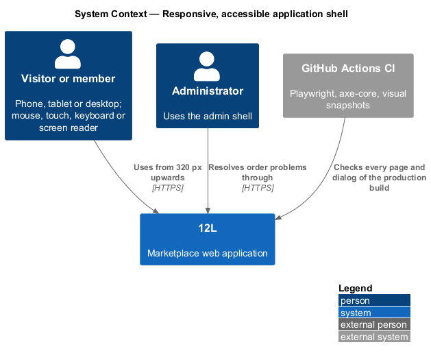
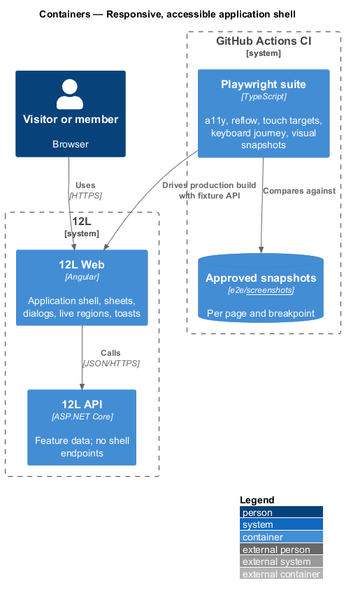
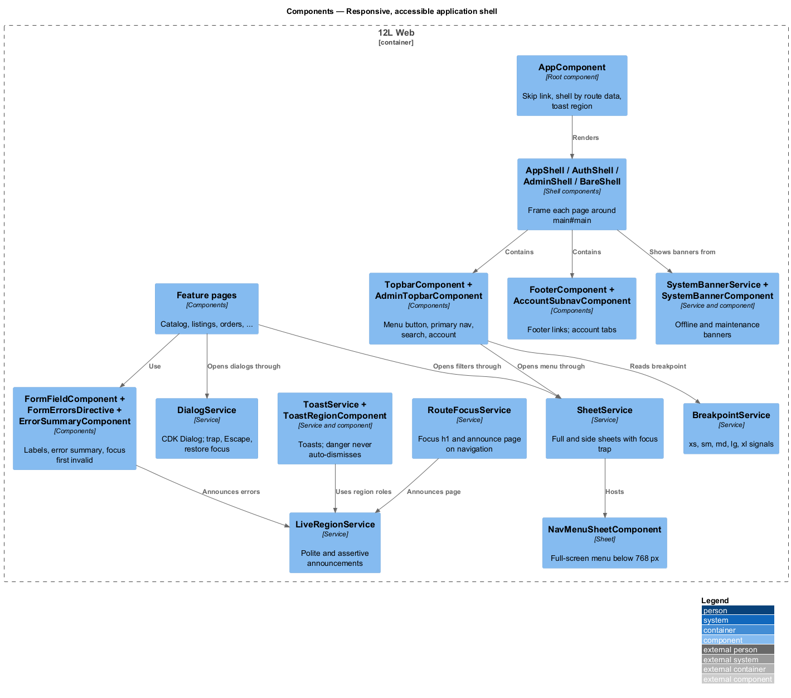
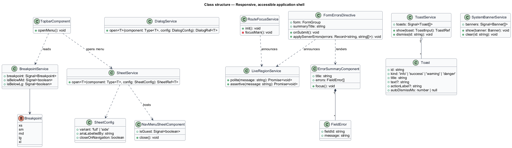
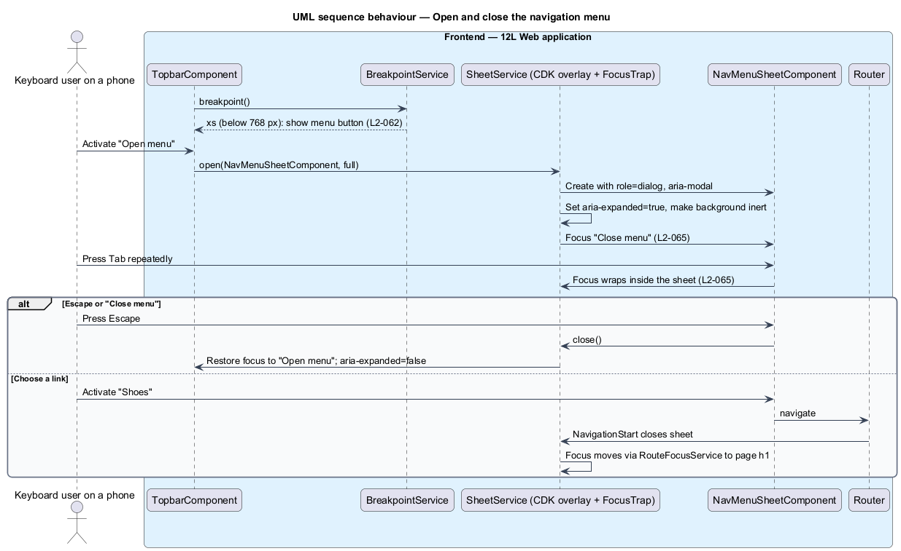
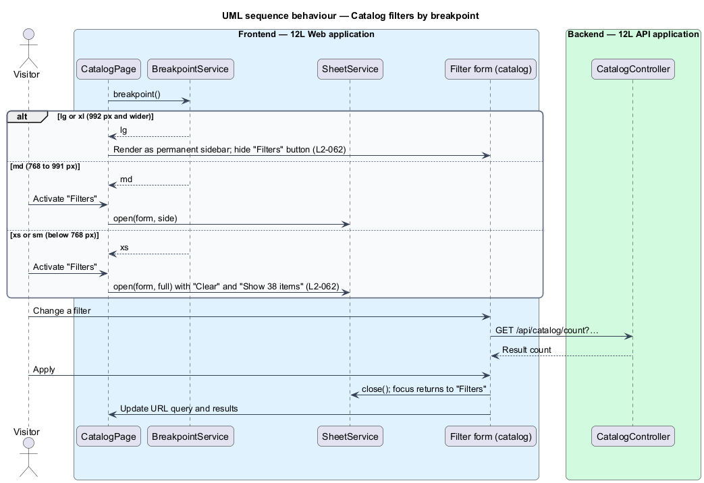
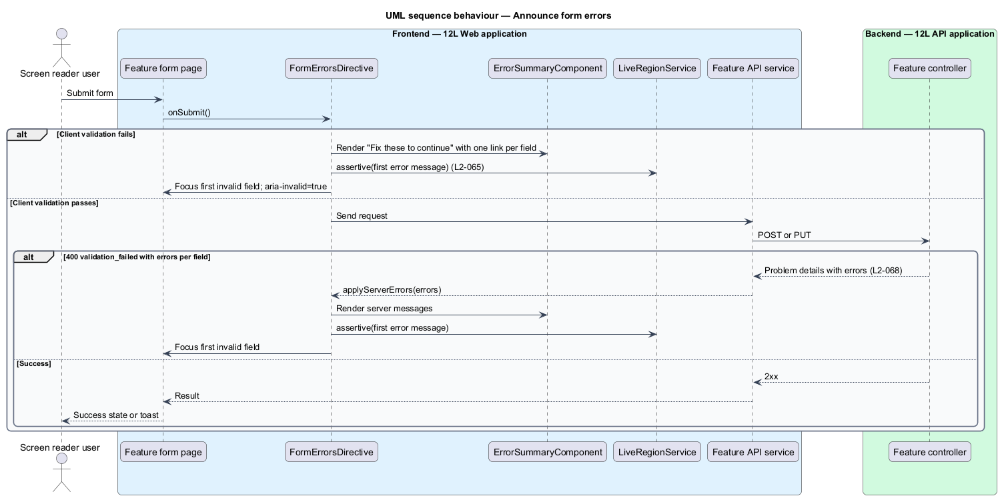
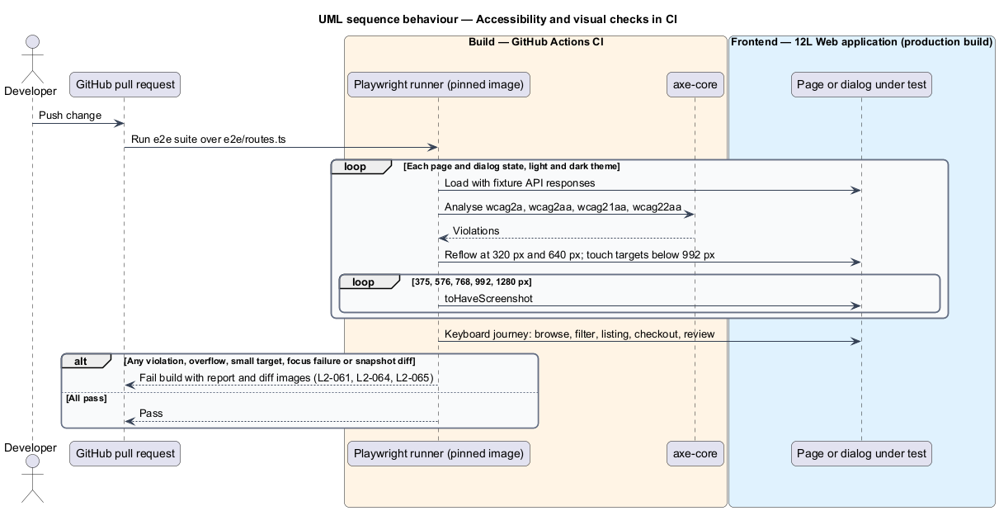

# Responsive, accessible application shell

## Overview

Every TuTuMuch page sits inside the same frame: a skip link, a top bar with the logo,
navigation, search and account entry, a main region, a footer, and an area for
toasts and banners. That frame is the **application shell**. This feature, part
of the `platform` subsystem, builds the shell and the shared behaviour that makes
every page and dialog responsive and accessible.

Terms used below:

- **breakpoint** — viewport width at which the layout changes: extra small (XS, below 576 px), small (SM, 576 px and up), medium (MD, 768 px and up), large (LG, 992 px and up) and extra large (XL, 1200 px and up) (`L2-061`)
- **sheet** — full-screen or side panel dialog that slides over the page; used for the navigation menu and the catalog filters on small viewports (`L2-062`)
- **focus trap** — dialog behaviour that keeps keyboard focus inside the dialog while it is open and returns it to the opening control on close (`L2-065`)
- **live region** — page element whose changes a screen reader announces without moving focus (`L2-065`)
- **touch target** — clickable area of a control; at least 44 by 44 CSS pixels below 992 px (`L2-063`)
- **visual snapshot** — approved screenshot of a page at one breakpoint, compared pixel by pixel in CI (`L2-061`)

The shell is used by every feature. Feature pages place their content inside the
main region and use the shared dialog, sheet, form-error, live-region and toast
services described here. The catalog subsystem owns the filter form itself
([search-and-filter-catalog](../../catalog/search-and-filter-catalog/README.md))
and the listing detail layout
([view-listing-detail](../../catalog/view-listing-detail/README.md)); this
feature owns the responsive containers and rules they rely on. The error and
offline pages are in [report-errors-and-observe](../report-errors-and-observe/README.md).

## Description

Source mocks: the shell in `docs/mocks/_build/mk.py` (`topbar`, `admin_topbar`,
`account_nav`, `footer`, `page_body`), `docs/mocks/dialogs/nav-menu/`,
`docs/mocks/dialogs/filters/` (responsive behaviour only),
`docs/mocks/notifications/toast/` and `docs/mocks/notifications/system-banner/`,
with tokens in `docs/mocks/assets/tokens.css` and components in
`docs/mocks/assets/ui.css`.

### Frontend — shell components (`src/frontend/projects/tutumuch/src/app/` and `projects/components/`)

Per `AGENTS.md`, the application project holds `AppComponent`, the four shell components and the routes; every reusable piece below (`tl-skip-link`, `tl-top-bar`, `tl-footer`, `tl-toast-region`, sheets, dialogs, form fields) lives in the `components` library (`@tutumuch/components`). Feature libraries never re-implement them.

- **`AppComponent`** — root component. Renders `SkipLinkComponent`, the shell
  chosen by the active route's `data.shell` (`'app' | 'auth' | 'admin' |
  'bare'`, default `'app'`), and `ToastRegionComponent`.
- **`SkipLinkComponent`** — first focusable element: "Skip to content", target
  `#main`; visible only on focus.
- **`AppShellComponent`** — `TopbarComponent`, optional
  `AccountSubnavComponent`, `<main id="main" tabindex="-1">` with
  `<router-outlet>`, `FooterComponent`. Banners from `SystemBannerService`
  render above the top bar.
- **`TopbarComponent`** — states `member`, `guest`; inputs from `AuthState`
  (accounts).
  - Menu button: `aria-label="Open menu"`, `aria-expanded`,
    `aria-controls="menu"`; shown below 1280 px (six category links do not fit
    narrower; ADR general/0006).
  - Logo linking to `/`.
  - Primary navigation `<nav aria-label="Primary">`: Clothing, Shoes, Dance,
    Sports, Cameras and tech, Toys and crafts, with `aria-current="page"` on the active category; shown from
    1280 px.
  - Search form `role="search"` with visually hidden label "Search TuTuMuch" and
    placeholder "Search brands and items"; full field from 992 px, an icon link
    "Search" below 992 px.
  - Member: "Sell" link (from 768 px) and avatar link "Your account,
    {display name}". Guest: "Sell" and "Sign in".
- **`AdminTopbarComponent`** — logo, "Admin" tag and avatar "Signed in as
  {administrator name}". No footer.
- **`AuthShellComponent`** — large logo above a centred card (`main#main`).
- **`BareShellComponent`** — logo-only top bar, used for the maintenance and
  offline pages.
- **`AccountSubnavComponent`** — `<nav aria-label="Account">` tabs: Overview,
  Listings, Purchases, Sales, Payouts, Profile, Emails, Settings; horizontally
  scrollable below 576 px without page-level horizontal scroll.
- **`FooterComponent`** — links "Marketplace rules", "Privacy", "Terms",
  a "Cookie settings" button (emits `cookieSettings`; the shell opens the
  cookie-settings dialog of `@tutumuch/privacy`) and
  "© 2026 TuTuMuch" (year from the clock).
- **`NavMenuSheetComponent`** (`docs/mocks/dialogs/nav-menu/`) — opened by the
  menu button through `SheetService` as a full-screen sheet with `id="menu"`,
  `role="dialog"`, `aria-modal="true"`, visually hidden heading "Menu", and a
  "Close menu" button that receives initial focus. Body: category links (large),
  then for a member "Sell an item", "Your listings", "Purchases", "Sales",
  "Settings" and a "Sign out" button; for a guest "Sell an item",
  "Marketplace rules" with "Sign in" and "Join TuTuMuch" buttons. States: `default`
  (member), `guest`. The sheet closes on navigation and on a resize to 768 px or
  wider.

### Frontend — shared behaviour (`src/frontend/projects/components/src/lib/`)

- **`BreakpointService`** — wraps CDK `BreakpointObserver` with the queries
  `(min-width: 36rem)`, `(min-width: 48rem)`, `(min-width: 62rem)` and
  `(min-width: 75rem)`, and exposes `breakpoint: Signal<'xs' | 'sm' | 'md' |
  'lg' | 'xl'>` plus `isBelowMd`, `isBelowLg` computed signals.
- **`_breakpoints.scss`** — `@mixin up($bp)` with `sm: 36rem`, `md: 48rem`,
  `lg: 62rem`, `xl: 75rem`. These values implement `L2-061`. The mock token
  file defines `--layout-breakpoint-sm: 40rem` and `--layout-breakpoint-lg:
  64rem`, which disagree with `L2-061` while `ui.css` already uses the
  `L2-061` values; the design-system token values shall be corrected to match.
- **Layout rules** — `.container` gutters per breakpoint from tokens;
  `min-width: 0` on grid children; long words wrap (`overflow-wrap: anywhere`)
  so no page scrolls horizontally at 320 px. Catalog grid: 2 columns XS/SM,
  3 MD, 4 LG/XL (`L2-061` AC2), implemented by `tl-listing-grid` in `@tutumuch/components`. The mock `ui.css` shows 3 columns at LG when the
  filter sidebar is present; the implementation follows `L2-061` with 4.
- **`SheetComponent` and `SheetService`** — built by search-and-filter-catalog
  in `@tutumuch/components` (`src/lib/sheet/`): `SheetService` opens a component whose
  template is a `tl-sheet` through `DialogService` (inert page, Escape closes,
  focus returns to the opener). The sheet fills the screen; with `side` it is a
  24rem left panel from 768 px. The catalog filter panel opens through it from the "Filters" button with "Clear" and "Show {n}
  items" actions; from 992 px the catalog renders the same filter form as a
  permanent sidebar and hides the "Filters" button (`L2-062`).
- **`DialogService`** — wraps CDK `Dialog` for every modal in the app:
  `role="dialog"`, `aria-modal="true"`, `aria-labelledby="dlg-title"`, optional
  `aria-describedby="dlg-desc"`, focus trap, `autoFocus` on the element marked
  `autofocus` or the first focusable, Escape closes, `restoreFocus: true`
  returns focus to the opener, background marked `inert`. Below 576 px dialogs
  render as bottom sheets; from 576 px centred (`ui.css`).
- **`RouteFocusService`** — on `NavigationEnd` (not on the first load), moves
  focus to the page `h1` (rendered with `tabindex="-1"`) or to `#main`, and
  announces the new page title through `LiveRegionService`.
- **`TuTuMuchTitleStrategy`** — `TitleStrategy` that sets `document.title` from
  route `title`; the suffix format is `<TO SUPPLY>`.
- **`LiveRegionService`** — wraps CDK `LiveAnnouncer`; `polite(message)` and
  `assertive(message)`.
- **`FormFieldComponent`** — visible `<label>` bound by `for`, help text and
  error text linked through `aria-describedby`, `aria-invalid` on error, single
  column below 576 px, `inputmode` passed through (for example `decimal` for
  price, so phones show a numeric keyboard, `L2-063` AC5).
- **`FormErrorsDirective` (`twlFormErrors`) and `ErrorSummaryComponent`** — on
  submit of an invalid form, or when server field errors arrive, renders the
  error summary (`role="alert"`, `tabindex="-1"`, title "Fix these to continue"
  unless a feature passes its own, one link per invalid field), announces the
  first message through the live region and moves focus to the first invalid
  field (`L2-065` AC5).
- **`ToastService`, `ToastRegionComponent`, `ToastComponent`**
  (`docs/mocks/notifications/toast/`) — the region is `role="status"`
  `aria-live="polite"`, fixed bottom, full width below 576 px and 24 rem wide
  from 576 px; newest toast at the bottom. Kinds `info`, `success`, `warning`,
  `danger`; optional text and one action ("View listing", "Undo", "Try again").
  Non-danger toasts auto-dismiss after 8 s, pause on hover and focus, and show a
  progress bar; `danger` toasts carry `role="alert"` and never auto-dismiss.
  Every toast has a "Dismiss" button.
- **`SystemBannerService` and `SystemBannerComponent`**
  (`docs/mocks/notifications/system-banner/`) — full-width banners above the top
  bar; kinds `info`, `success`, `warning`, `danger`; `role="status"`, or
  `role="alert"` for `danger`; optional "Dismiss". Content comes from
  report-errors-and-observe (offline) and keep-available-and-recoverable
  (maintenance).
- **`ListingPhotoAltPipe`** — returns the seller's photo description or
  "Photo {n} of {title}" (`L2-065` AC4); used by catalog and listing components.
- **Motion** — `ui.css` disables animations and transitions under
  `prefers-reduced-motion: reduce`; `MotionPreference` signal disables Angular
  animations through `@.disabled` on the root (`L2-065` AC6).
- **Focus indicator** — `:focus-visible` outline `--focus-ring-width` (2 px)
  in `--color-focus-ring` (ink on paper in light theme, paper on ink in dark
  theme), meeting 3:1 against adjacent colours (`L2-065` AC2).
- **Touch targets** — `--control-min-size: 2.75rem` (44 px) applied to
  buttons, links in lists, inputs, checkboxes' hit areas and icon buttons below
  992 px (`L2-063` AC4).
- **Themes** — light and dark through `prefers-color-scheme` and the tokens in
  `tokens.css`; `forced-colors` mode uses system colours.

### CI (`src/frontend/e2e`)

The harness is created by [set-up-the-workspace](../set-up-the-workspace/README.md) with one smoke test; the specs below are added by this feature.

- **`e2e/routes.ts`** — catalogue of every page route and dialog state to test,
  each with API fixtures served through Playwright `page.route` so tests do not
  need a backend.
- **`a11y.spec.ts`** — for each entry, in light and dark (`emulateMedia({
  colorScheme })`), runs `@axe-core/playwright` with tags `wcag2a`, `wcag2aa`,
  `wcag21a`, `wcag21aa`, `wcag22aa`; any violation fails the build (`L2-064`).
- **`reflow.spec.ts`** — at 320 px and at 640 px (200% zoom of a 1280 px
  window) asserts `document.documentElement.scrollWidth <= innerWidth` and that
  no focusable element is clipped (`L2-061` AC1, `L2-064` AC3).
- **`visual.spec.ts`** — `toHaveScreenshot` for each page at 375, 576, 768,
  992 and 1280 px, in the pinned Playwright Docker image; approved snapshots
  live in `e2e/__screenshots__/` and change only through a reviewed pull request
  (`L2-061` AC3).
- **`responsive-nav.spec.ts`** — below 768 px the menu button opens every
  navigation link; below 768 px "Filters" opens a full-screen panel with "Apply"
  (labelled "Show {n} items") and "Clear"; from 992 px the filters sidebar shows
  without a tap (`L2-062`).
- **`touch-targets.spec.ts`** — below 992 px measures each interactive element's
  bounding box ≥ 44 × 44 (`L2-063` AC4).
- **`keyboard-journey.spec.ts`** — browse, filter, open a listing, check out
  (stub payment fields) and leave a review using only the keyboard; asserts a
  visible focus outline at each step and dialog focus trap and return
  (`L2-065` AC1–AC3).
- **Contrast** — `L2-064` AC2 is covered by axe `color-contrast` and by the
  contrast table of the design system (`docs/design-system/`, `<TO SUPPLY>`
  until extracted).

### API

The feature adds no endpoint.

## Requirements

| L2 ID | Refines (L1) | Requirement |
|-------|--------------|-------------|
| `L2-061` | `L1-016` | Every page and dialog shall render without horizontal scrolling from 320px wide upwards. The layout shall adapt at these breakpoints: extra small (<576px), small (>=576px), medium (>=768px), large (>=992px) and extra large (>=1200px). |
| `L2-062` | `L1-016` | On XS and SM viewports, the main navigation shall collapse into a menu button and the catalog filters shall open in a full-screen panel. On MD, filters shall open in a side panel. On LG and XL, the navigation shall be shown in full and filters shall be a permanent sidebar. |
| `L2-063` | `L1-016` | On XS, SM and MD viewports, the listing detail page shall use one column with a swipeable photo gallery and a "Buy now" bar fixed to the bottom of the screen. On LG and XL, it shall use two columns with the gallery on the left. Forms shall use one column on XS and SM. Touch targets shall be at least 44 by 44 CSS pixels on XS, SM and MD. |
| `L2-064` | `L1-017` | Every page and dialog shall conform to WCAG 2.2 level AA. Automated accessibility checks shall run in CI on every page and fail the build on any violation. |
| `L2-065` | `L1-017` | Every function shall be usable with a keyboard alone, with a visible focus indicator and a logical focus order. Dialogs shall trap focus and return it on close. Every photo shall have alt text, every form field a visible label, and errors shall be announced to screen readers. |

## Diagrams

### System context

Visitors use TuTuMuch with a mouse, touch, keyboard or screen reader, on viewports
from 320 px upwards. CI checks every page with axe-core and visual snapshots.

### Containers

The shell lives entirely in `TuTuMuch Web`. CI runs Playwright against the production
build with fixture API responses.

### Components

`AppComponent` picks a shell per route. The top bar, sheets, dialogs, form-error
handling, live regions and toasts are shared components and services that every
feature page uses.

### Class structure

`BreakpointService` drives responsive switches. `DialogService` and
`SheetService` share the CDK focus trap, and `FormErrorsDirective` uses
`LiveRegionService` to announce errors.

### Behaviour — open and close the navigation menu

Below 768 px the menu button opens the full-screen menu sheet, focus moves to
"Close menu", Tab stays inside, and Escape returns focus to the menu button.

### Behaviour — filters by breakpoint

The catalog asks `BreakpointService` for the current breakpoint and shows the
filter form as a full-screen sheet, a side sheet or a permanent sidebar.

### Behaviour — announce form errors

An invalid submission renders the error summary, announces it through the live
region and moves focus to the first invalid field. Server field errors take the
same path.

### Behaviour — accessibility and visual checks in CI

Each pull request runs axe-core in both themes, reflow, touch-target, keyboard
and visual snapshot tests; any violation or snapshot difference fails the build.

