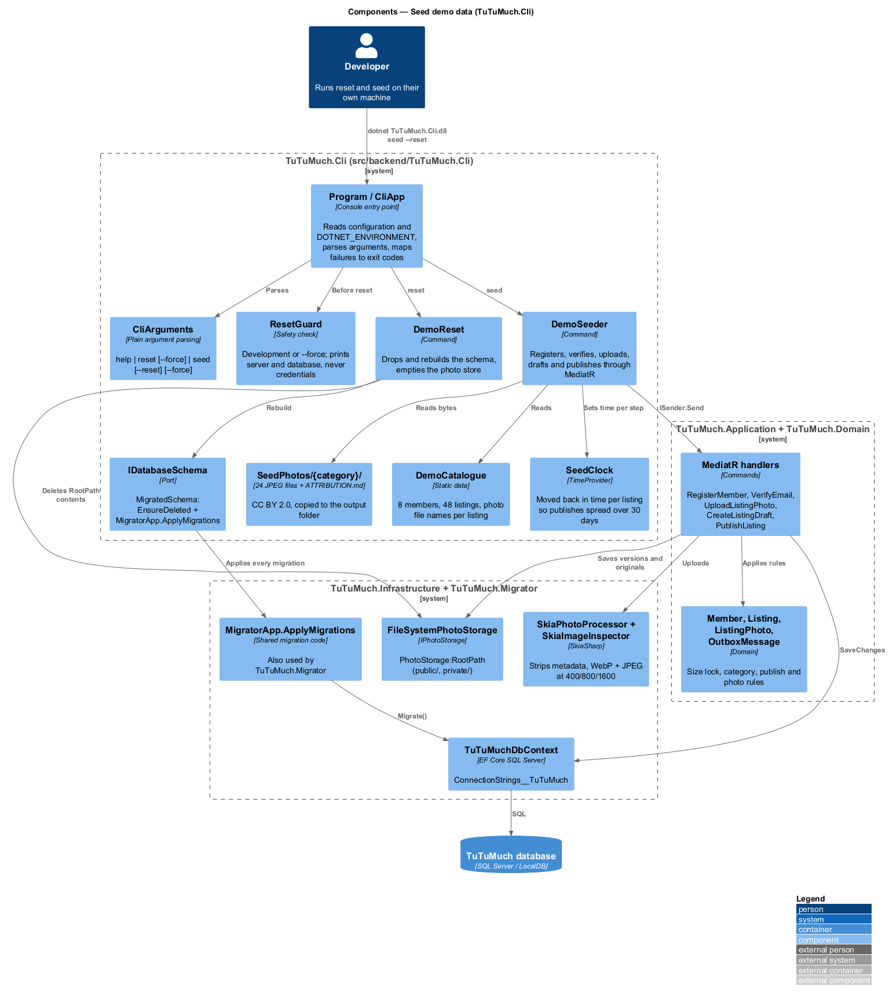
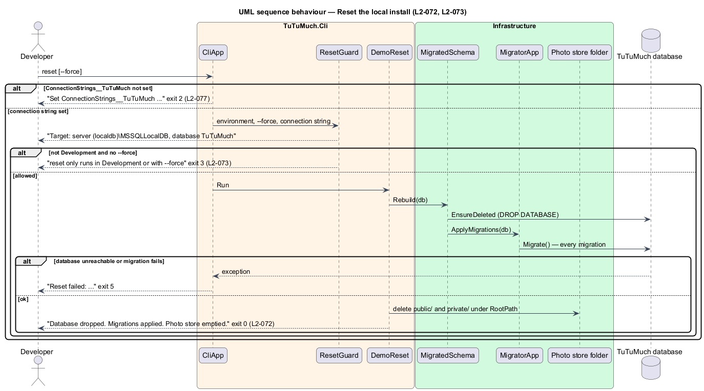
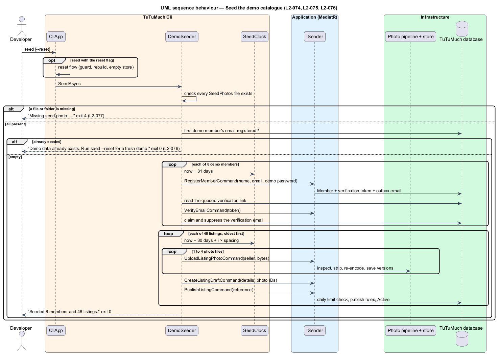

# Seed demo data

## Overview

TuTuMuch is a marketplace for all things young girls. A fresh local
install has no members and no listings, so every catalog page is empty until someone
registers, verifies, uploads photos and publishes by hand. This feature, part of the
`platform` subsystem, adds `TuTuMuch.Cli`, a developer tool with two commands: `reset`
gives an empty, fully migrated database and an empty photo store; `seed` loads a small
demo catalogue of members and Active listings with real product photographs in every
category. `seed --reset` does both. It refines `L1-019` through `L2-072` to `L2-077`.

Terms used below:

- **demo catalogue** — the fixed set of 8 members and 48 listings in `DemoCatalogue`
- **photo store** — the folder `FileSystemPhotoStorage` writes to, `PhotoStorage:RootPath`
  (`public/` versions, `private/` originals)
- **seed photos** — the 24 committed photographs under
  `src/backend/TuTuMuch.Cli/SeedPhotos/{Dresses,Tops,Outerwear,Bottoms}/`
- **reset guard** — the check that `reset` runs only in Development or with `--force`
  (`L2-073`)
- **seed clock** — the `TimeProvider` the seeder moves back in time per step

Who uses it: a developer on their own machine. It has no UI, adds no API endpoint, changes
nothing in the Angular app or the size rules, and is never run by the API, the Worker or CI
against a database ([ADR-0010](../../../adr/platform/0010-tutumuch-cli-for-demo-seeding.md)).
The demo set is not a load or scale fixture
([ADR general/0002](../../../adr/general/0002-no-load-or-scale-tests.md)).

## Description

### Project and composition (`src/backend/TuTuMuch.Cli`)

A console project (`OutputType Exe`) in `TuTuMuch.sln`, referencing `TuTuMuch.Application`,
`TuTuMuch.Infrastructure` and `TuTuMuch.Migrator`, plus `Microsoft.Extensions.Configuration.*`
and `Microsoft.Extensions.DependencyInjection`. `SeedPhotos/**` is copied to the output
folder.

- **`Program`** — builds `IConfiguration` from `appsettings.json`,
  `appsettings.{environment}.json` and environment variables, reads the environment from
  `DOTNET_ENVIRONMENT` (`Production` when unset, as the .NET host does) and calls
  `CliApp.RunAsync`.
- **`CliApp.RunAsync(args, output, configuration, environmentName, configureServices)`** —
  parses the arguments, builds a `ServiceProvider` with `AddApplication()` and
  `AddInfrastructure(configuration)` (the same composition as the API and the Worker),
  replaces `TimeProvider` with a `SeedClock`, registers `IDatabaseSchema`
  (`MigratedSchema`), `DemoReset` and `DemoSeeder`, then applies `configureServices`.
  Tests use that last hook to put SQLite in-memory, a fake `IPhotoStorage` and
  `EnsureCreatedSchema` in place; production passes nothing. Every exception from a
  command is caught, printed in one line and mapped to an exit code.
- **`CliArguments.Parse(args)`** — plain parsing, no `System.CommandLine`: the first
  argument is the command (`help`, `reset`, `seed`; `--help`, `-h` or none mean help), the
  rest are flags. `reset` takes `--force`; `seed` takes `--reset` and `--force`. Anything
  else is a usage error.

### Exit codes (`L2-077`)

| Code | Meaning |
|------|---------|
| 0 | Success, help, or `seed` found the demo data already there |
| 1 | Unknown command or option; usage is printed |
| 2 | `ConnectionStrings__TuTuMuch` is not set |
| 3 | The reset guard refused |
| 4 | A seed photo folder or file is missing |
| 5 | The database cannot be reached, or a migration or seed step failed |

### Reset (`L2-072`, `L2-073`)

1. **`ResetGuard.DescribeTarget(connectionString)`** reads `Data Source`/`Server` and
   `Initial Catalog`/`Database` with `SqlConnectionStringBuilder` and prints
   `Target: server …, database …`. Passwords and user IDs are never printed.
2. **`ResetGuard.Allows(environmentName, force)`** — true for `Development` (ignoring case)
   or `--force`. Otherwise the tool prints why and exits 3 before touching anything.
3. **`DemoReset.Run`** — `IDatabaseSchema.Rebuild(db, output)` then empties the photo
   store by deleting `RootPath/public` and `RootPath/private`. It prints each step.
4. **`MigratedSchema`** — `db.Database.EnsureDeleted()` then
   `MigratorApp.ApplyMigrations(db, output)`. `ApplyMigrations` is the method
   `MigratorApp.Run` now calls, so `TuTuMuch.Migrator` and the CLI share one migration path.

The migrations hold SQL Server SQL, so tests cannot run them on SQLite. Tests use
`EnsureCreatedSchema` (`EnsureDeleted` then `EnsureCreated`) behind the same
`IDatabaseSchema` seam, and `reset` against LocalDB is checked by hand. `MigratorTests`
keeps covering the migration list.

### Seed (`L2-074` to `L2-076`)

**`DemoSeeder.SeedAsync(output)`** runs in this order:

1. **Photos present** — every file named by the demo catalogue must exist under
   `Seed:PhotosPath` (default `{AppContext.BaseDirectory}/SeedPhotos`). A missing folder
   or file stops the seed before any write: exit 4, naming the path.
2. **Already seeded** — when the first demo member's email is registered, print "Demo data
   already exists. Run `seed --reset` for a fresh demo." and exit 0 (`L2-076`).
3. **Members** — for each demo member, with the seed clock 31 days back:
   `RegisterMemberCommand` (all `L2-001` rules, including the breached-password check),
   then the token is read from the queued `EmailVerification` outbox message's link and
   sent with `VerifyEmailCommand` (`L2-002`), then that outbox message is claimed and
   suppressed ("Demo member verified by TuTuMuch.Cli") so the Worker never sends it. A
   failed command result stops the seed with exit 5 and its error code.
4. **Listings** — in catalogue order (oldest first), listing *i* of *n* is created and
   published with the seed clock at `now − 30 days + i × (30 days ÷ n)`. For each:
   `UploadListingPhotoCommand` per photo file (the full upload pipeline: type sniffing,
   800 px rule, metadata strip, WebP and JPEG at 400/800/1600, content-addressed keys),
   `CreateListingDraftCommand` with the photo IDs, then `PublishListingCommand`. The size comes from the category, as for every listing
   (`L2-013`).
5. Print "Seeded 8 members and 48 listings." and exit 0.

**Daily publish limit.** `PublishListingCommandHandler` counts the seller's listings with
`PublishedAt` on or after the seed clock's UTC day. Because listings are published oldest
first and 48 listings are spread over 30 days across 8 sellers, each seller publishes at
most one listing per day, so the limit is never reached, even at `PublishesPerDay = 1`.
The rule itself is unchanged.

**Photo reuse.** Each listing uploads its own photo rows (a photo belongs to one listing),
but versions are keyed by the content hash, so the 24 files are stored once each and
served by `/photos/{hash}/{file}` like any upload.

### Demo catalogue (`DemoCatalogue`)

All demo members share the password `TuTuMuch-demo-only-2026`, documented in
`src/backend/TuTuMuch.Cli/README.md` as for local use only. Emails use the reserved `.test`
domain. No member is an administrator, onboarded for payouts or the author of any review,
report or order.

| Display name | Email |
|--------------|-------|
| `TutuTessa` | `tessa@demo.tutumuch.test` |
| `TwirlyTara` | `tara@demo.tutumuch.test` |
| `HandMeDownHana` | `hana@demo.tutumuch.test` |
| `PuddleJumperPia` | `pia@demo.tutumuch.test` |
| `RainbowRosa` | `rosa@demo.tutumuch.test` |
| `LeggingsLily` | `lily@demo.tutumuch.test` |
| `PartyDressPenny` | `penny@demo.tutumuch.test` |
| `CozyCoatCleo` | `cleo@demo.tutumuch.test` |

48 listings, 12 per category. They are published with the categories alternating, and each
category's two listings that share a cover photo are published six apart, so a catalog page
does not show the same photo side by side. Sellers take turns. Each has a subcategory from the
`L2-011` table, a title, a description of at least 20 characters, a brand from
`Selling:SuggestedBrands`, one of the five conditions (every `Used - Fair` listing names its
flaws), a price from $18 to $420 and shipping from $0 to $15.

| Category | Subcategories used | Seed photos (each the cover of 2 listings; 1 to 4 photos per listing) |
|----------|--------------------|------------------------------------------------------------|
| Dresses | Dresses, Skirts, Tutus | `floral-party-dress`, `yellow-sundress`, `navy-smocked-dress`, `denim-skirt`, `pink-tulle-tutu-skirt`, `lavender-tutu` |
| Tops | Shirts, T-shirts, Sweaters, Hoodies | `white-peter-pan-collar-shirt`, `unicorn-graphic-t-shirt`, `pink-striped-t-shirt`, `rainbow-knit-sweater`, `mint-cardigan-sweater`, `purple-hoodie` |
| Outerwear | Jackets, Coats | `purple-puffer-jacket`, `pink-denim-jacket`, `mint-fleece-jacket`, `yellow-raincoat`, `red-wool-coat`, `navy-peacoat` |
| Bottoms | Pants, Leggings, Shorts | `pink-corduroy-pants`, `khaki-pull-on-pants`, `denim-leggings`, `floral-leggings`, `denim-shorts`, `rainbow-shorts` |

A listing's first photo is its cover and matches its title; extra photos are other items
of the same category, so a buyer sees a gallery. Photo sources and licences are in
`SeedPhotos/ATTRIBUTION.md` (CC BY 2.0, Open Images).

### Tests (`tests/TuTuMuch.Cli.Tests`)

xUnit, SQLite in-memory through the `configureServices` hook, a fake `IPhotoStorage`
(dictionary) and `EnsureCreatedSchema`; the reset tests point `PhotoStorage:RootPath` at a
temporary folder. No SQL Server, LocalDB, Docker or connection string to a live database.
The real SkiaSharp pipeline runs on the committed photos. Each test file starts with the
`// Traces to:` header of `L2.md`:

- `CliArgumentsTests`, `HelpAndExitCodeTests` — `L2-077`.
- `ResetTests` — `L2-072`, `L2-073` (guard, target output without password, rows and
  files gone).
- `SeedMembersTests` — `L2-074` (verified, `.test`, sign-in with the demo password, no
  pending email).
- `SeedListingsTests` — `L2-075` (counts, sizes, photos and versions, brands in the API's
  `appsettings.json`, cover photo hashes, one publish per seller per day, catalog query per
  category, every detail query).
- `RepeatableSeedTests` — `L2-076`.
- `SeedLimitsTests` — `L2-075` (`PublishesPerDay = 1`), `L2-077` (missing photos, exit 4,
  nothing written, checked before `--reset` acts) and that every photo is committed,
  attributed and under 400 KB.

### Configuration values

| Setting | Value | Source |
|---------|-------|--------|
| `ConnectionStrings__TuTuMuch` | Required; the same setting as `TuTuMuch.Migrator` | Environment |
| `DOTNET_ENVIRONMENT` | `Development` to allow `reset`; `Production` when unset | Environment |
| `PhotoStorage:RootPath` | Same as the API (default `{temp}/tutumuch-photos`) | `PhotoStorageOptions` |
| `Selling:PublishesPerDay` | 20, unchanged | `SellingOptions` |
| `Seed:PhotosPath` | `{AppContext.BaseDirectory}/SeedPhotos` | `DemoSeeder` |
| Demo password | `TuTuMuch-demo-only-2026` | `DemoCatalogue`, CLI README |

## Requirements

| L2 ID | Refines (L1) | Requirement |
|-------|--------------|-------------|
| `L2-072` | `L1-019` | `reset` drops the database, applies every migration through the migrator's code and empties the photo store. |
| `L2-073` | `L1-019` | `reset` runs only in Development or with `--force`, and prints the target server and database first. |
| `L2-074` | `L1-019` | `seed` creates 6 to 10 verified demo members through the account commands, with a documented demo password. |
| `L2-075` | `L1-019` | `seed` creates 40 to 80 Active listings in every category through the listing and photo commands, without breaking the daily publish limit. |
| `L2-076` | `L1-019` | `seed` is repeatable and `seed --reset` gives the same fresh demo. |
| `L2-077` | `L1-019` | Usage, exit codes and one-line failure messages. |

Related requirements applied without restating them: `L2-071` (the verify command builds
and tests the CLI), `L2-001`, `L2-002`, `L2-006` (accounts), `L2-011` to `L2-019`
(categories, size lock, listing and photo rules), `L2-022`, `L2-025` (catalog and detail),
`L2-040` (no reviews), `L2-051` (daily limit), `L2-059` (photo delivery).

## Diagrams

### Components

The CLI composes the same Application and Infrastructure services as the API; seeding goes
through MediatR and the photo pipeline, and reset goes through the migrator's code.

### Behaviour — reset

### Behaviour — seed

## Open questions

- The photos are CC BY 2.0 from Open Images because Unsplash, Pexels and Wikimedia were
  unreachable when the feature was built. Swapping in CC0 or Unsplash-licensed photos needs
  only new files and a new `ATTRIBUTION.md`.
- `reset` against SQL Server is verified by hand on a developer machine; tests rebuild the
  schema with `EnsureCreated` on SQLite. The environment that built this feature had no SQL
  Server or LocalDB (and could not install one), so its hand check seeded a SQLite file
  through `CliApp` with the real file-system photo store, served it through `TuTuMuch.Api`
  and the Angular dev server, and confirmed the home, category and detail pages and a demo
  sign-in. The `reset` run against LocalDB on Windows on Arm is still owed.
- A seed interrupted half way leaves a partial demo; `seed --reset` is the documented
  recovery.
