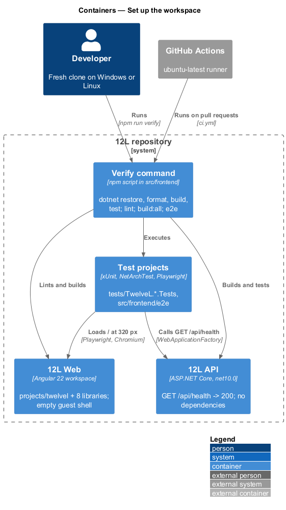
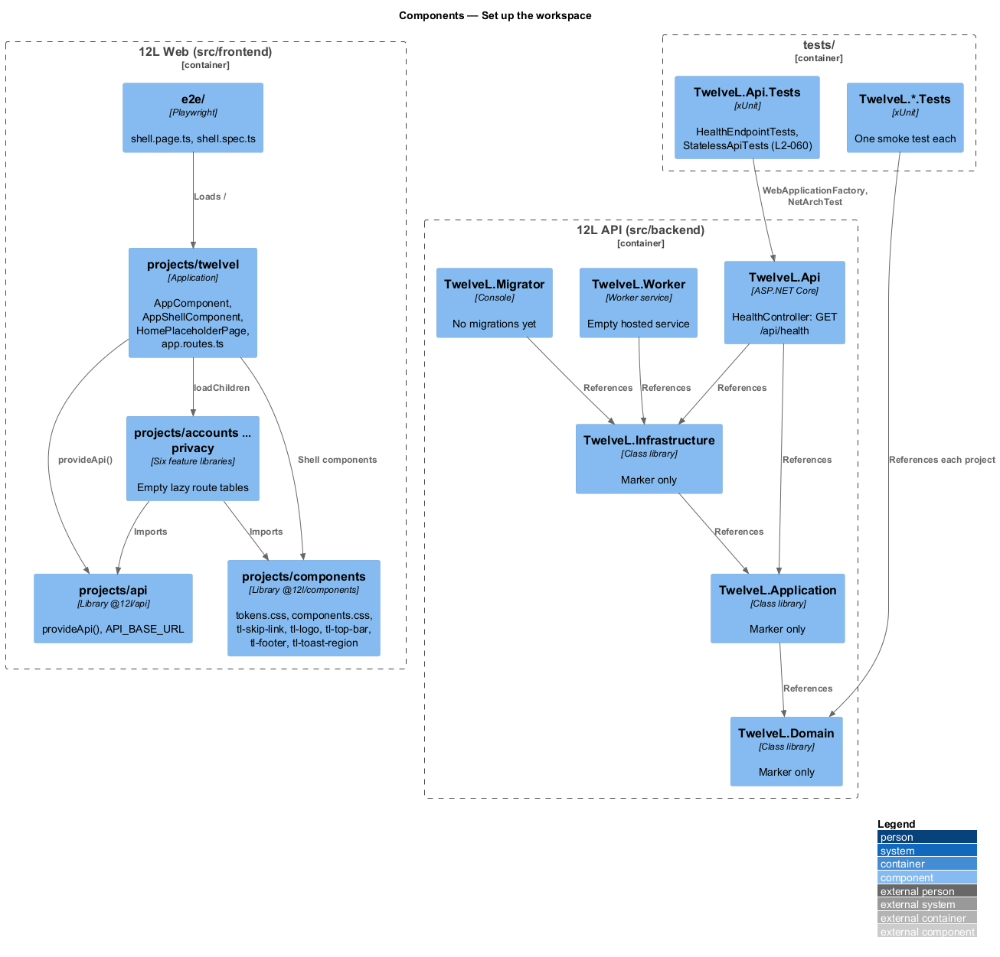
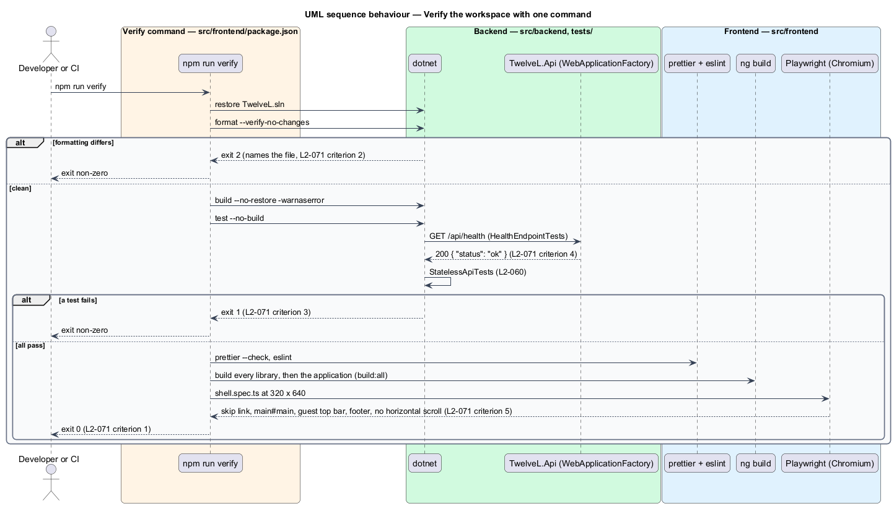

# Set up the workspace

## Overview

Tutu Much is a marketplace for men's US size 12 shoes and men's size L clothing. Before any
feature can be built, a developer needs a repository that builds, lints and tests on the
first day. This feature, part of the `platform` subsystem, creates that starting point:
the backend solution, the frontend workspace, the empty application shell, the test
harnesses and one command that verifies all of it. It is the prerequisite for every other
journey in `docs/journeys.md`.

Terms used below:

- **workspace** — the Angular monorepo under `src/frontend` with one application project and one library per area, as `AGENTS.md` mandates
- **solution** — the .NET solution under `src/backend` with the six `TutuMuch.*` projects
- **verify command** — the single command that restores, builds, lints and tests both stacks and exits non-zero on any failure (`L2-071`)
- **empty shell** — the application frame of [responsive-accessible-shell](../responsive-accessible-shell/README.md) in its guest state, with a placeholder home page and no feature screens
- **architecture test** — a unit test that inspects the compiled assemblies for forbidden registrations (`L2-060`)

The feature builds no product behaviour. The shell components it ships are the subset of
[responsive-accessible-shell](../responsive-accessible-shell/README.md) that the frame
needs (skip link, guest top bar, footer, toast region); the rest of that design, the
accounts subsystem's `AuthState`, HTTP interceptors beyond the base URL provider, EF
Core, the outbox, Redis, Docker, dependency scanning (`L2-052`, `L2-053`), visual
snapshots and axe runs over every route are deferred to their own features.

## Description

### Backend solution (`src/backend/TutuMuch.sln`)

Target framework `net10.0` (.NET 10 LTS SDK, pinned in `global.json`), nullable and
implicit usings on, warnings as errors.

- **`TutuMuch.Domain`** — class library; no package references. Empty apart from the
  `TutuMuch.Domain` namespace marker.
- **`TutuMuch.Application`** — class library referencing `Domain`. Empty apart from the
  namespace marker; MediatR and FluentValidation arrive with the first command.
- **`TutuMuch.Infrastructure`** — class library referencing `Application`. Empty apart
  from the namespace marker; EF Core arrives with the first entity.
- **`TutuMuch.Api`** — ASP.NET Core Web API referencing `Application` and
  `Infrastructure`. `Program.cs` registers controllers and maps them; `partial class
  Program` exposes the entry point to `WebApplicationFactory`. **`HealthController`**
  answers `GET /api/health` with `200` and the body `{ "status": "ok" }`; it touches no
  dependency, so it succeeds with no database (`L2-071` criterion 4). Tests run it in-process through `WebApplicationFactory`; no test uses SQL Server, LocalDB or a connection string ([ADR-0004](../../../adr/platform/0004-health-check-without-database.md)). The liveness and
  readiness endpoints of `L2-070` belong to
  [report-errors-and-observe](../report-errors-and-observe/README.md).
- **`TutuMuch.Worker`** — worker service referencing `Application` and `Infrastructure`,
  with an empty `Worker` hosted service.
- **`TutuMuch.Migrator`** — console app referencing `Infrastructure`; prints that no
  migrations exist yet and exits 0.
- **`Directory.Build.props`** — shared `TargetFramework`, `Nullable`, `ImplicitUsings`,
  `TreatWarningsAsErrors` and the `TutuMuch` root namespace.
- **`.editorconfig`** at `src/backend` — the `dotnet format` rules the verify command
  checks with `--verify-no-changes`.

### Backend tests (`tests/`)

One xUnit project per backend project, named `tests/TutuMuch.<Project>.Tests`, each
referencing its project:

- **`TutuMuch.Api.Tests`** — `HealthEndpointTests` uses `WebApplicationFactory<Program>`
  to call `GET /api/health` and asserts `200`, `application/json`, and that the body
  contains neither a version number, the machine name nor the text `ConnectionString`.
  **`StatelessApiTests`** (NetArchTest) loads `TutuMuch.Api` and `TutuMuch.Application`
  and fails when any type depends on the `Microsoft.Extensions.Caching.Memory` or
  `Microsoft.AspNetCore.Session` namespaces (`L2-060` criterion 1). A deliberate
  `IMemoryCache` dependency was used to confirm the test fails. It is the one architecture test of this feature.
- **`TutuMuch.Application.Tests`**, **`TutuMuch.Domain.Tests`**,
  **`TutuMuch.Infrastructure.Tests`**, **`TutuMuch.Worker.Tests`**,
  **`TutuMuch.Migrator.Tests`** — each holds one smoke test that the project's marker
  type loads, so every test project runs in CI from day one.

### Frontend workspace (`src/frontend`)

Angular 22 workspace (Angular CLI 22) on Node 22 LTS, standalone components, signals,
`npm ci`. `angular.json` registers the application and eight libraries; `tsconfig.json`
maps `@tutumuch/<library>` to each `projects/<library>/src/public-api.ts`.

- **`projects/tutumuch/`** — the application. `src/main.ts`, `src/index.html`,
  `src/styles.css` (imports the tokens and component styles of `@tutumuch/components`),
  `src/app/app.config.ts` (router with the feature routes, `provideApi()` from
  `@tutumuch/api`), `src/app/app.routes.ts` (`''` renders `HomePlaceholderPage`; each feature library's empty routes are attached with `loadChildren` under a provisional path that the feature's own design confirms),
  **`AppComponent`** (renders `tm-skip-link`, the shell for the active route and
  `tm-toast-region`), **`AppShellComponent`** (`tm-top-bar`, `<main id="main"
  tabindex="-1"><router-outlet>`, `tm-footer`) and **`HomePlaceholderPage`** (an `h1`
  "Everything in your size." and one paragraph). Auth, admin and bare shells are
  `<TO SUPPLY>` by the features that first use them.
- **`projects/components/`** (`@tutumuch/components`, prefix `tl`) — `src/styles/tokens.css`
  and `src/styles/components.css` copied from `docs/design-system/tokens/tokens.css` and
  `docs/design-system/assets/components.css`, with the `L2-061` breakpoint values.
  Components, each with `.ts`, `.html` and `.css`: **`tm-skip-link`**, **`tm-logo`**,
  **`tm-top-bar`** (guest state only: menu button with `aria-expanded="false"`, logo,
  primary navigation, search form, "Sell" and "Sign in" links), **`tm-footer`**
  (Marketplace rules, Privacy, Terms, Cookie settings, "© {year} Tutu Much" from `Date`; Cookie
  settings links to `/privacy#cookie-settings` until the cookie-settings dialog exists),
  **`tm-toast-region`** (`role="status"`, `aria-live="polite"`, empty until
  `ToastService` is implemented). Exported from `public-api.ts`.
- **`projects/api/`** (`@tutumuch/api`) — `provideApi(baseUrl)` registers `HttpClient` (fetch
  backend) and the `API_BASE_URL` injection token; no services yet.
- **`projects/accounts|catalog|listings|orders|reviews|privacy/`** — each exports
  `routes: Routes = []` from `src/lib/<area>.routes.ts` through `public-api.ts`, plus
  `ng-package.json`, `package.json`, `README.md` and `tsconfig.lib.json`.
- **Unit tests** — the workspace has no Vitest or Karma target: frontend behaviour is
  covered by Playwright, per the `AGENTS.md` testing rules, and the CLI's spec files were
  removed.
- **Lint and format** — `eslint.config.js` with `angular-eslint` (TypeScript and
  template rules, including the accessibility rules); `.prettierrc` with
  `prettier --check` in the lint script.
- **Scripts** in `src/frontend/package.json`: `build:all` builds every library then the
  application; `lint` runs Prettier and ESLint; `test:e2e` runs Playwright; **`verify`**
  is the verify command and runs, in order, `dotnet restore`, `dotnet format
  --verify-no-changes`, `dotnet build --no-restore -warnaserror`, `dotnet test
  --no-build` on `../backend/TutuMuch.sln`, then `lint`, `build:all` and `test:e2e`. It
  assumes `npm ci` has run once. Any non-zero exit stops the chain. Each step is also a
  script of its own (`backend:verify`, `lint`, `build:all`, `test:e2e`).

### End-to-end tests (`src/frontend/e2e`)

Playwright, Chromium only. Per the `AGENTS.md` testing rules the backend never runs: `webServer` serves the production build of `projects/tutumuch` (`dist/tutumuch/browser`) as static files on port 4200 with SPA fallback, and every test installs a catch-all `page.route('**/api/**')` fixture so no request can reach `Tutu Much API`.

- **`e2e/pages/shell.page.ts`** — page object with locators for the skip link,
  `main#main`, the top bar, the footer links and a `goto()`.
- **`e2e/tests/shell.spec.ts`** — header `// Traces to: L2-071, L2-065`; at 320 × 640
  asserts the skip link is the first focusable element, `main#main` exists, the guest
  top bar shows "Sign in", the four footer links are present and
  `document.documentElement.scrollWidth <= window.innerWidth` (`L2-071` criterion 5).
  It also asserts that no request left the browser for `/api/**` unfulfilled by a fixture.

### Continuous integration (`.github/workflows/ci.yml`)

Runs on every pull request and push to `main` on `ubuntu-latest`: checks out, installs
Node 22 and the .NET 10 SDK, runs `npm ci` and `npx playwright install --with-deps
chromium` in `src/frontend`, then `npm run verify`. A failing step fails the workflow
(`L2-071` criteria 2 and 3).

### Configuration values

| Setting | Value | Source |
|---------|-------|--------|
| .NET SDK | 10.0.x (`global.json`, `rollForward: latestFeature`) | [ADR-0001](../../../adr/platform/0001-runtime-versions.md) |
| Node | 22 LTS (`engines` in `package.json`) | ADR-0001 (platform) |
| Angular | 22.x | ADR-0001 (platform) |
| API base URL | `environment.apiBaseUrl`: `/api` in production, `http://localhost:5045/api` in development (the API's launch profile) | `projects/tutumuch/src/environments` |
| Playwright browser | Chromium | `AGENTS.md` |

## Requirements

| L2 ID | Refines (L1) | Requirement |
|-------|--------------|-------------|
| `L2-071` | `L1-019` | One command, run from a fresh clone, shall restore, build, lint and test the backend solution (`src/backend`) and the frontend workspace (`src/frontend`), and shall fail when any step fails. The API shall answer `GET /api/health` with HTTP 200 without a database or any other external dependency. The frontend command shall build every library and the application. The same command shall pass on Windows and on Linux CI. |

Related requirements applied without restating them: `L2-060` (the architecture test),
`L2-061` (breakpoint tokens), `L2-064` and `L2-065` (the shell's skip link, landmarks and
focus order). `L2-053` is deferred.

## Diagrams

### Containers

The developer's machine and the CI runner hold the same two containers, `Tutu Much Web` and
`Tutu Much API`, plus the test projects. No database, cache or external system is needed to
verify the workspace.

### Components

The verify command fans out to the backend solution and the frontend workspace; the
application depends on the feature libraries, which depend on `api` and `components`.

### Behaviour — verify the workspace

The verify command runs each step in order and stops at the first failure. CI runs the
same command on Linux.

## Open questions

- Auth, admin and bare shell components are `<TO SUPPLY>` by the first feature that
  routes to them.
- `ToastService`, `SheetService` and `DialogService` are `<TO SUPPLY>` by
  responsive-accessible-shell; the toast region ships empty.
- Dependency scanning (`L2-053`), axe runs over every route and visual snapshots are
  deferred to protect-credentials-and-supply-chain and responsive-accessible-shell.
