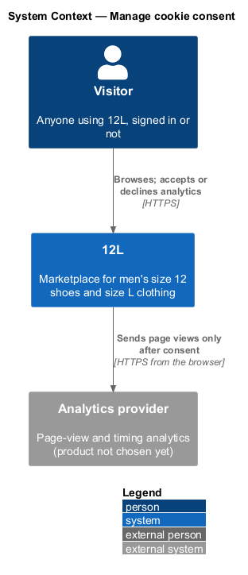
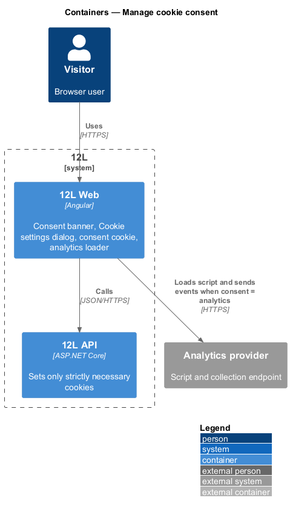
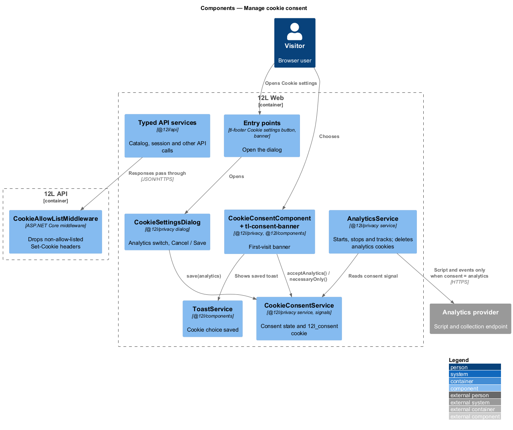
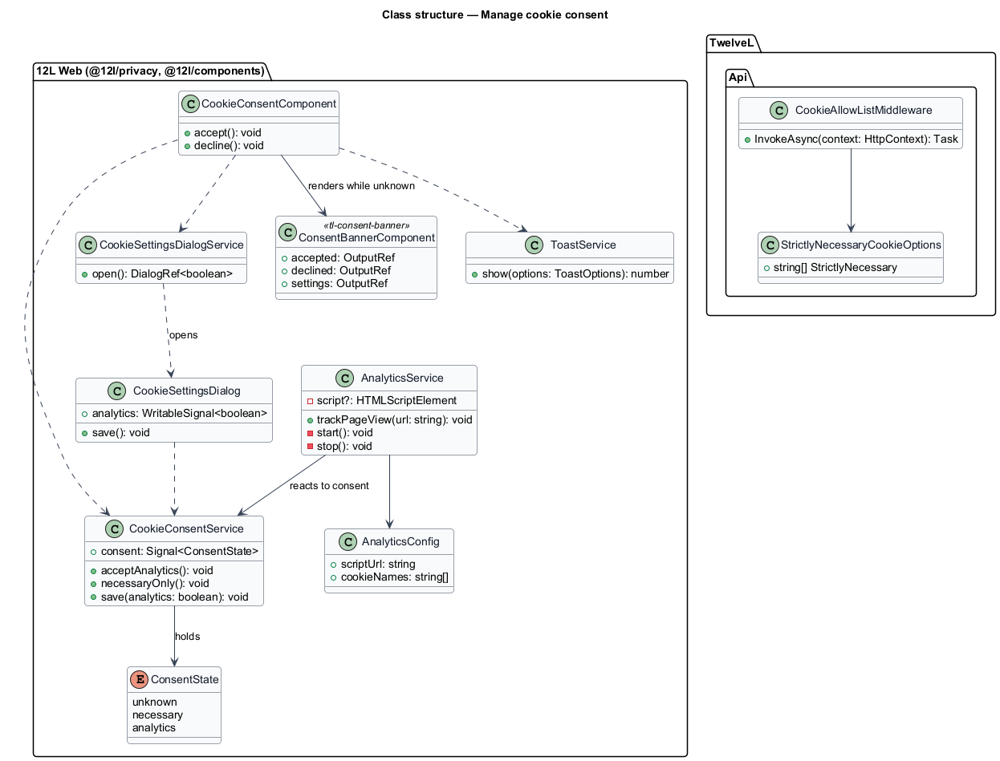
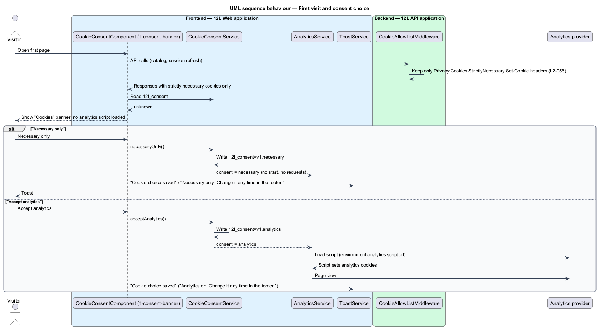
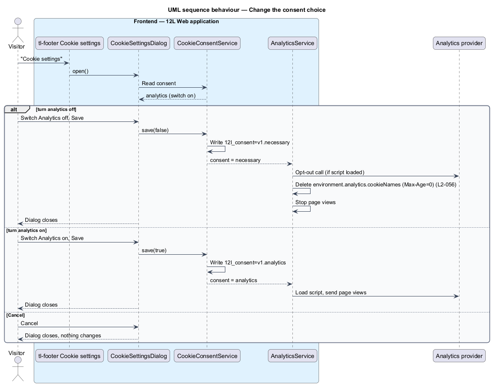

# Manage cookie consent

## Overview

TuTuMuch is a marketplace for new and used girls' clothing. Like most web
applications it uses cookies: some keep a member signed in and protect forms, and others
could measure which pages are slow. This feature makes sure that only the cookies TuTuMuch
cannot run without are set until the visitor decides about the rest, and that the
visitor can change that decision at any time.

On a first visit, `TuTuMuch Web` shows a consent banner at the bottom of the page. The
visitor accepts analytics or keeps necessary cookies only. Until a choice is made, and
for as long as the choice is "necessary only", no analytics script loads, no analytics
cookie is set and no analytics request leaves the browser. A "Cookie settings" dialog,
reachable from the footer of every page, from Settings and from the Privacy page, lets
the visitor switch analytics on or off later. Switching it off removes the analytics
cookies.

Terms used below:

> **strictly necessary cookie** — cookie without which a requested service cannot work: the session cookies (`L2-008`), the anti-forgery cookie (`L2-050`) and the consent cookie itself

> **analytics cookie** — cookie set by the analytics provider to measure page use and performance

> **consent state** — visitor's recorded choice: `unknown` (no choice yet), `necessary` or `analytics`

> **consent cookie** — first-party cookie named `tm_consent` that records the consent state in the browser

> **analytics provider** — external service that receives page-view events; the product is not chosen yet (deferred)

The feature belongs to the `privacy` subsystem (`L1-014`). It is mostly frontend: the
choice is stored in the browser with no request to `TuTuMuch API`. The API's part is to set
only strictly necessary cookies on every response.

## Description

### Frontend (`TuTuMuch Web`, `@tutumuch/privacy` and `@tutumuch/components`)

The consent code lives in the `privacy` feature library
(`src/frontend/projects/privacy/src/lib/consent/` and `.../cookie-settings/`). It is exported
to the application shell and loaded with it, not with a lazy route, because the banner appears
on the first page a visitor opens. It makes no call to `TuTuMuch API`, so `@tutumuch/api` is not involved.
Decisions are recorded in [ADR privacy/0001](../../../adr/privacy/0001-cookie-consent-in-the-browser-and-a-placeholder-analytics-provider.md).

- **`CookieConsentService`** (`consent/cookie-consent.service.ts`) — root service holding the
  consent state in a read-only signal `consent: Signal<'unknown' | 'necessary' | 'analytics'>`.
  On start-up it reads the consent cookie. Its methods are `acceptAnalytics()`,
  `necessaryOnly()` and `save(analytics: boolean)`. Each writes the consent cookie and updates
  the signal; `AnalyticsService` follows the signal. No HTTP request is made, so saving cannot
  fail and has no busy state.
- **Consent cookie** — `tm_consent`, value `v1.necessary` or `v1.analytics`, attributes
  `Path=/`, `Max-Age=15552000` (180 days), `Secure`, `SameSite=Strict`. It is readable by script
  (not `HttpOnly`) because the frontend reads it. An unknown or malformed value counts as
  `unknown`, so the banner returns.
- **`tl-consent-banner`** (`@tutumuch/components`, design system: Consent banner) — a `section`
  labelled by the heading "Cookies", with the text "We use necessary cookies to run TuTuMuch.
  Analytics only if you say yes.", a primary "Accept analytics" button, a secondary "Necessary
  only" button and a link-styled "Cookie settings" button. It emits `accepted`, `declined` and
  `settings`. It is fixed to the bottom of the page, does not block the page and does not trap
  focus.
- **`CookieConsentComponent`** (`tl-cookie-consent`, `consent/cookie-consent.ts`) — placed in
  the root component next to the toast region, so it shows in every shell. It renders
  `tl-consent-banner` while the state is `unknown`
  (`docs/mocks/notifications/cookie-consent/info.html`) and disappears once a choice is saved.
- **Saved toast** — after either banner button, `ToastService` shows a success toast titled
  "Cookie choice saved" (`docs/mocks/notifications/cookie-consent/success.html`). The body is
  "Necessary only. Change it any time in the footer." or "Analytics on. Change it any time in
  the footer."
- **`CookieSettingsDialog`** (`cookie-settings/cookie-settings-dialog.ts`) — small `tl-dialog`
  titled "Cookie settings" (`docs/mocks/dialogs/cookie-settings/`) with two `tl-switch`es that
  show their label and hint:
  - "Strictly necessary" with the hint "Sign-in and checkout. Always on.", checked and
    disabled.
  - "Analytics" with the hint "Helps us see which pages are slow.", with initial focus. It is
    off in the `default` state and on in the `analytics-on` state.

  "Cancel" closes without change. "Save" calls `CookieConsentService.save(...)` and closes.
  Saving from the dialog also counts as a first choice, so the banner closes. The dialog has
  no `busy` or `invalid` state. Focus returns to the control that opened it.
- **`CookieSettingsDialogService`** — `open()` opens the dialog through `DialogService`.
- **Entry points** — the footer button "Cookie settings" in the app shell (`tl-footer` emits
  `cookieSettings`, the shell calls `open()`) and the banner's "Cookie settings". The
  "Cookie settings" link on the Privacy page (`docs/mocks/pages/privacy/`) and the "Cookies" row
  on Settings (`docs/mocks/pages/settings/default.html`) are deferred until those pages exist;
  they will call the same service.
- **`AnalyticsService`** (`consent/analytics.service.ts`) — the only code that talks to the
  analytics provider. `provideAnalytics(environment.analytics)` in `app.config.ts` registers
  its configuration and creates it at start-up.
  - On `analytics` it appends one `<script src>` element for `scriptUrl` (no inline script,
    `L2-048`) and subscribes to router `NavigationEnd` events to send page views through
    `window.tutumuchAnalytics.pageView(url)` when the script exposes it.
  - On `necessary` it calls `window.tutumuchAnalytics.optOut()` when present, stops page views,
    and deletes every cookie named in `cookieNames` on `Path=/` for both the host and the parent
    domain, by writing it with `Max-Age=0`.
  - On `unknown` it does nothing, so nothing loads before a choice.
  - `trackPageView(url)` returns without effect unless the state is `analytics`.
- **Consent effect** — an Angular `effect` in the `AnalyticsService` constructor that reacts to
  the consent signal, as above.

### API (`TuTuMuch.Api`)

- **`StrictlyNecessaryCookieOptions`** (`TuTuMuch.Api/Privacy/`) — bound from
  `Privacy:Cookies:StrictlyNecessary`, the list of cookie names the API may set: the session
  cookies `tl_access` and `tl_refresh`. The anti-forgery cookie joins the list when the platform
  subsystem adds it.
- **`CookieAllowListMiddleware`** — first in the pipeline. Before headers are sent it reads
  each `Set-Cookie` header and removes any whose name is not in the list, logging a warning with
  the cookie name and path. This keeps a later change from adding a non-essential cookie by
  mistake (`L2-056` criterion 1).
- **Cookie attributes** — the session cookies are already `HttpOnly`, `Secure`,
  `SameSite=Strict` and `IsEssential = true` (`L2-008`); no `CookiePolicyOptions` is added.
- **Content Security Policy** — none exists yet. When the platform subsystem adds one
  (`L2-048`), the analytics script and collection origins go into `script-src` and
  `connect-src`; consent decides whether the frontend uses them.

### Data and configuration

The feature adds no tables. Consent is not recorded on the server and is not tied to a
member account; each browser holds its own choice.

| Key | Where | Value |
|-----|-------|-------|
| `environment.analytics.scriptUrl` | `TuTuMuch Web` environment | `https://analytics.tutumuch.invalid/script.js` until a provider is chosen; empty turns analytics off |
| `environment.analytics.cookieNames` | `TuTuMuch Web` environment | `['_tma']` until a provider is chosen |
| consent cookie lifetime | `CONSENT_MAX_AGE_SECONDS` in `@tutumuch/privacy` | 180 days |
| `Privacy:Cookies:StrictlyNecessary` | `TuTuMuch API` `appsettings.json` | `tl_access`, `tl_refresh` |

### Tests

Playwright never runs the backend: the analytics origin is served by a `page.route` fixture
whose script sets the `_tma` cookie. The `consent` fixture option starts every other test with
"Necessary only" chosen, so the banner stays out of their way.

- **Playwright, `e2e/tests/manage-cookie-consent.spec.ts`** with the page object
  `e2e/pages/cookie-consent.page.ts`:
  - first visit: the banner shows, every cookie is strictly necessary or `tm_consent`, and no
    request reaches the analytics origin (criterion 1);
  - "Necessary only": the toast, the cookie, then 3 further pages with no banner, no analytics
    request and no analytics cookie (criterion 2);
  - "Accept analytics": the toast, the cookie, the script loads and sets its cookie;
  - the banner's "Cookie settings" opens the dialog with its switches, and Save closes the
    banner (criterion 4); a malformed consent cookie shows the banner again (criterion 5);
  - withdraw: with analytics accepted, footer "Cookie settings", analytics off, Save, and the
    analytics cookie is gone and focus is back on the footer button (criterion 3); Cancel
    changes nothing.
- **xUnit, `tests/TuTuMuch.Api.Tests/CookieConsentTests.cs`** — calls a sample of endpoints,
  signed out and signed in, and asserts every `Set-Cookie` name is strictly necessary; a stray
  cookie set by a test-only endpoint is removed.

## Requirements

| L2 ID | Refines (L1) | Requirement |
|-------|--------------|-------------|
| `L2-056` | `L1-014` | Only strictly necessary cookies shall be set before consent. Analytics cookies shall be set only after the visitor accepts them, and the visitor shall be able to change their choice at any time. |

## Diagrams

### System context

A visitor uses TuTuMuch, and TuTuMuch's frontend sends page views to the analytics provider only
after the visitor accepts analytics.

### Containers

The consent state lives in `TuTuMuch Web` and the browser's consent cookie. `TuTuMuch API` sets
only strictly necessary cookies. The analytics provider is reached only from the
browser.

### Components

The banner, dialog and footer entry point all go through `CookieConsentService`, which drives
`AnalyticsService`. In `TuTuMuch API`, `CookieAllowListMiddleware` filters `Set-Cookie`
headers.

### Class structure

`CookieConsentService` owns the consent state and the consent cookie.
`AnalyticsService` depends on it, and both UI components call it.

### Behaviour — first visit and choice

The first page sets only strictly necessary cookies and shows the banner. "Necessary
only" saves the choice and loads nothing. "Accept analytics" saves the choice and then
loads the analytics script.

### Behaviour — change the choice later

The visitor opens "Cookie settings" from the footer. Turning analytics off stops the
provider and deletes its cookies. Turning it on starts the provider.

