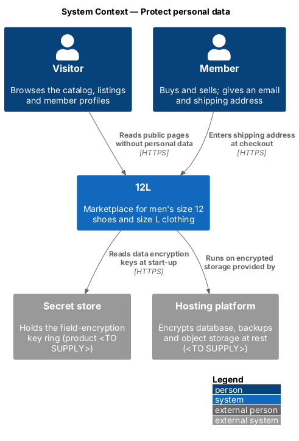
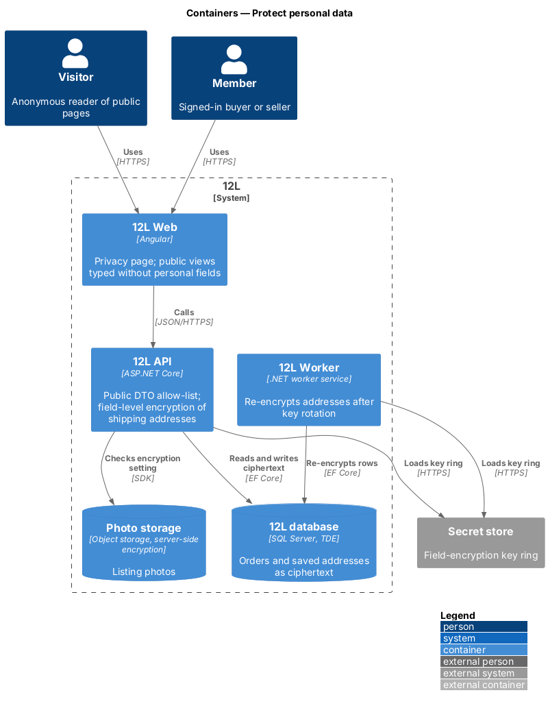
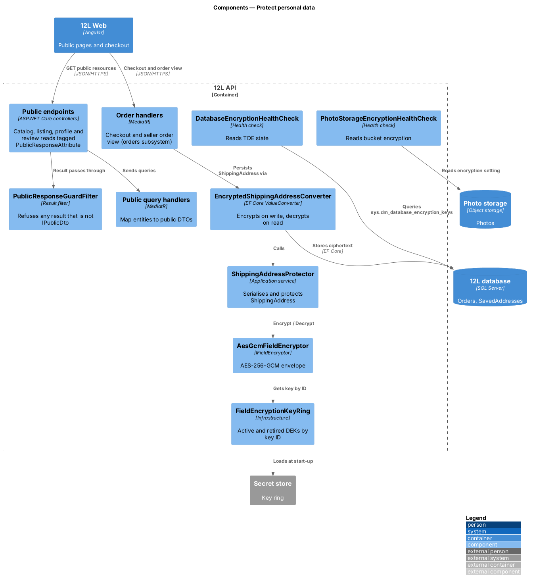
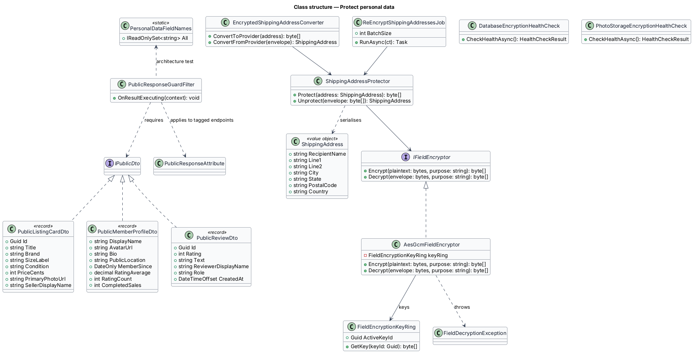
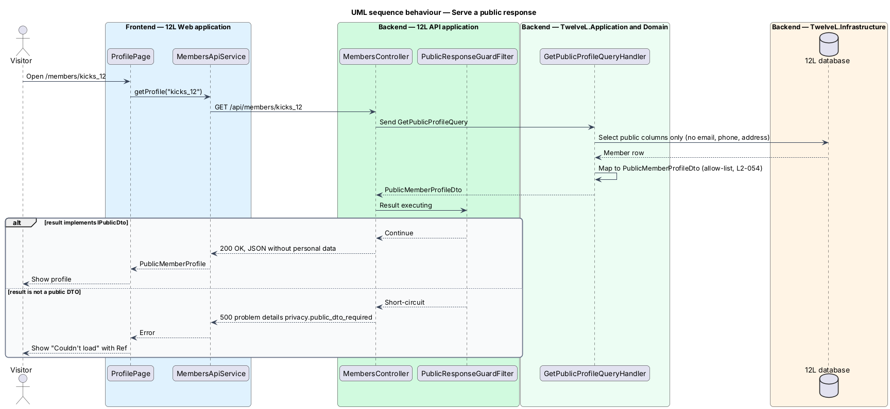
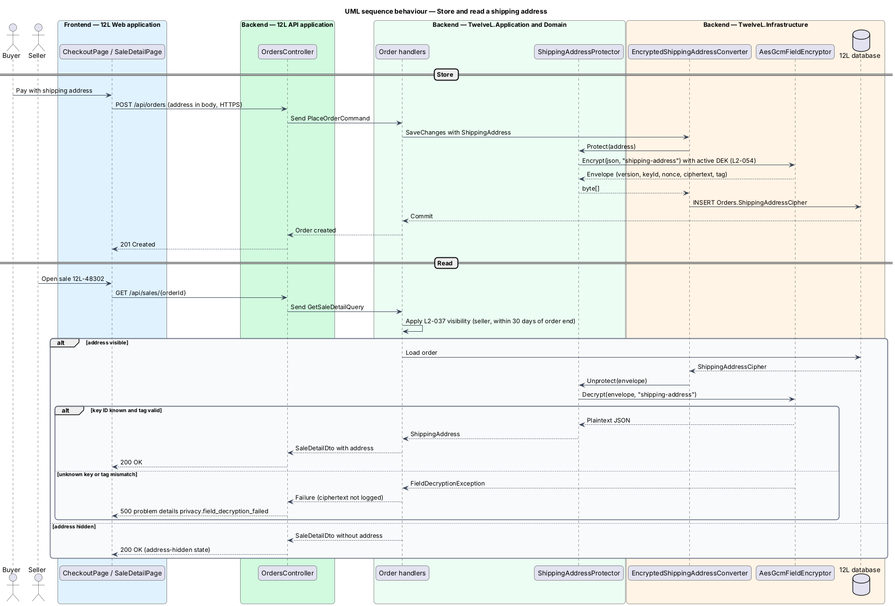
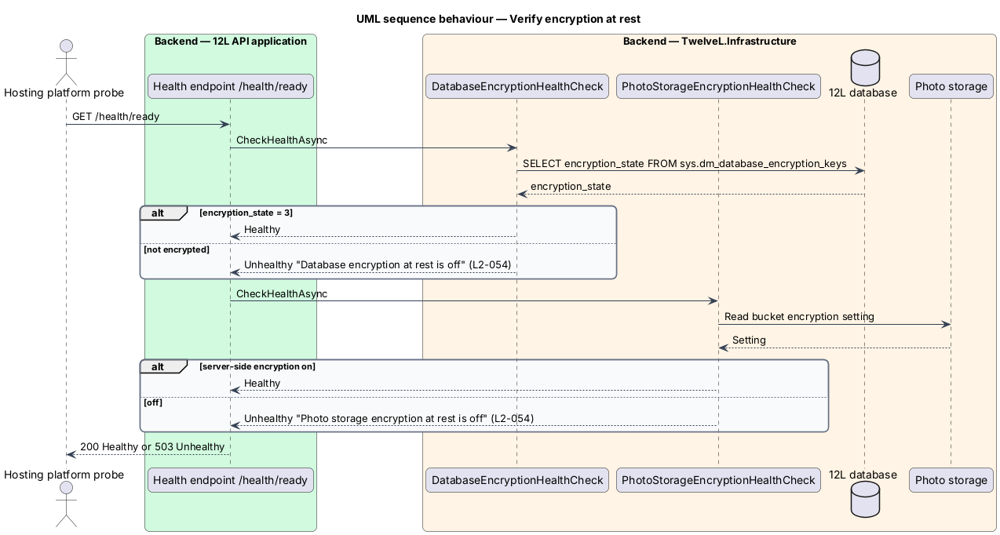

# Protect personal data

## Overview

Tutu Much is a marketplace where parents and families buy and sell girls'
clothing. To trade, members give Tutu Much personal data: an email address to sign in, a
shipping address at checkout and, where a later feature collects one, a phone number.
This feature keeps that data out of public view and unreadable to anyone who obtains a
copy of the stored bytes.

The feature has three parts.

- **Public allow-list.** Every public page and public API response is built from a
  dedicated data transfer object (DTO) whose fields are listed one by one. A field that
  is not on the list cannot reach a public response.
- **Field-level encryption.** The street, city, state, ZIP code and recipient name of each
  shipping address are encrypted by `Tutu Much API` before they are written to `Tutu Much database`.
- **Encryption at rest.** `Tutu Much database`, its backups and `Photo storage` are encrypted
  by the hosting platform, and a health check reports when that setting is off.

Terms used below:

> **personal data** — information that identifies a member or can be linked to one: email address, phone number, shipping address, full name

> **public response** — API response or page that an anonymous visitor may receive: catalog, listing detail, member profile and reviews

> **public DTO** — response type allowed in a public response, with every field named in an explicit allow-list

> **field-level encryption** — encryption of one column value by the application before the value reaches the database, so the database holds only ciphertext

> **data encryption key (DEK)** — symmetric key that encrypts field values; it is itself protected by a key held in the secret store

> **encryption at rest** — encryption of storage media by the platform, so a copied disk, file or backup is unreadable without the platform key

The feature belongs to the `privacy` subsystem (`L1-014`). It supplies building blocks
that other subsystems use: the catalog, listing detail and profile features return
public DTOs, checkout stores an encrypted address, and the seller's order view decrypts
it under the visibility rule owned by the orders subsystem (`L2-037`). The public
Privacy page (`docs/mocks/pages/privacy/`) explains these rules to visitors.

## Description

The slice runs from the Privacy page through `Tutu Much API` down to the stored bytes.

### Frontend (`Tutu Much Web`, `src/frontend/src/app/privacy/`)

- **`PrivacyPageComponent`** — static route component at `/privacy`
  (`docs/mocks/pages/privacy/default.html`). It shows the heading "Privacy", the line
  "Updated 1 Oct 2026" and six rules, each a title and one line:
  - "What we collect" — "Email, password hash, display name, shipping addresses, and orders."
  - "Never public" — "Your email, phone and street address never appear on Tutu Much pages."
  - "Encrypted" — "Shipping addresses are encrypted at rest. Card numbers never reach us."
  - "Your copy" — "Download everything we hold from Settings as a JSON file."
  - "Erasure" — "Close your account and we erase your data within 30 days."
  - "Cookies" — "Only necessary cookies until you accept analytics."

  A "Cookie settings" link below the list opens `CookieSettingsDialogComponent` from
  the manage-cookie-consent feature. The page has a single state; final legal wording
  is `<TO SUPPLY>` by counsel.
- **Public view models.** The typed API services in `catalog`, `listings` and `reviews`
  declare TypeScript interfaces that mirror the public DTOs (`PublicListingCard`,
  `PublicListingDetail`, `PublicMemberProfile`, `PublicReview`). The interfaces carry no
  field for email, phone or street address, so a component cannot bind to one.

### API (`TutuMuch.Api`)

- **Public endpoints.** `GET /api/catalog`, `GET /api/listings/{id}`,
  `GET /api/members/{displayName}` and `GET /api/members/{displayName}/reviews` are owned
  by the catalog and reviews subsystems. Each is tagged with the endpoint metadata
  `PublicResponseAttribute`. The tag declares that the endpoint returns only types that
  implement `IPublicDto`.
- **`PublicResponseGuardFilter`** — result filter registered for every endpoint tagged
  `PublicResponseAttribute`. Before serialisation it checks that the result value, or each
  element of a collection result, implements `IPublicDto`. A result that fails the check
  returns HTTP 500 with problem details code `privacy.public_dto_required` and logs the
  endpoint name. The check makes a leak fail loudly in tests instead of shipping.
- **Serialiser settings.** `System.Text.Json` serialises public DTOs with
  `JsonIgnoreCondition.WhenWritingNull` and no polymorphic type discovery, so a subtype
  cannot add fields at run time.

### Application and domain (`TutuMuch.Application`, `TutuMuch.Domain`)

- **`IPublicDto`** — marker interface for every public DTO. The public DTOs are C#
  `record` types with only init-only properties:
  - `PublicListingCardDto` — `Id`, `Title`, `Brand`, `SizeLabel`, `Condition`, `PriceCents`, `PrimaryPhotoUrl`, `SellerDisplayName`.
  - `PublicListingDetailDto` — the card fields plus `Description`, `PhotoUrls`, `ShippingCents`, `Status`, `Seller` (a `PublicSellerSummaryDto`).
  - `PublicSellerSummaryDto` and `PublicMemberProfileDto` — `DisplayName`, `AvatarUrl`, `Bio`, `PublicLocation` (city and state only, `L2-004`), `MemberSince`, `RatingAverage`, `RatingCount`, `CompletedSales`.
  - `PublicReviewDto` — `Id`, `Rating`, `Text`, `ReviewerDisplayName`, `Role`, `CreatedAt`.

  The member profile is built as `PublicProfileDto` (`reviews/view-member-profile`), whose
  property names are already checked against an allow-list in `MemberProfileTests`.
  The owning subsystems define the exact field lists; this feature owns the rule and
  the tests that enforce it.
- **`PersonalDataFieldNames`** — static list of forbidden property names used by the
  architecture test: `Email`, `EmailAddress`, `Phone`, `PhoneNumber`, `Street`,
  `Line1`, `Line2`, `PostalCode`, `Zip`, `ShippingAddress`, `FullName`, `RecipientName`.
- **`ShippingAddress`** — value object in `TutuMuch.Domain` with `RecipientName`,
  `Line1`, `Line2`, `City`, `State`, `PostalCode` and `Country` (always `US`, `L2-027`).
  It has no setters; a change creates a new instance.
- **`IFieldEncryptor`** — application port with
  `byte[] Encrypt(ReadOnlySpan<byte> plaintext, string purpose)` and
  `byte[] Decrypt(ReadOnlySpan<byte> envelope, string purpose)`. The `purpose` string
  (`"shipping-address"`) is bound into the authenticated data, so a ciphertext copied to
  another column fails to decrypt.
- **`ShippingAddressProtector`** — application service that serialises a
  `ShippingAddress` to UTF-8 JSON and calls `IFieldEncryptor`. Handlers in the orders
  subsystem call it; they never write a plaintext address.
- **Address read rule.** Decryption happens only in the handler that serves the seller's
  order view, after the visibility rule of `L2-037` passes (seller of the order, within
  30 days of the order ending). The buyer's own checkout and saved-address queries also
  decrypt. No public query decrypts.

### Infrastructure (`TutuMuch.Infrastructure`)

- **`AesGcmFieldEncryptor`** — implements `IFieldEncryptor` with AES-256-GCM from
  `System.Security.Cryptography.AesGcm`. Each value gets a fresh 12-byte random nonce.
  The stored envelope is: format version (1 byte), key ID (16 bytes), nonce (12 bytes),
  ciphertext, authentication tag (16 bytes).
- **`FieldEncryptionKeyRing`** — loads the active DEK and any retired DEKs from the
  secret store at start-up (`L2-052`), keyed by key ID. It encrypts with the active key
  and decrypts with whichever key ID the envelope names. A missing key ID raises
  `FieldDecryptionException`, logged without the ciphertext. The secret store product is
  `<TO SUPPLY>`.
- **`EncryptedShippingAddressConverter`** — EF Core `ValueConverter<ShippingAddress, byte[]>`
  that calls `ShippingAddressProtector`. `TutuMuchDbContext` applies it to every
  `ShippingAddress` property, so encryption cannot be skipped by a new handler.
- **`ReEncryptShippingAddressesJob`** — `Tutu Much Worker` job, run on demand after a key
  rotation. It reads rows whose key ID is not the active one in batches of
  `Privacy:Encryption:ReEncryptBatchSize` (default 500), re-encrypts and saves them.
- **`DatabaseEncryptionHealthCheck`** — ASP.NET Core health check that queries
  `sys.dm_database_encryption_keys` and reports `Unhealthy` unless the Tutu Much database has
  `encryption_state = 3` (encrypted). It is part of the readiness probe owned by the
  platform subsystem (`L2-070`).
- **`PhotoStorageEncryptionHealthCheck`** — reads the bucket encryption setting of
  `Photo storage` through the storage SDK and reports `Unhealthy` when server-side
  encryption is off. The SDK call depends on the storage product, `<TO SUPPLY>`.
- **Platform configuration.** Transparent data encryption on `Tutu Much database`, encrypted
  point-in-time backups (35-day retention, `L2-067`) and server-side encryption on
  `Photo storage` are set in the infrastructure-as-code templates. The hosting platform
  and template tool are `<TO SUPPLY>`. A CI step `verify-encryption-at-rest` reads the
  rendered templates and fails the build when any of the three settings is absent.
- **Log redaction.** The Serilog destructuring policy `PersonalDataDestructuringPolicy`
  replaces any property in `PersonalDataFieldNames` with `"[redacted]"`, so a logged
  object cannot write an address to the log (`L2-069`).

### Data (`Tutu Much database`)

| Table | Column | Type | Notes |
|-------|--------|------|-------|
| `Orders` | `ShippingAddressCipher` | `varbinary(1024)` | Envelope from `AesGcmFieldEncryptor`; no index |
| `Orders` | `ShippingAddressKeyId` | `uniqueidentifier` | Copy of the envelope key ID; indexed `IX_Orders_ShippingAddressKeyId` for re-encryption |
| `SavedAddresses` | `AddressCipher` | `varbinary(1024)` | Buyer's saved address for checkout (`L2-027`) |
| `SavedAddresses` | `AddressKeyId` | `uniqueidentifier` | Indexed `IX_SavedAddresses_AddressKeyId` |

No plaintext address column exists once this feature is built. Searching by address is not supported. [checkout-and-pay](../../orders/checkout-and-pay/README.md) stores addresses in plain `Shipping*` columns on `Checkouts` and `Orders` and in `SavedAddresses` until then ([ADR orders/0002](../../../adr/orders/0002-reserve-with-a-conditional-update-and-a-filtered-unique-index.md)); this feature's migration encrypts them into the cipher columns above, `Checkouts` included, and drops the plain ones.

### Configuration

| Key | Value |
|-----|-------|
| `Privacy:Encryption:ActiveKeyId` | Key ID of the active DEK, read from the secret store |
| `Privacy:Encryption:KeyRingSecretName` | Name of the secret holding the key ring, `<TO SUPPLY>` |
| `Privacy:Encryption:ReEncryptBatchSize` | `500` |

### Error codes

| Code | HTTP | Meaning |
|------|------|---------|
| `privacy.public_dto_required` | 500 | A public endpoint tried to return a type that does not implement `IPublicDto` |
| `privacy.field_decryption_failed` | 500 | An envelope could not be decrypted (unknown key ID or failed tag check) |

### Tests

- **Architecture test** (`PublicDtoAllowListTests`) — reflects over `TutuMuch.Application`
  and fails if any `IPublicDto` type, or any type it references, has a property named in
  `PersonalDataFieldNames`.
- **Contract test** (`PublicResponsesContainNoPersonalDataTests`) — seeds members with
  known emails, phone numbers and addresses, calls each public endpoint and fails if the
  response body matches an email pattern, a seeded phone number or a seeded street line.
- **Ciphertext test** — saves an order through `TutuMuchDbContext`, reads
  `ShippingAddressCipher` with raw ADO.NET and asserts the bytes do not contain the
  seeded street text and do decrypt to the original value.

## Requirements

| L2 ID | Refines (L1) | Requirement |
|-------|--------------|-------------|
| `L2-054` | `L1-014` | Email addresses, shipping addresses and phone numbers shall never appear in public pages or public API responses. Shipping addresses shall be encrypted at rest at the field level, and all databases, backups and photo storage shall be encrypted at rest. |

## Diagrams

### System context

Visitors and members use Tutu Much. Tutu Much reads encryption keys from the secret store, and the
hosting platform encrypts storage at rest.

### Containers

`Tutu Much API` builds public responses and encrypts addresses before they reach
`Tutu Much database`. `Tutu Much Worker` re-encrypts rows after a key rotation. `Photo storage` and
the database are encrypted by the platform.

### Components

Inside `Tutu Much API`, `PublicResponseGuardFilter` checks public results, and
`EncryptedShippingAddressConverter` routes every address through
`AesGcmFieldEncryptor`. Two health checks report the at-rest settings.

### Class structure

Public DTOs implement `IPublicDto`. `ShippingAddress` is persisted only through the
converter, which depends on `IFieldEncryptor` and its AES-GCM implementation and key
ring.

### Behaviour — serve a public response

A visitor opens a member profile. The handler maps the member to
`PublicMemberProfileDto`, and the guard filter confirms the type before serialisation.
A non-public type is refused with HTTP 500.

### Behaviour — store and read a shipping address

Checkout saves an order and the converter encrypts the address in the same unit of
work. When the seller opens the order, the handler applies the `L2-037` rule before
the converter decrypts. A failed decryption returns problem details without the
ciphertext.

### Behaviour — verify encryption at rest

The readiness probe runs both health checks. Either check reports `Unhealthy` when the
platform setting is off, and the CI step fails the build on the same condition.

