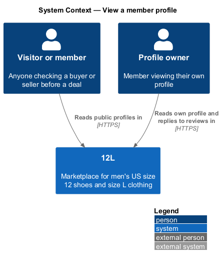
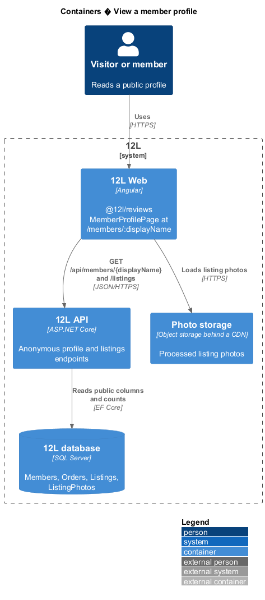
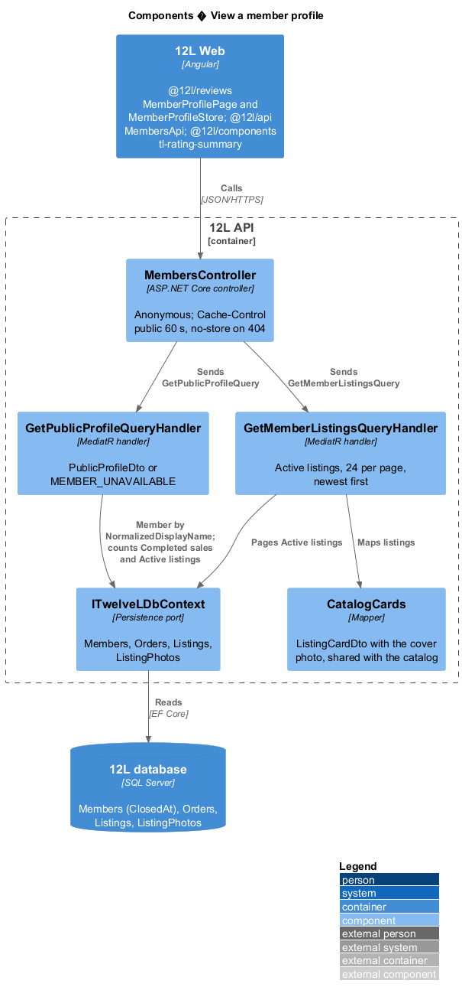
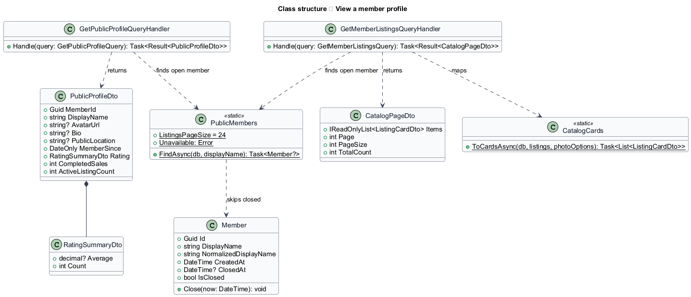
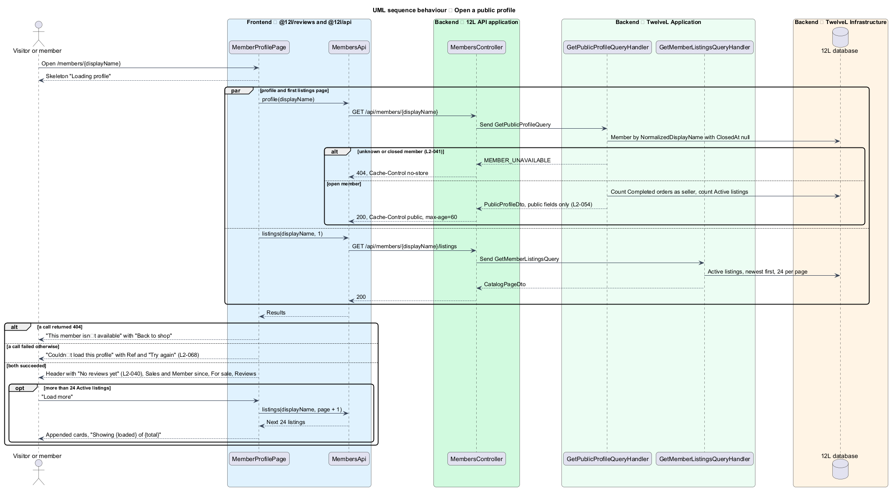

# View a member profile

## Overview

Tutu Much is a marketplace of new and used girls' clothing in which every
member can both buy and sell. Before buying, a member wants to know whom they are dealing
with. The *public profile* answers that question. Anyone, signed in or not, can open it at
`/members/{displayName}`.

A profile shows the member's avatar, display name, bio, public location, member-since
date, rating summary, number of completed sales, Active listings and published reviews
(`L2-041`). It never shows an email address, phone number, full name or street address,
neither on the page nor in the API response behind it (`L2-041`, `L2-054`).

Terms used throughout:

- **display name** — public handle of 3 to 30 letters, digits, underscores or hyphens, unique ignoring case (`L2-001`), used as the profile URL segment
- **public location** — city and state or region a member chooses to show (`L2-004`)
- **rating summary** — average star rating rounded to one decimal place plus the count of published reviews, calculated from published reviews only (`L2-040`)
- **completed sale** — order in which the member was the seller and that reached the Completed status (`L2-032`)
- **Active listing** — listing that is live in the catalog (`L2-019`)
- **unavailable member** — member whose account is closed (`L2-005`)

The listing detail page (`catalog` subsystem) shows the same completed-sale count in its
seller summary.

The feature sits in the `reviews` subsystem. It reads member data owned by `accounts`,
listings owned by `listings`, and published reviews. Review authoring, review replies
and member reporting are deferred ([ADR 0001](../../../adr/general/0001-defer-moderation-reviews-and-data-export.md)),
so until they return every profile shows "No reviews yet".

## Description

The slice runs from the profile route of `Tutu Much Web` through two anonymous read endpoints of
`Tutu Much API` to `Tutu Much database`. Screens, states and copy come from `docs/mocks/pages/profile/`
(states *default*, *own*, *empty*, *loading*, *error*, *unavailable* and *long*). What is
built now, and what waits for review authoring and edit-profile, is recorded in
[ADR reviews/0001](../../../adr/reviews/0001-public-profile-without-a-reputation-projection.md).

### Frontend (`src/frontend/projects/reviews/src/lib/member-profile/`)

- **Route** `members/:displayName` in `@tutumuch/reviews` (`reviews.routes.ts`), lazy-loaded under
  `/members` by the application and reachable without sign-in. The route parameter binds to
  the page's `displayName` input; the page title becomes "{displayName} · Tutu Much".
- **`MemberProfileStore`**: signal state. It requests the profile and the first page of
  listings in parallel. A 404 gives the *unavailable* view, any other failure the *error* view
  with the short correlation reference. `loadMore()` appends the next page and drops any card
  already shown.
- **`MemberProfilePage`**: composes the page from `@tutumuch/components` as listed in
  `docs/screen-composition.md`:
  - *loading*: skeleton `.profile-head` with an `avatar--xl` placeholder, the hidden heading
    "Loading profile" and the `tm-listing-grid` skeleton.
  - *default*: `.profile-head` with the initials avatar (or the photo when `avatarUrl` is
    set), the display name as the `h1`, the `map-pin` location and the bio when present, and
    `tm-rating-summary`; a `.stats` row of two `tm-stat` ("Sales", and "Member since" as
    "Jan 2025"); the "For sale" section with the Active listing total and `tm-listing-grid`;
    the "Reviews" section with the count and "No reviews yet".
  - *empty*: "For sale" shows the compact `tm-empty-state` "No items for sale" with
    "{displayName} hasn’t listed anything yet."
  - *long*: 24 cards per page (`L2-041`); `tm-load-more` reads "Showing {loaded} of {total}".
    A failed next page shows the danger `tm-alert` "Couldn’t load more items" with "Try again".
  - *unavailable*: `tm-center-state` with code "404", "This member isn’t available", "The
    account may have been closed." and "Back to shop" (to `/`).
  - *error*: `tm-center-state` "Couldn’t load this profile", "It’s us, not you." with the
    reference, "Try again" and "Back to shop" (`L2-068`).
  - *own*: the same as *default*; "Edit profile" waits for edit-profile.
- **`tm-rating-summary`** (`@tutumuch/components`): `role="img"` named "Rated {average} out of 5
  from {count} reviews" with the stars, the average to one decimal place and "({count}
  reviews)" ("review" for 1). With a count of 0 it renders the muted "No reviews yet"
  (`L2-040`).
- **`MembersApi`** (`@tutumuch/api`, `src/lib/reviews/members-api.ts`): `profile(displayName)`
  and `listings(displayName, page)`, returning `ApiResult`.
- The seller link of `tm-seller-summary` on the listing detail page opens this profile.

### API (`TutuMuch.Api`)

`MembersController` exposes two anonymous endpoints. `displayName` matches ignoring case.

| Verb and path | Purpose | Responses |
|---------------|---------|-----------|
| `GET /api/members/{displayName}` | Profile header, stats and rating summary | 200 `PublicProfileDto`; 404 `MEMBER_UNAVAILABLE` for an unknown or closed member |
| `GET /api/members/{displayName}/listings?page={n}` | Active listings, newest first, 24 per page | 200 `CatalogPageDto`; 400 `VALIDATION_FAILED` for a page below 1; 404 `MEMBER_UNAVAILABLE` |

The two cases of the 404 share one response body, so the API does not reveal whether a
display name exists or is closed. 200 responses carry `Cache-Control: public, max-age=60`;
the 404 carries `no-store`. Every error is an RFC 9457 problem details response with a
correlation ID (`L2-068`).

**Response contracts.** Dedicated public types; no handler serializes the `Member` entity.

- `PublicProfileDto`: `memberId`, `displayName`, `avatarUrl`, `bio`, `publicLocation` (the
  three are `null` until edit-profile stores them), `memberSince` (ISO date of the first day
  of the joining month), `rating` (`RatingSummaryDto`: `average` or `null`, `count`; always
  `null` and 0 while review authoring is deferred), `completedSales`, `activeListingCount`.
- `CatalogPageDto` of `ListingCardDto` comes from `catalog` and is reused as is.

**No-PII guard (`L2-054`).** `MemberProfileTests` reads the profile JSON of a member whose
email is set, fails when it contains an `@` or the password hash, and checks every property
name against the allow-list above, so adding a field such as `email` fails the build.

### Application and domain (`TutuMuch.Application/Profiles/`, `TutuMuch.Domain`)

- **`PublicMembers.FindAsync`**: the member by `NormalizedDisplayName` with `ClosedAt`
  null; otherwise `PublicMembers.Unavailable` (404 `MEMBER_UNAVAILABLE`).
- **`GetPublicProfileQuery`** (`DisplayName`) and its handler: counts `Orders` in status
  `Completed` with the member as seller, and the member's `Active` listings.
- **`GetMemberListingsQuery`** (`DisplayName`, `Page`) and its handler: the member's
  `Active` listings, newest `PublishedAt` first, page size fixed at 24, mapped by
  `CatalogCards.ToCardsAsync`, which the catalog also uses.
- **`Member.ClosedAt`** and **`Member.Close(now)`**: the closed state of `L2-005`. Closing an
  account from a screen belongs to the privacy work.
- **`GetListingDetailQueryHandler`** fills `SellerSummaryDto.CompletedSalesCount` with the same
  count, so the listing page and the profile agree.

### Infrastructure and data (`TutuMuch.Infrastructure`)

- Migration **`MemberClosedAt`** adds the nullable `Members.ClosedAt`.
- Index **`UX_Members_NormalizedDisplayName`** (owned by `accounts`) serves the profile lookup.
- The listing and order counts use the existing seller indexes of `listings` and `orders`.

### Tests

- xUnit `tests/TutuMuch.Api.Tests/MemberProfileTests.cs` against the in-memory test host:
  public profile, completed sales, the allow-list, the uniform 404 for unknown and closed
  members, paging 24 at a time and a refused page 0.
- Playwright `src/frontend/e2e/tests/view-member-profile.spec.ts` with the
  `MemberProfilePage` page object and the `memberProfile` and `serveProfile` fixtures; every
  API call is served by `page.route`.

### Open questions

- Whether a renamed member's old URL redirects waits for edit-profile.
- The profile reviews list, rating projection and their cache eviction return with review
  authoring.

## Requirements

The feature realizes the following level-2 (L2) requirements. Each L2 requirement refines
a level-1 (L1) requirement, cited by identifier. `L2-054` is listed because the profile is
one of the public responses it governs.

| L2 ID | Refines (L1) | Requirement |
|-------|--------------|-------------|
| `L2-040` | `L1-009` | Each member shall have an average rating (rounded to one decimal place) and a count of published reviews, calculated from published reviews only. |
| `L2-041` | `L1-010` | Each member shall have a public profile at `/members/{displayName}` showing their avatar, display name, bio, public location, member-since date, rating summary, number of completed sales, Active listings and published reviews. The profile shall never show email address, phone number, full name or any street address. |
| `L2-054` | `L1-014` | Email addresses, shipping addresses and phone numbers shall never appear in public pages or public API responses. Shipping addresses shall be encrypted at rest at the field level, and all databases, backups and photo storage shall be encrypted at rest. |

## Diagrams

### System context

Visitors and members read public profiles in Tutu Much. Profile photos come from photo storage
through the CDN. No external system takes part in building a profile.

### Containers

`Tutu Much Web` calls two anonymous endpoints on `Tutu Much API`, which reads `Tutu Much database`. The
browser loads the listing photos from `Photo storage`.

### Components

`MembersController` sends two queries. Both find an open member first; the listings query
maps cards with the catalog's `CatalogCards`.

### Class structure

The query handlers return dedicated public DTOs that hold no private fields. `Member`
carries the closed state that makes a profile unavailable.

### Behaviour: open a public profile

The page requests the profile and the first listings page in parallel. An unknown or
closed member returns one uniform HTTP 404 and the "This member isn’t available" page
(`L2-041`).

