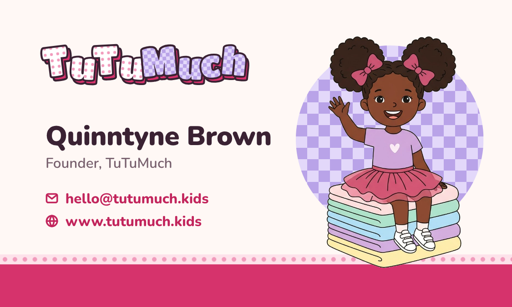
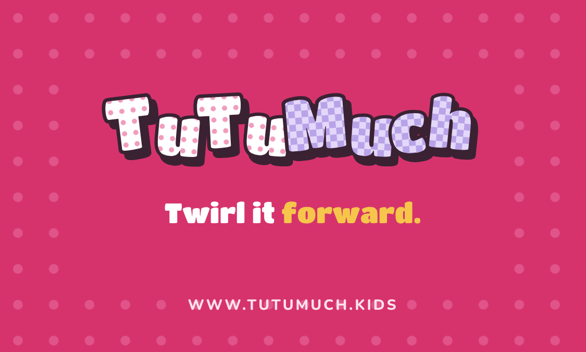
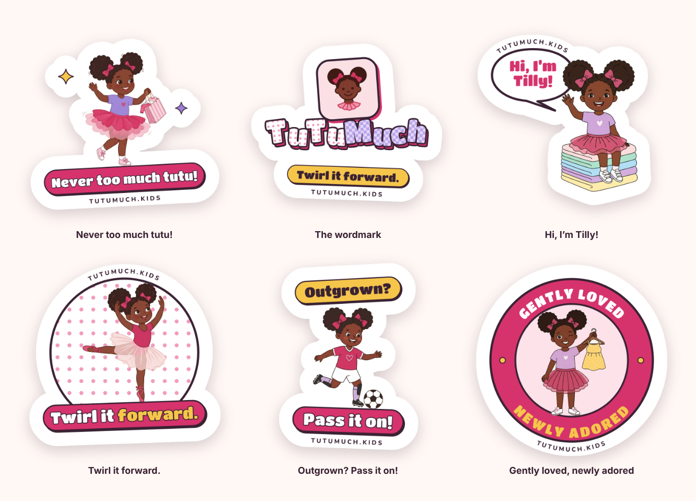
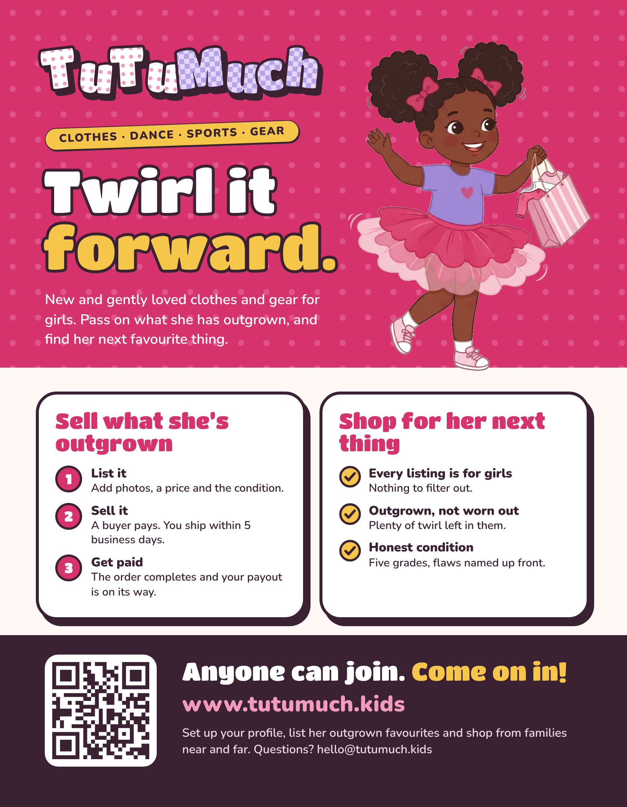
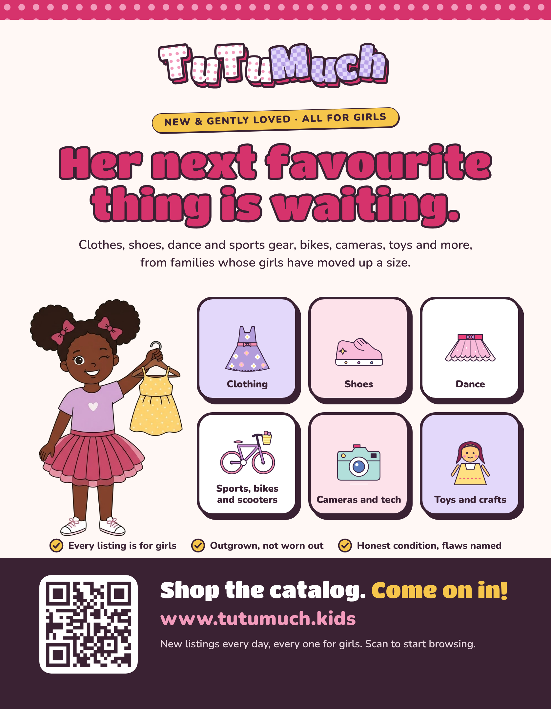
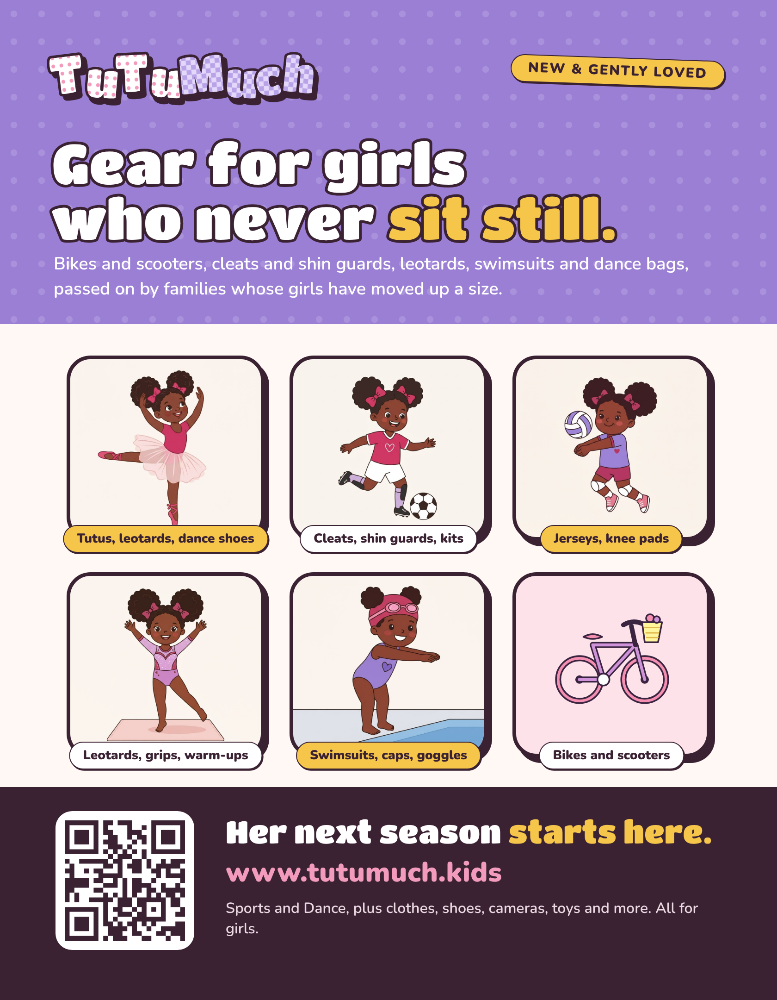
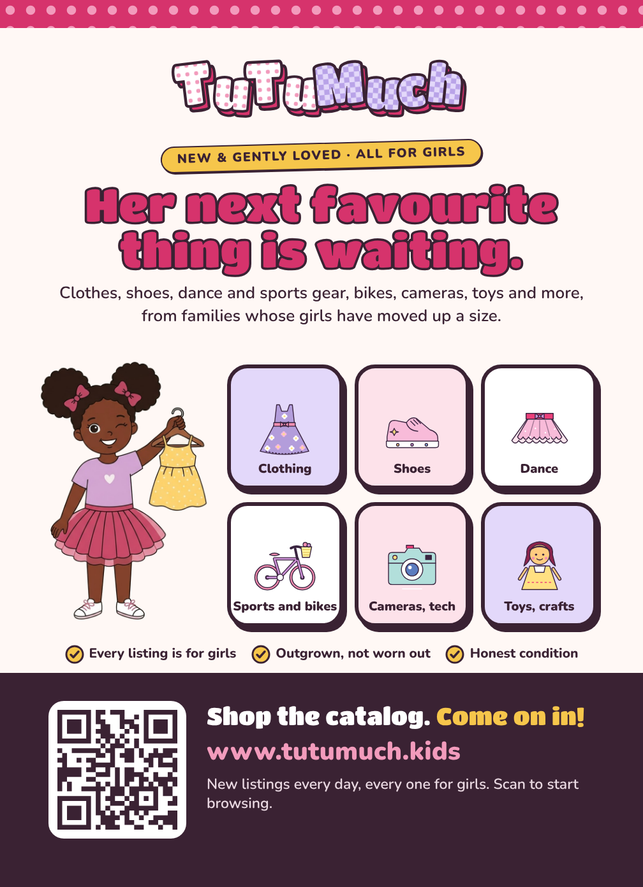
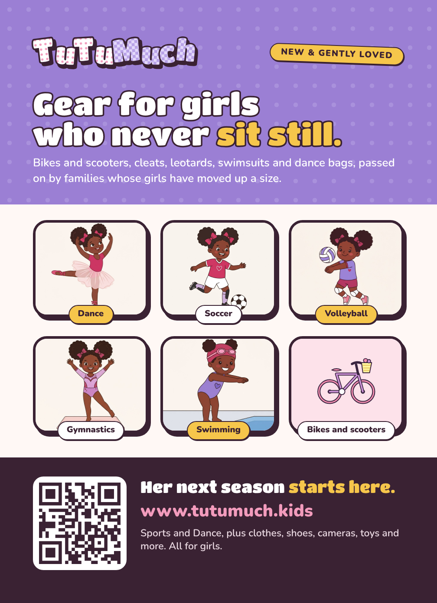
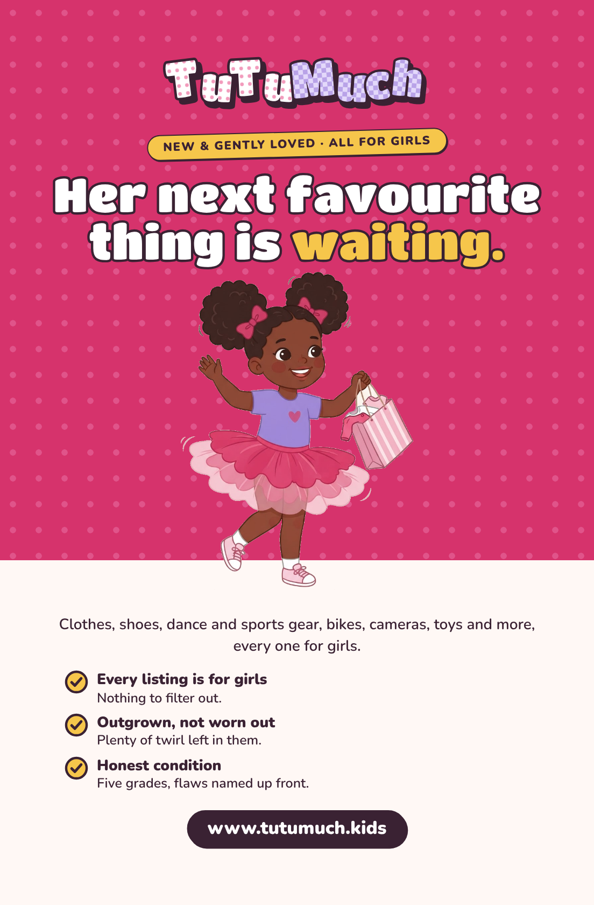
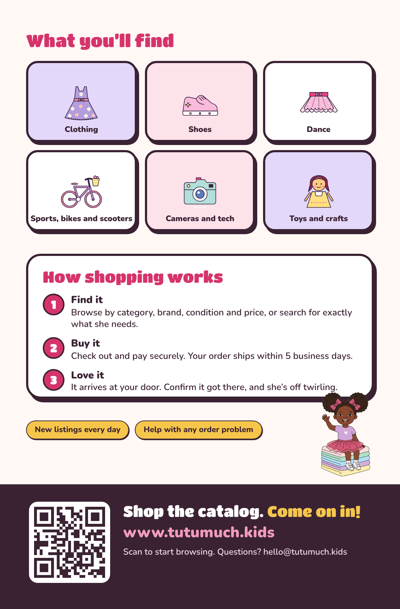

# TuTuMuch print collateral

Business cards, die-cut stickers and flyers to hand out to parents. They use the TuTuMuch
wordmark (the same letters as `tl-logo`), Tilly from the Magic Patterns brand kit, the brand
palette in `docs/design-system/tokens/tokens.css` and the copy on `/welcome`, so what people
hold in their hands matches the site. See [ADR general/0007](../adr/general/0007-print-collateral-in-docs-print.md).

| | Print these | For review |
|---|---|---|
| Business card | `business-cards/tutumuch-business-card.pdf` (front, back), or the two 300 DPI PNGs | `*-guides.png` |
| Stickers (6) | `stickers/sticker-N-*.png` | `stickers/contact-sheet.png`, `*-preview.png` |
| Flyers (3, Letter) | `flyers/flyer-N-*-print-bleed.pdf` (print shop), `flyer-N-*-letter.pdf` (home printer) | `flyers/*-preview.png` |
| Buyer handouts (2, 5 × 7) | `flyers/flyer-N-*-5x7-print-bleed.pdf` (print shop), `flyer-N-*-5x7.pdf` (trimmed) | `flyers/*-5x7-preview.png` |
| Shopper flyer (Half Letter, two-sided) | `flyers/flyer-6-shop-half-letter-print-bleed.pdf` (print shop), `flyer-6-shop-half-letter.pdf` (trimmed) | `flyers/*-half-letter-{front,back}-preview.png` |

## Business card




Quinntyne Brown, Founder · hello@tutumuch.kids · www.tutumuch.kids. Tilly waves from her stack
of folded clothes on the front; the back is the wordmark with its reversed ink shadow on
raspberry polka dots and "Twirl it forward."

| | |
|---|---|
| Trim | 3.5 × 2 in (standard North American card) |
| Bleed | 0.125 in on every side: the PDF and PNGs are 3.75 × 2.25 in |
| Safe area | 0.125 in inside the trim (the dashed line in the `-guides` PNGs) |
| PNG | 1125 × 675 px, 300 DPI (written into the file) |
| PDF | Two pages, front then back, live text with Titan One and Nunito embedded |

Order "3.5 × 2 in, with bleed" and upload the PDF. If the printer wants images, upload
`tutumuch-card-front.png` and `tutumuch-card-back.png`.

## Stickers



Every sticker carries **TUTUMUCH.KIDS** the TwinkleTune way: ink Nunito 800 tracked caps
(28px, 7px tracking), set in the white keyline and following the edge of the artwork. It runs
below the banner or chip on 1, 2 and 5, over the speech bubble on 3, over the disc on 4 and
under the badge on 6. The bare domain redirects to www.tutumuch.kids.

1. **Never too much tutu!** Tilly's catchphrase under her twirl.
2. **The wordmark.** Tilly's face mark over the Gingham wordmark and "Twirl it forward."
3. **Hi, I'm Tilly!** Waving from the clothes stack, in a speech bubble.
4. **Twirl it forward.** The dance pose on a polka-dot disc.
5. **Outgrown? Pass it on!** The soccer pose, for sellers.
6. **Gently loved, newly adored.** A round badge with the Show & Tell pose.

### Print spec

| | |
|---|---|
| Canvas | 900 × 900 px = 3 × 3 in at 300 DPI (written into the file) |
| Background | Transparent; the die cut follows the alpha edge |
| Keyline | 60 px (0.2 in) of white beyond the artwork on every edge |
| Cut | One connected piece, checked by the renderer |
| Colour | sRGB; the printer converts to CMYK, and their proof is the check |
| Finish | Matte keeps the pastels truest; gloss also works |

Order **die-cut, custom shape, 3 × 3 in** (Sticker Mule, Jukebox, Vistaprint and others) and
upload the print PNG, not the preview. Their tool traces the cut from the transparent edge,
and the white keyline is sized for that. Check the proof: the cut should run around the outside
of the white border, not through the artwork.

### How the keyline is built

TwinkleTune's stickers are all vector, so their keyline is a fat white stroke behind each
shape. Tilly is a raster illustration, so here the renderer builds the keyline from the pixels
instead:

1. Capture the artwork (`.stage`) with a transparent background.
2. Dilate its alpha by a 60 px disc by drawing the artwork offset around rings of radius 60, 55,
   … 5.
3. Fill any enclosed transparent holes, so the sticker is solid white behind the art.
4. Paint that shape white, put the artwork on top, and check that it is one piece and clears the
   canvas edge.
5. Draw the edge URL on the white. It is captured on its own (`.rim`), so it never grows the cut,
   and the renderer fails if any of it comes within 10px of the cut line or 6px of the artwork.

`_build/stickers/_rim.js` lays the URL out: `data-under` / `data-over` follow a chip's bottom or
top edge (rotation included), and `data-ellipse` with `data-side` runs it around a circle or
the speech bubble.

## Flyers

| Flyer | For | Says |
|---|---|---|
|  | **1. Join**: parents who might buy and sell | "Twirl it forward." The three selling steps (List it, Sell it, Get paid) and why to shop here |
|  | **2. Shop**: buyers only | "Her next favourite thing is waiting." The six categories, from clothing to bikes and toys |
|  | **3. Shop gear**: sports and dance families | "Gear for girls who never sit still." Tilly's five sports poses plus bikes and scooters |

Every flyer ends with a QR code that opens https://www.tutumuch.kids.

### 5 × 7 buyer handouts

Card-sized versions of the two buyer flyers, to hand out:

| Handout | Is |
|---|---|
|  | **4. Shop, 5 × 7**: flyer 2 at card size |
|  | **5. Shop gear, 5 × 7**: flyer 3 at card size |

| | |
|---|---|
| Trim | 5 × 7 in, single-sided |
| `-5x7-print-bleed.pdf` | 5.25 × 7.25 in: 0.125 in bleed for a print shop that trims |
| `-5x7.pdf` | 5 × 7 in, bleed cropped off |
| Safe area | 0.25 in inside the trim, checked by the renderer |

Order "5 × 7 flyer" or "5 × 7 postcard", single-sided, and upload the bleed PDF.

### Half Letter shopper flyer, two-sided

For shoppers only; it says nothing about selling.

| | |
|---|---|
|  |  |
| **Front**: "Her next favourite thing is waiting." Tilly twirls out of the hero; the three shopper promises and the address | **Back**: the six categories, "How shopping works" (find it, buy it, love it) and the QR code |

| | |
|---|---|
| Trim | Half Letter, 5.5 × 8.5 in, two-sided |
| `-print-bleed.pdf` | Two pages (front, back) at 5.75 × 8.75 in: 0.125 in bleed for a print shop that trims |
| `.pdf` | Two pages at 5.5 × 8.5 in, bleed cropped off |
| Safe area | 0.25 in inside the trim, checked by the renderer on each side |

Order "5.5 × 8.5 flyer" (also sold as Half Letter or half-page), double-sided, and upload the
bleed PDF: page 1 is the front, page 2 the back. The steps on the back follow the checkout,
ship (within 5 business days) and complete-order journeys.

| | |
|---|---|
| Trim | US Letter, 8.5 × 11 in |
| `-print-bleed.pdf` | 8.75 × 11.25 in: 0.125 in bleed for a print shop that trims |
| `-letter.pdf` | 8.5 × 11 in with the bleed cropped off, for a home or office printer ("fit to page" off) |
| Safe area | 0.375 in inside the trim. The renderer fails if any words (measured to the ink, so nowrap text that overflows its box counts) or the QR code fall outside it |
| Preview PNG | 1680 × 2160 px, for review only |

Tilly's images are about 1024 px, so on a full-page flyer she prints at roughly 150 to 200 DPI.
That is fine for handouts. For posters, export larger images from Magic Patterns first.

## Regenerating

```bash
python -I docs/print/_build/cutout.py         # only when the Tilly originals change
node docs/print/_build/render.mjs             # everything
node docs/print/_build/render.mjs stickers    # or: cards, flyers
node docs/print/_build/render.mjs flyers flyer-2-shop   # one item
```

The renderer uses Playwright from the environment, or `@playwright/test` from
`src/frontend/node_modules` after `npm ci`. `cutout.py` needs Pillow and numpy. Rendering never
touches the network: the fonts and images are all local.

It fails loudly if a font or image did not load, if a sticker is not 900 × 900 RGBA, if its cut is
more than one piece or touches the canvas edge, if its edge URL leaves the white rim, or if any flyer words leave the safe area.

Edit the HTML sources, never the PNGs or PDFs.

```
docs/print/
  business-cards/   tutumuch-business-card.pdf, tutumuch-card-{front,back}[-guides].png
  stickers/         sticker-N-*.png (print), *-preview.png, contact-sheet.png
  flyers/           flyer-N-*-print-bleed.pdf, *-letter.pdf or trimmed *.pdf, *-preview.png
                    (a two-sided flyer has two .sheet elements and two-page PDFs)
  characters/       Tilly cutouts (transparent PNG) + ATTRIBUTION.md
  _build/
    render.mjs      renders and checks everything
    cutout.py       removes Tilly's background
    print.css       fonts, palette, chip/dots/gingham idioms
    wordmark.js     the Gingham wordmark as live vector SVG
    qr-tutumuch-kids.svg   QR for https://www.tutumuch.kids (segno, error level M)
    business-cards/ stickers/ flyers/   the HTML sources, edit these
    characters-src/ the Magic Patterns originals
    fonts/          Titan One and Nunito with their SIL Open Font Licences
```

## Fonts

Titan One is the wordmark face; the app already ships it in
`src/frontend/projects/tutumuch/public/fonts/`. Nunito is Giddy's rounded sans
(`--font-family-sans`). Both are in `_build/fonts/` with their SIL Open Font Licence texts.
